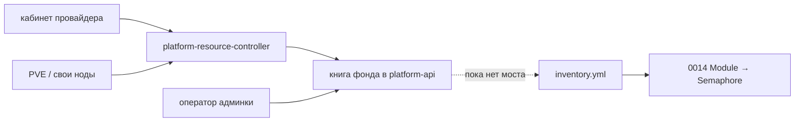

# ADR-0014.1: Platform resource controller — учёт фонда (`ExternalResource` / `InternalResource`)

- **Статус:** Предложено (схемы и граница; код не реализован)
- **Дата:** 2026-09-24
- **Авторы:** Alexandr Yankov (решения), Cursor (оформление по итогам обсуждения)

## Контекст

[ADR-0014](0014-platform-controller-architecture.md) — **платформенный контроллер apply**:
`Module` CR → Semaphore → роль на уже существующий Ansible-inventory. Хосты он не заводит
(0014 §5: без CRD `Host`), фонд размещения не ведёт.

[ADR-0015.2](0015.2-admin-panel.md) §6 задал **книгу фонда**: общее количество, метка
`allocation: system | user | unassigned`. Откуда строка берётся и кто пишет *observed* — там
не закрыто.

Этот ADR не расширяет бинарник 0014 и не заводит второй apply-контур. Он описывает
**platform-resource-controller**: наблюдатель, который **добавляет и сверяет** ёмкость в книге
админки. 0014 inventory по-прежнему не читает.

Две схемы по **происхождению ёмкости**, не по тому, кому она отдана:

| Вид | Что это | Ось 0015.1 |
|---|---|---|
| `ExternalResource` | купленное / арендованное у провайдера | `procurement: partner` |
| `InternalResource` | наши ноды, своё железо | `procurement: platform_metal` |

`allocation: system | user` — метка **на той же строке**, не два контроллера «платформа vs
пользователь». BYO и гости клиента — Estate / Inventory (0015.1 / 0015.3), не этот фонд.

## Схема



## Решения

### 1. Отдельный контроллер учёта, не ветка 0014

**Решение:** `platform-resource-controller` — воркер рядом с `platform-api`
([0015.2.1](0015.2.1-admin-panel-architecture.md)): тот же образ или второй Deployment в
`ns: platform`. Он **observe / upsert** в книгу. Не смотрит `Module` CR, не дергает Semaphore,
не пишет inventory.

Не Kubernetes Operator на CRD железа: объект живёт в хранилище админки, не в etcd как SoT
ноды Selectel/PVE.

Имя «контроллер» здесь — цикл сверки фонда. «Платформенный контроллер» без уточнения
по-прежнему значит 0014.

**Обоснование:** apply и учёт ёмкости — разные направления. Смешать в 0014 — второй SoT
на хосты (CR vs inventory), от чего 0014 §5 отказался.

### 2. Один фонд, два kind по закупке

**Решение:** в книге одна строка на единицу ёмкости. Дискриминатор `origin`:

- `external` — купили (dedicated, IaaS, квотный пул кабинета);
- `internal` — своя нода / свой кластер / свой пул.

Общие поля (0015.2 §6) есть у обоих. Специфика — в `spec` соответствующего kind.
`allocation` и `offered` пишет **только оператор**, контроллер их не выставляет.

### 3. `ExternalResource` — то, что покупаем

Контроллер тянет из API кабинета (`connect: api`) или, если dedicated уже наш по IP,
из локального API площадки (`connect: local`). Секрет — `secret_ref` провайдера (OpenBao).
Тем же проходом можно обновить `ProviderAccount.status` (0015.2 §7).

```yaml
apiVersion: platform.devops-labs.ru/v1
kind: ExternalResource
metadata:
  resource_id: selectel:dedicated:12345   # стабильно: {provider_id}:{class}:{external_id}
  site_id: selectel-spb-1
spec:
  origin: external
  provider_id: selectel
  external_id: "12345"                    # id в кабинете провайдера
  class: dedicated                        # dedicated | vps | pool | quota
  sku: dedicated.generic                  # строка ProviderTariff
  kind: node                              # node | cluster | pool
  connect: api                            # api | local | overlay
status:                                   # пишет только контроллер
  observed_at: "2026-09-24T05:00:00Z"
  exists: true
  state: active                           # active | missing | failed
  consumed:
    sku: dedicated.generic
    amount: "12000.00"
# allocation / offered — на обёртке фонда, не в status контроллера
```

Нет кабинета (`platform_metal`) — этого kind нет, только §4.

### 4. `InternalResource` — свои ноды

Контроллер тянет с площадки, до которой control plane уже дотягивается: PVE, libvirt,
kube-apiserver **нашего** кластера. Лейбл/тег на ноде — подсказка в карточке, не авто-`allocation`.

```yaml
apiVersion: platform.devops-labs.ru/v1
kind: InternalResource
metadata:
  resource_id: aicd:pve:proxnode1         # стабильно: {site_id}:{source}:{name}
  site_id: aicd
spec:
  origin: internal
  kind: node                              # node | cluster | pool
  source: proxmox                         # proxmox | libvirt | k3s | bare
  name: proxnode1
  hostname: proxnode1.aicd.platform
  connect: local
  capacity:
    cpu_cores: 32
    memory_mib: 131072
    disk_gib: 4000
status:
  observed_at: "2026-09-24T05:00:00Z"
  exists: true
  state: active
  facts:
    pve_version: "8.4"
    labels: []                            # теги источника, не политика фонда
```

Первый узел площадки, которой ещё нет в каталоге `site_id`, контроллер сам не открывает:
сначала карточка площадки + `connect` (+ секрет, если нужен), иначе ручной ввод строки.

### 5. Цикл сверки

Один проход по источнику, у которого sync включён и `connect` позволяет **pull**:

1. list у провайдера или у hypervisor/API площадки;
2. стабильный `resource_id` (§3 / §4) — без него каждый тик плодит дубли;
3. нет в книге → вставить, `allocation: unassigned`;
4. есть → обновить только `status` / ёмкость / `exists`; **не** трогать `allocation`, `offered`;
5. было у нас, нет у источника несколько тиков → `state: missing`, не удалять
   (тем более `system` / `user`);
6. для `provider_id` — обновить `ProviderAccount.status` (баланс, квоты, consumption).

Идемпотентность: второй прогон без изменений снаружи — книга `changed=0`.

Запуск: периодически; кнопка в админке; после нашего apply (создали dedicated — не ждать тик).
Не на heartbeat каждой VM.

`connect: overlay` без доступа к API источника в этот цикл не входит, пока нет сети по
[0014.1.1](0014.1.1-resource-onboarding-protocol.md).

### 6. Кто пишет что

| Поле / объект | Контроллер | Оператор (админка) | 0014 |
|---|---|---|---|
| появление / `exists` / `state` observed | да | ручной ввод, если pull нет | нет |
| `ProviderAccount.status` | да (если API) | лимит / овердрафт / тариф | нет |
| `allocation`, `offered`, drain | нет | да | нет |
| Ansible-inventory, `Module` | нет | нет | да |

Гостевые VM на отданной ёмкости и BYO — не list этого контроллера.

### 7. Связь с 0014 — моста нет

**Решение:** 0014 **не** читает книгу. Inventory в git остаётся адресом apply.

Мост «из `allocation: user|system` собрать inventory» — отдельное решение, не этот ADR.
Пока два контура сознательно расходятся: учёт ёмкости vs накат роли.

## Открыто

- сеть, минимум на хосте, права и join — [0014.1.1](0014.1.1-resource-onboarding-protocol.md);
  там же ещё открыты продукт overlay и TTL token;
- набор коннекторов v1 (Selectel? PVE? оба?) и порог `missing`;
- мост книга → inventory для 0014;
- код, чарт воркера.

## Явно вне периметра

- расширение reconcile 0014 на хосты;
- CRD `Host` / `ExternalResource` в Kubernetes как SoT;
- два контроллера «системные vs пользовательские» ресурсы;
- Estate / Inventory клиента (0015.3);
- `tofu apply`, создание VM (контроллер не заказывает железо).

## Последствия

- 0015.2 §6: появление строки в фонде — этот ADR; метка кому отдан — по-прежнему админка.
- 0014: без изменений; в ссылках — сосед, не потребитель.
- 0015.2.1: воркер — часть `platform-api`, не роль `infra_panel` и не platform-controller.

## Ссылки

- [ADR-0014.1.1](0014.1.1-resource-onboarding-protocol.md) — сеть, минимум на хосте, права, шаги.
- [ADR-0014](0014-platform-controller-architecture.md) — apply, inventory, не фонд.
- [ADR-0015.2](0015.2-admin-panel.md) — книга, `allocation`, `ProviderAccount`.
- [ADR-0015.2.1](0015.2.1-admin-panel-architecture.md) — `admin-ui` + `platform-api`.
- [ADR-0015.1](0015.1-infra-agent.md) — `owner` / `procurement` / `connect`; BYO не здесь.
- [ADR-0015.3](0015.3-contracts.md) — Estate / Inventory, не фонд.
- [ADR-0016](0016-openbao-secrets-pki.md) — секреты коннекторов.
