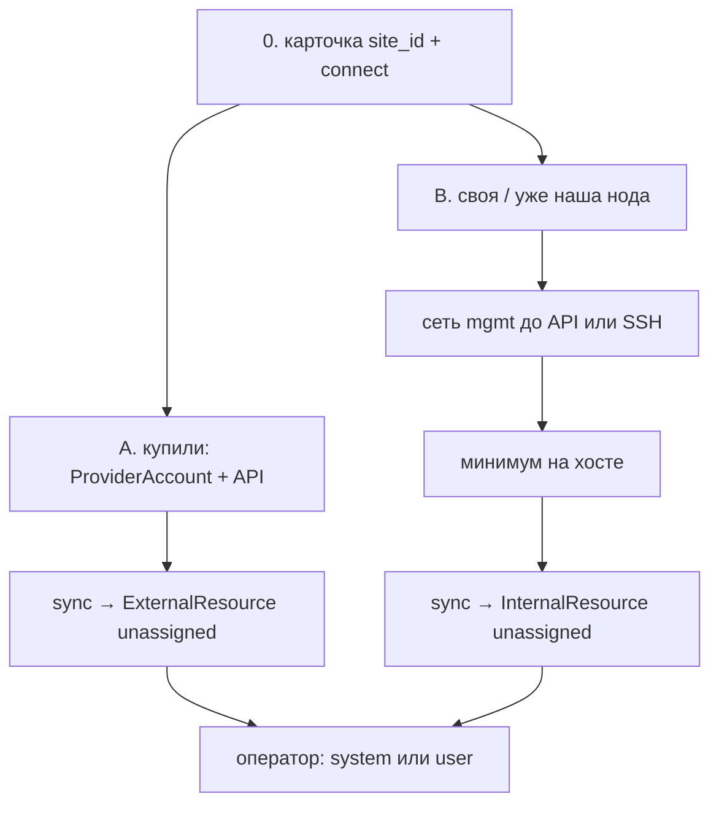

# ADR-0014.1.1: Протокол добавления ресурса в фонд платформы

- **Статус:** Предложено (протокол; код и продукт overlay не реализованы)
- **Дата:** 2026-09-24
- **Авторы:** Alexandr Yankov (решения), Cursor (оформление по итогам обсуждения)

## Контекст

[ADR-0014.1](0014.1-platform-resource-controller.md) задал наблюдателя и схемы
`ExternalResource` / `InternalResource`. Кто **заказывает** железо и как строка попадает в
книгу — разные шаги. Без протокола оператор не знает: какую сеть поднять, что поставить на
ноду, какими правами контроллер ходит, когда жать sync.

Этот ADR не заказывает VM (`tofu` / консоль провайдера) и не накатывает роли (0014). Он
фиксирует **допуск ёмкости в фонд**: предусловия, сеть, минимум на хосте, права, шаги.
Метка `allocation` по-прежнему только в админке (0015.2 §6). BYO и гости клиента — не этот
протокол (0015.1 / 0015.3).

Продукт туннеля (свой WG hub или иной) в 0015.2 открыт; здесь — только **требования к
связности**, не выбор реализации.

## Схема

Один физический dedicated часто даёт **две** строки: закупка в кабинете (`ExternalResource`) и
гипервизор, который мы поставили (`InternalResource`). Счёт и квоты висят на провайдере, не на
ноде.

## Решения

### 1. Без карточки площадки в фонд не входим

**Решение:** первым всегда `site_id` в админке: `owner`, `procurement`, `connect`, при
`partner` — `provider_id` и `secret_ref`. Контроллер сам площадку не создаёт (0014.1 §4).

Пока нет площадки — нет sync, нет join.

### 2. Три пути входа (не одна «кнопка добавить»)

| Путь | Когда | Что появляется в книге |
|---|---|---|
| **A. Кабинет** | `connect: api`, купили квоту / VPS / dedicated в партнёре | `ExternalResource` (+ `ProviderAccount.status`) |
| **B. Нода local** | своё железо или dedicated, до которого control plane уже ходит | `InternalResource` |
| **C. Нода overlay** | наша (или снятая нами) площадка за NAT, pull без туннеля не достаёт | тот же `InternalResource`, после сети §3 |

Путь A не требует ОС на железе. Пути B/C требуют §3–§5. IaaS, который мы создали и сразу
управляем как PVE/k3s, проходит A, затем B (или C).

### 3. Сеть — только management plane

**Решение:** в фонд пускаем хост, до **management** которого дотягивается control plane
(`platform-api` / resource-controller на узлах платформы). Пользовательские overlay-сети
тенанта и публичный интернет приложения сюда не входят.

| `connect` | Что должно быть до первого sync ноды |
|---|---|
| `api` (только кабинет) | исходящий HTTPS **с платформы** на API провайдера (443). Нода не нужна |
| `local` | L3 с узлов платформы до mgmt-IP: SSH `22`, PVE `8006`/API, kube-apiserver `6443` — что есть по `source`. Не 0.0.0.0/0 на эти порты |
| `overlay` | туннель **поднят до sync**. Инициатор — как в 0015.1 (часто дальняя сторона). После туннеля те же mgmt-порты, что у `local`, по адресам overlay |

DNS: mgmt-имя резолвится с платформы (свои зоны / `hosts`, не публичный must). NTP на ноде —
обязателен (иначе API-токены и TLS плывут).

Маршрут «гость тенанта → API провайдера» не открываем. Ключ кабинета остаётся на платформе.

### 4. Что должно быть установлено

**Решение:** для попадания в фонд — **минимум субстрата**, не весь стек платформы (не Authelia,
не LiteLLM, не агенты 0015).

**Путь A (кабинет):** на стороне провайдера ничего не ставим. На платформе — валидный
`secret_ref` и включённый sync.

**Пути B/C (нода), по `source`:**

| `source` | Минимум |
|---|---|
| `proxmox` | PVE установлен, API слушает на mgmt, уникальный `pve` hostname |
| `libvirt` | qemu/libvirt, API/socket доступен с учётки платформы |
| `k3s` | kube-apiserver доступен с платформы (не обязательно join в *наш* workload-кластер на этом шаге) |
| `bare` | ОС из поддерживаемых коллекцией (Ubuntu 24.04 / Rocky 9 — как у ролей), SSH, `hostname` уникален в `site_id` |

Общее для любой ноды:

- синхронизация времени;
- нет дефолтных паролей на mgmt API;
- **не** требуется `monitoring_agent` для первого upsert (живность — после, когда нода уже в
  фонде и, если надо, в inventory 0014);
- **не** ставим на этом шаге пользовательские VM и системные аддоны — сначала `unassigned`,
  потом метка, потом размещение.

### 5. Права: кто куда ходит

**Решение:** машины не логинятся как люди `platform-*`. Секреты — OpenBao, `secret_ref` на
провайдере или площадке (0015.2 §4). Контроллер ходит **исходящими** вызовами.

| Куда | Кто | Право | Кто не ходит |
|---|---|---|---|
| API провайдера | resource-controller | **read**: список инстансов, квоты, баланс если отдаёт API. Create VM — не этот протокол | клиент LK, нода, Authelia-юзер |
| PVE / libvirt | resource-controller | **audit/list** (ВМ, ноды, сторадж). Создавать гостей — tofu/0014, не sync | `allocation` писать этим токеном нельзя |
| kube-apiserver площадки | resource-controller | list/get `Node` (и при необходимости Namespace для ёмкости). Не cluster-admin | токен ноды не пишет в книгу фонда |
| SSH на ноду | оператор / EE Semaphore (0014), не контроллер учёта | ключ площадки в OpenBao; человек — через bastion/свои рельсы | контроллер не обязан SSH, если есть API |
| `platform-api` книга | оператор Authelia | engineers: sync + позже метка; admins: счёт провайдера; viewers: чтение | нода **не** POST'ит себе `system` |
| Join (путь C) | одноразовый token площадки | только «я site X, вот факты»; не смена `allocation` | общий пароль на флот, логин человека |

Нода, даже с join-token, не может выставить себе `allocation: system`.

Firewall mgmt: source — CIDR платформы и/или overlay; PVE/SSH/API не торчат в мир.

### 6. Шаги оператора

**A. Купили у провайдера**

1. Площадка + `provider_id` + тариф/лимиты счёта (admins).
2. `secret_ref` в OpenBao, rotate не в git.
3. Sync → строки `ExternalResource` как `unassigned`.
4. Проверить `ProviderAccount` (баланс, квоты). Не отдать и не пометить `system` молча.
5. Когда появится ОС/гипервизор на купленном — путь B или C на ту же `site_id`.

**B. Своя или уже доступная нода**

1. Площадка `connect: local` (или dedicated, IP уже наш).
2. Сеть §3, минимум §4, учётка API §5 в OpenBao.
3. Sync → `InternalResource` `unassigned`.
4. Оператор: `system` (только компоненты платформы) или `user` (+ `offered`, если видно в LK).

**C. Нода за NAT**

1. Площадка `connect: overlay`, туннель по требованиям §3 (продукт — открыто).
2. Платформа выдаёт **site-scoped** join-token (TTL, одно использование или короткое окно).
3. Дальняя сторона поднимает туннель; control plane видит mgmt.
4. Дальше как B: минимум, sync, метка. Token в книгу прав не пишет.

После метки этот протокол кончается. Накат роли — inventory + 0014 (моста нет, 0014.1 §7).

### 7. Критерии «принято в фонд»

Строка в книге и:

- стабильный `resource_id`;
- `status.exists: true` на последнем sync (или честный ручной ввод, если pull нет);
- для external — `provider_id` и попадание в период счёта;
- для internal — ответ mgmt API или зафиксированные capacity;
- `allocation` ещё может быть `unassigned` — это успех учёта, не размещения.

Не критерий: зелёный Grafana, членство в k3s workload-кластера, запись в `inventory.yml`.

## Открыто

- конкретный продукт overlay и порты туннеля;
- TTL join-token и кто его крутит (админка / OpenBao);
- минимальный набор привилегий PVE по имени роли апстрима (сверить живьём);
- коннекторы v1 (тот же открытый пункт 0014.1).

## Явно вне периметра

- заказ VM и оплата в кабинете (кроме учёта после факта);
- apply 0014 и сборка inventory;
- Init / Estate BYO;
- установка полного monitoring/agent-стека как условие входа.

## Последствия

- 0014.1: join-token и «что до первого sync» закрыты этим протоколом на уровне требований.
- 0015.2: появление строки без метки — штатный исход, не дыра.

## Ссылки

- [ADR-0014.1](0014.1-platform-resource-controller.md) — контроллер и схемы.
- [ADR-0015.2](0015.2-admin-panel.md) — фонд, счёт провайдера, секреты.
- [ADR-0015.1](0015.1-infra-agent.md) §9 — `connect` / `procurement`.
- [ADR-0014](0014-platform-controller-architecture.md) — apply после учёта.
- [ADR-0016](0016-openbao-secrets-pki.md) — `secret_ref`.
- [ADR-0019](0019-platform-rbac-model.md) — кто жмёт в админке.
