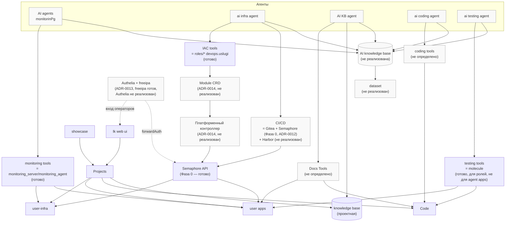
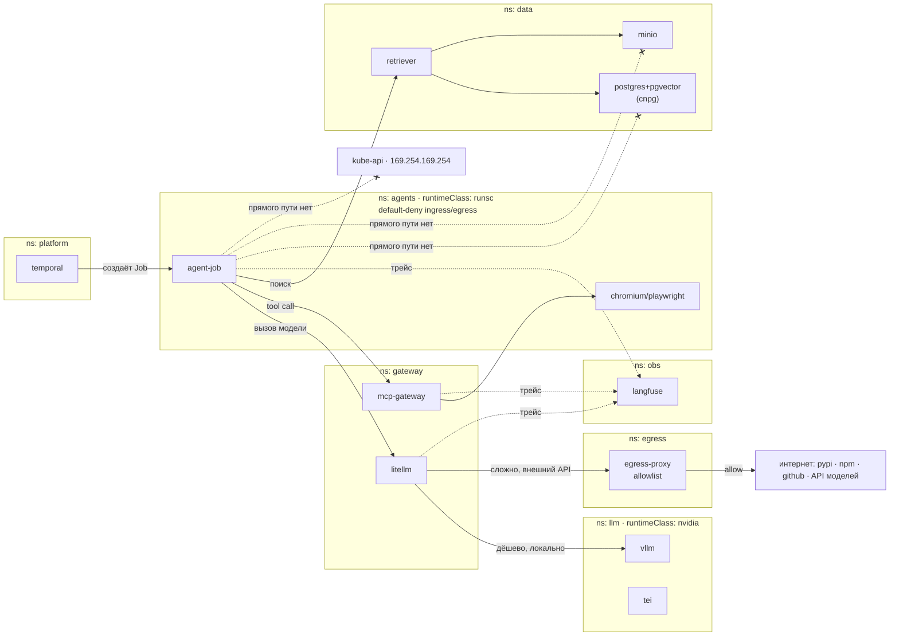

# ADR-0015: Облачная платформа с AI-агентами — архитектура сервисов и размещение агентного стека

- **Статус:** Предложено (концепция; ни архитектура, ни техническая раскладка не проверены реализацией)
- **Дата:** 2026-08-22
- **Авторы:** Alexandr Yankov (концепция), Ivan Vinogradov (реализация), Claude Code (оформление по итогам обсуждения)

## Контекст

`docs/adr/0012-cicd-platform-architecture.md`, `0013-unified-auth-architecture.md` и
`0014-platform-controller-architecture.md` уже переопределяют позиционирование этого репозитория
с «набора Ansible-ролей» на «платформу» — с `Module` CRD, GitOps-reconcile и Semaphore как общим
исполнительным конвейером (`docs/overview.md`, «Целевая архитектура платформы»). Все три ADR
предполагают, что *решения* — за оператором: он коммитит `Module`-манифест, а платформенный
контроллер и Semaphore лишь непрерывно сводят инфраструктуру к декларации.

Материалы, зафиксированные в `docs/Requirements Specification/scheme-cloud-platform-development.md`
и `docs/Requirements Specification/agent-stack-k3s.md`, идут на шаг дальше: они предполагают, что
*решения о том, что менять и как* тоже принимает не оператор, а специализированные AI-агенты,
действующие через тот же исполнительный слой инструментов, которым сегодня пользуется инженер
вручную. Это отдельная архитектурная надстройка над уже принятыми ADR-0012/0013/0014, а не их
замена: агенты — новый *потребитель* уже спроектированного исполнительного контура, а не новый
контур взамен него.

Два источника описывают эту надстройку на разных уровнях абстракции и сведены в этот ADR как один
согласованный объект решения:

- **`scheme-cloud-platform-development.md`** — бизнес-архитектура: кто клиент платформы, из каких
  сущностей состоит проект, как агенты слоями `agents → tools → resources` разделяют
  ответственность, как накапливается общая база знаний.
- **`agent-stack-k3s.md`** — техническая раскладка: где и как физически исполняется сам
  агентный стек (LLM-инференс, гейтвеи, песочницы, RAG, наблюдаемость) на одном k3s-узле.

## Схема связей компонентов

Диаграмма ниже — тот же слой `агенты → инструменты → ресурсы`, что и в исходной
бизнес-архитектуре, но с явной привязкой узлов `Tools`/`Exec` к тому, что в этом репозитории уже
реализовано, а что нет (серая заливка — не реализовано; относится к решениям §1–§5 выше).

*Не закрашены (уже реализовано или частично реализовано): `IAC tools` (роли коллекции),
`monitoring tools` (`monitoring_server`/`monitoring_agent`), `Semaphore API` (Фаза 0 ADR-0014),
`testing tools` в узком смысле molecule (но не для агентных `user apps`), `freeipa` внутри
`Authelia + freeipa`. Закрашено серым — решено архитектурно, но не реализовано ни строкой кода:
все пять агентов, `Module` CRD и контроллер, `Authelia`, `AI knowledge base`/`dataset`, а также
`Docs Tools`/`coding tools`, для которых конкретный инструмент ещё не выбран.*

## Решения

### 1. Агент никогда не работает с ресурсом проекта напрямую — только через инструмент

**Решение:** между любым агентом и `user-infra`/`user apps`/`Code` всегда стоит инструмент
(IaC/CI-CD/monitoring/testing/docs) — тот же, которым пользовался бы инженер-человек. Прямых
связей «агент → ресурс» в архитектуре нет.

**Обоснование:** это даёт воспроизводимость и аудит (каждое действие агента — обычный вызов
обычного инструмента, оставляющий обычный след), заменяемость агента без переделки исполнительного
контура, и, важно для этого репозитория конкретно — **уже реализованные роли `devops.uslugi`
становятся `IAC tools` без единой правки**: агент вызывает то же самое исполнение, что сегодня
запускает оператор вручную или через Semaphore (`0012` §5).

### 2. `Projects` — единица владения и изоляции клиентов

**Решение:** `Projects` — корневая сущность, порождающая четыре типа ресурсов: `user-infra`,
`user apps`, `Code`, `knowledge base` (проектная, локальная). Обе точки входа для людей (`lk web
ui` — клиент платформы, `showcase` — конечные пользователи клиента) сходятся на `Projects`.

**Обоснование:** естественная граница мультитенантности — ресурсы разных клиентов не пересекаются
по конструкции, а не по дополнительной проверке прав на каждом инструменте.

### 3. Специализация агентов по домену, один агент — один слой инструментов (с одним осознанным исключением)

**Решение:** пять агентов, каждый привязан к своему набору инструментов: `AI agents monitoring`
(`monitoring tools`), `ai infra agent` (`IAC tools` **и** `CI/CD` — единственное исключение из
правила «один агент — один инструмент»), `AI KB agent` (`Docs Tools`, и единственный с прямой
записью в проектную `knowledge base`), `ai coding agent` (`coding tools`), `ai testing agent`
(`testing tools`).

**Обоснование:** специализация по домену проще контролировать и дешевле эксплуатировать, чем
универсальный агент; агент можно заменить или отключить по отдельности. `ai infra agent` держит
оба инструмента сразу не случайно — путь «инфраструктура готова → приложение доставлено» логически
неразделим на двух независимых исполнителей без промежуточного протокола передачи между ними.

### 4. Двухуровневая память: платформенная (обучающая) и проектная (рабочая)

**Решение:** все пять агентов пишут в общую `AI knowledge base` платформы, откуда формируется
`dataset` для обучения/дообучения/оценки агентов. Только `AI KB agent` дополнительно пишет вниз, в
`knowledge base` конкретного проекта.

**Обоснование:** разделяет «опыт, который делает агентов платформы умнее в целом» и «контекст,
нужный для работы с конкретным клиентом прямо сейчас» — общая база не должна течь между клиентами
напрямую, а проектная не обязана дожидаться цикла обучения, чтобы быть полезной.

### 5. `IAC tools`/`CI/CD` для `ai infra agent` — не новый слой, а уже принятая архитектура этого репозитория

**Решение:** когда `ai infra agent` вызывает `IAC tools`, это означает конкретно: роли
`devops.uslugi` (`roles/*`) плюс `Module` CRD и reconcile-контроллер, оркестрирующий Semaphore
(`0014`). Когда он вызывает `CI/CD` — это Gitea Actions + Semaphore Task Templates + Execution
Environment из Harbor (`0012` §1/§4/§5). Агент физически инициирует то же самое действие, которое
сегодня в ADR-0014 инициирует оператор через `kubectl apply` на `Module` CR или ручной запуск в
Semaphore — агент лишь становится ещё одним автором `Module`-манифеста или ещё одним вызывающим
Semaphore API.

**Обоснование:** не плодить второй, параллельный механизм автоматизации инфраструктуры ради
агентов — весь риск и вся ответственность за безопасное применение изменений остаются там, где уже
спроектированы (идемпотентность ролей, GitOps reconcile, единая история запусков в Semaphore).
Агентный слой — это *кто инициирует* reconcile, а не *как* он исполняется.

### 6. Агентный стек размещается в кластере k3s/k8s с тремя runtime-классами для изоляции

**Решение:** кластер — k3s (self-hosted) или k8s (self-hosted либо managed), один узел или
несколько; конкретная топология и дистрибутив — деталь окружения, не фиксируются этим ADR. На
каждом узле, где размещается стек, containerd поддерживает три `RuntimeClass`: `runc` (дефолт —
Traefik/CoreDNS, Postgres/MinIO/Redis, LiteLLM/MCP-gateway, Langfuse/Grafana, Temporal), `nvidia`
(инференс — LLM-сервер и/или TEI, dcgm-exporter), `runsc`/gVisor (песочницы агентов — `agent-job`,
browser automation, git/shell; без GPU и без `hostNetwork`).

**Уточнение (2026-09-05).** Изначально в этой строке был назван конкретно vLLM — на момент
написания §6 это была рабочая гипотеза, не решение. Выбор движка (и то, что TEI фактически
исполняется под `runc`, а не `nvidia` — CPU, не GPU) — предмет `docs/adr/0021-agent-platform-model-selection.md`,
принятого с учётом реальной миграции `moon-local-engineer` на эту платформу. Здесь остаётся в силе
только сама трёхколоночная схема рантаймов, не конкретное ПО в колонке `nvidia`.

**Обоснование:** нужен только один HTTP-эндпоинт гейтвея агенту, не доступ к GPU напрямую —
разделение по колонкам рантаймов означает, что скомпрометированная песочница агента физически не
имеет пути к NVIDIA-драйверу; это разделение работает одинаково независимо от числа узлов и от
того, кто управляет control-plane. Технологически это продолжение уже принятого в коллекции
паттерна k3s-развёртывания через Helmwave (`monitoring_server_k3s`, `platform/cicd/`), а не новый
оркестратор с нуля.

### 7. Namespace — граница безопасности, `agents` — default-deny по умолчанию

**Решение:** отдельный namespace на функциональный домен (`llm`, `gateway`, `agents`, `data`,
`platform`, `obs`, `egress`, `kube-system`). `agents` — default-deny ingress и egress, с ровно
четырьмя разрешёнными исходящими адресами (kube-dns, `litellm.gateway`, `mcp-gateway.gateway`,
`egress-proxy.egress`); `Pod Security: restricted`, `automountServiceAccountToken: false`. Только
`gateway` хранит ключи внешних провайдеров и имеет общий egress — через единственный
`egress-proxy` под с allowlist.

**Обоснование:** агент получает данные только через `retriever`-сервис конкретными запросами, не
прямым подключением к базе — прямого пути из `agents` к Postgres/MinIO/kube-api/адресу метаданных
облака нет по конструкции сети, а не по соглашению. Под с примонтированным токеном
ServiceAccount, умеющий исполнять код, — путь к правам в кластере, если периметр не закрыт заранее.

### 8. GPU — общий ресурс, делится программно, не аппаратно (для пилота)

**Решение:** по умолчанию — time-slicing в device plugin (карта как несколько «реплик») плюс
эмбеддинги на CPU там, где этого достаточно. MIG (честное аппаратное деление) — отложено,
доступно только на картах уровня дата-центра, недоступных на пилоте. GPU Operator осознанно не
используется — конфликтует с автоматической подстановкой NVIDIA-рантайма самим k3s; вместо него
toolkit ставится на хост вручную, `nvidia-device-plugin` — отдельным DaemonSet.

**Обоснование:** `nvidia.com/gpu: 1` в k8s отдаёт карту целиком одному поду — без явного решения о
разделении vLLM и TEI конкурируют за единственную карту. Time-slicing — простейший работающий
вариант для пилота (нет изоляции памяти, требует ручного контроля суммарного VRAM), MIG —
корректное решение при росте на профессиональное железо.

### 9. Порядок bootstrap — фиксированная последовательность, не рекомендация

**Решение:** строгий порядок разворачивания кластера: (1) NVIDIA driver + `nvidia-container-toolkit`
+ `runsc` на хосте, (2) установка k3s, (3) патч containerd под gVisor, (4) device plugin, (5)
каркас namespace (Pod Security, ResourceQuota, default-deny) до первой нагрузки, (6)
секреты/данные, (7) наблюдаемость, (8) инференс и гейтвей, (9) первый агент — вручную, одним
`kubectl create job`, и только потом Temporal и расписания.

**Обоснование:** k3s читает окружение хоста (PATH) в момент собственного старта — если toolkit
ставится после k3s, NVIDIA-рантайм не подхватывается автоматически, и единственное лечение —
перезапуск k3s, диагностируемый небыстро. Каждый следующий шаг предполагает, что предыдущий уже
подтверждён явной проверочной командой (`nvidia-smi`, `kubectl get runtimeclass`, `dmesg` внутри
тестового пода и т.п.), а не «наверное, сработало».

## Схема размещения агентного стека (k3s)

Консолидация диаграмм §05/§06 исходного `agent-stack-k3s.md` в одну — путь одного шага агента и
сетевые границы одновременно (решения §6–§9 выше). Пунктирные стрелки с крестом — путь, которого
нет по конструкции сети (`default-deny` в `ns: agents`), а не по соглашению.

*Ключевое: `agent-job` не знает адреса `vllm` и не имеет ключей внешнего провайдера — видит
только `svc litellm`; переключение локально/внешний API — правка values LiteLLM, а не пересборка
агента (§6). Данные — только через `retriever`, не прямым подключением к БД (§7). GPU есть только
в `ns: llm` — песочница агента (`ns: agents`) его не получает (§6/§8).*

### 10. Реализация Фазы 1 (2026-08-28): нода `llm1` — фундамент (нода в кластере, изоляция,
RuntimeClass, каркас namespace)

Закрывает только фундамент §6/§7/§9 — сами workload'ы стека (vLLM/TEI, LiteLLM, MCP-gateway,
Temporal, Langfuse, CloudNativePG+pgvector, MinIO, egress-proxy) сознательно вне периметра, чтобы
проверить GPU/изоляцию до вложений в полный стек (тот же принцип "фундамент → следующий слой", что
freeipa → Authelia → forwardAuth → OIDC в ADR-0013).

**Топология — уточнено с пользователем.** `llm1` — не отдельный k3s-кластер (изначальная
формулировка §6 до обобщения предполагала один узел, что могло читаться и так), а **второй узел
уже существующего** k3s `platform/aicd-devops-labs-ru` (control-plane —
`aicd-labs`). Изоляция от уже работающих там Gitea/Semaphore/OpenBao/Authelia/Radar/infra-panel —
через taint `dedicated=agents:NoSchedule` + `RuntimeClass`, а не через отдельный control-plane.
Экономит инфраструктуру (не нужен второй control-plane/etcd/Traefik ради одной GPU-ноды), a
weaker изоляция (общий control-plane) для пилота приемлема.

**Terraform — импорт существующей VM, не создание.** `llm1` уже существовала на Proxmox с GPU
passthrough, настроенным вручную на уровне гипервизора — заведена в state через `terraform import`
(`platform/aicd-devops-labs-ru/terraform/llm1-target.tf`). Все hardware-атрибуты
(`cpu`/`memory`/`disk`/`network_device`/`hostpci`/`vga`/... ) — под `lifecycle.ignore_changes`:
единственная цель ресурса — чтобы tofu знал о существовании VM (IP для ansible inventory), не
управлял её конфигурацией — ошибочный diff здесь рискует отцепить GPU при реальном apply.

**Host bootstrap — новая роль `roles/k3s_gpu_node`.** NVIDIA driver (`ubuntu-drivers autoinstall`)
→ `nvidia-container-toolkit` → gVisor (`runsc`), строго в этом порядке (§9: toolkit — до k3s, иначе
NVIDIA-рантайм не подхватывается автоматически). Обработчик `runsc` дописывается в
`config.toml.tmpl` containerd k3s этой же ролью, до первого старта агента.

**Join к кластеру — официальный install-скрипт k3s, не роль `xanmanning.k3s` (отклонение от
исходного плана).** При разборе исходников роли (`ensure_pre_configuration.yml`) выяснилось: её
auto-clustering логика не поддерживает сценарий "чистый standalone-агент, присоединяющийся к
внешнему, установленному не этим прогоном control-plane, в отдельном play" — либо ошибочно
переизбирает единственный хост play control-node'ом (`k3s_control_node: true` перезаписывается
безусловно, если в play не найдено ни одного контроллера), либо требует затащить уже работающий
control-plane `aicd-labs` в тот же play целиком (штатный способ роли "extending a cluster") — оба
пути рискованны для живого, уже эксплуатируемого кластера ради join одного worker'а. Вместо этого —
`curl https://get.k3s.io | INSTALL_K3S_EXEC=agent K3S_URL=... K3S_TOKEN=... sh -`, тот же метод,
что рекомендует сам k3s для этого сценария (docs.k3s.io/quick-start), полностью изолированно от
control-plane. `K3S_TOKEN` — читается с control-plane (`/var/lib/rancher/k3s/server/node-token`)
тем же приёмом (delegate + slurp + set_fact + `no_log`), что уже применяется в этом репозитории для
межхостовых секретов одного прогона.

**Кластерные объекты — задачи `site.yml`, не Helm-релиз.** `RuntimeClass` (`nvidia`, `runsc`),
`nvidia-device-plugin` DaemonSet (без time-slicing — §8 явно откладывает эту оптимизацию до
появления больше одного потребителя карты), taint узла, каркас namespace (`llm`, `gateway`,
`agents`, `data`, `obs`, `egress`), Pod Security `restricted` + default-deny `NetworkPolicy` — всё
в `agents` (§7). Единственное разрешающее правило, реализуемое уже сейчас — egress к kube-dns:
остальные три адреса (`litellm.gateway`/`mcp-gateway.gateway`/`egress-proxy.egress`) появятся вместе
со своими namespace в следующей фазе, их физически ещё нет.

**Найденные реальным прогоном проблемы (по хронологии, все исправлены):**

1. **ansible-core 2.20: пустая строка в `when:` — не булево значение.** Строгая проверка типа
   conditional'ов (`ALLOW_BROKEN_CONDITIONALS`) не приводит пустую строку к `false` автоматически —
   `when: k3s_gpu_node_nvidia_driver_package` (defaults: `""`) падал с "Conditional result (False)
   was derived from value of type 'str'". Исправлено на `| length == 0` / `| length > 0`.
2. **gVisor: пакет `containerd-shim-runsc-v1` не существует отдельно** в официальном apt-репозитории
   (`storage.googleapis.com/gvisor/releases`) — бинарник уже входит в пакет `runsc`
   (`/usr/bin/containerd-shim-runsc-v1`), вопреки некоторым сторонним гайдам по k3s+gVisor.
3. **`nvcr.io` полностью недоступен с этого стенда** — `403 Forbidden` даже на корневом пути
   (TLS-хендшейк проходит, блок на уровне CDN/edge), тот же класс проблем, что уже задокументирован
   для `github.com` release-assets и `vagrantcloud.com` в этой коллекции. `docker.io/nvidia/
   k8s-device-plugin` не альтернатива (нет тегов новее v0.5.0, 2020 год). Обходной путь — образ
   собран локально (control-хост, куда `docker`/интернет доступны) из официального Dockerfile
   NVIDIA (`github.com/NVIDIA/k8s-device-plugin`, тег `v0.17.1`) с точечным патчем: базовый образ
   `nvcr.io/nvidia/cuda:12.8.0-base-ubi9` заменён на `docker.io/nvidia/cuda:12.8.0-base-ubi9` (тот
   же тег, тот же дайджест публикуется и на Docker Hub), плюс независимая находка — сам апстримный
   Dockerfile качает Go по устаревшему пути `storage.googleapis.com/golang/go...` (реальный GCS
   403, объект давно перенесён на `dl.google.com/go/...` — не связано с сетевым блоком, просто
   устаревший URL в Dockerfile 2019–2022 года). Готовый образ запушен в собственный OCI-реестр
   Gitea этого же стенда (`gitea.aicd.devops-labs.ru/nvcr.io/nvidia/k8s-device-plugin:v0.17.1`,
   организация `nvcr.io` — сохраняет оригинальный путь как имя пакета, публичный доступ) через
   `skopeo copy --dest-tls-verify=false` (не `docker push` — control-хост без passwordless sudo не
   может завести доверие к внутреннему PKI CA в `/etc/docker/certs.d`, `skopeo` делает HTTP сам,
   без root-демона).
4. **containerd на `llm1` тянет образы напрямую (хост, не под)** — резолвинг `gitea.aicd.
   devops-labs.ru` и доверие к TLS не идут через `coredns-custom` кластера (тот резолвит только
   ВНУТРИ пода). Нужны отдельная запись `/etc/hosts` и системный trust store с внутренним PKI CA
   прямо на `llm1` (задачи в play, до первого pull).
5. **containerd (embedded в k3s-agent) кэширует системный пул CA на момент своего старта** —
   `update-ca-certificates` после того, как k3s-agent уже был однажды запущен (например, повторный
   прогон после добавления нового CA к уже присоединённой ноде), недостаточен: pull падал с
   "certificate signed by unknown authority", хотя файл CA уже лежал на диске. Добавлен handler
   `Перезапустить k3s-agent`, `listen`-топик общий с `update-ca-certificates` — на свежем хосте
   (юнит ещё не существует) `failed_when: false` делает рестарт безопасным no-op.
6. **CPU-тип VM `llm1` по умолчанию (Proxmox `kvm64`/`qemu64`) не даёт гостю SSE4.2/x86-64-v2** —
   тот же класс проблемы, что уже был у VM `freeipa` этого окружения (см. README) — свежий glibc в
   базовом образе UBI9 (на котором собран device-plugin) отказывался стартовать: `Fatal glibc
   error: CPU does not support x86-64-v2`. Исправлено сменой `cpu.type` на `x86-64-v2-AES` через
   Proxmox API (`hostpci`/GPU passthrough это не трогает — чистый cpu-атрибут) и **полным
   перезапуском VM** (stop+start, не гостевой reboot — тип CPU применяется только при холодном
   старте QEMU-процесса).
7. **`nvidia-device-plugin` без явного `runtimeClassName` стартует под `runc`** (дефолт узла) —
   `nvidia-container-toolkit` не инжектирует ни `/dev/nvidia*`, ни библиотеки драйвера, под падал в
   `CrashLoopBackOff` ("Incompatible strategy detected auto" / "did you configure the NVIDIA
   Container Toolkit?"). Исправлено явным `runtimeClassName: nvidia` в спеке DaemonSet.

**Проверено реальным прогоном:** `nvidia-smi` на `llm1` показывает GPU (RTX 5060 Ti);
`kubectl get nodes` — `aicd-labs`/`llm1` оба `Ready`; `kubectl get runtimeclass` — `nvidia` и
`runsc` присутствуют, оба реально зарегистрированы в containerd узла (`status.runtimeHandlers`);
`kubectl describe node llm1` — `nvidia.com/gpu: 1` в Allocatable; под `nvidia-device-plugin`
`Running 1/1`; taint `dedicated=agents:NoSchedule` подтверждён (обычные поды платформы на `llm1`
не планируются); Pod Security `restricted` в `agents` подтверждена живым тестом (под без нужного
`securityContext` отклонён API-сервером с explicit-сообщением о нарушенных полях); default-deny +
`allow-egress-kube-dns` подтверждены живым тестом (тестовый под резолвит `kube-dns` успешно, но
получает `Connection reset by peer` при попытке достучаться до `kubernetes.default.svc` — политика
реально блокирует, не просто существует на бумаге); повторный прогон `site.yml` полностью
идемпотентен (`llm1: changed=0`, на `aicd-labs` — только уже задокументированные always-changed
задачи).

### 11. Агентный фреймворк для `agent-job` — OpenAI Agents SDK (2026-09-20)

**Решение:** цикл рассуждение → tool-call → наблюдение внутри `agent-job` (§6, §9) реализуется на
[OpenAI Agents SDK](https://openai.github.io/openai-agents-python/), не на LangGraph (основной
рассмотренный альтернативный вариант) и не на CrewAI/AutoGen/LlamaIndex Workflows/Pydantic AI
(рассмотрены и отклонены по совокупности критериев ниже).

**Обоснование:**

1. **Нативная поддержка MCP** — тот же протокол инструментов, что уже зафиксирован §1/§6
   (`JOB -->|tool call| MCP`) — без адаптера поверх, в отличие от LangGraph
   (`langchain-mcp-adapters`, отдельный пакет).
2. **Официальная интеграция с Temporal — GA с марта 2026** (turn агента исполняется как Temporal
   Activity) — прямое соответствие уже принятому §6/§9/схеме выбору Temporal как оркестратора
   джобов, без необходимости решать, как совместить два независимых слоя durability. У LangGraph
   к 2026 году тоже появился официальный Temporal-плагин (граф целиком = Workflow, узел =
   Activity) — по зрелости Temporal-интеграции кандидаты сейчас равны, это не решающий критерий.
3. **Лицензия — решающий критерий.** Обе базовые библиотеки MIT. Но самостоятельный
   production-сервер LangGraph (`langgraph-api` — persistence, HTTP API, task queues, streaming;
   то, что нужно для self-hosted прод-развёртывания без LangGraph Platform SaaS) распространяется
   по **Elastic License 2.0**, не MIT — self-host без Enterprise-лицензии потребовал бы писать
   собственную FastAPI-обвязку поверх MIT-библиотеки `langgraph` заново. У OpenAI Agents SDK
   отдельного «серверного» продукта нет — сам SDK и есть весь продукт, без аналогичной ловушки.
   Для платформы, уже один раз явно уходившей от BSL/geo-block-зависимости именно по этому классу
   риска (OpenBao вместо HashiCorp Vault, `docs/adr/0012-cicd-platform-architecture.md` §3), это
   прямое повторение того же критерия, не новый довод.
4. **Минимум абстракций поверх принципа §1** («агент никогда напрямую, только через инструмент»)
   — примитивы `Agent`/`Handoff`/`Guardrail`/`Runner` не добавляют собственного слоя неявного
   поведения поверх и без того явного вызова инструмента, в отличие от более многослойного API
   `StateGraph`.
5. **`Handoff` — прямое соответствие §3** («пять агентов, специализация по домену, одно
   исключение — `ai infra agent` держит оба инструмента сразу»): `ai infra agent` моделируется
   одним агентом с двумя группами инструментов, остальные — явным `handoff` между ними при
   необходимости передачи задачи. LangGraph выражает то же самое веткой узла графа — эквивалентно
   по результату, чуть больше кода на тот же случай.

**Что это решение НЕ закрывает:**
- **Human-in-the-loop** (см. «Не проработано» ниже) — у LangGraph есть встроенный `interrupt()`
  для паузы на подтверждение человеком; в OpenAI Agents SDK то же самое собирается вручную через
  `guardrails`/проверки на стороне вызывающего кода — решение о фреймворке не отменяет
  необходимость спроектировать сам approval-шаг отдельно.
- **Формат `tool_calls.arguments`** (задокументированный открытый риск
  `docs/adr/0021-agent-platform-model-selection.md` §5, баг `llama-server`) — нормализация
  происходит на границе LiteLLM независимо от выбора агентного фреймворка; выбор SDK эту
  проверку не отменяет и не заменяет.

### 12. Temporal — оркестратор запуска и жизненного цикла `agent-job` (подробно, 2026-09-20)

**Что это.** Temporal — открытый движок durable execution: workflow описывается обычным кодом
(не YAML/DSL-декларацией), а платформа гарантирует, что он либо доводится до конца, либо явно
проваливается с диагностируемой причиной — несмотря на падения процессов, перезапуски нод,
сетевые обрывы. Механизм — event-sourced replay: каждый шаг, сигнал, таймер пишется в
упорядоченную историю событий (Event History) в БД сервера; при сбое воркера workflow не
стартует заново, а детерминированно восстанавливается повтором истории до места сбоя. Ключевые
примитивы: **Workflow** (оркестрирующий код, детерминированный), **Activity** (отдельный шаг с
побочным эффектом — вызов внешнего сервиса, ретраится независимо от остального workflow по
заданной retry-policy), **Worker** (процесс, исполняющий код Workflow/Activity — забирает задачи
из **Task Queue**, а не получает их push'ем), **Signal**/**Query** (внешнее событие, которое
может разбудить или спросить состояние уже выполняющегося workflow).

**Роль в этой архитектуре.** На схеме (§ «Схема размещения агентного стека») Temporal —
единственный узел, создающий `agent-job` (`TEMPORAL -->|создаёт Job| JOB`), живёт в `ns: platform`
под `runc` (§6 — обычный рантайм: сам Temporal не исполняет код агента, только оркестрирует
создание/повтор/расписание). §9 явно откладывает его до последнего шага bootstrap: «первый
агент — вручную, одним `kubectl create job`, и только потом Temporal и расписания» — тот же
принцип «фундамент → следующий слой», что уже применён для freeipa → Authelia в ADR-0013:
сначала подтверждается, что изолированный прогон агента корректен сам по себе, и только потом
поверх него добавляется слой оркестрации/повторов.

**Почему durable execution важен именно для агентов, не «обычный cron/k8s CronJob».** Прогон
агента — не одна операция, а цепочка из нескольких вызовов модели и инструментов, растянутая на
минуты (иногда дольше). Одноразовый Job без durable-слоя при любом транзиентном сбое (вытеснение
пода, перезапуск ноды, OOM, сетевой обрыв к LiteLLM) теряет весь прогресс целиком — прогон нужно
начинать с нуля: это повторная (платная) генерация модели и риск задвоенных побочных эффектов,
если вызванный инструмент не идемпотентен. Temporal восстанавливает Workflow с последнего
завершённого шага, а не с начала, и ретраит только упавшую Activity, не весь прогон.

**Открытый вопрос №1 — где именно исполняется код агента: Worker или изолированный Job.**
Диаграмма ADR (`TEMPORAL --> создаёт Job --> JOB`) описывает паттерн «Temporal лишь порождает k8s
Job, вся работа агента — внутри изолированного пода `runsc`» — это сохраняет границу доверия §7
(Temporal в `ns: platform`, доверенный процесс; агент — в `ns: agents`, default-deny, без токена
ServiceAccount). Но официальная интеграция OpenAI Agents SDK + Temporal (выбрана §11) построена
на другом паттерне: каждый ход (turn) агента исполняется как Temporal Activity **внутри самого
Worker-процесса**, без создания отдельного k8s Job на каждый шаг. Эти два паттерна не
эквивалентны по границе изоляции — этот ADR не выбирает между ними явно, вопрос предстоит закрыть
до реализации: либо Worker сам живёт в `ns: agents` под `runsc` (изоляция сохраняется, но Worker
— постоянный процесс, не одноразовый Job, что меняет модель из диаграммы), либо Worker остаётся в
`ns: platform` и лишь создаёт/наблюдает `agent-job` как раньше, а Activity внутри Workflow — это
вызов «дождаться завершения Job», а не сам ход агента.

**Открытый вопрос №2 — хранилище Temporal Server.** Self-hosted Temporal Server требует
SQL-совместимой БД (PostgreSQL/MySQL, начиная с Temporal Server v1.20 — без отдельного
Elasticsearch, ранее обязательного для advanced visibility) или Cassandra для персистентности
Event History. `ns: data` уже получает Postgres+pgvector через CloudNativePG для `retriever` (§
схема размещения) — переиспользует ли Temporal тот же кластер отдельной базой/схемой, или
получает собственный инстанс CloudNativePG, этим ADR не решено.

**Human-in-the-loop — `Signal` как кандидат-механизм, не решение.** Примитив `Signal` технически
подходит для паузы workflow на подтверждение человеком (см. «Не проработано: Контроль и
human-in-the-loop» ниже) — но это возможность механизма, а не спроектированный approval-flow;
последовательность шагов, кто именно подтверждает и через какой UI, этим ADR не определены.

## Не проработано (следующие шаги)

- **Мультитенантность и права агентов внутри проекта** — как разграничиваются клиенты платформы
  и права каждого агента на конкретный `Module`/Semaphore task template; частично пересекается с
  `0013-unified-auth-architecture.md` (Authelia/freeipa), но там речь про людей-операторов, не про
  межагентную авторизацию.
- **Оркестрация агентов и разрешение конфликтов** — кто и как запускает агентов, что происходит,
  если `ai coding agent` и `ai infra agent` меняют систему одновременно. Прямых связей между
  агентами в архитектуре нет — координация не спроектирована. §11 даёт технический примитив
  (`Handoff` в OpenAI Agents SDK) для передачи задачи между агентами, но политику разрешения
  конфликтов при одновременном изменении не определяет — это решение до сих пор не принято.
- **Обратная связь от ресурсов к агентам** — все стрелки в бизнес-архитектуре направлены в одну
  сторону; как агент узнаёт результат своего действия, не показано (вероятно, через `monitoring
  tools` + `AI knowledge base`, но не решено явно).
- **Контроль и human-in-the-loop** — где именно в контуре стоит человек с правом вето, особенно
  для изменений в проде; пересекается с уже принятым в `0014` «Semaphore остаётся
  ручным/аварийным путём», но не описывает approval-шаг перед автоматическим действием агента.
  §11 фиксирует, что выбранный фреймворк не даёт готового примитива паузы (в отличие от
  отклонённого LangGraph) — approval-шаг придётся спроектировать и реализовать отдельно, поверх
  `guardrails`. §12 добавляет второй кандидат-механизм на стороне оркестрации (`Signal` Temporal)
  — оба варианта технически возможны, ни один не выбран.
- **Биллинг, квоты и лимиты ресурсов клиента.**
- **Замыкание цикла `dataset → обучение агентов`** — обратная стрелка от датасета к агентам на
  схеме отсутствует.
- ~~**Модельный слой** — какие LLM/сервисы стоят за агентами~~ — конкретные модели выбраны
  `docs/adr/0021-agent-platform-model-selection.md` (`Qwen3.6-35B-A3B` через `llama-server` за
  LiteLLM, `BAAI/bge-m3` за TEI, единая модель на все пять агентов и на мигрирующий
  `moon-local-engineer`, без внешних провайдеров на этом этапе). **Изоляция от данных клиента при
  мультитенантности по-прежнему не решена** — тот ADR явно выносит её за периметр (одна модель
  обслуживает всех, без per-tenant маршрутизации).
- **HA control-plane k3s** — SQLite datastore принят только для пилота (без HA); переход на
  embedded etcd (`--cluster-init`) требует решения до появления второго узла — миграция позже
  болезненна.
- **Путь роста на несколько узлов** — `local-path-provisioner` привязывает PV к узлу (только
  RWO), `ServiceLB` публикует порты прямо на IP узла; ни то, ни другое не решено на много узлов
  (MetalLB как кандидат для LoadBalancer, но не для StorageClass).
- **Как `ai infra agent` технически вызывает Semaphore API** (аутентификация, соответствие
  `spec.role` → task template) — тот же открытый вопрос, что уже зафиксирован в `0014`
  «Не проработано»; не решается заново этим ADR, но становится актуальным раньше, если агент — не
  человек, а автоматический вызывающий.

## Ссылки

- `docs/Requirements Specification/scheme-cloud-platform-development.md` — исходное описание
  бизнес-архитектуры (по схеме `schemecloudplatformdevelopment.drawio`, лист «high level»).
- `docs/Requirements Specification/agent-stack-k3s.md` — исходное техническое описание раскладки
  агентного стека на k3s (рантаймы, namespace, сеть, bootstrap, чек-лист).
- `docs/adr/0012-cicd-platform-architecture.md` — Execution Environment (Harbor), self-hosted git
  с CI (Gitea, §4), Semaphore UI (§5) — исполнительный слой, который `ai infra agent` вызывает как
  `CI/CD`.
- `docs/adr/0013-unified-auth-architecture.md` — единая авторизация (Authelia/freeipa) для
  людей-операторов платформенной инфраструктуры; пересекается с открытым вопросом
  мультитенантности агентов, но не закрывает его.
- `docs/adr/0014-platform-controller-architecture.md` — `Module` CRD, GitOps-reconcile,
  оркестрация Semaphore — механизм, которым `ai infra agent` фактически исполняет изменения
  инфраструктуры (§1).
- `docs/overview.md`, «Функциональный охват» — существующие подсистемы коллекции
  (`roles/*`), которые становятся `IAC tools` без изменений в самих ролях.
- [OpenAI Agents SDK](https://openai.github.io/openai-agents-python/) — документация фреймворка,
  выбранного §11.
- [How the Temporal Platform Works](https://temporal.io/how-it-works),
  [Temporal architecture — Temporal Documentation](https://docs.temporal.io/encyclopedia/architecture/temporal-architecture)
  — Workflow/Activity/Worker/Task Queue/Event History, источник §12.
- [Temporal Visibility — Temporal Documentation](https://docs.temporal.io/visibility) — SQL
  advanced visibility без обязательного Elasticsearch с v1.20, на что ссылается §12 «Открытый
  вопрос №2».
- [Production-ready agents with the OpenAI Agents SDK + Temporal](https://temporal.io/blog/announcing-openai-agents-sdk-integration),
  [OpenAI Agents SDK integration — Temporal Documentation](https://docs.temporal.io/develop/python/integrations/openai-agents)
  — официальная интеграция (GA с марта 2026), на которую ссылается §11 п.2.
- [LangGraph vs Temporal: AI Agent Orchestration Compared](https://www.langchain.com/resources/langgraph-vs-temporal),
  [Temporal's LangGraph Plugin adds Durable Execution](https://temporal.io/blog/temporal-langgraph-plugin-durable-execution)
  — рассмотренная и отклонённая альтернатива (§11).
- [LangGraph is MIT-Licensed, but Your Production Deployment Might Not Be](http://rvernica.github.io/2026/03/langchain-license)
  — источник находки про Elastic License 2.0 у `langgraph-api`, решающий довод §11 п.3.
- `docs/adr/0012-cicd-platform-architecture.md` §3 — прецедент того же класса лицензионного
  риска (OpenBao вместо HashiCorp Vault), на который ссылается §11 п.3.
- `docs/adr/0021-agent-platform-model-selection.md` §5 — открытый риск формата
  `tool_calls.arguments` у `llama-server`, не закрываемый выбором агентного фреймворка (§11).
