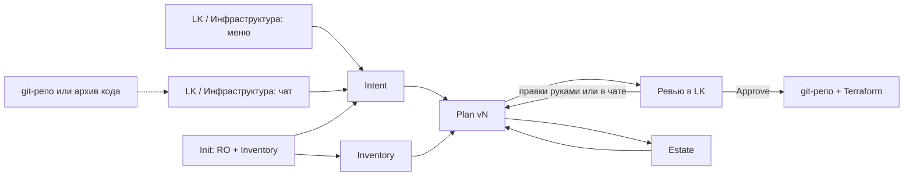
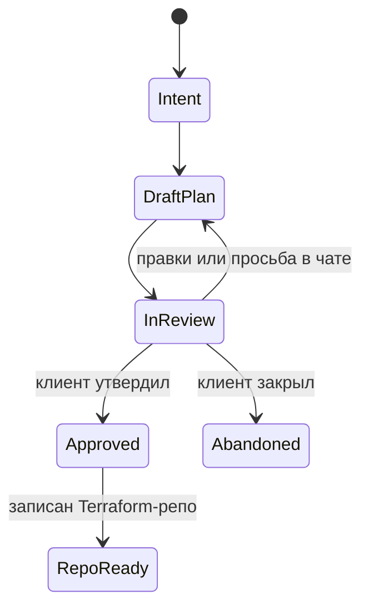
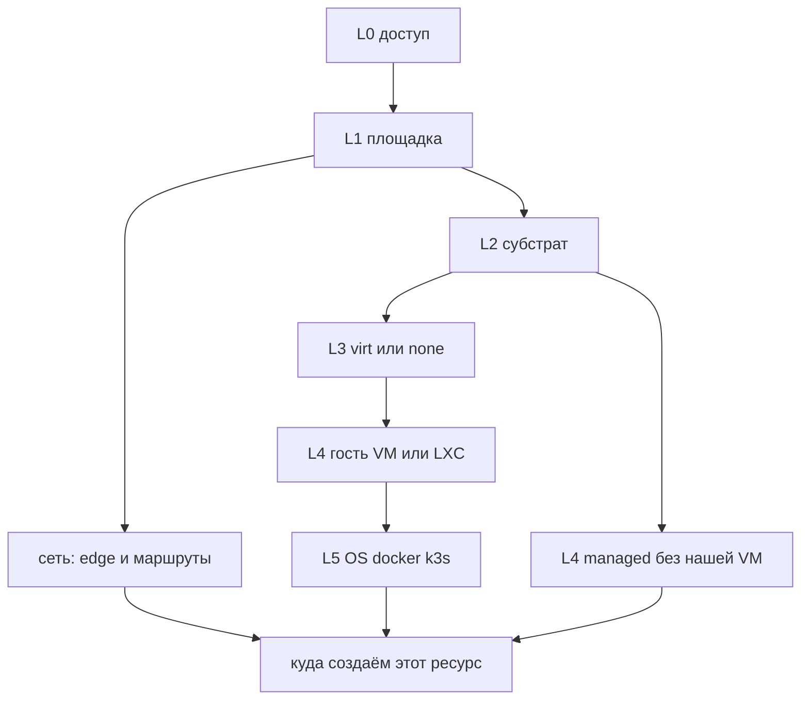

# ADR-0015.1: `ai infra agent` — активация, LK «Инфраструктура», память контура

- **Статус:** Предложено (архитектурное решение; код и UI не реализованы)
- **Дата:** 2026-09-20
- **Авторы:** Alexandr Yankov (решения), Cursor (оформление по итогам обсуждения)

## Контекст

[ADR-0015](0015-ai-agent-platform-architecture.md) задаёт слой `агент → инструмент → ресурс`,
пять доменных агентов и рантайм (`agent-job` + OpenAI Agents SDK + Temporal). `ai infra agent`
там владеет `IAC tools` и `CI/CD`, но не сказано:

- кто его будит;
- с чем говорит личный кабинет (LK), которого в схеме 0015 есть узел, а контракта нет;
- как агент узнаёт уже существующую инфраструктуру и **помнит** ту, которой управляет;
- куда класть новый ресурс, если клиент дал доступ к облаку (dedicated, VM, managed и железо —
  разные этажи).

[ADR-0025](0025-client-onboarding-architecture.md) закрывает ручной онбординг: отдельный git-репо
клиента, `terraform-modules/site-proxmox|site-libvirt`, скилл-анкета. Это прецедент результата,
не контур агента. Скилл
[`.claude/skills/client-onboarding/SKILL.md`](../../.claude/skills/client-onboarding/SKILL.md) —
эталон вопросов и правило «нет имён/IP/секретов клиента в коллекции».

Этот ADR не пересматривает 0015 §1–§11 и не заменяет 0025. Он описывает **только**
`ai infra agent` и раздел LK «Инфраструктура». Код, UI и `tofu apply` сюда не входят.

## Схема

## Решения

### 1. LK — кабинет клиента; оператор на infra-panel

**Решение:** LK — кабинет владельца `Project`. Оператор платформы остаётся на infra-panel /
Semaphore. Open WebUI — общий чат с моделью и **не** создаёт `Intent` / `Plan`.

**Обоснование:** в 0015 уже два входа (`lk web ui` и `showcase`) сходятся на `Projects`. Смешивать
клиентский контур создания инфры с аварийным контуром оператора — повторить ошибку, от которой
0014 сознательно отделяет ручной Semaphore.

### 2. Два способа активации, один `Intent`

**Решение:** агент сам себя не будит. Клиент в разделе «Инфраструктура» запускает один контур
двумя входами.

**Способ A — меню.** Клиент накликивает, что создать. Обязательно учитываются:

1. стек проекта (DNS, Postgres, k3s, …);
2. best-practice минимум (мониторинг, DNS, бэкап, hardening) — агент дополняет явно в Plan,
   пункты можно снять на ревью;
3. уровни размещения (§9), не плоская галочка «облако / свой сервер».

Итог меню — структурированный `Intent`, не свободный текст как единственный источник правды.

**Способ B — чат.** Тот же агент в LK. Задаёт вопросы, по ответам собирает цепочку ресурсов.
Можно подключить git-репо или загрузить код — агент оценивает стек и предлагает инфру. Чат
пишет в тот же `Intent`; меню и чат смешиваются.

Политики по расписанию и аварийный Semaphore — вне этого цикла. Они не активируют создание
клиентской инфры.

**Обоснование:** два UX, одна машина состояний. Иначе чат и мастер расходятся, и Approve
непонятно к чему относится.

### 3. Цикл Plan / Review до явного Approve

**Решение:** после `Intent` агент не создаёт репозиторий и не применяет инфру. Он отдаёт `Plan vN`.
Цикл, пока клиент не утвердит:

1. Plan: цепочка ресурсов, обоснование best practice, слой размещения, какие Terraform-модули
   и роли;
2. ревью в LK;
3. правки руками или просьба в чате;
4. `Plan vN+1`, история версий сохраняется.

`Approve` — единственный переход к материализации. Отказ/закрытие Run план не применяет.
Параллельно один активный Plan-цикл на Project.

Дефолт после Approve: создаётся **отдельный** git-репозиторий клиента (0025 §1) и в нём
описывается инфраструктура Terraform (`terraform-modules/` коллекции как git-source с тегом).
`tofu apply` — не этот цикл, а следующий Run/Approval.

**Обоснование:** «утвердил план» и «создал живые машины» — разные согласия. Скилл 0025 уже
генерирует репо без apply; агент повторяет ту же границу. HITL, который 0015 «Не проработано»
оставлял открытым, для инфры закрывается этим циклом, не `interrupt()` фреймворка.

### 4. Паспорт `ai infra agent` в этом контуре

**Решение:**

- **Владеет:** сбор `Intent` (меню + чат + анализ репо); генерация и ревизия `Plan`; после
  Approve — клиентский git-репо и Terraform под выбранный слой размещения. Ansible-роли
  `devops.uslugi.*` — следующий слой в том же репо (`site.yml` как в 0025), не apply из чата.
- **Учитывает:** стек, явный best-practice минимум, уровни размещения и сеть (§9), приложенный
  репозиторий, Estate и Inventory.
- **Не делает в этом цикле:** `tofu apply`, мутации по SSH, promote HA, правки
  `platform/gitops`, вызов Semaphore. RO-сбор фактов для Inventory (отдельный tool, не сырая
  команда из чата) — разрешён.
- **Не видит:** чужие Project, OpenBao root, kube-apiserver платформы (`home_k3s` / `aicd`).
  Клиентский k8s — только со scoped-доступом этого Project.
- **Помнит:** `Estate` и `Inventory` — объекты Project в lk-api, не контекст чата. Каждый Run
  читает их первым.
- **Handoff:** coding / testing / kb в плане инфры не участвуют. AI monitoring agent (когда
  появится) отдаёт observed-сводку; infra сам метрики не разбирает.

**Обоснование:** специализация 0015 §3 сохраняется. IAC в 0015 §5 по-прежнему роли + Module +
Semaphore; этот ADR отодвигает вызов Semaphore за Approve и за отдельный apply-цикл — иначе
агент обходит HITL.

### 5. Слои состояния существующей инфры

**Решение:** мониторинг, гипервизор и k8s отвечают на разные вопросы. Агент сначала выясняет:
greenfield / уже управляли / живёт вне нашего Terraform. Если инфра есть — собирает слои и
показывает расхождение в Plan.

| Слой | Откуда | Что даёт | Чего не даёт |
|---|---|---|---|
| **Declared** | git-репо Project, tfstate, Ansible-inventory после Approve, история Plan | чем уже управляем | машины вне state; внутренности гостя |
| **Placement** | API площадки (Proxmox, libvirt, облако) | VM / сети / диски на площадке | здоровье сервиса, что внутри гостя |
| **Observed** | VictoriaMetrics / будущий monitoring-агент | хост жив, exporters | полный список VM, если хост не в scrape |
| **Workload k8s** | kube-apiserver **клиентского** кластера | деплои / ns | ВМ под кластером, non-k8s |

Не источники Inventory: роль `monitoring_agent` (нет API «отдай хозяйство»), платформенный k8s,
Open WebUI / сырой scrape из чата.

Greenfield — Init не нужен, сразу Intent → Plan. «Уже есть» или первая инициализация на чужой
площадке — Init, выбор import, затем Plan.

**Обоснование:** один API не закрывает картину. Свести всё к мониторингу или к «что k8s знает» —
типичная ошибка, от которой этот контур должен быть защищён в ADR, а не в промпте.

### 6. Init: сначала RO-учётка, потом обход, потом «что импортируем»

**Решение:** срабатывает, когда платформа только поднимается или агента впервые подключили к
инфре, которой мы не управляем. Повседневный обход — не под админом клиента.

1. Клиент разово кладёт bootstrap-admin в OpenBao **этого** Project (хватит прав *создать*
   RO-учётку).
2. Первый tool-call Init — создать read-only principal: Proxmox `PVEAuditor`; облако IAM
   ReadOnly; клиентский k8s SA + `view`; libvirt/SSH — учётка без destroy/undefine (если ролей
   нет — ограничение явно в Plan).
3. RO-секрет фиксируется в OpenBao Project. Bootstrap-admin убирается из инструментов обхода.
4. Сбор Inventory под RO (§8), включая сеть.
5. Классификация стека размещения (§9) по увиденному — не переспрашивать очевидное. Затем
   клиент отмечает import и, при создании, **куда класть** (только варианты этого стека).
6. Выбранное → `Intent.import[]`. Остальное остаётся в Inventory как «обнаружено, вне
   управления».

Init не создаёт Terraform-репо и не делает apply. Отказ дать bootstrap-admin — fallback: ручной
перечень хостов, `declared-by-user`, в Plan пометка что обхода не было.

**Обоснование:** обход под root навсегда — неприемлемая граница. RO создаётся агентом, чтобы
клиент не собирал Auditor-роль вручную, но админ не остаётся в повседневных tools.

### 7. Estate — память о том, чем агент управляет

**Решение:** `Estate` — реестр ресурсов Project в lk-api (зеркало — Terraform state клиентского
репо). Не chat-history и не веса модели.

Запись минимум: id на площадке, имя, тип (`vm` / `network` / `k8s` / `db` / …), слой размещения,
статус (`imported` / `planned` / `in-repo` / `applied`), ссылка на модуль Terraform, версия Plan.
Секреты не хранятся.

Правила:

1. Старт любого Run — чтение Estate.
2. Повторный RO-обход — сверка, не чистый лист.
3. Меню и чат не предлагают создать заново то, что уже в Estate, без явного «пересоздать».
4. Пишется только при import, Approve (новые → `planned` / `in-repo`) и будущем Apply
   (`applied`). Чат без Approve Estate не меняет.
5. Снятое с управления уходит из актуального Estate, остаётся в истории.

Источник правды по составу управляемого: **Estate + tfstate**. RO и мониторинг говорят, жив ли
известный ресурс и не появилось ли чужое рядом.

**Обоснование:** без реестра владения каждый заход в чат — amnesia. LLM-окно этим реестром быть
не может.

### 8. Inventory — книга фактов контура

**Решение:** агент сам создаёт и ведёт Inventory. Estate отвечает «чем управляем», Inventory —
«как это выглядит».

Это не Ansible `inventory.yml` (0014 / 0025). Ansible-inventory — хосты для playbook; он
**выводится** из книги после Approve. Книга живёт раньше репо.

Сбор двумя слоями. Hypervisor не видит процессы, пользователей, пакеты и пути конфигов внутри
гостя.

| Слой | Откуда | Что заполняет |
|---|---|---|
| **Placement** | API гипервизора / облака | ВМ / серверы / сети, выделенные ресурсы, свободные на ноде / квота |
| **Guest** | RO на госте (SSH или эквивалент без sudo-mutate), только allowlisted tools | ОС, свободные CPU/RAM/диск внутри, слушающие порты, юниты, пользователи, софт, пути конфигов |
| **Workload k8s** | scoped kubeconfig Project (`view`) | ноды, version, ns, Service/Ingress, allocatable vs used |

Нет гостевого RO — статус `placement-only`, в Plan пометка. Init должен завести или принять
гостевой RO, иначе книга — каркас ВМ.

Схема записи хоста / узла:

- **identity** — hostname, роль, ОС, id на площадке;
- **placement** — слой §9, id;
- **capacity** — выделено и свободно (гость и отдельно нода / квота);
- **network** — интерфейсы, слушающие порты (bind + port + юнит), не дамп трафика;
- **network_plane** (на Project) — центральный роутер / edge, default gateway, public IP,
  private L2/L3, NAT, известные маршруты, VPN. Без этого агент не предлагает «поставить ВМ в
  эту сеть»;
- **runtime** — systemd / compose / k8s workloads, не полный `ps aux`;
- **users** — login-способные и заведённые нами, не весь `/etc/passwd`;
- **software** — пакеты / образы;
- **configs** — карта «сервис → основные файлы». **Пути, не содержимое.** Секреты не копируются;
- **k8s** — если кластер в стеке;
- **meta** — `collected_at`, полнота слоя, пробелы прав.

Хранение: объект `Inventory` в lk-api; после Approve — зеркало в клиентском git
(`inventory/facts.yml` или аналог) рядом с выводимым `ansible/inventory.yml`.

Пишется при Init, повторной сверке, import / Approve / будущем Apply. Чат факты не выдумывает.

Канонические пути конфигов — из `roles/*/README` и defaults коллекции, не вопрос клиенту
«где www.conf».

**Обоснование:** без книги агент не отличит занятый порт от свободного диска и не предложит
осмысленный Plan. Ansible-inventory для этого слишком узкий; мониторинг — про живость, не про
состав.

### 9. Уровни размещения: доступ ≠ слой, на котором создаём

**Решение:** доступ к аккаунту облака не значит «создаём IaaS VM». Плоский выбор
«облако / свой сервер / Proxmox» запрещён. Агент разбирает стек и спрашивает «куда создаём?»
только вариантами, которые на этом стеке есть.

Базовые схемы (узнаёт по Inventory, не переспрашивает очевидное):

1. Cloud → dedicated → виртуализация. Новый ресурс чаще VM на уже стоящем гипервизоре; новый
   dedicated — если не хватает ноды.
2. Cloud → dedicated → всё на железе. Пакет / контейнер на хосте или второй dedicated, не VM
   без места, где ей жить.
3. Cloud → VM → приложения. Ещё одна VM в VPC / подсети или диск / IP.
4. Cloud → managed. Цепочка: кто к кому ходит, SG, private endpoint, секреты. Лишнюю VM «под
   базу» не рисовать.
5. Физический сервер или серверы. SSH / IPMI, облачного API нет. Новый ресурс — на каком хосте.

Каталог частых паттернов (в ADR, не в промпте чата):

| id | Паттерн | Типичный вид |
|---|---|---|
| P1 | cloud-dedicated-virt | Hetzner Robot / OVH / Selectel dedicated + Proxmox. Референс 0025 |
| P2 | cloud-dedicated-bare | тот же дедик без гипервизора |
| P3 | cloud-iaas-vm | EC2 / Yandex Compute / GCP / Azure / Selectel / Timeweb Cloud + VPC |
| P4 | cloud-managed-chain | compute + managed DB + object storage + LB |
| P5 / P6 | physical-single / fleet | офис, дом, коло |
| P7 | colo-ipmi | стойка, iLO/iDRAC, без cloud API |
| P8 | vps-panel | REG.RU / FirstVDS / Timeweb VPS: панель + SSH, часто без IaaS API. Не обещать `tofu apply` |
| P9 | cloud-mk8s | EKS / GKE / AKS / Yandex MKS: node group / workload, не «VM под k3s» |
| P10 | nested-k3s | k3s на VM из P1/P3: ns / workload vs новая VM vs worker |
| P11 | hybrid | локальный PVE/физика + облачный S3/managed DB; обязателен VPN/маршрут |
| P12 | multi-site | две площадки: какая первая, как сети склеены |
| P13 | home-lab | физика + PVE без аккаунта облака |
| P14 | cloud-vpc-edge | NAT / cloud router / vSwitch / OPNsense / VyOS / MikroTik |
| P15 | bare-metal-api | Equinix Metal / Hetzner Robot: заказ ещё одного dedicated ≠ IaaS VM |

Сеть — отдельная плоскость. После Init агент находит центральный роутер / default gateway,
public vs private, NAT, стыки подсетей. Ресурс не кладётся в сеть без маршрута к уже выбранным
зависимостям. Если Inventory сеть не закрыла — вопрос, не догадка.

Модули сегодня: `terraform-modules/site-proxmox` и `site-libvirt` (P1 / P13). Остальное агент
классифицирует в Plan (слой + куда создаём + какой модуль понадобится). Универсальный модуль
«на все облака» запрещён — 0025 §2. Нет модуля — в Plan «модуль TBD», репо не рисует
несуществующий provider.

**Обоснование:** реальный клиент 0025 уже был «облачный аккаунт → dedicated → Proxmox». Если
агент сведёт это к «создать VM в облаке», план будет ложным. Каталог нужен, чтобы эрудиция жила
в решении, а не в удачном промпте.

### 10. Контракт LK: раздел «Инфраструктура»

**Решение:** весь контур infra-агента — в одном разделе кабинета, на уровне Project. Другие
агенты получат свои разделы позже.

Экраны v1:

- **Обзор** — Estate, краткая Inventory, статус цикла, Init если не проходили;
- **Инвентарь** — книга фактов и определённый паттерн P1–P15;
- **Инициализация** — bootstrap-секрет, статус RO (площадка + гость), таблица находок, чекбоксы
  import;
- **Мастер** — стек / куда создаём / компоненты + best-practice;
- **Чат** — диалог и подключение / загрузка репозитория;
- **План** — ревью `Plan vN`, diff версий, правки, Approve;
- **История** — кто что утвердил.

LK не ходит в Terraform / Semaphore / kube. Чат и мастер → lk-api → Temporal → `agent-job`
infra. Меню пишет Intent в lk-api; агент нормализует и дополняет best practice.

**Обоснование:** без выделенного раздела активация размажется по общему чату и снова упрётся в
открытый вопрос 0015 «кто запускает агентов».

### 11. Остальные агенты

**Решение:** monitoring / coding / testing / kb не создают Terraform-репо и не ведут этот
Plan-цикл. Их активация — отдельные ADR. В v1 LK достаточно каркаса кабинета и полного контура
только infra.

**Обоснование:** 0015 §3. Расширять HITL на все пять агентов в одном документе — смешать
нерешённое с уже согласованным.

## Явно вне периметра

- `tofu apply` и регистрация в Semaphore / Module / Flux (0025 §5, 0015 «как агент вызывает
  Semaphore»);
- живой `terraform import` существующей VM;
- код LK, lk-api, `agent-job` infra;
- биллинг, MCP-бэкенды, группы `proj-*`;
- Terraform-модули облаков помимо Proxmox / libvirt;
- параллельные Plan-циклы на один Project (запрещены, политика конфликта не проектируется).

## Последствия для ADR-0015

Закрыто этим ADR, только для `ai infra agent` и клиентской инфры:

- кто активирует агента — клиент, меню или чат раздела «Инфраструктура»;
- human-in-the-loop — цикл Plan / Review / Approve.

По-прежнему открыто в 0015: мультитенантность прав агентов, оркестрация конфликтов между
доменами, обратная связь от ресурсов, биллинг, вызов Semaphore, apply.

## Ссылки

- [ADR-0015](0015-ai-agent-platform-architecture.md) — слой агентов, паспорт домена infra (§3,
  §5), рантайм (§6, §9, §11).
- [ADR-0025](0025-client-onboarding-architecture.md) — отдельный git-репо, terraform-modules,
  граница apply.
- [ADR-0014](0014-platform-controller-architecture.md) — Ansible-inventory в git, без CRD хостов.
- `.claude/skills/client-onboarding/SKILL.md` — эталон анкеты и запрет клиентских секретов в
  коллекции.
- `docs/platform/infra-panel.md` — панель оператора, не LK клиента.
- `docs/platform/agent-platform.md` — фактический стек инференса, не контракт агента.
