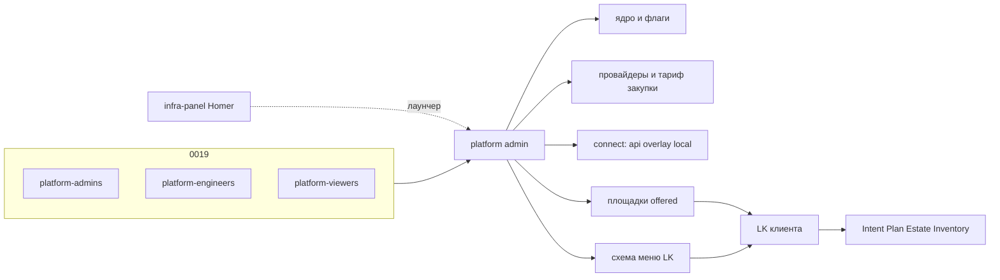

# ADR-0015.2: Platform admin — ядро, провайдеры, меню LK

- **Статус:** Предложено (архитектурная граница; код и UI не реализованы)
- **Дата:** 2026-09-24
- **Авторы:** Alexandr Yankov (решения), Cursor (оформление по итогам обсуждения)

## Контекст

[ADR-0015.1](0015.1-infra-agent.md) закрыл контур клиента: Intent / Plan / Estate / Inventory,
куда кладём (`owner` / `procurement` / `connect`). Каталог площадок, ключи партнёров и то, какие
пункты меню видит LK, клиент настраивать не должен.

Сейчас у оператора нет конфигуратора:

- [infra-panel](0008-infra-panel-role.md) — Homer, стартовая страница со ссылками;
- Semaphore — ручной/аварийный run (0014);
- Open WebUI — чат с моделью, не создаёт Intent.

[ADR-0019](0019-platform-rbac-model.md) уже задаёт **кто** человек на платформе
(`platform-admins` / `platform-engineers` / `platform-viewers`). Этот ADR не пересматривает 0019
и не заводит группы на сервис. Он говорит, **какое приложение** крутит системный слой и как на
него ложатся те же три персоны.

Клиентский LK и `proj-*` (0019 §2, зарезервированы) сюда не входят.

## Схема

## Решения

### 1. Отдельное приложение, не LK и не Homer

**Решение:** системный слой — **platform admin**. Не раздел в кабинете клиента, не страница
Homer, не Semaphore. infra-panel может ссылаться на админку как на ещё один пункт лаунчера.

**Обоснование:** то же, что 0015.1 §1 и 0014: смешать кабинет клиента с настройкой ядра —
два контура в одном UI.

### 2. Что админка владеет

**Решение:** только политика и каталоги платформы, не инфру конкретного Project.

| Домен | Делает | Не делает |
|---|---|---|
| Ядро | окружения, feature flags, какие агенты/разделы LK живые (0015 §3, 0015.1 §11) | `kubectl` / Module CR руками вместо 0014 |
| Провайдеры | `provider_id`, партнёрские креды в OpenBao, прайс **закупки** | счёт клиенту, маржа (биллинг 0015 открыт) |
| Reachability | `connect` площадки: `local` / `api` / `overlay` | продукт VPN и TTL ключей — § «Открыто» |
| Площадки | наше железо, партнёрские сайты, публикация в Project (`offered`) | Init BYO и Estate клиента (0015.1) |
| Меню LK | какие пункты кабинета существуют и кому из клиентов видны | контент «Инфраструктура» (Intent/Plan) |
| Люди | смотрит группы 0019; не заводит свою ролевую модель | данные FreeIPA — `freeipa_directory` (0019 §3) |

Клиент в LK не видит ключи, org провайдера, закупочный прайс, чужие Project, редактор меню и
флаги ядра.

### 3. Кто ходит — те же `platform-*`

**Решение:** вход как у остальных сервисов за Authelia (0013 + 0019): claim `groups`, не локальные
роли админки.

| Группа 0019 | В platform admin |
|---|---|
| `platform-admins` | полное изменение доменов §2 |
| `platform-engineers` | правка каталога площадок / `connect` / публикация `offered`; без смены ядра и без чтения закупочных секретов |
| `platform-viewers` | только чтение |

Локальный break-glass — как в 0019 §7, не новая схема.

`proj-*` по-прежнему не заводятся (0019 §2). Когда появятся — это права **в LK клиента**, не
новые роли админки.

**Обоснование:** per-service группа `platform-admin-panel-admins` — то, от чего 0019 §1 отказался.
Три персоны уже отображаются в Grafana/Gitea/Semaphore; админка — четвёртый сервис на ту же
ось.

### 4. Секреты и ротация

**Решение:** партнёрские API-токены и overlay-ключи — только OpenBao платформы (0016). Админка
пишет *ссылку* на секрет и запускает rotate, сами значения в UI и в объектах
[0015.3](0015.3-contracts.md) не хранит. Клиент rotate не инициирует.

Интервал и алерт «rotate не прошёл» — открыто.

### 5. Экраны v1 не проектируем здесь

**Решение:** этот ADR фиксирует границу и RBAC. IA/макеты, стек UI, API админки — следующий
проход, когда дойдём до кода. Пока достаточно, что LK читает опубликованный каталог, а пишет
его только admin.

## Открыто

- продукт overlay (свой WG hub или иной);
- TTL и процедура ротации;
- обязателен ли overlay до партнёрской VM, если хватает API + cloud-init (0015.1 §9);
- сетка тарифов продажи клиенту;
- код, домен, forwardAuth-маршрут.

## Явно вне периметра

- клиентский LK и объекты [0015.3](0015.3-contracts.md);
- пересмотр групп 0019 и заведение `proj-*`;
- замена infra-panel (лаунчер остаётся);
- `tofu apply`, Semaphore Task Template на клиента;
- межагентная авторизация (0015 «Не проработано»).

## Последствия

- 0015.1 §1: оператор в platform admin, не «на infra-panel».
- 0019: новый сервис на те же `platform-*`; отдельная группа не нужна.
- 0008: Homer не становится конфигуратором.

## Ссылки

- [ADR-0015.1](0015.1-infra-agent.md) — LK, цикл, `owner` / `procurement` / `connect`.
- [ADR-0015.3](0015.3-contracts.md) — Intent / Plan / Estate / Inventory.
- [ADR-0019](0019-platform-rbac-model.md) — `platform-admins` / `engineers` / `viewers`.
- [ADR-0013](0013-unified-auth-architecture.md) — Authelia, вход людей.
- [ADR-0016](0016-openbao-secrets-pki.md) — секреты платформы.
- [ADR-0008](0008-infra-panel-role.md) — лаунчер.
- [ADR-0014](0014-platform-controller-architecture.md) — Semaphore не админка.
- `docs/platform/infra-panel.md` — фактический Homer.
