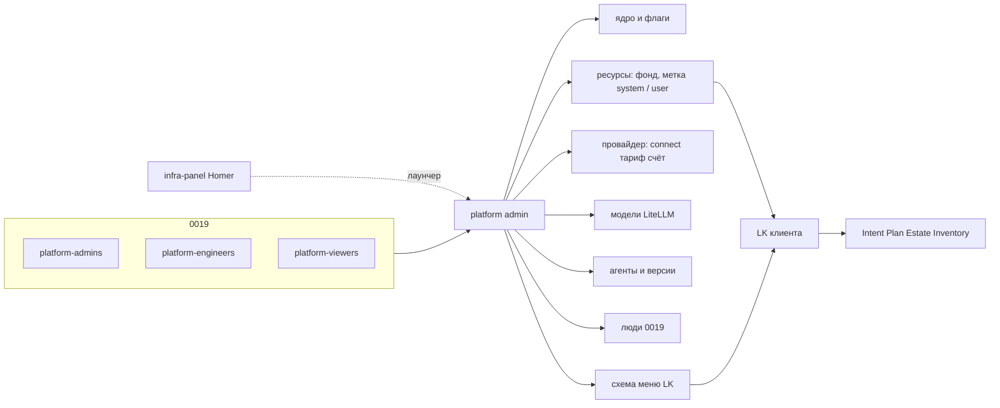

# ADR-0015.2: Platform admin — ресурсы, провайдеры, модели, агенты, люди

- **Статус:** Предложено (архитектурная граница; код и UI не реализованы)
- **Дата:** 2026-09-24
- **Авторы:** Alexandr Yankov (решения), Cursor (оформление по итогам обсуждения)

## Контекст

[ADR-0015.1](0015.1-infra-agent.md) закрыл контур клиента: Intent / Plan / Estate / Inventory,
куда кладём (`owner` / `procurement` / `connect`). Каталог площадок, ключи партнёров и то, какие
пункты меню видит LK, клиент настраивать не должен.

Сейчас у оператора нет конфигуратора:

- [infra-panel](0008-infra-panel-role.md) — Homer, стартовая страница со ссылками;
- Semaphore — ручной/аварийный run (0014);
- Open WebUI — чат с моделью, не создаёт Intent.

[ADR-0019](0019-platform-rbac-model.md) уже задаёт **кто** человек на платформе
(`platform-admins` / `platform-engineers` / `platform-viewers`). Этот ADR не пересматривает 0019
и не заводит группы на сервис. Он говорит, **какое приложение** крутит системный слой и как на
него ложатся те же три персоны.

Клиентский LK и `proj-*` (0019 §2, зарезервированы) сюда не входят.

## Схема



## Решения

### 1. Отдельное приложение, не LK и не Homer

**Решение:** системный слой — **platform admin**. Не раздел в кабинете клиента, не страница
Homer, не Semaphore. infra-panel может ссылаться на админку как на ещё один пункт лаунчера.

**Обоснование:** то же, что 0015.1 §1 и 0014: смешать кабинет клиента с настройкой ядра —
два контура в одном UI.

### 2. Что админка владеет

**Решение:** только политика и каталоги платформы, не инфру конкретного Project.

| Домен | Делает | Не делает |
|---|---|---|
| Ядро | окружения, feature flags, какие разделы LK живые | `kubectl` / Module CR руками вместо 0014 |
| Ресурсы | общий фонд; часть помечаем под систему, остальное отдаём пользователям (§6) | гипервизор / `tofu apply` / Estate клиента |
| Провайдеры | облака, к которым мы подключены: `connect`, тариф, **наш** баланс / лимит / овердрафт / квоты / потребление (§7) | ЛК клиента у провайдера; счёт клиенту; продукт VPN |
| Модели | каталог LLM/эмбеддингов за LiteLLM: что подключено, кому можно (§8) | замена движка 0021; прямые ключи в UI |
| Агенты | реестр: кто жив, версия, фреймворк (§9) | код агента, Temporal Worker, `agent-job` руками |
| Люди | список и **смена** членства `platform-*` (0019) (§10) | новые типы групп; `proj-*`; правка `svc-*` |
| Меню LK | какие пункты кабинета существуют и кому из клиентов видны | контент «Инфраструктура» (Intent/Plan) |

Клиент в LK не видит ключи, org провайдера, `ProviderAccount` / тариф закупки, ресурсы с
`allocation: system`, чужие Project, редактор меню, флаги ядра, реестр агентов.

### 3. Кто ходит — те же `platform-*`

**Решение:** вход как у остальных сервисов за Authelia (0013 + 0019): claim `groups`, не локальные
роли админки.

| Группа 0019 | В platform admin |
|---|---|
| `platform-admins` | полное изменение доменов §2, включая счёт провайдера (`limit` / овердрафт / квоты) и людей |
| `platform-engineers` | ресурсы / `connect` / `offered`, каталог моделей и версии агентов; **нет** счёта провайдера, смены ядра, людей write, raw секретов |
| `platform-viewers` | только чтение |

Локальный break-glass — как в 0019 §7, не новая схема.

`proj-*` по-прежнему не заводятся (0019 §2). Когда появятся — это права **в LK клиента**, не
новые роли админки.

**Обоснование:** per-service группа `platform-admin-panel-admins` — то, от чего 0019 §1 отказался.
Три персоны уже отображаются в Grafana/Gitea/Semaphore; админка — четвёртый сервис на ту же
ось.

### 4. Секреты и ротация

**Решение:** партнёрские API-токены, overlay-ключи и ключи **внешних** моделей — только OpenBao
платформы (0016). Админка пишет *ссылку* на секрет и запускает rotate, сами значения в UI и в
объектах [0015.3](0015.3-contracts.md) не хранит. Клиент rotate не инициирует.

Интервал и алерт «rotate не прошёл» — открыто.

### 5. Каркас приложения — ADR-0015.2.1

**Решение:** граница и RBAC — здесь. Из каких процессов состоит админка, куда деплоится, как
стыкуется с Homer — [ADR-0015.2.1](0015.2.1-admin-panel-architecture.md). Макеты и стек UI
по-прежнему не рисуем до кода.

### 6. Ресурсы: общий фонд, метка системе или пользователям

**Решение:** книга — **весь фонд** того, на чём control plane может размещать нагрузку (общее
количество). Это не три сорта ресурсов (`platform` / `tenant` / `shared`). Оператор **выделяет
и помечает** часть фонда под систему платформы; туда едут только системные компоненты.
Остальное **отдаём пользователям** — там они размещают своё.

| Поле | Смысл |
|---|---|
| `resource_id` | стабильный id |
| `site_id` | площадка 0015.1 §9 (`owner` / `procurement` / `connect`) |
| `kind` | `node` \| `cluster` \| `pool` |
| `allocation` | `unassigned` — в фонде, ещё никому; `system` — помечен под платформу; `user` — отдан пользователям |
| `state` | `active` \| `drain` \| `failed` |
| `offered` | виден ли в LK; имеет смысл только при `allocation: user` |

Сводка фонда (обзор): `total` = все записи; `system` / `user` / `unassigned` — суммы по метке.
Новый ресурс входит как `unassigned`, пока оператор не пометил и не отдал.

Правила размещения:

- системный компонент (Authelia, LiteLLM, агенты платформы, …) — только `allocation: system`;
- клиентский P* / Project — только `allocation: user`;
- `unassigned` — не место размещения, только учёт «есть в фонде».

Третьего режима «на этом же куске и система, и клиент» нет: чтобы не отдать пользователю ноду,
на которой крутится ядро, её нужно **пометить** `system`, а не «поделиться».

Появление и сверка строк фонда — [ADR-0014.1](0014.1-platform-resource-controller.md):
`ExternalResource` (купленное) и `InternalResource` (свои ноды). Метку `allocation` тот
контроллер не ставит.

Квоты и деньги провайдера на ресурс **не** вешаем — они на карточке провайдера (§7).

**Обоснование:** иначе клиентский стенд садится на ноду LiteLLM / Authelia, или системный
аддон — в чужой Project.

### 7. Провайдер: connect, тариф и **наш счёт у него**

**Решение:** баланс, лимит, овердрафт, квоты и потребление — поля **провайдера**, не ресурса и
не отдельного домена «закупка». Это наш кабинет у Selectel / Yandex / … : сколько там денег,
какой потолок, какие квоты API/квот облака, что уже съели.

У `procurement: partner` (и облачного кабинета, если он наш) обязательно:

1. **`connect`** — `local` / `api` / `overlay` (0015.1 §9). Ключи — OpenBao, §4.
2. **`ProviderTariff`** — как мы тарифицируем SKU этого провайдера (версионированный документ).
3. **`ProviderAccount`** — живой счёт и квоты **этого** `provider_id`.

`platform_metal` кабинета у облака нет — счёта нет, только ресурсы §6. Сетка продажи клиенту
по-прежнему открыта (0015).

```yaml
apiVersion: platform.devops-labs.ru/v1
kind: ProviderAccount
metadata:
  provider_id: selectel
  currency: RUB
  period: calendar_month
spec:                              # задаёт оператор (admins)
  limit:
    amount: "50000.00"             # наш потолок трат у этого провайдера
  overdraft:
    enabled: true
    amount: "10000.00"
    action: freeze_new_placement   # иначе alert_only
  quotas:                          # квоты кабинета провайдера, не placement
    - name: vcpu
      unit: cores
      limit: "64"
    - name: floating_ip
      unit: pcs
      limit: "8"
    - name: projects
      unit: pcs
      limit: "3"
status:                            # пишет platform-api (синк / ввод)
  period_start: "2026-09-01"
  balance: "18420.00"              # сколько у нас там осталось (prepaid) или лимит − consumed
  consumed_amount: "31580.00"      # деньги за период
  in_overdraft: false
  consumption:                     # что потребляем сейчас, в единицах квот и SKU
    - name: vcpu
      used: "40"
    - name: floating_ip
      used: "5"
    - sku: dedicated.generic
      used: "2"
      amount: "24000.00"
    - sku: traffic.egress
      used: "800"
      unit: gib
      amount: "4000.00"
```

Тариф (как считать деньги с SKU) — отдельный документ на том же `provider_id`:

```yaml
apiVersion: platform.devops-labs.ru/v1
kind: ProviderTariff
metadata:
  provider_id: selectel
  version: 3
  currency: RUB
  period: calendar_month
spec:
  items:
    - sku: dedicated.generic
      unit: month
      price: "12000.00"
    - sku: traffic.egress
      unit: gib
      price: "5.00"
```

Правила счёта (всегда `provider_id`, не `resource_id`):

- `balance` / `limit` / `overdraft` — деньги **нашего** договора с этим провайдером.
- `quotas[].limit` vs `consumption[].used` — квоты кабинета (vCPU, IP, проекты, …), которые
  провайдер нам выдал, и факт потребления.
- Исчерпан денежный `limit + overdraft` **или** любая квота с `used >= limit` →
  `action: freeze_new_placement` на ресурсах **этого** провайдера; уже живущее не гасим.
- `alert_only` — только сигнал.
- Порог предупреждения по умолчанию — 80% денежного `limit` и 80% каждой квоты.
- Смена тарифа — новый `version`; прошлый период не пересчитываем.

Ресурс (метка `allocation`, drain) отвечает «из фонда кому отдан». Провайдер отвечает «на каких
условиях мы у него живём и сколько уже съели».

### 8. Модели

**Решение:** админка показывает и включает **то, с чем платформа реально ходит в LiteLLM**
(0015 §6, 0021) — локальный инференс и внешние API, когда они появятся. Не второй роутер.

| Поле | Смысл |
|---|---|
| `model_id` | псевдоним LiteLLM |
| `kind` | `chat` \| `embed` |
| `backend` | `local` \| `external` |
| `provider_id` | если `external` — тот же каталог §7 (токен и spend) |
| `purpose` | `platform` \| `tenant` \| `both` |
| `state` | `enabled` \| `disabled` \| `drain` |

Ключи внешних моделей — OpenBao. Оператору видно «задан / rotate», не значение. 0021 остаётся
выбором **локального** движка и пилотной модели, не этим каталогом.

### 9. Агенты и версии

**Решение:** реестр агентов платформы, не репозиторий их кода. Фреймворк — поле записи, не
догма UI: 0015 §11 фиксирует OpenAI Agents SDK как **дефолт новых** `agent-job`, но на платформе
уже есть и будут другие контуры (`moon-local-engineer` и т.п.).

| Поле | Смысл |
|---|---|
| `agent_id` | `infra` \| `monitoring` \| `kb` \| `coding` \| `testing` \| иной зарегистрированный |
| `version` | semver или tag образа |
| `framework` | `openai-agents-sdk` \| `langgraph` \| `crewai` \| `autogen` \| `llamaindex` \| `pydantic-ai` \| `custom` |
| `image_ref` | что реально крутится |
| `models` | список `model_id` из §8, которыми этому агенту можно |
| `state` | `enabled` \| `disabled` \| `drain` |

Смена версии в админке — желаемое состояние. Выкат — тот же контур, что у остальных аддонов
(0014 / Helmwave), не `kubectl` из UI.

### 10. Люди: читать и менять 0019, не изобретать роли

**Решение:** раздел «Люди» — операторский UI над той же моделью [0019](0019-platform-rbac-model.md).
SoT групп и учёток — FreeIPA. Админка **не** заводит `platform-admin-panel-*` и не рисует свои
роли.

Можно: список людей и групп; членство в `platform-admins` / `engineers` / `viewers`; завести
человека (пароль — OpenBao, смена при первом входе, как 0019 §3); выключить / включить.
Нельзя: новые имена групп; `proj-*` (по-прежнему резерв); править `svc-*`; удалять последнюю
учётку в `platform-admins`; снять с себя последний admin, если другого admin нет.

`freeipa_directory` остаётся GitOps-базой и аддитивна (0019 §3). Живая смена членства из
админки идёт в FreeIPA сразу и **не** вычищается следующим прогоном роли (нет полного prune).

### 11. Производные от §6–§10

Следует из правил выше, отдельно не обсуждалось — принимаем здесь:

| Производное | Зачем |
|---|---|
| Нельзя отдать последнее `system` | в фонде должна остаться помеченная система, иначе некуда класть ядро |
| Drain ресурса | новые размещения стоп, живое не трогаем — то же семейство, что freeze провайдера |
| Привязка модель→агент | агент не вызывает то, чего нет в его `models` |
| Spend внешней модели | идёт в `ProviderAccount` того `provider_id`, не на ресурс и не отдельной кассой |
| Аудит мутаций | кто сменил группу, тариф, `allocation`, версию агента |
| Сервисные учётки | `svc-*` видны read-only, чтобы не путать с людьми |
| Самоблокировка | API отвергает операцию, после которой не останется ни одного `platform-admins` |

## Открыто

- ~~продукт overlay (свой WG hub или иной)~~ — роль края и туннели: [ADR-0028](0028-platform-network.md);
  VPN как продукт клиенту по-прежнему вне периметра;
- TTL и процедура ротации;
- обязателен ли overlay до партнёрской VM, если хватает API + cloud-init (0015.1 §9);
- сетка тарифов **продажи** клиенту и маржа;
- откуда пишется `ProviderAccount.status` (тик 0014.1, выгрузка, ручной ввод);
- код, точный hostname, стек UI, БД `platform-api` (0015.2.1).

## Явно вне периметра

- клиентский LK и объекты [0015.3](0015.3-contracts.md);
- пересмотр набора групп 0019 и заведение `proj-*`;
- замена infra-panel (лаунчер остаётся);
- `tofu apply`, Semaphore Task Template на клиента;
- межагентная авторизация (0015 «Не проработано»);
- обучение моделей и цикл `dataset → агент`.

## Последствия

- 0015.1 §1: оператор в platform admin, не «на infra-panel».
- 0019: новый сервис на те же `platform-*`; отдельная группа не нужна.
- 0008: Homer не становится конфигуратором.
- 0015.2.1: два процесса (`admin-ui` + `platform-api`), `ns: platform`, forwardAuth, каталог не в Homer.
- 0015 «Биллинг»: счёт у провайдера (`ProviderAccount`: баланс / лимит / овердрафт / квоты /
  потребление) закрыт здесь; продажа клиенту — нет.
- 0019: админка — живой write членства; набор групп не меняется.

## Ссылки

- [ADR-0015.2.1](0015.2.1-admin-panel-architecture.md) — каркас: admin-ui + platform-api, деплой.
- [ADR-0015.1](0015.1-infra-agent.md) — LK, цикл, `owner` / `procurement` / `connect`.
- [ADR-0028](0028-platform-network.md) — ProjectNet, platform edge, плоскости сети.
- [ADR-0015](0015-ai-agent-platform-architecture.md) — пять агентов, LiteLLM, дефолт SDK.
- [ADR-0021](0021-agent-platform-model-selection.md) — локальный движок и пилотная модель.
- [ADR-0015.3](0015.3-contracts.md) — Intent / Plan / Estate / Inventory.
- [ADR-0019](0019-platform-rbac-model.md) — `platform-admins` / `engineers` / `viewers`.
- [ADR-0013](0013-unified-auth-architecture.md) — Authelia, вход людей.
- [ADR-0016](0016-openbao-secrets-pki.md) — секреты платформы.
- [ADR-0008](0008-infra-panel-role.md) — лаунчер.
- [ADR-0014](0014-platform-controller-architecture.md) — Semaphore не админка; apply, не фонд.
- [ADR-0014.1](0014.1-platform-resource-controller.md) — синк фонда: external / internal.
- [ADR-0014.1.1](0014.1.1-resource-onboarding-protocol.md) — протокол входа ресурса в фонд.
- `docs/platform/infra-panel.md` — фактический Homer.
