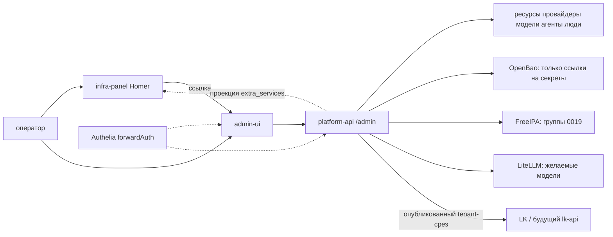
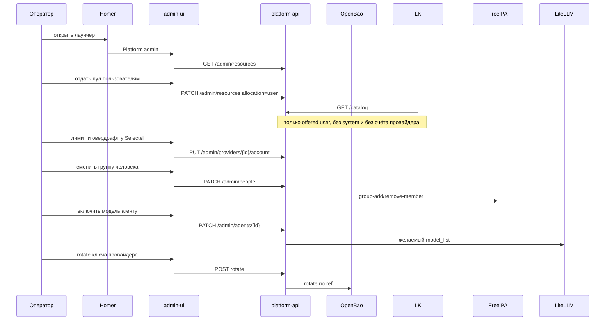

# ADR-0015.2.1: Каркас и архитектура platform admin

- **Статус:** Предложено (каркас; код и UI не реализованы)
- **Дата:** 2026-09-24
- **Авторы:** Alexandr Yankov (решения), Cursor (оформление по итогам обсуждения)

## Контекст

[ADR-0015.2](0015.2-admin-panel.md) зафиксировал границу: админка ≠ LK ≠ Homer, домены владения,
вход через `platform-*` ([0019](0019-platform-rbac-model.md)). Экраны и раскладку сервисов
оставил на следующий проход.

[ADR-0008](0008-infra-panel-role.md) — статический Homer: YAML, без бэкенда, одна страница на
всех. Кросс-ролевой автодискавери ссылок в 0008 §3 отвергнут. На `platform/*` вход уже Authelia
forwardAuth, не basic-auth роли.

Этот ADR не пересматривает 0015.2 и не заменяет 0008. Он кладёт **каркас**: из каких процессов
состоит админка, куда деплоится, как стыкуется с Homer и с будущим LK, как выполняется [0022](0022-new-component-requirements.md).

## Схема

## Решения

### 1. Два процесса: `admin-ui` и `platform-api`

**Решение:** админка — не ещё один Homer и не один монолит в ConfigMap.

| Процесс | Роль |
|---|---|
| `admin-ui` | SPA / статическая оболочка экранов §5. Секретов и бизнес-логики нет |
| `platform-api` | пишет и отдаёт каталог 0015.2. Первыми — маршруты `/admin/*` |

Клиентский LK **не** ходит в `admin-ui`. Позже тот же `platform-api` отдаёт опубликованный срез
каталога под `/catalog` (или аналог) для lk-api — разные RBAC, одна правда. Отдельный `admin-api`
навсегда — отклонён: LK всё равно должен читать тот же каталог.

Homer каталог **не** хранит. Максимум — проекция ссылок (`extra_services`), источник — API.

**Обоснование:** 0008 сознательно без бэкенда. Админке нужны роли внутри UI, ссылки на OpenBao и
запись `offered`. Это другой класс приложения.

### 2. Размещение — `ns: platform`, аддон Helmwave, не роль `infra_panel`

**Решение:** два Helm-релиза (или один чарт с двумя Deployment) в `ns: platform`, тот же класс,
что `radar` / `docs` / `infra-panel`: IngressRoute, TLS из цикла `issue-tls-cert.yml` (0022 §5),
без PVC у UI.

- Домен: `admin.<платформенный-домен>` (точное имя — в values окружения).
- Homer остаётся на `infra-panel.<домен>`.
- Роль `infra_panel` не расширяем: не тащить админку в `config.yml.j2`.

Порядок: новый компонент **после** 0022 — чарт через Nexus helm-proxy, когда он включён (0022 §1);
до этого релиз не добавлять «напрямую в интернет» как исключение.

**Обоснование:** 0008 §1 — `infra_panel` не оркестратор знаний платформы. Смешать деплой
конфигуратора с лаунчером повторит stale ConfigMap (0008 §8) на мутабельном состоянии.

### 3. Вход — forwardAuth, как у Homer/Radar, не basic-auth роли 0008

**Решение:** и UI, и `/admin` API за Authelia `forwardAuth` + `subject: group:platform-*`
(0019 §5, 0022 §2 «Веб-UI без нативного OIDC»). Свой login/OIDC в админке не заводим.

API доверяет заголовкам Authelia (`Remote-User`, группы) только от Traefik/mesh, не с интернета
напрямую. Внутри процесса раскладывает 0015.2 §3:

| Группа | API |
|---|---|
| `platform-admins` | все `/admin` write, включая счёт провайдера и людей |
| `platform-engineers` | write ресурсов / `connect` / `offered`, моделей, версий агентов; **нет** `ProviderAccount`, ядра, людей write, raw секретов |
| `platform-viewers` | GET |

Ссылка в Homer (0022 §3): корень `admin-ui`. Это forwardAuth-only — отдельный OIDC-login URL не
нужен.

**Обоснование:** на `platform/*` Homer уже снят с basic-auth. Возвращать htpasswd только для
админки — шаг назад относительно 0019.

### 4. Состояние: каталог в API, секреты только в OpenBao

**Решение:**

- Флаги ядра, ресурсы (`allocation` system/user; observed пишет [0014.1](0014.1-platform-resource-controller.md)), провайдеры без ключей, `ProviderTariff` и `ProviderAccount`
  (баланс / лимит / овердрафт / квоты / потребление на `provider_id`), каталог моделей, реестр
  агентов, схема меню LK — в хранилище `platform-api`.
- Партнёрские токены, overlay и ключи внешних моделей — OpenBao (0016). В каталоге —
  `secret_ref`, в UI — «задан / rotate», не значение.
- Люди и членство `platform-*` — FreeIPA (0019); API пишет туда, свой каталог пользователей не
  держит.
- Желаемый набор моделей — в API; применение к LiteLLM — отдельный шаг контура, не правка
  values руками из UI.
- Intent / Plan / Estate / Inventory (0015.3) в админку **не** кладём.

Движок БД в этом ADR не выбираем: тот же класс, что будущий lk-api (когда появится Postgres
платформы — он; пилот без отдельного «admin-sqlite на узле»). Git / ConfigMap Homer не SoT.

Проекция в Homer — опциональный шаг после записи каталога (рендер пункта «Platform admin» и
позже списка живых UI). Если проекции нет — пункт в `infra_panel_extra_services` руками, как
сейчас любой новый аддон (0022 §3).

### 5. Каркас экранов v1

Не макеты, а модули, 1:1 с доменами 0015.2 §2.

| Модуль | Задача | Кто пишет |
|---|---|---|
| Обзор | фонд: total / system / user / unassigned; счёт провайдеров; модели/агенты down | viewers+ |
| Ядро | окружения, feature flags, какие разделы LK живы | admins |
| Ресурсы | фонд: пометить `system` или отдать `user`, drain | engineers+ |
| Провайдеры | карточка: `connect`, тариф, **счёт** (баланс / лимит / овердрафт / квоты / потребление), freeze | `connect` — engineers+; счёт и тариф — admins |
| Модели | что за LiteLLM, `purpose`, bind на агентов, enable/drain | engineers+ |
| Агенты | `agent_id`, версия, `framework`, `models`, enable/drain | engineers+ |
| Люди | список 0019, членство, завести / выключить | admins (write); viewers+ read |
| Меню LK | пункты кабинета, кому видны | admins |
| Журнал | аудит мутаций §11 | viewers+ |

Клиент этих экранов не видит. BYO Init и Estate — LK (0015.1). Срез каталога — только
`allocation: user` и `offered: true`.

### 6. Потоки, которые каркас обязан выдержать

Контрольный список (не код):

1. Оператор с `platform-viewers` не проходит write.
2. LK не получает секрет провайдера, `ProviderAccount`, тариф и ресурсы `allocation: system`.
3. Engineer не меняет людей и не пишет счёт провайдера (`limit` / овердрафт / квоты).
4. Снять последнего `platform-admins` — отказ API.
5. Падение Homer не роняет API и наоборот.
6. `freeze_new_placement` не даёт новый tenant-ресурс на этом провайдере.

## Соответствие ADR-0022

Новый компонент — с этого ADR, не «исключение как у старых».

| 0022 | Как здесь |
|---|---|
| §1 образы/чарты из Nexus | релиз не заводить в обход helm-proxy |
| §2 RBAC сразу | §3, не shared htpasswd |
| §3 ссылка в infra-panel | обязательный пункт лаунчера на корень UI |
| §4 метрики | `/metrics` у `platform-api` + scrape + дашборд в одном прогоне, когда появится код |
| §5 TLS | тот же `issue-tls-cert.yml` |

## Открыто

- стек UI (не блокирует каркас);
- конкретная БД `platform-api`;
- ~~продукт overlay~~ — [ADR-0028](0028-platform-network.md); TTL rotate ключей туннеля там же открыт;
- обязательна ли проекция Homer из API в v1 (можно руками одну ссылку);
- код, чарт, точный hostname.

## Явно вне периметра

- замена или переписывание роли `infra_panel`;
- экраны LK и объекты 0015.3;
- apply / Semaphore;
- новые группы вне 0019 и правка `svc-*`.

## Последствия

- 0015.2 §5 закрыт этим ADR в части «из каких кусков» и «куда деплоить»; макеты по-прежнему не
  рисуем.
- 0008 остаётся лаунчером; долг автодискавери (§3) можно закрыть проекцией из API, не
  `hostvars` ролей.

## Ссылки

- [ADR-0015.2](0015.2-admin-panel.md) — граница и RBAC.
- [ADR-0014.1](0014.1-platform-resource-controller.md) — воркер синка фонда, не 0014 apply.
- [ADR-0008](0008-infra-panel-role.md) — Homer, почему без бэкенда.
- [ADR-0019](0019-platform-rbac-model.md), [ADR-0013](0013-unified-auth-architecture.md) — вход.
- [ADR-0016](0016-openbao-secrets-pki.md) — секреты.
- [ADR-0022](0022-new-component-requirements.md) — чек-лист нового компонента.
- [ADR-0017](0017-platform-cicd-default-addons.md) — аддоны Helmwave.
- [ADR-0028](0028-platform-network.md) — allocator / ProjectNet; этот ADR по-прежнему каталог, не FIB.
- `docs/platform/infra-panel.md` — фактический лаунчер на `platform/*`.
