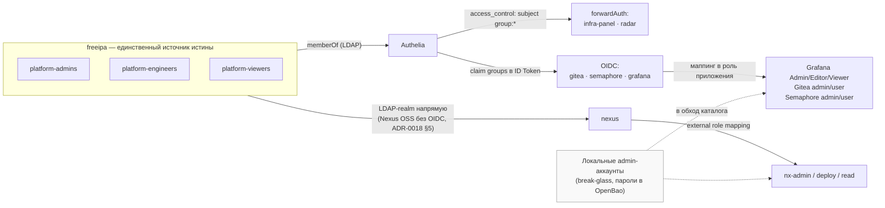

# ADR-0019: Ролевая модель доступа к компонентам платформы — группы `freeipa` как единый источник прав

- **Статус:** Предложено (архитектурное решение; реализация не начата)
- **Дата:** 2026-09-02
- **Авторы:** Ivan Vinogradov (решения), Claude Code (оформление по итогам обсуждения)

## Контекст

ADR-0013 закрыл **аутентификацию**: единый каталог (`freeipa`), Authelia как OIDC-провайдер и
`forwardAuth`-шлюз, реальные логины проверены живым прогоном на `platform/aicd` и
`platform/aicd-devops-labs-ru`. **Авторизации в этом контуре нет вовсе** — проверено по коду на
2026-09-02:

| Слой | Фактическое состояние |
|---|---|
| `freeipa` | Каталог пуст: только сервисные bind-аккаунты `svc-authelia`, `svc-nexus`, `svc-monitoring`. Групп нет ни одной. ADR-0011 §3 сознательно выводит данные каталога за границы роли |
| Authelia `access_control` | `default_policy: deny`, но правила — только по домену (`infra-panel`/`radar` → `one_factor`, `sso` → `bypass`). Условий `subject:`/`group:` нет |
| OIDC-клиенты | `semaphore`/`gitea`/`grafana` — у всех `authorization_policy: one_factor` |
| claim `groups` | Не выдаётся никому: `claims_policies` протаскивают в ID Token только `email` (+`nickname` для Gitea) |
| Grafana | `role_attribute_path` не задан → любой вошедший получает дефолтную роль организации; Admin — только локальный аккаунт |
| Gitea / Semaphore | Авторегистрация OIDC без маппинга групп; админ — только локальный (`gitea_admin`, `admin`) |
| Nexus | LDAP-realm активен, `groupType: DYNAMIC` + `userMemberOfAttribute: memberOf` — **группы уже читаются каталогом**, но ни одной Nexus-роли на LDAP-группу не заведено → LDAP-пользователь входит с нулевыми правами |

Практический смысл этого состояния: **любой заведённый в каталоге человек получает одинаковый
доступ ко всей платформе** — от дашбордов Grafana до Semaphore, запускающего ansible на живой
инфраструктуре. Пока в каталоге нет ни одного реального пользователя, это безопасно; в момент
заведения второго человека это становится дырой. ADR-0013 «Не проработано» фиксирует и пустой
каталог, и `one_factor` как осознанный MVP-охват — этот ADR закрывает оба пункта.

Смежное, но **не покрываемое** здесь: доступ к самому `kube-apiserver` (`kubectl`) — ROADMAP №55,
отдельный компонент (Dex/OIDC перед apiserver) и отдельный маппинг `groups`→`ClusterRoleBinding`.

## Схема: одна группа — две точки контроля



*Ключевое: группа одна, а решений по ней принимается два — «пускать ли вообще» (Authelia или
LDAP-realm Nexus) и «кем пустить внутрь приложения» (нативный маппинг сервиса). Пунктиром —
аварийный путь, который сознательно остаётся в обход каталога (§7).*

## Решения

### 1. Три сквозные группы-персоны, а не группа на каждый сервис

**Решение:** базовая модель — три группы, описывающие **роль человека на платформе**, а не набор
сервисов: `platform-admins`, `platform-engineers`, `platform-viewers`. Каждый сервис
самостоятельно отображает эти три группы в свои внутренние роли (§6). Группа под конкретный
сервис заводится только как точечное исключение, когда трёх персон реально не хватает — не по
умолчанию.

**Обоснование:** per-service схема (`grafana-admins`, `gitea-users`, `nexus-deployers`, …) даёт
комбинаторный рост: 6 сервисов × 3 уровня = 18 групп, которые нужно держать в голове и
синхронно сопровождать при добавлении каждого следующего аддона (ADR-0017 явно предполагает, что
аддоны будут добавляться). Персоны отражают то, как доступ реально выдаётся на практике —
«новый инженер в команду», а не «доступ к Grafana отдельно от доступа к Gitea». Обратная
совместимость с точностью сохраняется escape-hatch'ем: сервис-специфичная группа остаётся
возможной, но каждая такая группа — осознанное отклонение, а не норма.

### 2. Схема именования с заделом под мультитенантность ADR-0015

**Решение:** имена групп строятся по фиксированной схеме `<область>-<квалификатор>-<уровень>`:

| Префикс | Назначение | Примеры |
|---|---|---|
| `platform-` | Платформенные персоны (§1) и сервисные исключения | `platform-admins`, `platform-engineers`, `platform-viewers`, `platform-grafana-admins` (исключение) |
| `proj-` | Права внутри конкретного проекта-тенанта (ADR-0015 §2) — **зарезервировано, не заводится сейчас** | `proj-acme-admins`, `proj-acme-engineers` |
| `svc-` | **Занято**: сервисные bind-аккаунты (`svc-authelia`/`svc-nexus`/`svc-monitoring`) — под группы не использовать | — |

Уровни — фиксированный закрытый список `admins`/`engineers`/`viewers`, одинаковый на всех
областях.

**Обоснование:** `svc-`-коллизия — не гипотетическая: три аккаунта с этим префиксом уже живут в
каталоге, и группа `svc-nexus-admins` рядом с пользователем `svc-nexus` читалась бы как «группа
этого аккаунта». Зафиксировать префиксы до появления второй области дешевле, чем переименовывать
группы, на которые уже завязаны `access_control`, JMESPath-выражения Grafana и external role
mapping Nexus. `proj-`-ветка резервируется, но **не реализуется**: ADR-0015 сам ещё в статусе
«Предложено», а проектная изоляция требует не только групп, но и решения, как проект отображается
в контейнеры прав самих приложений (организации Gitea, проекты Semaphore) — см. «Не проработано».

Механизм наследования базовых прав проектной группой — вложенные группы FreeIPA
(`ipa group-add-member platform-engineers --groups=proj-acme-engineers`): `memberOf` вычисляется
транзитивно, поэтому и Authelia, и Nexus увидят обе группы без дополнительной настройки.

### 3. Данные каталога — новая роль `freeipa_directory`, отдельная от `freeipa`

**Решение:** группы и учётные записи людей заводит **новая роль коллекции `freeipa_directory`** —
декларативно и идемпотентно, поверх уже поднятого сервера. Роль `freeipa` не расширяется, а
оркестрация окружения (`site.yml`) перестаёт быть местом, где заводятся аккаунты.

Ориентировочная схема переменных (детали — на этапе реализации):

```yaml
freeipa_directory_groups:
  - name: platform-admins
    description: "Полные права на все компоненты платформы"

freeipa_directory_users:
  - name: ivan
    first: Ivan
    last: Vinogradov
    email: ivan@aicd.platform
    groups: [platform-admins]
```

**Обоснование:** три варианта размещения разобраны явно.

- *Расширить `freeipa`* — пересматривает ADR-0011 §3 («роль — только каталог, не данные») и
  делает роль непригодной для сценария «сервер разворачиваем мы, наполняет заказчик».
- *Оставить в `site.yml`* — так сейчас заводятся `svc-*`-аккаунты, и для трёх сервисных bind'ов
  это было соразмерно. Для ролевой модели — нет: одинаковый набор групп нужен обоим окружениям
  (`platform/aicd`, `platform/aicd-devops-labs-ru`) и всем будущим стендам, а `site.yml`
  копируется между окружениями целиком — расхождение групп между стендами стало бы вопросом
  времени. Ровно тот же аргумент, что уже привёл к вынесению Radar/infra-panel/Authelia в общие
  `helm/values` вместо копипасты (ADR-0013 §6, ADR-0017).
- *Отдельная роль* — сохраняет границу ADR-0011 §3 дословно (`freeipa` = сервер,
  `freeipa_directory` = данные), переиспользуется обоими окружениями, покрывается собственным
  molecule-сценарием поверх сценария `freeipa`.

Два свойства роли фиксируются решением, а не оставляются на усмотрение реализации:

1. **Аддитивность по умолчанию.** Роль создаёт и обновляет объекты из списков, но **не удаляет**
   пользователей/группы, которых в списках нет. Удаление — отдельный явный флаг (`*_prune`,
   дефолт `false`). Каталог — не только про платформу: там же живут `svc-*`-аккаунты и всё, что
   заведено вручную; «декларативный» прогон, вычищающий незнакомое, снёс бы работающий доступ.
2. **Пароли людей — из OpenBao и с обязательной сменой при первом входе.** Для `svc-*`-аккаунтов
   применён `--password-expiration` далеко в будущем (пароль сервисный, интерактивного входа нет).
   Для людей нужно ровно обратное — дефолтное поведение FreeIPA «сменить при первом входе»
   сохраняется, иначе первичный пароль из ansible остаётся действующим бессрочно.

### 4. Группы доезжают до потребителя claim'ом `groups` **в ID Token**, не через `/userinfo`

**Решение:** к OIDC-клиентам добавляется scope `groups`, и группы принудительно переносятся в ID
Token через `claims_policies` — тем же механизмом, которым уже перенесены `email` и `nickname`.

**Обоснование:** это не предположение, а уже оплаченная в этом репозитории находка: ADR-0013 §9
зафиксировал, что и Semaphore, и Gitea читают claim'ы **из ID Token** и не ходят в `/userinfo`,
из-за чего `email` пришлось протаскивать явной `claims_policy`. У `groups` ровно та же природа
(нестандартный для ID Token claim), поэтому попытка «просто добавить scope» предсказуемо даст тот
же класс ошибки. Формулируем это решением заранее, чтобы не переоткрывать находку живым прогоном.

Отдельно: `claims_policy` **не выдаёт прав на claim**, а только переносит уже разрешённый
scope'ом claim в токен — значит `groups` обязан быть и в `scopes` клиента (та же оговорка, что уже
записана в комментарии к `nickname` в `authelia/values.yaml`).

### 5. Два независимых уровня контроля: допуск и роль внутри приложения

**Решение:** одна и та же группа проверяется дважды, разными механизмами, и это не дублирование:

1. **Допуск** — Authelia решает, пускать ли пользователя к сервису вообще:
   `access_control.rules[].subject: ['group:platform-...']` для `forwardAuth`-потребителей и
   именованные политики `identity_providers.oidc.authorization_policies` вместо нынешнего
   плоского `authorization_policy: one_factor` — для OIDC-клиентов.
2. **Роль внутри приложения** — сам сервис по claim `groups` (или по LDAP-группе, в случае Nexus)
   решает, кем пустить: админом, редактором или читателем (§6).

**Обоснование:** только первый уровень означал бы, что любой допущенный до Grafana получает права
администратора Grafana; только второй — что Authelia пропускает к сервису кого угодно, а сервис
разбирается сам (и молча заводит аккаунт авторегистрацией, как Gitea делает сейчас). Первый
уровень при этом ещё и единственный, который работает для `infra-panel`/`radar` — у них нет
никаких внутренних ролей вообще.

### 6. Маппинг персон на роли конкретных сервисов

**Решение:** целевая матрица. Столбец «Механизм» — что именно правится; отметка «требует сверки»
означает, что возможность **не подтверждена ни кодом репозитория, ни живым прогоном** и должна
быть проверена до реализации, а не предполагаться.

| Сервис | `platform-admins` | `platform-engineers` | `platform-viewers` | Механизм |
|---|---|---|---|---|
| infra-panel | доступ | доступ | доступ | `access_control.subject` (внутренних ролей нет) |
| radar | доступ | доступ | доступ (UI и так read-only) | `access_control.subject` |
| Grafana | Admin | Editor | Viewer | `auth.generic_oauth.role_attribute_path` (JMESPath по `groups`) + `role_attribute_strict: true`; `allow_assign_grafana_admin` — по необходимости |
| Gitea | admin | обычный пользователь | restricted-пользователь | `gitea admin auth add-oauth`: `--group-claim-name`/`--admin-group`/`--restricted-group` — **требует сверки** с версией Gitea и с тем, пробрасывает ли чарт эти флаги |
| Semaphore | admin | обычный пользователь | — (не пускать) | Маппинг админа из claim — **требует сверки** (v2.19.8, `SEMAPHORE_OIDC_PROVIDERS`); если не поддерживается — только допуск через Authelia, админ остаётся локальным (§7) |
| Nexus | `nx-admin` | роль с правами publish/deploy | read-only | External role mapping LDAP-группы → роль Nexus; идемпотентно через REST — **требует сверки** схемы (`/service/rest/v1/security/roles`) в OSS-редакции |
| OpenBao | root/policy (вне каталога) | — | — | Не интегрируется этим ADR — см. «Не проработано» |

**Обоснование:** `platform-viewers` намеренно не допускается в Semaphore: Semaphore запускает
ansible против живой инфраструктуры, и «безопасного read-only» там нет — просмотр истории задач
уже раскрывает инвентарь и вывод плейбуков. Для Grafana `role_attribute_strict: true` существен:
без него пользователь, не попавший ни в одну группу (например, `svc-*`-аккаунт или человек,
заведённый в каталоге вне платформенных групп), получил бы дефолтную роль организации вместо
отказа.

### 7. Локальные admin-аккаунты остаются как break-glass

**Решение:** существующие локальные администраторы (`admin` Nexus, `gitea_admin`, `admin`
Semaphore, admin Grafana, root-токен OpenBao) **не отключаются** при включении ролевой модели.
Пароли — там же, где сейчас (OpenBao). Local Authenticating Realm Nexus остаётся активным рядом с
`LdapRealm`, как и решено в ADR-0018 §5.

**Обоснование:** вся ролевая модель висит на двух точках отказа — `freeipa` (одна VM, без
репликации, ADR-0011) и Authelia (один под). Если любая из них недоступна, платформа без
break-glass становится недоступна администратору именно в тот момент, когда её нужно чинить.
Это сознательный компромисс: остаточные локальные пароли — плата за возможность войти в Nexus и
Grafana, когда каталог лежит.

### 8. Порядок внедрения: сначала данные, только потом ужесточение политик

**Решение:** фиксированная последовательность, а не рекомендация:

1. `freeipa_directory` заводит группы и **как минимум одного реального человека** в
   `platform-admins`.
2. Authelia начинает отдавать `groups` (scope + `claims_policy`), политики допуска при этом
   **остаются прежними** (`one_factor`).
3. Живой клик-тест: вход каждым из потребителей, claim `groups` реально виден в ID Token
   (проверять по токену/логам сервиса, а не по факту «логин прошёл»).
4. Включается маппинг ролей внутри приложений (§6) — на этом шаге ошибка ещё не запирает доступ,
   а лишь выдаёт неверную роль.
5. Только теперь `access_control`/`authorization_policies` ужесточаются с `one_factor` до
   group-gated.

**Обоснование:** шаги 1 и 5, выполненные в обратном порядке, дают гарантированную блокировку:
`default_policy: deny` плюс правило, требующее членства в группе, которой ещё нет ни у кого,
означает, что `infra-panel` и `radar` перестают пускать вообще всех, включая того, кто это
включил. Тот же принцип «фундамент → следующий слой», которым уже шли `freeipa` → Authelia →
`forwardAuth` → OIDC (ADR-0013) и нода `llm1` (ADR-0015 §10).

## Не проработано (следующие шаги)

- **Маппинг админа в Semaphore** — ключевая неизвестная §6: если `SEMAPHORE_OIDC_PROVIDERS`
  (v2.19.8) не умеет назначать админа по claim'у, у Semaphore остаётся ровно два состояния
  (пустили/не пустили), а администрирование — через локальный аккаунт. Проверить до реализации,
  от этого зависит, нужна ли сервис-специфичная группа-исключение (§1).
- **External role mapping в Nexus OSS через REST** — в репозитории уже автоматизированы
  LDAP-сервер и активация realm'а, но маппинг групп на роли ни разу не делался; неизвестно,
  покрыт ли он публичным REST в OSS-редакции или только UI. Если только UI — это ломает принцип
  «стенд разворачивается одним прогоном» и требует отдельного решения.
- **OpenBao** — единственный компонент платформы, полностью вне каталога (root-токен и политики).
  LDAP/OIDC auth method у OpenBao есть, но это отдельная работа с ревизией ADR-0016 (кто и как
  получает какие политики), не «ещё один потребитель групп».
- **Проектные группы `proj-*`** (§2) — зарезервирован только префикс. Не решено, как проект
  отображается в контейнеры прав самих приложений (организация/команда Gitea, проект Semaphore,
  папка/folder Grafana) и кто их заводит — это часть мультитенантности ADR-0015, а не этого ADR.
- **`kubectl`/kube-apiserver** — вне охвата, ROADMAP №55.
- **Сервисы вне платформенной сети** — `monitoring_server`/Grafana клиентских стендов и
  `reverse_proxy_*` заказчиков: то же ограничение, что уже зафиксировано в ADR-0013
  «Не проработано» (нет сетевого маршрута к платформенной Authelia), ролевая модель его не
  снимает.
- **Аудит** — «кто и когда получил доступ» этим ADR не решается: Authelia логирует входы, но
  единого журнала выдачи/отзыва прав (кто добавил человека в `platform-admins`) нет.
- **Отзыв доступа** — при удалении человека из группы `pre_configured_consent_duration: '1 year'`
  (ADR-0013 §10) и живые сессии приложений не инвалидируются мгновенно; фактическое время отзыва
  и нужно ли его сокращать — не проработано.

## Ссылки

- `docs/adr/0011-freeipa-role.md` §3 — граница «роль = сервер, не данные каталога», которую
  сохраняет решение §3; открытый вопрос №2 того ADR (`*_auth_method`) закрыт ADR-0013 §4.
- `docs/adr/0013-unified-auth-architecture.md` — аутентификация, поверх которой строится эта
  авторизация; §9 — находка «claim'ы читаются из ID Token, не из `/userinfo`» (обоснование §4);
  §10 — `consent_mode`/срок согласия (влияет на отзыв прав); «Не проработано» — пустой каталог и
  `one_factor`, закрываемые этим ADR.
- `docs/adr/0018-internal-caching-proxy.md` §5 — Nexus как единственный потребитель LDAP напрямую
  (OSS без OIDC), уже читающий `memberOf` (`groupType: DYNAMIC`).
- `docs/adr/0017-platform-cicd-default-addons.md` — набор аддонов, каждый из которых становится
  потребителем ролевой модели (обоснование §1 — почему модель должна переживать добавление
  следующего аддона).
- `docs/adr/0015-ai-agent-platform-architecture.md` §2 — `Projects` как единица изоляции
  тенантов, под которую резервируется префикс `proj-` (§2); «Не проработано» того ADR —
  межагентная авторизация, смежная и не покрытая здесь.
- `docs/adr/0016-openbao-secrets-pki.md` — хранилище паролей (первичные пароли пользователей §3,
  break-glass §7); интеграция самого OpenBao с каталогом — вне охвата.
- `ROADMAP.md` №55 — единая авторизация для `kube-apiserver` (Dex/OIDC + `groups`→RBAC),
  смежная область за пределами этого ADR.
- [Authelia — Access Control](https://www.authelia.com/configuration/security/access-control/) —
  `subject: ['group:...']` для `forwardAuth`-потребителей (§5).
- [Authelia — OpenID Connect Authorization Policies](https://www.authelia.com/configuration/identity-providers/openid-connect/provider/) —
  именованные политики вместо плоского `one_factor` (§5).
- [Authelia — OpenID Connect Claims](https://www.authelia.com/configuration/identity-providers/openid-connect/claims/) —
  `claims_policies`, механизм переноса `groups` в ID Token (§4).
- [Grafana — Generic OAuth, `role_attribute_path`](https://grafana.com/docs/grafana/latest/setup-grafana/configure-security/configure-authentication/generic-oauth/) —
  маппинг групп в Admin/Editor/Viewer (§6).
