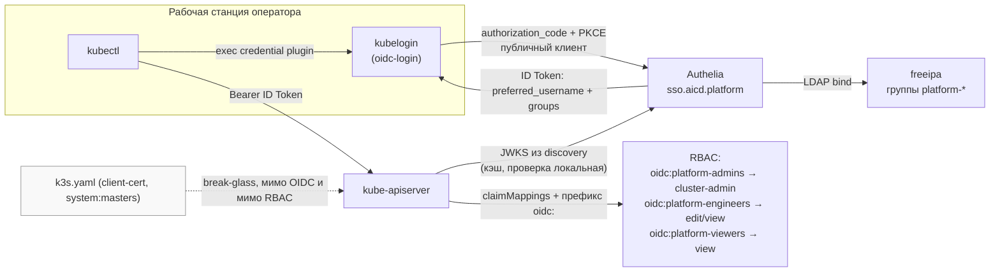

# ADR-0020: Доступ к `kube-apiserver` по OIDC — Authelia как issuer, группы `freeipa` как RBAC-субъекты

- **Статус:** Предложено (архитектурное решение; реализация не начата)
- **Дата:** 2026-09-02
- **Авторы:** Ivan Vinogradov (решения), Claude Code (оформление по итогам обсуждения)

> Этот ADR **пересматривает вывод ADR-0013 §5** в части выбора провайдера для ROADMAP №55
> (там было записано «отдельный компонент, Dex или аналог, а не Authelia»). Основание пересмотра
> — §1 ниже.

## Контекст

ADR-0013 закрыл аутентификацию для приложений за reverse-proxy, ADR-0019 — авторизацию в них же
через группы `freeipa`. Оба ADR явно выводят `kubectl` за периметр и передают его в ROADMAP №55.
Фактическое состояние доступа к самим кластерам на 2026-09-02, проверено по коду:

| Что | Фактическое состояние |
|---|---|
| Аргументы `kube-apiserver` | Не задаются вовсе. `platform/aicd` и `platform/aicd-devops-labs-ru` подключают `xanmanning.k3s` без единого ключа `k3s_server` (`ansible/site.yml`, «Установить K3s»). У роли `monitoring_server` `k3s_server` есть, но только ради `disable: [local-storage]` (`meta/main.yml`) |
| Единственный способ получить доступ | `/etc/rancher/k3s/k3s.yaml`, снятый `ansible.builtin.fetch` на control-хост, с подменой `127.0.0.1` на IP ноды (`site.yml`, «Снять kubeconfig с control-хоста») |
| Что представляет собой этот доступ | Клиентский сертификат группы `system:masters`. Он **обходит RBAC целиком** — привязать к нему ограничения невозможно в принципе |
| Привязка к человеку | Отсутствует. Файл лежит рядом с плейбуком, копируется как обычный артефакт; в аудите apiserver все действия выглядят как один и тот же субъект |
| Отзыв доступа | Невозможен без ротации CA кластера — у client-cert нет ни срока в пределах разумного, ни списка отзыва в k3s по умолчанию |

Практический смысл: **ролевая модель ADR-0019 обходится одним файлом.** Человек, которому по
ADR-0019 полагается `platform-viewers`, получив `k3s.yaml`, становится администратором кластера,
внутри которого живут Authelia, OpenBao и весь платформенный стек — включая секреты, из которых
эта ролевая модель и состоит. Пока оператор один, это терпимо; в момент появления второго
человека это главная оставшаяся дыра контура.

### Схема: где появляется OIDC

*Ключевое: apiserver обращается к Authelia только за JWKS-ключами и кэширует их — проверка токена
происходит локально. Недоступность Authelia блокирует **выдачу** новых токенов, но не работу уже
выданных и не работу кластера. Пунктиром — путь, сознательно остающийся в обход всего (§7).*

## Решения

### 1. Issuer — Authelia напрямую, без Dex

**Решение:** OIDC-issuer'ом для `kube-apiserver` выступает **уже развёрнутая Authelia**. Отдельный
компонент (Dex или аналог) не вводится. `kubectl` становится четвёртым OIDC-клиентом рядом с
`semaphore`/`gitea`/`grafana`. Вывод ADR-0013 §5 («для №55 — отдельный компонент, не Authelia»)
данным решением отменяется.

**Обоснование:** аргументы §5 пересмотрены по двум пунктам, третий — новый.

- *Фактическая посылка §5 больше не верна.* §5 опирался на тезис «апстрим прямо не позиционирует
  эту реализацию как issuer для сервисов, которым нужны кастомные claims под RBAC». На 2026-09-02
  у Authelia есть **официальная страница интеграции именно с `kubelogin`** и отдельная страница
  «Tested Versions» — ровно этот сценарий документирован апстримом.
- *Beta-риск реален, но уже принят платформой и не расширяется этим решением.* OIDC-провайдер
  Authelia по-прежнему не GA (beta 8 из 9 плюс отдельная стадия GA, v4.40.0), апстрим просит
  повышенной осторожности, и ломающие изменения заявлены **в самой beta 8** — удаление
  plaintext-паролей и переработка consent-policy, что напрямую задевает `consent_mode:
  pre-configured` из ADR-0013 §10. Но этот же провайдер уже обслуживает три продовых клиента:
  перечисленное уронит логины Gitea/Semaphore/Grafana независимо от того, подключён кластер или
  нет. Четвёртый клиент **не создаёт нового класса риска**, а последствие сбоя для кластера
  ограничено — break-glass client-cert (§7) не зависит от OIDC вообще. Обратное неверно и стоит
  назвать прямо: этот ADR **повышает цену** уже принятого beta-риска, потому что к сломанным
  логинам добавляется сломанный `kubectl`. Именно поэтому §7 — не формальность.
- *Dex не даёт изоляции, ради которой его стоило бы вводить.* Изоляция от смены провайдера —
  главный довод за шим — здесь иллюзорна: при переходе на другой IdP коннектор Dex всё равно
  переконфигурируется (та же работа), а сам Dex остаётся навсегда. При этом он изолирует одного
  потребителя из шести — Gitea, Semaphore, Grafana, Nexus и `forwardAuth`-панели подключены к
  Authelia напрямую и переезжают в любом случае; стоимость миграции определяется этими пятью.
  Настоящий слой изоляции уже построен и это `freeipa` (ADR-0019): группы живут в каталоге, любой
  IdP — только проектор. Вариант «Dex поверх Authelia» разобран и отброшен отдельно: он сохраняет
  зависимость от beta-OIDC Authelia (потребляет её как upstream-коннектор) **и** добавляет
  компонент — худшее из двух.
- *Цена Dex в этом стенде — не «один под».* Helm-релиз, TLS-сертификат из внутреннего PKI,
  bind-аккаунт `svc-dex` в каталоге, секрет в OpenBao, свой `values.yaml`, ещё одно звено в
  цепочке холодного старта и вторая форма логина мимо портала Authelia. Для шима под одного
  потребителя это противоречит критерию «лёгкие однобинарные инструменты», которым ADR-0013 §2/§5
  обосновывали отказ от Keycloak.

### 2. Механизм на стороне apiserver — `AuthenticationConfiguration`, не флаги `--oidc-*`

**Решение:** используется **structured authentication configuration** — файл
`AuthenticationConfiguration` на ноде, подключаемый через
`kube-apiserver-arg: authentication-config=<path>`. Устаревшее семейство `--oidc-issuer-url`/
`--oidc-client-id`/`--oidc-groups-claim` не применяется.

**Обоснование:** оба кластера закреплены на `k3s_release_version: v1.35.1+k3s1`, а structured
authentication configuration **вышла в GA именно в v1.35** (доступна с 1.29, stable с 1.34) — то
есть формулировка ROADMAP №55 «просто `--kube-apiserver-arg=oidc-*`» устарела ещё до начала
реализации. Три практических следствия, каждое существенно для этого стенда:

1. **Горячая перезагрузка — но только для содержимого уже существующего файла.** После того как
   `--authentication-config=<path>` один раз добавлен в аргументы apiserver'а, дальнейшие правки
   маппинга (например, RBAC-привязок §6) подхватываются без рестарта. Сама ПЕРВАЯ активация флага
   (§9 шаг 3) — это новый CLI-аргумент apiserver'а, а не правка файла, поэтому k3s в этот момент
   перезапускается как обычно при смене `k3s_server`. Для single-node кластеров (оба платформенных
   окружения — одна control-plane нода) это короткое, но реальное окно недоступности apiserver'а
   именно на шаге 3, а не «правка маппинга без даунтайма платформы» — это свойство относится к
   шагу 4 и последующим, не к самой активации.
2. **CEL для маппинга и валидации claim'ов** вместо фиксированной семантики флагов: имя
   пользователя и список групп вычисляются выражением, а `claimValidationRules` позволяют
   отвергнуть токен, у которого нет ожидаемого claim'а, — вместо молчаливого входа с пустым
   набором групп.
3. **Несколько issuer'ов** поддерживаются одновременно — то есть будущая замена провайдера (§4)
   выполняется параллельным добавлением второго issuer'а, а не «выключили старый, включили новый».

Задание самого аргумента — через `k3s_server` роли `xanmanning.k3s`, тем же приёмом, которым
`monitoring_server` уже задаёт `disable: [local-storage]`, плюс `ansible.builtin.template` для
самого файла конфигурации.

Осознанное расхождение с апстримом, которое стоит зафиксировать, чтобы не «чинить» его при
реализации: официальная страница интеграции Authelia с `kubelogin` (§1) показывает именно
**устаревшие флаги** `--oidc-issuer-url`/`--oidc-client-id`/`--oidc-groups-claim`, а её раздел
«Tested Versions» проверялся на Authelia v4.39.20 и Kube Login v1.33.0. Мы следуем этой странице
в части настройки клиента (§3), но **не** в части apiserver — на v1.35 флаги остаются рабочими,
однако лишают горячей перезагрузки, CEL и нескольких issuer'ов, то есть всех трёх свойств, ради
которых §2 и принимается.

### 3. Клиент — `kubelogin` как exec credential plugin, публичный клиент с PKCE

**Решение:** на рабочей станции оператора устанавливается
[`int128/kubelogin`](https://github.com/int128/kubelogin) (`kubectl oidc-login`); kubeconfig
использует секцию `exec`, а не `auth-provider`. В Authelia заводится клиент с `public: true` и
`require_pkce: true`, без client secret, с `redirect_uris` на `http://localhost:8000` и
`http://localhost:18000`.

**Обоснование:** это не выбор из удобства, а единственный оставшийся путь — встроенный в
`client-go` OIDC `auth-provider` объявлен устаревшим в Kubernetes 1.22 и **удалён в 1.26**;
kubeconfig с `auth-provider: oidc` на v1.35 просто не работает. Публичный клиент с PKCE, а не
конфиденциальный с секретом, — потому что client secret, раздаваемый на рабочие станции
операторов, секретом не является; PKCE закрывает ровно тот класс атак, ради которого секрет там
был бы нужен. Поля `public` и `require_pkce` уже присутствуют в конфигурации Authelia этого
стенда (у всех трёх нынешних клиентов выставлены в `false`) — механизм не новый, меняется только
значение.

Следствие для эксплуатации, которое стоит принять явно: **на рабочей станции появляется
обязательный сторонний бинарь**. Это плата за отказ от статического kubeconfig, а не побочный
эффект выбора Authelia — при Dex или Keycloak `kubelogin` понадобился бы точно так же.

### 4. Issuer URL — контракт платформы, а не деталь реализации

**Решение:** `https://sso.aicd.platform` (соответственно `https://sso.aicd.devops-labs.ru`)
фиксируется как **стабильный идентификатор issuer'а**, переживающий смену программного
обеспечения за ним. Замена провайдера обязана сохранить этот URL, а не унаследовать URL нового
продукта.

**Обоснование:** прямой ответ на вопрос «сможем ли мы заменить Authelia на Keycloak, если сейчас
откажемся от Dex». Apiserver привязан не к продукту, а к четвёрке «issuer URL + audience + CA +
имена claim'ов»; при сохранённом URL замена сводится к тому, что новый провайдер начинает
отдавать те же discovery и JWKS — ключи подтягиваются автоматически. Keycloak по умолчанию
публикует issuer как `https://<host>/realms/<realm>`, что настраивается frontend-URL'ом, но
решать это нужно сейчас: зафиксированный заранее URL — дешёвое решение, а перевыпуск токенов и
одновременная перенастройка шести потребителей в момент миграции — дорогое. Механизм нескольких
issuer'ов (§2) делает переход ещё и обратимым: новый добавляется рядом со старым, а не вместо.

### 5. Резолвинг issuer'а и доверие CA на самой ноде

**Решение:** на control-plane ноду добавляются (а) запись `/etc/hosts` вида
`<IP ноды> sso.aicd.platform` и (б) явный путь к PEM внутреннего PKI CA в поле
`issuer.certificateAuthority` файла `AuthenticationConfiguration`.

**Обоснование:** без этого связка не заработает, и обе причины видны заранее, до первого прогона.

- *DNS.* Домены `*.aicd.platform` существуют только в `/etc/hosts` операторов и в ConfigMap
  `coredns-custom` **внутри** кластера (`site.yml`, комментарий у «Определить ClusterIP
  встроенного в k3s Traefik»). Процесс `kube-apiserver` работает на хосте и резолвит через
  `/etc/resolv.conf` ноды — CoreDNS ему недоступен. Приём с `/etc/hosts` на ноде в репозитории уже
  устоялся: ровно так решены `gitea` и `nexus-cache` для containerd на `llm1`
  (`platform/aicd-devops-labs-ru/ansible/site.yml`).
- *TLS.* Внутренний CA уже кладётся в системный trust store ноды
  (`/usr/local/share/ca-certificates/aicd-platform-ca.crt` + `update-ca-certificates`), но
  apiserver для проверки issuer'а системным хранилищем **не пользуется** — ему нужен явно
  указанный CA. Файл уже есть на диске, требуется только сослаться на него.

### 6. RBAC: префикс `oidc:` обязателен, три привязки, `platform` namespace исключён из `edit`

**Решение:** `claimMappings.username.prefix` и `claimMappings.groups.prefix` — оба `oidc:`
(непустые). Целевые привязки:

| Группа каталога | Субъект RBAC | Права |
|---|---|---|
| `platform-admins` | `oidc:platform-admins` | `ClusterRoleBinding` → `cluster-admin` |
| `platform-engineers` | `oidc:platform-engineers` | `ClusterRoleBinding` → `view` (весь кластер) + `RoleBinding` → `edit` в `monitoring` и `cache` |
| `platform-viewers` | `oidc:platform-viewers` | `ClusterRoleBinding` → `view` |

**Обоснование:** три отдельных момента.

*Префикс — требование безопасности, а не косметика.* Без него имя группы из каталога попадает в
RBAC как есть, и человек, способный завести в FreeIPA группу `system:masters`, получает
администратора кластера в обход всего остального. Тот же довод для имени пользователя: без
префикса возможна коллизия с `system:serviceaccount:...`. Префикс делает пространство имён
каталога заведомо непересекающимся со встроенным.

*Почему `platform` namespace исключён из `edit`, хотя решение звучало как «edit в namespace'ах
платформы».* Встроенная роль `edit` **включает чтение и запись Secret'ов** в своём namespace, а в
namespace `platform` живут Authelia и OpenBao. Инженер с `edit` там прочитал бы
`oidc_issuer_private_key` — приватный ключ подписи ID Token — и смог бы выписать себе токен с
группой `platform-admins`, то есть поднять себя до `cluster-admin` в обход каталога. Это
замкнутый цикл: тот самый секрет, на котором держится вся модель, оказался бы доступен субъекту,
которого модель ограничивает. Namespace `platform` управляется Helmwave и Flux, прямой `edit`
там и не является предполагаемым путём изменений (ADR-0014) — поэтому исключение не отнимает
рабочий сценарий, а закрывает escalation-путь. Рабочие namespace'ы инженера — `monitoring` и
`cache`. Изменения в `platform` идут через Semaphore/Flux; аварийные — через break-glass (§7).

`cache` в этом списке безопасен по тому же критерию, каким `platform` исключён — не потому что
namespace'ы разного класса сами по себе, а потому что **сейчас** там нет секрета уровня
`oidc_issuer_private_key`: проверено по коду, `namespace: cache` содержит только `nexus-tls`/
`nexus-cache-tls` (TLS-сертификаты для терминации, не identity-материал). Это негласный инвариант,
а не архитектурное свойство namespace — если в `cache` когда-нибудь появится привилегированный
секрет (например, материализованный в k8s Secret admin-токен Nexus), `edit` там нужно пересмотреть
по той же логике, что и `platform` выше.

*Почему готовые `view`/`edit`, а не свои ClusterRole.* RBAC не умеет запрещать, только разрешать,
поэтому «`edit` минус Secret'ы» невозможно выразить вычитанием — пришлось бы собирать роль с
нуля и сопровождать её при каждом новом CRD. Выбор namespace'ов как границы даёт тот же эффект
меньшей ценой. Пересмотреть, если инженерам реально понадобится запись в `platform`.

### 7. Break-glass: client-cert kubeconfig остаётся, но перестаёт быть рабочим инструментом

**Решение:** `/etc/rancher/k3s/k3s.yaml` не отключается и не ограничивается. Меняется его статус:
из повседневного способа доступа он становится аварийным — не раздаётся людям, а его копия на
control-хосте (`{{ playbook_dir }}/.kube-tmp/`) остаётся только тем, чем является сегодня по
факту — рабочим артефактом ansible/helmwave.

**Обоснование:** прямой аналог §7 ADR-0019 (локальные admin-аккаунты сервисов сохраняются как
break-glass) и обязательное условие для §1: именно существование пути мимо OIDC делает приемлемым
использование beta-провайдера для доступа к кластеру. Сценарии, где он необходим, реальны и не
экзотичны: Authelia не поднялась после рестарта ноды (её ingress зависит от кластера, который она
же аутентифицирует), ломающее изменение в апстриме, ошибка в самом файле
`AuthenticationConfiguration`. Отключение локального доступа ради чистоты модели создало бы
ситуацию, из которой нет выхода без консоли гипервизора.

Честная оговорка, которую решение не снимает: этот сертификат — `system:masters`, он обходит
RBAC и не отзывается иначе как ротацией CA кластера. То есть §7 — не «безопасный запасной путь»,
а принятый риск, ограниченный организационно (кто имеет доступ к ноде и к control-хосту), а не
технически.

### 8. Охват — только платформенные окружения; роль `monitoring_server` не затрагивается

**Решение:** решение применяется к `platform/aicd` и `platform/aicd-devops-labs-ru`. k3s-путь роли
`monitoring_server` остаётся на client-cert; `kube-apiserver-arg` в её `meta/main.yml` не
добавляется.

**Обоснование:** роль коллекции разворачивается на клиентских стендах, у которых **нет сетевого
маршрута к платформенной Authelia** — то же ограничение, что уже зафиксировано в ADR-0013
«Не проработано» для Grafana клиентских стендов. Подключение внешнего issuer'а сделало бы
работоспособность control-plane клиентского кластера зависящей от чужой инфраструктуры, а сама
роль приобрела бы архитектурную связность, которую ADR-0008 §3 и ADR-0011 §3 последовательно
исключают. Если у клиентского стенда появится собственный каталог, это отдельная задача с
собственным решением, а не расширение этого ADR.

### 9. Порядок внедрения

**Решение:** фиксированная последовательность, каждый шаг проверяем отдельно.

1. **Предусловие — ADR-0019.** Группы `platform-*` реально заведены (роль `freeipa_directory`), в
   каталоге есть хотя бы два человека с разными группами, claim `groups` доезжает до ID Token
   (ADR-0019 §4). Без этого проверить §6 нечем.
2. **Клиент `kubernetes` в Authelia** (`public: true`, `require_pkce: true`, scope `groups`) +
   `/etc/hosts` и CA на ноде (§5). Проверка — `curl` discovery-эндпоинта **с самой ноды** и ручной
   логин через `kubectl oidc-login get-token`, до какой-либо правки apiserver.
3. **`AuthenticationConfiguration` без RBAC-привязок.** Первое добавление флага apiserver'у —
   рестарт k3s на единственной control-plane ноде (см. оговорку в §2), не горячий reload; выполнять
   в объявленное окно обслуживания, не «между делом». Ожидаемый результат после рестарта —
   `kubectl` проходит аутентификацию и получает `Forbidden` с именем субъекта `oidc:<username>` и
   группами в сообщении. Это и есть проверка §2/§6: субъект виден, прав нет.
4. **RBAC-привязки** (§6), затем клик-тест ролевой модели: `platform-viewers` не может
   `kubectl delete`, `platform-engineers` может в `monitoring`, но не в `platform`,
   `platform-admins` может всё.
5. **Перевод оператора на OIDC-kubeconfig** и понижение статуса `k3s.yaml` до break-glass (§7).
6. **Перенос на `platform/aicd-devops-labs-ru`** — механически, по образцу ADR-0013 §7→§8.

**Обоснование:** порядок выбран так, чтобы каждый шаг падал отдельно и понятным образом. Шаг 3
специально предшествует шагу 4: если объединить их, невозможно отличить «токен не принят» от
«прав не хватило» — а это два совершенно разных места отладки (issuer/CA/claim'ы против RBAC).
Шаг 2 целиком выполняется до касания apiserver по той же причине: ошибка в discovery или CA не
должна выглядеть как сломанный control-plane.

## Явно вне периметра (v1)

- **Аутентификация сервисных потребителей API** (platform-controller, Flux, Helmwave) — остаются
  на ServiceAccount-токенах и client-cert. OIDC здесь не нужен: у них нет человека, которому
  соответствует запись в каталоге.
- **Аудит-политика apiserver.** OIDC делает возможным различение людей в журнале, но сам журнал
  (`--audit-policy-file`, хранение, доставка в Loki) этим ADR не настраивается.
- **`two_factor` для доступа к кластеру.** Остаётся `one_factor`, как и у остальных потребителей
  — ограничение то же, что в ADR-0013 §2 (enrollment TOTP не автоматизирован).
- **Сетевое ограничение доступа к порту 6443.** Ортогонально аутентификации.

## Верификация

Что считается доказательством работоспособности (не «под запустился»):

1. `kubectl --user=oidc get nodes` под пользователем из `platform-viewers` — успех; тот же
   `kubectl delete pod` — отказ с явным упоминанием `oidc:platform-viewers`.
2. `kubectl auth can-i --list` под каждой из трёх персон даёт три разных набора.
3. Проверка escalation-пути §6: пользователь из `platform-engineers` получает `Forbidden` на
   `kubectl get secret -n platform`.
4. Правка маппинга в `AuthenticationConfiguration` подхватывается **без рестарта** k3s (проверка
   §2) — `systemctl status k3s` показывает тот же PID до и после.
5. Break-glass: при намеренно остановленной Authelia `kubectl` с OIDC не работает, а с
   `k3s.yaml` — работает (проверка §7).
6. Идемпотентность: повторный прогон `site.yml` даёт `changed=0` на задачах §5 и §2.

## Ссылки

- `docs/adr/0013-unified-auth-architecture.md` — аутентификация, поверх которой всё строится;
  §5 — пересматриваемый этим ADR вывод (см. врезку в начале); §9 — находка «claim'ы читаются из
  ID Token, не из `/userinfo`», из-за которой §3 сразу закладывает `groups` в ID Token.
- `docs/adr/0019-platform-rbac-model.md` — группы-персоны `platform-*`, являющиеся субъектами §6;
  §4 — механизм доставки claim `groups`; §7 — паттерн break-glass, воспроизведённый в §7 здесь.
  Пункт «`kubectl`/kube-apiserver — вне охвата, ROADMAP №55» того ADR закрывается этим.
- `docs/adr/0011-freeipa-role.md` §3 — граница «роль = сервер, не данные»; каталог как
  единственный источник истины, переживающий смену IdP (§1, §4).
- `docs/adr/0016-openbao-secrets-pki.md` — внутренний PKI, чей CA используется в §5.
- `docs/adr/0014-platform-controller-architecture.md` — GitOps-путь изменений, из-за которого
  исключение `platform` namespace в §6 не отнимает рабочий сценарий.
- `docs/adr/0008-infra-panel-role.md` §3 — принцип отсутствия кросс-ролевой связности,
  обосновывающий §8.
- `ROADMAP.md` №55 — исходная постановка задачи. Её формулировка развилки («Dex напрямую с
  freeipa vs Dex через Authelia») этим ADR закрывается третьим вариантом, в ней не названным;
  предложение «просто `--kube-apiserver-arg=oidc-*`» устарело — см. §2.
- [Authelia — Kube Login (интеграция с `kubectl oidc-login`)](https://www.authelia.com/integration/openid-connect/clients/kubelogin/)
  — официальная документация сценария, основание §1 и §3.
- [Authelia — OpenID Connect 1.0 Provider (roadmap)](https://www.authelia.com/roadmap/active/openid-connect-1.0-provider/)
  — статус beta 8/9 + GA, основание оговорки о риске в §1.
- [Kubernetes — Authenticating](https://kubernetes.io/docs/reference/access-authn-authz/authentication/)
  — `AuthenticationConfiguration`, `claimMappings`, префиксы (§2, §6).
- [KEP-3331 — Structured Authentication Configuration](https://github.com/kubernetes/enhancements/tree/master/keps/sig-auth/3331-structured-authentication-configuration)
  — стадии зрелости фичи (§2).
- [`int128/kubelogin`](https://github.com/int128/kubelogin/blob/master/docs/setup.md) — exec
  credential plugin (§3).
- [GKE — Deprecated authentication plugin for Kubernetes clients](https://cloud.google.com/kubernetes-engine/docs/deprecations/auth-plugin)
  — удаление встроенного OIDC `auth-provider` в 1.26, основание §3.
