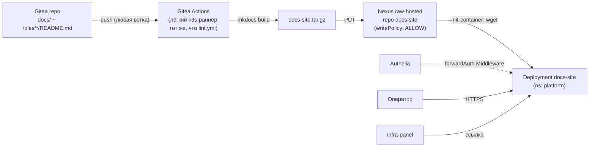

# ADR-0024: Публикация документации платформы внутри стенда

- **Статус:** Принято (решения обсуждены и подтверждены оператором 2026-09-07 — уточняют черновик
  этого же дня; код реализован в обоих окружениях платформы, живой `helmwave up`/CI-прогон
  намеренно не выполнялся в этом заходе — см. «Реализация» ниже)
- **Дата:** 2026-09-07
- **Авторы:** Claude Code (по мотивам ROADMAP №51; первая версия — черновик без обсуждения с
  оператором, эта редакция закрывает все 4 открытых вопроса черновика явными ответами оператора)

## Контекст

`ROADMAP.md` №51 фиксирует асимметрию: документация коллекции (README ролей, `docs/adr/`,
`docs/platform/`, сам ROADMAP) существует только в git-репозитории. Внутри развёрнутого стенда её
читать негде — [infra-panel.md](../platform/infra-panel.md) агрегирует ссылки на сервисы платформы,
но не на саму документацию. Оператору без доступа к git (или без желания искать нужный файл в
дереве репозитория) неоткуда узнать архитектуру уже развёрнутой рядом платформы.

Актуальность вопроса выросла: весь k3s-путь платформы получил полный комплект HLD/LLD/DD-диаграмм в
`docs/platform/*.md` — это win, если он читаем оператором стенда, и бесполезный объём, если он
остаётся исключительно git-артефактом.

ROADMAP №51 прямо оставлял нерешёнными три вопроса и требовал отдельного ADR перед реализацией:
1. Конкретный движок сайта.
2. Какой контент публиковать (весь `docs/` или курируемое подмножество).
3. Нужна ли интеграция с единой авторизацией (ADR-0013/ADR-0019).

Первая версия этого документа была черновиком с решениями по умолчанию, не обсуждёнными с
оператором. Эта редакция фиксирует финальные решения по всем трём вопросам ROADMAP плюс четырём
дополнительным открытым вопросам, которые сам черновик оставил нерешёнными (см. «Решения» ниже —
уточнения отмечены явно там, где решение поменялось относительно черновика). Компонент новый,
поэтому на него полностью распространяется чек-лист `docs/adr/0022-new-component-requirements.md`
— §5 ниже проходит по всем 12 пунктам.

### Схема (реализовано)



## Решения

### 1. Движок — MkDocs Material

**Решение:** [MkDocs Material](https://squidfunk.github.io/mkdocs-material/) — статический
генератор сайта из Markdown.

**Обоснование:**
- Источник — уже чистый Markdown с относительными ссылками, ровно тот формат, который MkDocs
  потребляет без преобразований. Более того, весь массив `docs/platform/*.md` построен на
  mermaid-диаграммах в `` ```mermaid `` code fence — MkDocs Material рендерит их «из коробки» через
  `pymdownx.superfences`, без отдельного JS-плагина и без переписывания диаграмм.
- Статическая сборка, не рантайм-сервис с БД — [Backstage
  TechDocs](https://backstage.io/docs/features/techdocs/) тянет за собой Backstage-бэкенд и
  Kubernetes/Docker-исполнитель сборки, [Docusaurus](https://docusaurus.io/) требует Node.js-
  тулчейн, которого сегодня нет ни у одного компонента коллекции.

### 2. Сборка — CI-джоба Gitea Actions + Nexus raw-hosted репозиторий (уточнение черновика)

**Решение (изменено относительно черновика):** черновик по умолчанию предлагал сборку
init-container'ом самого пода при каждом старте — оператор явно выбрал более тяжёлый, но
традиционный вариант: `mkdocs build` выполняется **CI-джобой** `.gitea/workflows/docs-site.yml`
(тот же лёгкий k3s-раннер, что `.gitea/workflows/lint.yml`, — ADR-0012 §4 прямо допускает
«сборку документации» как задачу этого класса) при `push` в любую ветку (**не** `branches: [main]`
— живым прогоном найдено: реальная разработка коллекции идёт в feature-ветках, `main` зеркала
почти не обновляется напрямую, ограничение веткой означало бы, что джоба никогда не триггерится в
текущем рабочем процессе; тот же принцип, что уже был в `lint.yml`), затрагивающем `docs/**`,
`roles/*/README.md` или `mkdocs.yml`. Собранный сайт упаковывается в `docs-site.tar.gz` и
публикуется в Nexus (`PUT .../repository/docs-site/latest.tar.gz`). Init-container самого пода
(`helm/values/*/namespaces/platform/docs-site/values.yaml`) только скачивает уже готовый архив и
распаковывает в общий `emptyDir`, который раздаёт основной контейнер (`nginx:1.27-alpine`).

**Отдельный raw-hosted репозиторий Nexus `docs-site`, не `internal-releases`.** Существующий
`internal-releases` (ADR-0018 §9) создан с `writePolicy: ALLOW_ONCE` — путь неизменяем после первой
публикации (годится для версионированных бинарей вроде `freeipa-exporter`). `docs-site` пересобирается
и перезаписывается по одному и тому же пути (`docs-site/latest.tar.gz`) при **каждом** push — этому
принципиально нужен `writePolicy: ALLOW`. Смешивать оба паттерна записи в одном репозитории не стали
— заведён второй репозиторий, своя роль `docs-site-publisher` (read/browse/add/edit), свой сервисный
пользователь `svc-docs-site-publisher` (пароль — новое поле `docs_site_publisher_password` в
`secret/nexus`, тот же ретрофит-приём, что `internal_releases_reader_password`).

**Nexus не отдаёт анонимный доступ** (ADR-0018 §9 — anonymous access глобально выключен) —
init-container пода тоже аутентифицируется тем же `svc-docs-site-publisher` (роль включает read,
отдельный read-only аккаунт для единственного внутреннего консьюмера избыточен, в отличие от
`svc-ipa-exporter-reader`, которого читают внешние по отношению к CI хосты-агенты). URL — внутрикластерный
Service Nexus (`nexus.cache.svc.cluster.local:8081`), не публичный домен — тот же приём, что
gitea-actions-runner ходит на `gitea-http.platform.svc.cluster.local`.

**Публикация Gitea Actions secret — ручной шаг, не автоматизация.** CI-джобе нужны
`NEXUS_DOCS_PUBLISHER_USER`/`_PASSWORD` как Gitea Actions secrets. В коллекции нет ни одного примера
автоматизации таких секретов через REST (`PUT /api/v1/repos/{owner}/{repo}/actions/secrets/{name}`),
а owner/repo зеркала самой коллекции нигде не заведены переменной в site.yml (единственный текущий
консьюмер, `.gitea/workflows/lint.yml`, был вручную запушен оператором — тот же класс действия, что
git-push-ограничение агента, зафиксированное для `platform/gitops`/`platform/devops-uslugi` во всей
остальной работе этой сессии). Значения — в Gitea UI из `secret/nexus` (см. README окружений,
«Ручные шаги»), тем же классом действия, что настройка Semaphore Project для `postgresql-infra-1`
(ADR-0023 §7).

### 3. Публикуемый контент — два независимых раздела навигации; `ROADMAP.md` не публикуется

**Решение (подтверждено):** сайт делится на два независимых top-level раздела навигации MkDocs:

1. **«Архитектура»** — `docs/overview.md`, `docs/components.md`, `docs/adr/`, `docs/platform/`.
2. **«Роли коллекции»** — README каждой доступной роли (`roles/*/README.md`).

`ROADMAP.md`, `docs/runbooks/`, `docs/proxmox-templates.md` и
`docs/Requirements Specification/` не публикуются ни в одном из разделов — не входят в список
черновика, staging-скрипт их не копирует.

**Реализация:** `.gitea/scripts/build-docs-site.py` собирает staging-дерево `docs_build/` (две
папки `Архитектура/` и `Роли коллекции/`, не коммитится — `.gitignore`) перед `mkdocs build`.
Взаимные относительные ссылки между разделами (`roles/*/README.md` → `docs/adr/`,
`docs/components.md` → `roles/*/README.md`) переписываются на лету под новую глубину/родителя —
без этого `mkdocs build --strict` не проходил бы (36 предупреждений при первом прогоне, сведено к
8 — оставшиеся ведут на намеренно неопубликованный `ROADMAP.md`/`docs/runbooks/`; из-за них `mkdocs
build` в CI запускается **без** `--strict`, см. комментарий в `.gitea/workflows/docs-site.yml`).

### 4. Доступ — тот же forwardAuth-периметр, что Radar/infra-panel, без ролевой дифференциации

**Решение (подтверждено):** `IngressRoute` + Authelia `forwardAuth` Middleware
(`authelia-forward-auth`) — тот же механизм, что [radar.md](../platform/radar.md) и
[infra-panel.md](../platform/infra-panel.md). Допуск всем трём группам
(`platform-admins`/`platform-engineers`/`platform-viewers`, `docs/adr/0019-platform-rbac-model.md`)
без внутренней дифференциации — сайт read-only, различать внутри него нечего.

### 5. Имя релиза/домен — `docs-site` / `docs.<домен окружения>` (подтверждено)

**Решение:** оператор подтвердил рабочие названия черновика как финальные. Без номера инстанса —
`docs-site` singleton на окружение, как `radar`/`infra-panel`, не подпадает под конвенцию
`<component>-<purpose>-<n>` (ADR-0023 §6/ROADMAP №61), которая — для потенциально-множественных
инфра-компонентов.

### 6. Визуальный бейдж статуса ADR (уточнение черновика)

**Решение (изменено относительно черновика):** черновик оставлял это нерешённым, опасаясь сложности
сборки (`mkdocs-macros`). Оператор подтвердил — бейджи нужны. Реализовано **без** `mkdocs-macros`:
`.gitea/scripts/build-docs-site.py` при копировании `docs/adr/*.md` парсит строку
`- **Статус:** ...`, вставляет `<span class="adr-status adr-status-{draft|proposed|accepted|
implemented}">...</span>` сразу под заголовком H1 — обычный HTML внутри markdown, который MkDocs
Material рендерит без изменений; цвета — `docs/stylesheets/extra.css`, подключён через `extra_css`
в `mkdocs.yml`. Источник правды остаётся строкой «Статус:» в самом ADR — бейдж не редактируется
вручную.

### 7. Развёртывание — тот же паттерн, что у остальных лёгких платформенных сервисов

**Решение:** Helm-релиз через `localrepo/universal-chart` (официального чарта для связки
«init-container + статическая раздача» нет), `namespace: platform`. Применение чек-листа
`docs/adr/0022-new-component-requirements.md`:

| № чек-листа | Решение для `docs-site` |
|---|---|
| §1 Установка из внутреннего репозитория | Образ `nginx:1.27-alpine` — через `docker-hub-proxy` Nexus, не напрямую с `docker.io`; init-container `alpine:3.20` (wget/tar — штатные апплеты busybox, без `apk add`) |
| §2 RBAC сразу | См. §4 выше — все три группы, `access_control.subject` |
| §3 Ссылка в infra-panel | Новая запись в `config.yml` (`docs.<домен>`) |
| §4 Метрики | Экспортёр не заводится — тот же прецедент, что Radar/infra-panel |
| §5 TLS | `docs-site-tls`, тот же цикл `issue-tls-cert.yml` из внутреннего PKI OpenBao |
| §6 DNS | `docs.<домен>` — в `coredns-custom` **и** в README окружения (`/etc/hosts` операторов) |
| §7 Секреты | **Есть** (уточнение черновика, который предполагал «не требуются»): `docs_site_publisher_password` в `secret/nexus` (создание пользователя/роли Nexus — идемпотентно в site.yml) + Gitea Actions secret (ручной шаг, §2 выше) |
| §8 Стаб `releases_common/docs-site.yaml` | Заведён пустым (`---`) до первого `helmwave up --tags docs-site` |
| §9 `resources.requests`/`limits` | Заведены явно для init-container и основного контейнера |
| §10 NetworkPolicy | Явное решение (уточнение черновика, который предполагал egress к Gitea): egress теперь к Nexus (`namespace: cache`, init-container скачивает готовый артефакт) + kube-dns, ничего сверх — сборка ушла в CI, под больше не обращается к Gitea вообще. Общий вопрос default-deny для `namespace: platform` этим ADR не закрывается (ADR-0022 §10 — отдельная, ещё не решённая задача) |
| §11 Резервное копирование | Не требуется — состояние отсутствует (без PVC), сайт полностью восстановим повторным скачиванием артефакта из Nexus при следующем рестарте пода |
| §12 MCP | Не применимо |

**Обоснование:** точное повторение уже устоявшегося паттерна остальных лёгких read-only UI
платформы (Radar, infra-panel) — намеренно без изобретения нового способа разворачивания ради
одного статического сайта.

## Реализация

Код готов для обоих окружений (`platform/aicd`, `platform/aicd-devops-labs-ru`):
`.gitea/workflows/docs-site.yml`, `.gitea/scripts/build-docs-site.py`, `mkdocs.yml`,
`docs/stylesheets/extra.css` (общие для обоих окружений — один и тот же собираемый сайт);
`roles/postgresql`-подобного нового Ansible-role для этого компонента не заведено — `docs-site`,
как `radar`/`infra-panel`(k3s-путь)/`gitea-actions-runner`, чисто Helm+`site.yml`-компонент, без
Ansible-роли (сервер не нуждается в конфигурации за пределами Helm values). Terraform не требуется
— компонент целиком внутри уже существующего k3s.

Локально проверено (без живого кластера): `.gitea/scripts/build-docs-site.py` +
`mkdocs build` — валидный сайт с обоими разделами навигации и бейджами статуса; `helm template`
через `helm/localrepo/universal-chart` с `--api-versions traefik.io/v1alpha1` — Deployment
(init-container + nginx), Service, IngressRoute рендерятся без ошибок для values обоих окружений;
`ansible-lint --profile production`/`--syntax-check` — чисто для всех изменённых Ansible-файлов.

**Явно НЕ выполнено в этом заходе** (по аналогии с `postgresql-infra-1`, ADR-0023): живой
`helmwave up --tags docs-site`, первый реальный прогон `.gitea/workflows/docs-site.yml`, ручная
настройка Gitea Actions secrets, живая проверка (`curl docs.<домен>`, 401 без сессии/200 с ней,
бейджи в браузере). См. ROADMAP №51.

## Явно вне периметра (v1)

- Поиск по документации — MkDocs Material включает клиентский поиск «из коробки», отдельного
  решения не требует, но и не проверялся живым прогоном.
- Версионирование сайта по историческим ревизиям (`mike` — плагин MkDocs для версий) — у стенда
  одна живая версия документации, соответствующая текущему `main`, версионировать нечего.
- Публикация `ROADMAP.md` (§3).

## Ссылки

- `ROADMAP.md` №51 — исходная идея.
- `docs/adr/0012-cicd-platform-architecture.md` §4 — Gitea Actions/лёгкий k3s-раннер, прямо
  допускающий «сборку документации» как задачу этого класса.
- `docs/adr/0018-internal-caching-proxy.md` §9 — `internal-releases`, паттерн raw-hosted
  репозитория и scoped-пользователя, который §2 выше расширяет вторым репозиторием.
- `docs/adr/0019-platform-rbac-model.md` — модель допуска, применённая в §4.
- `docs/adr/0022-new-component-requirements.md` — чек-лист, применённый целиком в §7.
- `docs/adr/0023-postgresql-standalone-role.md` §6/§7 — naming convention (почему `docs-site` без
  номера инстанса) и прецедент «код готов, живые шаги — отдельным заходом».
- [docs/platform/radar.md](../platform/radar.md), [docs/platform/infra-panel.md](../platform/infra-panel.md)
  — ближайшие структурные аналоги (лёгкий read-only UI за `forwardAuth`, `universal-chart`, без PVC).
- [docs/overview.md](../overview.md) — граница «`docs/` = архитектура, README ролей = реализация»,
  сохранённая в §3 как структурное разделение разделов навигации.
- [docs/platform/nexus.md](../platform/nexus.md) — raw-hosted репозитории, `docker-hub-proxy`.
- [docs/platform/gitea-actions-runner.md](../platform/gitea-actions-runner.md) — CI-раннер,
  выполняющий `.gitea/workflows/docs-site.yml`.
