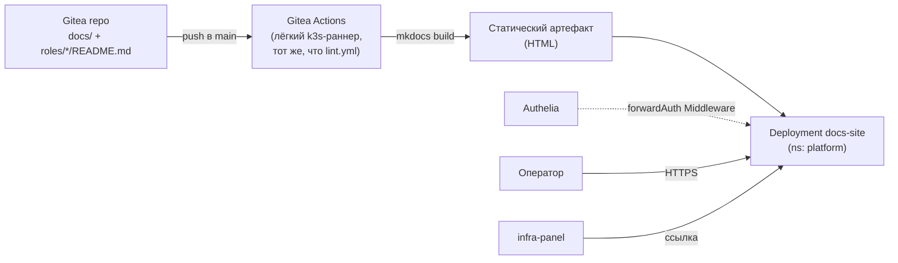

# ADR-0024: Публикация документации платформы внутри стенда

- **Статус:** Черновик (идея зафиксирована в `ROADMAP.md` №51; решения ниже — предложение по
  умолчанию, **не обсуждено с оператором**, требует подтверждения/правки перед реализацией)
- **Дата:** 2026-09-07
- **Авторы:** Claude Code (черновик по мотивам ROADMAP №51, оформлен по запросу, без предварительного
  обсуждения с оператором — в отличие от остальных ADR коллекции)

## Контекст

`ROADMAP.md` №51 фиксирует асимметрию: документация коллекции (README ролей, `docs/adr/`,
`docs/platform/`, сам ROADMAP) существует только в git-репозитории. Внутри развёрнутого стенда её
читать негде — [infra-panel.md](../platform/infra-panel.md) агрегирует ссылки на сервисы платформы,
но не на саму документацию. Оператору без доступа к git (или без желания искать нужный файл в
дереве репозитория) неоткуда узнать архитектуру уже развёрнутой рядом платформы.

Актуальность вопроса выросла: только что (текущей задачей) весь k3s-путь платформы получил полный
комплект HLD/LLD/DD-диаграмм в `docs/platform/*.md` — это win, если он читаем оператором стенда, и
бесполезный объём, если он остаётся исключительно git-артефактом.

ROADMAP №51 прямо оставляет нерешёнными три вопроса и требует отдельного ADR перед реализацией:
1. Конкретный движок сайта.
2. Какой контент публиковать (весь `docs/` или курируемое подмножество).
3. Нужна ли интеграция с единой авторизацией (ADR-0013/ADR-0019).

Этот документ — попытка закрыть все три, но **черновиком**: ниже приведены решения по умолчанию с
обоснованием, а не результат обсуждения с оператором, как у прочих ADR коллекции. Компонент новый,
поэтому на него полностью распространяется чек-лист `docs/adr/0022-new-component-requirements.md`
— решения §5 этого документа явно проходят по всем 12 пунктам.

### Схема (предлагаемая)



## Решения

### 1. Движок — MkDocs Material

**Решение:** [MkDocs Material](https://squidfunk.github.io/mkdocs-material/) — статический
генератор сайта из Markdown.

**Обоснование:**
- Источник — уже чистый Markdown с относительными ссылками, ровно тот формат, который MkDocs
  потребляет без преобразований. Более того, весь массив `docs/platform/*.md` (эта же задача)
  построен на mermaid-диаграммах в `` ```mermaid `` code fence — MkDocs Material рендерит их «из
  коробки» через `pymdownx.superfences`, без отдельного JS-плагина и без переписывания диаграмм.
  Это не гипотетическое удобство, а прямая экономия: десятки уже написанных диаграмм не пришлось
  бы трогать.
- Статическая сборка, не рантайм-сервис с БД — [Backstage
  TechDocs](https://backstage.io/docs/features/techdocs/) тянет за собой Backstage-бэкенд и
  Kubernetes/Docker-исполнитель сборки, [Docusaurus](https://docusaurus.io/) требует Node.js-
  тулчейн, которого сегодня нет ни у одного компонента коллекции. Для ~20 markdown-файлов оба
  варианта избыточны по весу и по новым зависимостям.
- Готовый официальный образ (`squidfunk/mkdocs-material`, `docker.io`) закрывает и сборку, и
  раздачу одним и тем же инструментом — не нужен отдельный веб-сервер поверх.

### 2. Сборка — статический артефакт, собираемый заново при каждом старте пода (v1)

**Решение:** `mkdocs build` выполняется **init-container'ом самого пода** при каждом запуске
(клонирует из Gitea оба публикуемых раздела — `docs/` и `roles/*/README.md`, §3 — строит сайт,
кладёт результат в `emptyDir`, который затем раздаёт основной контейнер — nginx или тот же образ
`mkdocs-material` в режиме serve готовой сборки). Отдельный CI-шаг в Gitea Actions в v1 не
заводится.

**Обоснование:** самый дешёвый вариант по числу новых движущихся частей — не требует ни нового
Nexus-репозитория для хранения артефакта, ни отдельного workflow, ни координации «когда собранный
артефакт готов, когда можно катить под». Цена — пересборка сайта при каждом рестарте пода
(секунды на ~20 файлов) и то, что каждый под должен уметь дотянуться до Gitea по сети — оба
компонента уже в одном кластере, это не новая связность.

**Открытый вопрос, оставленный явно (см. «Открытые вопросы» ниже):** ADR-0012 §4 прямо допускает
использование лёгкого k3s-раннера Gitea Actions для «сборки документации» — то есть вариант
«собирать в CI, публиковать артефакт в Nexus raw-hosted репозиторий, под раздаёт готовое» рассмотрен
и отклонён для v1 по цене (новый Nexus-репозиторий, новый workflow), но не окончательно — стоит
пересмотреть, если время старта пода/нагрузка на Gitea при пересборке станут заметны.

### 3. Публикуемый контент — два независимых раздела навигации; `ROADMAP.md` не публикуется

**Решение:** сайт делится на два независимых top-level раздела навигации MkDocs, не
перемешанных между собой:

1. **«Архитектура»** — `docs/overview.md`, `docs/components.md`, `docs/adr/`, `docs/platform/`.
2. **«Роли коллекции»** — README каждой доступной роли (`roles/*/README.md`), как отдельный
   каталог/справочник по параметрам и примерам вызова ролей.

`ROADMAP.md` не публикуется ни в одном из разделов.

**Обоснование:** граница между архитектурным слоем (`docs/`) и слоем README ролей — та же, что уже
проведена таблицей «Как устроена документация коллекции» в [docs/overview.md](../overview.md), и
она по-прежнему валидна как классификация контента. Но у неё двое разных читателей, а не один: у
`docs/` — тот, кому интересна архитектура платформы целиком, у README ролей — тот, кто прогоняет
конкретную роль коллекции против клиентских хостов и которому нужны её параметры/переменные/
примеры вызова прямо сейчас. Оба читателя — легитимные потребители развёрнутого стенда, поэтому
предыдущая редакция этого черновика (полное исключение README ролей) не соответствовала запросу —
исправлено разнесением по отдельным разделам навигации, а не смешиванием, чтобы граница смыслов
сохранилась хотя бы структурно, раз не публикацией. `ROADMAP.md` остаётся исключённым отдельно:
это черновик идей с разделами «Не проработано» практически у каждого пункта (в том числе у этого
самого пункта №51) — публикация внутреннего бэклога решений как готового сайта создаёт
недостоверное впечатление законченности там, где её нет.

### 4. Доступ — тот же forwardAuth-периметр, что Radar/infra-panel, без ролевой дифференциации

**Решение:** `IngressRoute` + Authelia `forwardAuth` Middleware (`authelia-forward-auth`) — тот же
механизм, что [radar.md](../platform/radar.md) и [infra-panel.md](../platform/infra-panel.md).
Допуск всем трём группам (`platform-admins`/`platform-engineers`/`platform-viewers`,
`docs/adr/0019-platform-rbac-model.md`) без внутренней дифференциации — сайт read-only, различать
внутри него нечего.

**Обоснование:** ROADMAP №51 отдельно отмечает, что документация «не обязательно требует
авторизации вовсе» — в отличие от админ-панелей. Формально это верно, но раз весь остальной веб-UI
платформы уже стоит за этим же Middleware бесплатно (компонент уже развёрнут, добавление ещё одного
потребителя не стоит ничего дополнительно), оставлять единственный сервис открытым — не выигрыш, а
неоднородность модели допуска без причины. Открытый вопрос ROADMAP закрывается в пользу «включить,
раз это ничего не стоит».

### 5. Развёртывание — тот же паттерн, что у остальных лёгких платформенных сервисов

**Решение:** Helm-релиз через `localrepo/universal-chart` (официального чарта для связки
«init-container со сборкой + статическая раздача» нет), `namespace: platform`. Применение чек-листа
`docs/adr/0022-new-component-requirements.md`:

| № чек-листа | Решение для `docs-site` |
|---|---|
| §1 Установка из внутреннего репозитория | Образ `squidfunk/mkdocs-material` — через `docker-hub-proxy` Nexus ([nexus.md](../platform/nexus.md)), не напрямую с `docker.io` |
| §2 RBAC сразу | См. §4 выше — все три группы, `access_control.subject` |
| §3 Ссылка в infra-panel | Новая запись в `config.yml` (`docs.<домен>`) |
| §4 Метрики | Экспортёр не заводится — тот же прецедент, что Radar/infra-panel (простой read-only UI, содержательных метрик за пределами «под жив» нет) |
| §5 TLS | `docs-site-tls`, тот же цикл `issue-tls-cert.yml` из внутреннего PKI OpenBao |
| §6 DNS | `docs.<домен>` — в `coredns-custom` **и** в README окружения (`/etc/hosts` операторов) |
| §7 Секреты | Не требуются — сайт публичен для допущенных групп, отдельного секрета у компонента нет |
| §8 Стаб `releases_common/docs-site.yaml` | Завести пустым (`---`) до первого `helmwave up --tags docs-site` |
| §9 `resources.requests`/`limits` | Обязательны явно (компонент новый, не входит в список известных исключений §9 ADR-0022) |
| §10 NetworkPolicy | Явное решение: egress к Gitea (клон `docs/` init-container'ом) + kube-dns, ничего сверх; общий вопрос default-deny для `namespace: platform` этим ADR не закрывается (ADR-0022 §10 — отдельная, ещё не решённая задача) |
| §11 Резервное копирование | Не требуется — состояние отсутствует (без PVC), сайт полностью восстановим пересборкой из git при следующем рестарте пода |
| §12 MCP | Не применимо — компонент не предоставляет функциональность, полезную MCP-инструменту |

**Обоснование:** точное повторение уже устоявшегося паттерна остальных лёгких read-only UI
платформы (Radar, infra-panel) — намеренно без изобретения нового способа разворачивания ради
одного статического сайта.

## Открытые вопросы (перед реализацией)

Эти пункты сознательно оставлены нерешёнными этим черновиком — требуют подтверждения оператором,
а не додумывания:

1. **Хранение собранного артефакта** — init-container при каждом старте пода (§2, по умолчанию) или
   отдельный CI-шаг Gitea Actions + Nexus raw-репозиторий, если пересборка при рестарте окажется
   заметной по времени/нагрузке.
2. **Публикация `ROADMAP.md`** — сейчас решено «нет» (§3); может быть пересмотрено, если оператору
   важно давать читателю стенда видимость планов, а не только принятых решений.
3. **Имя релиза/компонента и домен** — рабочие названия `docs-site` / `docs.<домен>` в этом
   черновике условны, не зафиксированы как решение.
4. **Отображение статуса ADR** («Реализовано»/«Предложено»/«Черновик» — как у этого самого
   документа) на самом сайте — зеркалить текст как есть, или добавлять визуальные бейджи поверх
   markdown-заголовков средствами MkDocs (например, `mkdocs-macros` или ручная разметка) — не
   проработано, добавляет сложность сборки ради, возможно, необязательного украшения.

## Явно вне периметра (v1)

- Поиск по документации — MkDocs Material включает клиентский поиск «из коробки», отдельного
  решения не требует, но и не проверялся живым прогоном.
- Версионирование сайта по историческим ревизиям (`mike` — плагин MkDocs для версий) — у стенда
  одна живая версия документации, соответствующая текущему `main`, версионировать нечего.
- Публикация `ROADMAP.md` — см. «Открытые вопросы» №2.

## Ссылки

- `ROADMAP.md` №51 — исходная идея и три открытых вопроса, которые этот черновик пытается закрыть.
- `docs/adr/0012-cicd-platform-architecture.md` §4 — Gitea Actions/лёгкий k3s-раннер, прямо
  допускающий «сборку документации» как задачу этого класса.
- `docs/adr/0019-platform-rbac-model.md` — модель допуска, применённая в §4.
- `docs/adr/0022-new-component-requirements.md` — чек-лист, применённый целиком в §5.
- [docs/platform/radar.md](../platform/radar.md), [docs/platform/infra-panel.md](../platform/infra-panel.md)
  — ближайшие структурные аналоги (лёгкий read-only UI за `forwardAuth`, `universal-chart`, без PVC).
- [docs/overview.md](../overview.md) — граница «`docs/` = архитектура, README ролей = реализация»,
  сохранённая в §3 как структурное разделение разделов навигации, а не как основание для
  исключения одного из них из публикации.
- [docs/platform/nexus.md](../platform/nexus.md) — `docker-hub-proxy`, источник образа `mkdocs-material`.
