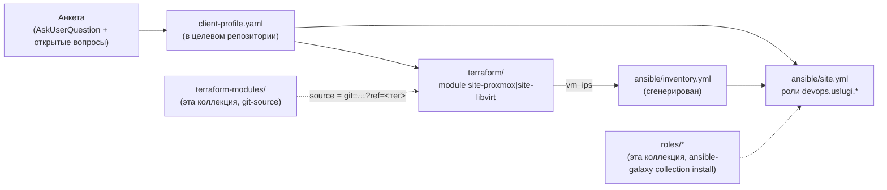

# ADR-0025: Онбординг ресурсов нового клиента — скилл + анкета + terraform-modules

- **Статус:** Предложено (архитектурное решение; v1 реализован — Terraform-модули + скилл;
  интеграция с существующей GitOps-платформой сознательно не решена, см. §5)
- **Дата:** 2026-09-20
- **Авторы:** Ivan Vinogradov (решения), Claude Code (оформление по итогам обсуждения)

## Контекст

До этого ADR в коллекции не было процесса «принять инфраструктуру нового внешнего клиента» —
только `roles/*` (переиспользуемая библиотека), `demo/*` (одноразовые демо-стенды для показа
ролей) и `platform/aicd*` (два экземпляра *внутренней* платформы, обслуживающей саму разработку
коллекции). Реальный внешний клиент понадобился раньше, чем этот пробел был замечен:
`ROADMAP.md` №61 (naming convention) заранее зарезервировал под такой сценарий формат
`client-<slug>`, но ничего не реализовывал.

Пример, на котором отлаживалось решение (не хранится в этой коллекции нигде, кроме этого
абстрактного описания — см. «Жёсткое правило» ниже): клиент на собственном дедике облачного
провайдера, на котором уже вручную поднят Proxmox VE и отдельная VM-роутер — структурно тот же
паттерн, что уже есть в `platform/aicd-devops-labs-ru/terraform` (провайдер `bpg/proxmox`), не
нативный облачный API. Запрошенный набор ролей клиента: DNS, git-сервер (только ВМ, без
установки самого git-сервера на этом шаге), FreeIPA, Postgres, Redis, k3s (два узла — основной и
второй под мониторинг), S3-совместимое хранилище (MinIO).

## Схема

## Решения

### 1. Отдельный git-репозиторий на клиента, не каталог в этой коллекции

**Решение:** результат работы скилла — самостоятельный git-репозиторий (Terraform + Ansible),
не директория внутри `ansible-devops-uslugi`.

**Обоснование:** та же граница, что уже проведена между этой коллекцией (библиотека ролей) и
`platform/gitops` (декларация конкретного окружения, ADR-0014) — библиотека и её потребители не
смешиваются в одном дереве git. Клиентский репозиторий не обязан быть доступен операторам этой
коллекции и наоборот; исходный код ролей и Terraform-модулей клиент подключает версионно
(`ansible-galaxy collection install`, git-sourced Terraform module), не копированием.

### 2. `terraform-modules/` — новая полка коллекции, тот же принцип версионирования, что `roles/`

**Решение:** `terraform-modules/site-proxmox/` и `terraform-modules/site-libvirt/` — дочерние
Terraform-модули с одинаковым интерфейсом (`vms` — карта ВМ, `vm_ips` — output), по одному на
облако/гипервизор. Клиентский репозиторий подключает нужный модуль git-ссылкой с закреплённым
тегом: `source = "git::<url>//terraform-modules/site-proxmox?ref=<тег>"`.

**Обоснование:** пользователь явно запросил абстракцию под несколько облаков сразу, а не
Proxmox-only решение. Граница абстракции — «модуль на облако», не универсальный модуль на все
случаи: внутри одного облака ВМ одного типа ресурса, разница только в параметрах (карта +
`for_each`), а смешение Proxmox/libvirt/будущих облаков в одном модуле потребовало бы условной
логики поверх принципиально разных provider API — не абстракция, а протечка. Версионирование
git-ссылкой с закреплённым `ref` — та же дисциплина «точная версия, не диапазон», что уже принята
для `xanmanning.k3s` в `requirements.yml` этой коллекции (ROADMAP №61 упоминает её как образец).

`site-proxmox` — обобщение уже проверенного живым прогоном паттерна
`platform/aicd-devops-labs-ru/terraform/vm.tf` (там — явный resource-блок на каждую VM,
стенд рос органически; здесь VM объявляются все сразу картой из анкеты, поэтому `for_each`
уместен и не нарушает принцип «явное лучше абстракции» — это один и тот же тип ресурса на одном
провайдере, не смешение разных облаков). `site-libvirt` — тот же приём для паттерна
`platform/aicd/terraform` (`network.tf`/`storage.tf`/`vms.tf`).

**Известное ограничение, унаследованное от референсов:** ни один модуль не создаёт cloud-init
шаблон (Proxmox) или не собирает Packer-образ (libvirt) — оба предполагают, что базовый
образ/шаблон уже существует на целевом хосте. Для Proxmox это реальный, сегодня не закрытый
пробел на новом хосте клиента (см. README модуля, раздел «Предусловия»).

### 3. Роли клиента — переиспользуются как есть, недостающие — заглушка, не новая роль

**Решение:** `freeipa`, `postgresql`, `infra_dns`, `fail2ban` (базовый hardening для ВМ без
профильной роли) применяются к клиентским ВМ по полному имени коллекции
(`devops.uslugi.<role>`), без изменений. Redis, MinIO и «просто ВМ» под git-сервер — ролей в
коллекции нет ни для одной: Terraform поднимает ВМ, Ansible заводит inventory и
`devops.uslugi.fail2ban`, установка самого софта — явный `# TODO` комментарий-маркер в
`site.yml`, не молчаливый пропуск и не полноценная задача в рамках этого ADR.

**Обоснование:** написание 2-3 новых ролей — отдельная по объёму задача (роль, README, molecule),
не часть «собрать скилл онбординга»; откладывать реализацию скилла до появления всех ролей
задержало бы реальный, уже нужный сейчас результат ради полноты, которая понадобится позже.
Явный TODO-маркер — тот же принцип, что уже применён требованием №4 ADR-0022 (экспортёр без
дашборда — заметная, а не молчаливая недоделка): оператор клиентского репозитория видит в
`site.yml`, что именно не реализовано, а не находит это по факту сбоя.

### 4. k3s — два узла одного кластера, паттерн `llm1`, без Helm-нагрузки в v1

**Решение:** первый узел — `xanmanning.k3s` (`k3s_state: installed`, server), второй — **не**
через `xanmanning.k3s`, а сырой install-скрипт `get.k3s.io` с `INSTALL_K3S_EXEC=agent` и
`K3S_TOKEN` из `hostvars` первого узла (delegate_to + slurp + set_fact), тейнт
`dedicated=<taint>:NoSchedule` — join-паттерн, один в один
`platform/aicd-devops-labs-ru/ansible/site.yml`, play «GPU-нода llm1», но без задач
`k3s_gpu_node`/gVisor/NVIDIA (для простого тейнта под мониторинг это лишнее — там изоляция
нужна от произвольного кода агентов, здесь просто разделение ресурсов). Helm-нагрузка на этот
кластер — вне периметра v1 (см. §5).

**Обоснование:** второй узел кластера — уже трижды пройденный, живо проверенный путь в этой
коллекции (`llm1`) — переизобретать его для клиента не было причины. Ограничение по Helm —
прямое следствие §5: разворачивать helmwave/OpenBao-стек на клиентском кластере, когда неясно,
подключается ли он вообще к платформенному GitOps-контуру, зафиксировало бы архитектуру раньше
решения.

### 5. Интеграция с platform-controller/Semaphore/Flux — целевой механизм, с барьером доступа для клиента

**Решение (первая редакция, 2026-09-20):** v1 не регистрирует клиента ни в Semaphore
(`client-<slug>` Project), ни в Module CRD `platform-controller`, ни во Flux `platform/gitops`.
Клиентский репозиторий полностью самодостаточен — исполняется вручную (`tofu apply`/
`ansible-playbook` оператором), не через GitOps-контур существующей платформы.

**Обоснование (первая редакция):** решение сознательно отложено (уточнено с оператором при
разработке этого ADR) — подключение к platform-controller требует ответов на вопросы, которые
сам контроллер сегодня не закрывает даже для внутренних компонентов (пилот только на
`platform/aicd`, ADR-0014 §11): как аутентифицируется клиентский Semaphore Project, куда идут
секреты клиента, кто владеет `inventoryRef`. Форсировать эти ответы ради первого клиента
означало бы проектировать мультитенантность вслепую, на одном примере.

**Уточнение (2026-09-20, тот же день) — решение выше пересмотрено, это была ошибка первой
редакции.** Module CRD + reconcile-контроллер + Semaphore (ADR-0014, Фазы 0–6 реализованы и
проверены на `platform/aicd`) — целевой механизм материализации инфраструктуры **и для
клиентских `Project`, не только для самой платформы**. Откладывать его подключение до
неопределённого «позже» было неверно: это не отдельный, параллельный механизм на будущее, а тот
же самый, уже работающий контур, которым `ai infra agent` исполняет `tofu apply`/
`ansible-playbook` клиентского репозитория (`docs/adr/0015-ai-agent-platform-architecture.md`
§5, уточнено тем же числом).

**Барьер доступа — что делает это решение безопасным для внешнего клиента, не отменяет его:**

- **Клиент никогда не получает сетевого/RBAC-доступа к самому Semaphore** — ни UI, ни API, ни
  через forwardAuth (в отличие от оператора платформы, `docs/platform/semaphore.md`). Вызов
  Semaphore API — только server-to-server, из `lk-api`, привилегированными кредами платформы,
  инициированный `Approve` в цикле `ai infra agent` (`docs/adr/0015.1-infra-agent.md` §3).
- **Клиент видит статус и результат запуска через `lk-api`**, не напрямую из Semaphore.
- **Логи — не напрямую из Semaphore, а выборкой из Loki** (часть стека `monitoring_server`,
  ROADMAP №68, на дату этого уточнения ещё не развёрнут ни на одном окружении): job-логи
  Semaphore уходят в Loki с меткой запуска (run/job ID); `lk-api` запрашивает Loki с фильтром по
  этой метке и отдаёт клиенту только его собственные логи — у клиента нет прямого доступа ни к
  Loki, ни к общему пулу логов платформы.

**Остаётся открытым — отдельно от вопроса доступа к Semaphore/логам, этим уточнением не
решается:**

- **Чей OpenBao хранит секреты клиента** — свой изолированный инстанс/namespace на `Project`,
  или общий с платформой namespace (последнее создаёт границу доверия между клиентами,
  требующую отдельного решения).
- **Кто и как владеет `inventoryRef`** в Module CR клиента — сегодня `inventoryRef` в ADR-0014
  указывает на `platform/gitops`; для клиента это должен быть его собственный, отдельный
  git-репозиторий (этот же ADR, §1) — механизм переиспользования Module CRD для произвольного,
  не `platform/gitops`, git-источника не специфицирован.
- **Структура Semaphore Project/Task Template на клиента** — свой Semaphore Project и Task
  Template на каждого `client-<slug>`, или один общий шаблон с URL репозитория как параметром —
  не решено.

## Жёсткое правило (применимо к скиллу, не к этому ADR)

`.claude/skills/client-onboarding/SKILL.md` и всё рядом с ним не должны содержать имени клиента,
домена, IP или секрета — только обобщённую процедуру и `templates/client-profile.example.yaml`
с заглушками. Реальные данные примера, использованного при отладке (см. «Контекст»), не попали
ни в этот ADR, ни в скилл, ни в `terraform-modules/` — только в generated-вывод вне git-дерева
этой коллекции.

## Явно вне периметра v1

- Реальная установка Redis/MinIO/git-сервера (заглушка, §3).
- Helm-слой на клиентском k3s (§4).
- Конкретная структура Semaphore Project/Task Template на клиента, владение `inventoryRef`,
  изоляция OpenBao клиента (§5) — механизм подключения к Module CRD/Semaphore решён, эти три
  детали реализации — нет.
- Облака помимо Proxmox/libvirt — добавляются тем же паттерном (§2), когда появится реальный
  клиент на них, не заранее.

## Ссылки

- `ROADMAP.md` №61 — naming convention `client-<slug>`, первый реальный потребитель.
- `.claude/skills/client-onboarding/SKILL.md` — исполняемая процедура целиком.
- `terraform-modules/site-proxmox/README.md`, `terraform-modules/site-libvirt/README.md` —
  предусловия и известные ограничения каждого модуля.
- `platform/aicd-devops-labs-ru/terraform/{vm.tf,inventory.tf,templates/inventory.yml.tpl}`,
  `platform/aicd-devops-labs-ru/ansible/site.yml` (play «GPU-нода llm1») — референсные паттерны,
  на которых основаны §2 и §4.
- `platform/aicd/terraform` — референс для `site-libvirt` (§2).
- `docs/adr/0014-platform-controller-architecture.md` — `Module` CRD/reconcile-контроллер/
  Semaphore, целевой механизм материализации по §5 (уточнено 2026-09-20); §11 — статус пилота
  (Фазы 0–6, только `platform/aicd`).
- `ROADMAP.md` №68 — MinIO+Loki для стека `monitoring_server`, на который опирается барьер
  доступа к логам в §5 (принято 2026-09-16, на дату этого ADR не развёрнуто ни на одном
  окружении).
- `docs/adr/0015-ai-agent-platform-architecture.md` §5 (уточнено 2026-09-20) — этот репозиторий
  формально назван `IAC tools`, которые вызывает `ai infra agent`; роли `roles/*` внутри — не
  инструмент сам по себе, а исполнительное содержимое результата, который агент составляет.
- `docs/adr/0015.1-infra-agent.md` — агентный контур, который должен повторить этот онбординг
  диалогом в LK (скилл остаётся ручным прецедентом).
- `docs/adr/0022-new-component-requirements.md` требование №4 — прецедент явного TODO-маркера
  вместо молчаливой недоделки, на который ссылается §3.
- `roles/freeipa`, `roles/postgresql`, `roles/infra_dns`, `roles/fail2ban` — переиспользуемые
  роли (§3).
