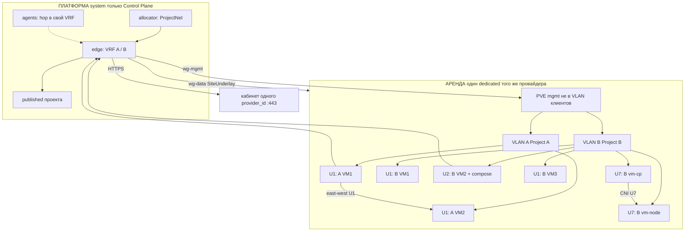
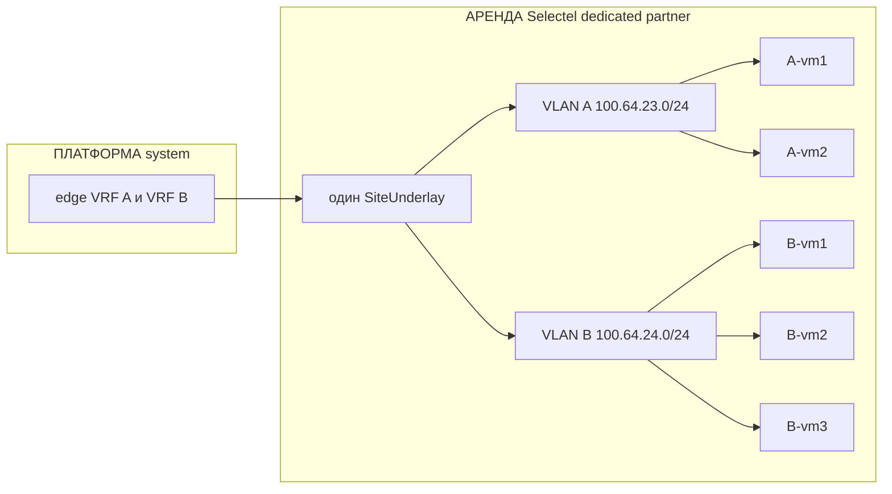
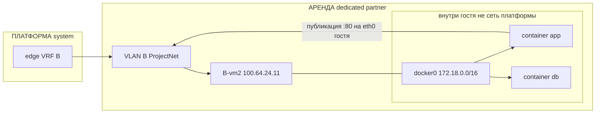
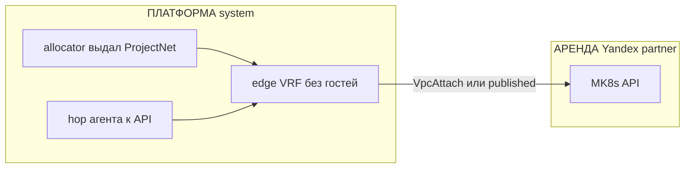
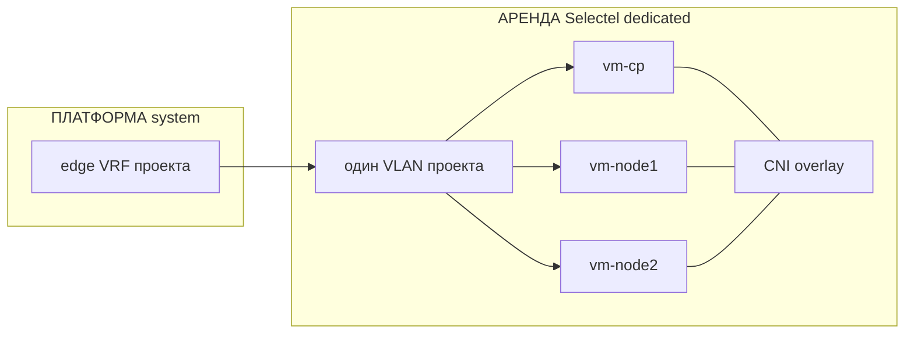
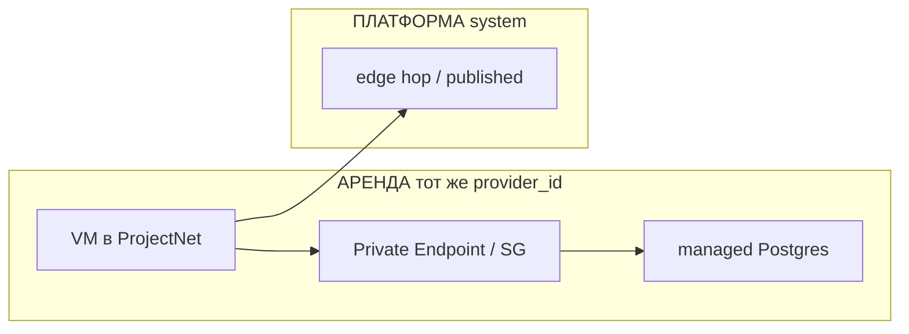

# ADR-0028: Сеть платформы — ProjectNet, edge, плоскости, туннели

- **Статус:** Предложено (архитектура; код, чарт и роль не реализованы)
- **Дата:** 2026-09-26
- **Авторы:** Alexandr Yankov (решения), Cursor (оформление по итогам обсуждения)

## Контекст

Пользователь Project создаёт VM, k8s, сети, БД (свои и managed), подключает своё или получает
ёмкость из фонда. Ресурсы появляются четырьмя путями: своё железо платформы, купленный dedicated /
IaaS, managed у провайдера, BYO клиента.

[ADR-0014.1.1](0014.1.1-resource-onboarding-protocol.md) §3 закрывает только **management plane**:
как control plane достаёт API/SSH/PVE (`local` / `api` / `overlay`). Пользовательские сети
тенанта туда явно не входят. Продукт overlay в [0015.2](0015.2-admin-panel.md) и [0015.1](0015.1-infra-agent.md)
оставлен открытым. Документа, где задаётся адрес проекта и где пакет реально едет, не было.

Без этого агент и Plan не отличают «сеть клиента» от LAN гипервизора и от кабинета Selectel, а
агент с доступом «во все туннели» видит соседа.

Этот ADR не пересматривает 0014.1.1 (mgmt), 0015.1 (оси `owner` / `procurement` / `connect`) и
не продаёт VPN как продукт клиенту (0015.2 §2). Код, hostname edge и дистрибутив пилота сюда
не входят сверх выбора класса (ниже).

## Схема

Одна модель по [0015.1](0015.1-infra-agent.md) §9: один Project — один `provider_id`, этажи
облако → dedicated → virt. У нас только Control Plane платформы. Allocator выдаёт ProjectNet
у провайдера; edge — mgmt/published/hop, не east-west.

U4a/b/c и U5 в этом ADR появились как перебор hybrid («наша VM + Yandex MK8s», «наш CP +
нода Selectel»). Из 0015.1 они **не следуют** — в живой схеме их нет (§9 «отклонено»).

Где что лежит:

| На схеме | Чьё | Закупка | Примеры |
|---|---|---|---|
| **Платформа** | мы, `allocation: system` | `platform_metal` ядра | edge, allocator, агенты — только CP платформы |
| **Аренда** | один `provider_id` проекта | `partner` | dedicated Selectel **или** VPC/MK8s Yandex, не оба в одном Project |
| **Своё клиента** | клиент, тот же смысл: один кабинет | `byo` | его Selectel / его стойка, не смесь с нашей арендой |



Живые варианты:

| id | Что на схеме | Сеть | Что нельзя |
|---|---|---|---|
| **U1** | Два Project на одном dedicated: 2 и 3 VM | Два ProjectNet, два VLAN, один underlay | Общий `vmbr` / `10/24`; WG на каждую VM |
| **U2** | У B ещё compose **внутри** своей VM | docker0 только в госте | compose на PVE; `172.18/16` в edge |
| **U7** | Self-k8s проекта B: cp + node в **том же** VLAN B | NodeIP из ProjectNet B, CNI поверх | CNI на `vmbr0`; нода на нашем CP |
| **U6** | Другой Project, целиком MK8s **того же** одного провайдера, без наших VM | published / VPC attach, без второй площадки | Смешать с U1 на Selectel в одном Project |
| **U8** | VM + managed БД **того же** `provider_id` | endpoint в его VPC | БД другого облака; БД в VLAN dedicated |

Плоскости на той же схеме: `wg-mgmt` → только PVE; кабинеты облаков → с платформы, не из VLAN
гостей; агент → hop в **свой** VRF; гости → platform только через published.

Агент проекта B не получает `AllowedIPs` на сеть A. Между VLAN A и B на dedicated маршрута нет.

## Решения

### 1. Определяют и маршрутизируют — разные места

**Решение:** адрес и VRF **задаёт** control plane; пакет **гоняет** datapath на краю и на
площадке. API не форвардит. Коммутатор на PVE не выдаёт CIDR проекта.

| Объект | Кто задаёт | Кто маршрутизирует |
|---|---|---|
| Prefix pool | platform-api / админка | никто |
| SystemNet | админка, `allocation: system` | mgmt-фабрик платформы (0014.1.1) |
| **ProjectNet** | allocator **при создании Project**: `vrf_id` + синтетический CIDR + DNS-зона | **platform edge**, таблица этого VRF |
| **Attachment** | Plan после Approve: ресурс Estate ↔ этот ProjectNet | FIB на площадке, где ресурс живёт, плюс туннель до edge |
| ObservedNet | не мы: Inventory `network_plane` | уже роутер площадки / облака |

Один SoT адресов тенанта — allocator в `platform-api`. Роль, cloud-init и агент не раздают
`10.x` «от себя».

Префикс проекта — **синтетический** (пул вроде `100.64.0.0/10` или ULA), не `10.0.0.0/8`.
Реальный CIDR площадки (VPC, BYO, LAN PVE) — observed. Коллизия с ProjectNet — отказ Plan, не
склейка.

**Обоснование:** иначе два Approve разъедутся, а hybrid/BYO с чужим `10` сломает таблицу.

### 2. Четыре плоскости, не одна сеть

**Решение:**

| Плоскость | Смысл | Не смешивать с |
|---|---|---|
| **mgmt** | фонд, tofu, PVE/SSH, API провайдера | NIC гостя |
| **data** | ProjectNet и его Attachment | SystemNet |
| **agents** | `ns: agents`, default-deny (0015) | стоячая mesh во все VRF |
| **published** | точечный выход VM на разрешённые имена проекта | «весь LAN платформы» |

Четыре канала связанности:

| Канал | Определяет | Маршрутизирует |
|---|---|---|
| Платформа ↔ облако | админка `connect: api`, tofu | HTTPS с system-узлов; VPC attach отдельно |
| Наша инфра ↔ платформа | SystemNet | mgmt, 0014.1.1 |
| Агенты ↔ платформа | 0015 (разрешённые svc) | внутри `ns: agents`; в ProjectNet — только hop на Run |
| Приложение ↔ платформа | published-список Project | edge + Ingress, без SystemNet и чужого VRF |

**Обоснование:** один туннель на mgmt + tenant + агентов даёт соседу чужой Estate.

### 3. Platform edge — программный роутер, не приложение

**Решение:** edge — системная VM (`allocation: system`): Linux + policy routing / VRF + nftables
или VyOS. Не под в k3s, не Traefik, не Authelia, не `egress-proxy` из 0015, не край провайдера.

Он: (1) держит таблицу на каждый Project; (2) терминирует стыки; (3) выпускает из VRF только
published.

Не край платформы: MikroTik и OpenWrt — класс CPE/площадки (P14), не концентратор VRF.
Пилот — Linux + WireGuard + nftables. VyOS — если появится BGP до официального Cloud VPN.

**Обоснование:** CNI кластера не терминирует туннели со всех dedicated и не изолирует ProjectNet.
Железо/CPE нельзя крутить из allocator так же, как VM в фонде.

### 4. Туннель по умолчанию — WireGuard; IPsec — адаптер

**Решение:** поле стыка `tunnel: wireguard | ipsec`.

- **WireGuard** — dedicated, который мы поставили; BYO за NAT (инициирует дальняя сторона,
  0015.1 §9); эфемерный peer агента.
- **IPsec (IKEv2, route-based VTI)** — только если провайдер отдаёт официальный Cloud VPN и
  своей VM-роутера в VPC нет.

Не дублировать WG+IPsec на одном стыке в v1. Не один IPsec «на всю платформу».

Ключи туннелей — OpenBao, как прочие секреты площадки (0016). Клиент ключ кабинета провайдера
не видит.

**Обоснование:** много VRF, NAT, автоматизация peer из allocator — сильная сторона WG.
IPsec нужен как чужой стандарт, не как «серьёзнее».

### 5. Референс: Project → dedicated Selectel → VM

**Решение:** типовой путь (P1: partner dedicated + виртуализация).

1. Админка: провайдер, `connect: api`, заказ dedicated. HTTPS только с платформы на API.
2. На ящике — ОС и гипервизор. Нода в фонде, метка `user`: это **общая площадка**
   (`site`), не эксклюзив одного Project. На ней режутся VLAN/сегменты проектов (§8).
3. Project уже имеет ProjectNet (пример: `100.64.23.0/24`, VRF `prj-23`).
4. Approve VM → apply по **wg-mgmt** на API гипервизора.
5. NIC гостя — на **отдельный** bridge/VLAN проекта, адрес из ProjectNet. Не на mgmt-bridge
   и не на WAN.
6. **wg-data** в том же VRF: edge ↔ этот VLAN. Два туннеля (или два VRF в одном конверте),
   не один WG на всё.
7. Inventory: observed IP, gw, `network_plane.edge`.

На dedicated минимум:

- WAN — только UDP туннеля, не `8006` в `0.0.0.0/0`;
- bridge mgmt — гипервизор / SSH;
- bridge проекта — только гости этого Project. Второй Project — второй VLAN.

L3 гостя в пилоте: шлюз ProjectNet на dedicated (VRF/netns), дальше `wg-data` на edge.

Published для VM (через data → edge), не весь `10.10.10.0/24`: их git/DNS, при необходимости
каталог **этого** клиента, scrape **к** VM. Нет: LiteLLM, Semaphore, API провайдера, SystemNet,
чужой ProjectNet. Интернет с VM — только если разрешён NAT в её VRF, не в обход через WAN
dedicated.

Агент не имеет стоячего маршрута в `100.64.23.0/24`. На Run — эфемерный WG-peer или bastion
в этом VRF; после Run peer снимается.

**Обоснование:** Selectel знает dedicated и кабинет платформы, не сеть тенанта. Связанность с
ядром есть только потому, что edge знает VRF и allow-list.

### 5.1 Несколько VM одного проекта на том же dedicated

**Решение:** один ProjectNet, один VRF, **один** `wg-data` на площадку проекта, один
`vmbr`/VLAN. Каждая VM — ещё один tap на том же bridge и ещё один адрес из того же CIDR
(`100.64.23.10`, `.11`, `.12` выдаёт allocator, не DHCP «от PVE втихую»).

East-west (VM↔VM этого Project) идёт **по bridge на dedicated**, не через platform edge и не
через второй WG на каждую машину. Edge видит префикс целиком (`AllowedIPs = 100.64.23.0/24`),
не /32 на гостя.

Второй Project на том же ящике — по-прежнему другой VLAN и другой `wg-data`. Гости разных
проектов не шарят L2.

Несколько Attachment в Estate: по записи на VM, сеть одна. Plan не поднимает новый туннель
на каждую машину.

**Обоснование:** иначе N туннелей на N VM — операционный шум без изоляции внутри проекта.
Изоляция — между проектами, не между своими же гостями.

### 5.2 Runtime на гостях: docker-compose не на гипервизоре

**Решение:** docker-compose (и любой runtime приложения) крутится **внутри VM проекта**, не
на PVE и не на WAN-хосте dedicated. Гипервизор остаётся субстратом фонда (`source: proxmox`);
смешать с ним compose — отдать клиенту ноду, на которой mgmt и чужие VLAN.

Три уровня сети, их не склеивать:

| Уровень | Где | Кто задаёт | Пример |
|---|---|---|---|
| ProjectNet | tap / VLAN | allocator | `100.64.23.10` на eth0 гостя |
| Docker bridge / compose network | внутри одной VM | compose-файл клиента | `app` ↔ `db` на `172.18.0.0/16` |
| Меж-VM | ProjectNet | те же адреса гостей | `app-vm:80` → `db-vm:5432` |

Compose на **одной** VM: платформа сеть контейнеров не маршрутизирует и не выдаёт. Наружу
контейнер торчит published-портом на адрес гостя в ProjectNet. Inventory и scrape смотрят
этот адрес:порт, не `172.18.0.2`.

Compose **на нескольких VM** (app на одной, postgres на другой): контейнеры не в одном docker
network. Связь — `100.64.23.11:5432` по east-west §5.1. В compose — hostname/IP соседней VM
из Estate/Inventory, не `db` как имя контейнера на чужой машине.

Публикация наружу (если нужна): отдельная VM-прокси в том же ProjectNet (`reverse_proxy_traefik`
/ `nginx_multidomain` коллекции) или published-порт + allow на edge. Edge по-прежнему не знает
про docker0.

Платформа не оркестрирует compose (не Portainer-as-a-service). Агент инфры может заложить в
Plan VM с ролью `docker` (коллекция уже ставит Engine) и место под compose-файл клиента;
apply — как остальной IAC, не `docker compose up` из чата.

Агент на Run ходит hop'ом в ProjectNet и видит порты гостя. Соседний проект и сокеты
гипервизора — нет.

**Обоснование:** docker0 — деталь гостя, как loopback. Вынести его в VRF платформы — сломать
изоляции и начать маршрутизировать чужие `172.17.0.0/16`. На гипервизоре compose обходит
VLAN проекта целиком.

### 5.3 Два слоя: облако и гипервизор

**Решение:** два слоя, не один apply. Selectel ортогонален: **чей** платёжный аккаунт.

| Слой | Что создаём | API | State / раннер |
|---|---|---|---|
| **1. облако** | сервер у провайдера (dedicated + выделенный IP, ОС) | Selectel | state 1, раннер у нас |
| **2. гипервизор** | виртуалки **внутри** уже созданного сервера | PVE по wg-mgmt | state 2, второй раннер у нас |

После слоя 2 — Ansible / Helmwave на гостей, не третий tfstate.

Кабинет **один** — Selectel. Не «наш ЛК платформы» плюс отдельно Selectel. Развилка оплаты:

| Кто платит | `procurement` | Ключ API | Слой 1 |
|---|---|---|---|
| Мы | `partner` | `ProviderAccount` платформы | заказ в нашем аккаунте; клиенту ЛК Selectel нет |
| Клиент | `byo` | ключ Project в OpenBao | сначала discover, потом заказ в **его** аккаунте |

Сеть на ящике режется **до** гостей, как у U7, даже если Project на dedicated пока один.

Раннер в обоих случаях стоит **у нас** (Semaphore / `agent-job` на control plane). На ещё не
существующем ящике ему жить негде. HTTPS — только с платформы на API Selectel.

```mermaid
sequenceDiagram
    participant R1 as раннер 1 (у нас)
    participant Sel as API Selectel
    participant Box as dedicated WAN IP
    participant Rtr as vm-router в PVE
    participant Edge as platform edge
    participant R2 as раннер 2 (у нас)
    participant PVE as PVE API :8006
    participant Node as VM / нода U7

    alt кабинет клиента
        R1->>Sel: ключ BYO, discover
    else кабинет платформы
        R1->>Sel: ключ ProviderAccount
    end
    R1->>Sel: заказ dedicated
    Sel-->>Box: сервер + выделенный IP
    R1->>Box: SSH bootstrap, накат PVE
    R1->>PVE: создать vm-router
    Rtr->>Edge: WG mgmt + WG data
    Note over Box,PVE: :8006 и SSH — не в 0.0.0.0/0
    R2->>Edge: wg-mgmt
    Edge->>PVE: создать VM / ноды
    R2->>Node: Ansible / Helmwave по ProjectNet
```

Слои нельзя склеить в один state: разные provider и срок жизни. Пока нет слоя 1 — нет PVE.
Пока нет слоя 2 — нет адресов ProjectNet, Ansible/Helmwave рано. Helmwave не ходит на
публичный IP ноды.

**Как режется сеть на ящике** (с первого дня, не «потом поправим»):

| Интерфейс | Где | Что по нему едет | Чего нет |
|---|---|---|---|
| **WAN** | NIC dedicated, выделенный IP Selectel | UDP туннеля; до готовности WG — временный SSH bootstrap | `8006`, kube-apiserver, SSH гостей |
| **vmbr0 / mgmt** | хост PVE | API гипервизора, SSH хоста | CNI, eth0 нод U7 |
| **vmbr-N / VLAN проекта** | только гости этого Project | ProjectNet, east-west U7, NodeIP | WAN, mgmt PVE |
| **wg-mgmt** | **хост PVE** (после bootstrap) | раннер 2 → `:8006` | трафик подов |
| **wg-data** | **vm-router** | VRF проекта ↔ platform edge; published; hop агента | API Selectel, чужой ProjectNet |

Роутер — **первая** VM в PVE, не «ещё одна нода k8s». Он — шлюз ProjectNet и `wg-data`.
Хост PVE туннель data **не** терминирует: иначе hypervisor и сеть тенанта — один fault domain.

Пока WG не встал, раннер 1 ходит на выделенный IP. Как только `wg-mgmt` up — публичные
`22`/`8006` закрываются (остаётся UDP WG; break-glass SSH — с CIDR платформы, не `0.0.0.0/0`).
Дальше `connect` площадки = `overlay` (0014.1.1 путь A → C, потом PVE API как «local через
туннель»).

U7 садится **только** на VLAN проекта: cp + node живут в одном ProjectSegment, CNI overlay
поверх NodeIP из ProjectNet, не на `vmbr0`. Интернет с нод — NAT в VRF на vm-router, не
второй выделенный IP на каждую VM. Выделенный IP — у ящика, один.

Ящик после заказа — **site** в фонде (`user`). Если Project на нём один — это U7 (один VLAN).
Сеть всё равно как у площадки, не «весь dedicated = один L2»: иначе U1 потом не налезет.
Ноды U7 не получают второй NIC «в интернет Selectel».

**Обоснование:** 0025 уже видел этот паттерн вручную («дедик + PVE + отдельная VM-роутер»).
Один state не может одновременно вызвать API Selectel и API PVE, которого ещё нет. Канал к
control plane обязан родиться на ящике **до** второго раннера, иначе создавать гостей нечем.
CNI на WAN/mgmt — дыра и конфликт с U1.

### 5.4 Один Project — один провайдер (как 0015.1 §9)

**Решение:** мультиклауда для клиента нет (0015.1 §9). Один Project — один `provider_id`.
Весь стек (VM, k8s, БД) у него. У нас на железе — только Control Plane **платформы**.

Бывшие U4/U5 из перебора hybrid — не каталог. Слои create §5.3 — этажи того же P1.

East-west — у провайдера (VLAN / VPC). Edge — mgmt, published, hop.

**Обоснование:** иначе снова hairpin CNI и два кабинета в одном Plan.

### 6. Пять способов ресурса — разные Attachment, один ProjectNet

| Откуда ресурс | Стык |
|---|---|
| Фонд `user` на нашем железе | не тенант: у нас только CP платформы (0015.1 §9) |
| Купленное IaaS | VPC, который создали мы; WG или IPsec на edge |
| Managed | Private Endpoint / SG в нашем VPC; WG на RDS нет |
| BYO | overlay инициирует клиент, приземление только в его VRF |
| Пользователи каталога | не сеть; FreeIPA / группы (0019) |

Без ProjectNet агент не предлагает «поставить VM в сеть». `network_plane` в Inventory без
выданного ProjectNet — чужая наблюдаемая сеть, не наша.

### 7. Порядок: сначала сеть проекта, потом гость

1. Создали Project → allocator выдал ProjectNet (ещё нет FIB).
2. Approve → Attachment в объекте (ещё нет пакета).
3. Apply на площадке → интерфейс / WG / endpoint.
4. Edge ставит маршрут «CIDR проекта → этот стык».
5. Inventory пишет observed.
6. Hop агента — только после шага 4, на время Run.

### 8. Модель услуги: один каркас на все стыки

**Решение:** у каждого Project ровно один **ProjectNet** (VRF + синтетический CIDR). Площадка
(dedicated / VPC **одного** `provider_id`) — **site**. На сайте живёт много проектов.
Изоляция — между проектами, не «ящик = один клиент».

Три объекта стыка, не путать с VM:

| Объект | Сколько | Смысл |
|---|---|---|
| **SiteUnderlay** | один на пару edge↔site | WG (или IPsec в облако): доставить L3 до ящика. Не сеть клиента |
| **ProjectSegment** | один на пару Project↔site | VLAN/VNI + шлюз из **этого** ProjectNet на этом ящике |
| **ClusterOverlay** | один на k8s проекта | CNI (VXLAN и т.п.) **поверх** ProjectNet. Edge поды не маршрутизирует |

Плюс невидимый платформе уровень: docker0 / compose network внутри гостя (§5.2).
Живые U — в разделе «Схема»; U4/U5/U9 — §9 «отклонено».

На одном dedicated: один `wg-mgmt`, один **data-underlay**, N VLAN. Не N туннелей на N VM.
Между VLAN проектов на ящике **нет** маршрута. Компрометация гипервизора — граница доверия
общей площадки (как у любого shared PVE), не дыра в модели.

k8s: адрес **ноды** — из ProjectNet. Весь кластер у того же `provider_id` (U7 self или U6
managed). Pod/Service CIDR — уникальные на кластер. Edge знает ноды, не каждый pod /32.
Hybrid kubelet (бывший U4c) и сплит CP/нод (U5) не строим.

### 9. Перебор вариантов услуги

Ниже — что клиент делает в LK и что обязана построить сеть. Все строки — один каркас §8.

| id | Что сделали клиенты | Сеть | Запрещено |
|---|---|---|---|
| **U1** | Два Project: 2 VM и 3 VM на **одном** dedicated | Два ProjectNet, два VLAN, один SiteUnderlay. East-west только внутри своего VLAN | Общий `vmbr1`, общий `10.0.0.0/24`, один WG «на всех гостей» |
| **U2** | Как U1, у второго ещё docker-compose на своей VM | Как U1 + docker0 только в госте B. Порты наружу — на `100.64.B.x` | compose на PVE; маршрутизировать `172.18.0.0/16` в VRF |
| **U6** | Только MK8s у выбранного провайдера, своих VM нет | published / VPC attach; ProjectNet всё равно | Второй провайдер; «сети нет, потому что managed» |
| **U7** | Весь self-k8s на dedicated **этого** провайдера | Все NodeIP в одном VLAN/ProjectNet | Flannel на mgmt-bridge; нода на нашем CP |
| **U8** | VM + managed БД у **того же** провайдера | endpoint в его VPC. WG на RDS нет | БД другого облака; БД в VLAN dedicated |
| **U4a/b/c, U5, U3-на-нашем-железе, U9-склейка** | отклонено: не из 0015.1 | — | мультиклауд / сплит площадок |

Сводная картина — в разделе «Схема». Ниже каждый случай отдельно: маленькая схема и что
именно строится.

#### U1 — два проекта, 2 и 3 VM на одном dedicated

Где: ядро — **платформа**; гости — **аренда** (один dedicated Selectel). Нашего железа нет.



Два клиента делят ящик, не сеть. Allocator выдал два ProjectNet. На PVE два VLAN, пять tap.
A-vm1 пингует A-vm2 по bridge, без edge. До B-vm1 маршрута нет: другой VRF, другой VLAN.
К платформе каждая VM ходит в свой VRF → published своего проекта. Один underlay на dedicated,
не пять WG. Запрещено: общий `vmbr`, общий `10.0.0.0/24`, «гости видят друг друга потому что
один Selectel».

#### U2 — как U1, у B на VM docker-compose

Где: VM — **аренда** (тот же dedicated); docker0 — внутри гостя, не площадка и не платформа.



Сеть услуги — по-прежнему ProjectNet B, не compose и не LAN dedicated. Контейнеры на одной
VM разговаривают по docker0; платформа этот CIDR не знает и не маршрутизирует. Снаружи
(соседняя VM B, edge, агент) виден только `100.64.24.11:80`. Compose на PVE запрещён: тогда
стек обойдёт VLAN и увидит чужой сегмент. Если app и db разъедутся на две VM — это уже U1
east-west, в compose пишут адрес соседнего гостя из Estate, не имя контейнера.

#### Отклонено: U3-на-нашем-железе, U4a/b/c, U5, U9-склейка

Откуда были: ранняя таблица «все сочетания площадок» (наша VM + Yandex MK8s; наш k8s CP +
нода Selectel; офис BYO + VLAN на dedicated). **Не вывод из 0015.1.**

| id | Что предполагали | Почему нет |
|---|---|---|
| **U4a** | VM (у нас или на Selectel) ходит клиентом в **Yandex** MK8s | Два провайдера в одном Project |
| **U4b** | VM на dedicated + kubelet **в VPC Яндекса** | То же + compute на двух площадках |
| **U4c** | Наша VM как kubelet в чужом MK8s | Hybrid, hairpin через edge |
| **U5** | CP self-k8s у нас, worker в Selectel | Тенантный CP на нашем железе; CNI через нас |
| **U3** как «нода на нашем PVE» | Self-k8s на фонде `user` | У нас только CP платформы; живой self-k8s — U7 |
| **U9** | Склеить BYO LAN и VLAN на dedicated в один ProjectNet | Две площадки, тот же запрет |

Чертежи этих строк из ADR убраны, чтобы не читались как каталог услуг.

#### U6 — только Managed K8s, своих VM нет

Где: сеть и hop — **платформа**; кластер — **аренда** Yandex. Нашего user-железа нет.



Это **другой** Project с `provider_id` этого managed-облака, не «ещё один кластер» у проекта
с dedicated. Compute на нашей стороне нет. ProjectNet всё равно выдаётся (hop агента, учёт).
Нельзя сказать «сети нет, потому что managed». Нельзя добавить к этому же Project VM в
другом облаке (это был U4).

#### U7 — весь self-k8s на одном dedicated

Где: все ноды — **аренда** одного dedicated; edge — **платформа**. Нашего железа нет.



Один site, все NodeIP в одном ProjectSegment. East-west нод — по bridge, не через edge.
CNI нельзя сажать на mgmt-bridge PVE. Соседний проект на том же ящике — свой VLAN, свой
кластер, свой pod CIDR. Тенантный CP не на нашем железе.

Как ящик и канал появляются — §5.3 (слой облака → слой гипервизора, vm-router, потом этот VLAN).

#### U8 — VM + managed БД

Где: оба у **одного** `provider_id` (0015.1). VM на dedicated того же кабинета, не на нашем
Control Plane. БД — managed того же провайдера. Стык — площадка / published, не hairpin U4.



Compute и БД у **одного** провайдера (P4 в 0015.1, без второго облака). На RDS нет WG. БД не
кладут в VLAN dedicated как гостя. Чужой Project endpoint не резолвит. Стык через наш edge
нужен только если published/hop, не чтобы склеить два облака.

## Явно вне периметра

- код edge, роль/чарт, точный hostname и выбор Linux vs VyOS сверх класса §3;
- продукт «VPN клиенту в офис» и сетка продажи (0015.2);
- TTL rotate ключей туннеля (остаётся открытым);
- замена mgmt-протокола 0014.1.1;
- объекты Intent/Plan (0015.3) — Attachment ссылается на них, не заменяет;
- публичный Ingress / Traefik как замена edge;
- оркестрация docker-compose платформой и compose на гипервизоре dedicated;
- мультиклауд и hybrid-kubelet (бывшие U4/U5) — не обещаем.

## Открыто

- размер и разбиение пула `100.64.0.0/10` (или ULA);
- TTL и процедура ротации WG/IPsec ключей;
- обязателен ли data-туннель, если гостю достаточно только published Ingress;
- HA пары edge;
- откуда именно published-список (каталог 0015.2 vs объект Project).

## Последствия

- 0014.1.1 §3 остаётся mgmt-only; продукт overlay для **допуска в фонд** — WG как в §4, не
  отдельный «какой хочешь VPN».
- 0015.1 / 0015.2: открытый «продукт overlay / VPN» для связанности тенанта закрыт этим ADR
  на уровне роли edge и WG; продажа VPN клиенту по-прежнему вне периметра.
- 0015.3 Inventory `network_plane` получает смысл: edge + ProjectNet + observed, не «просто
  default gw на PVE».
- Allocator — домен `platform-api` (0015.2.1), не lk-api. LK видит свой CIDR и Attachment,
  не пул и не чужие VRF.
- 0015.1 §9 остаётся источником: оси, мастер, этажи create, один `site_id` на Project.
  Этот ADR рисует FIB и туннели, не переписывает мастер.

## Ссылки

- [ADR-0014.1.1](0014.1.1-resource-onboarding-protocol.md) — mgmt до ноды в фонде.
- [ADR-0014.1](0014.1-platform-resource-controller.md) — фонд, не маршруты тенанта.
- [ADR-0015.1](0015.1-infra-agent.md) §8–§9 — Inventory `network_plane`, `connect`.
- [ADR-0015.2](0015.2-admin-panel.md), [0015.2.1](0015.2.1-admin-panel-architecture.md) —
  каталог площадок, allocator.
- [ADR-0015.3](0015.3-contracts.md) — Estate / Inventory.
- [ADR-0015](0015-ai-agent-platform-architecture.md) — `ns: agents`, default-deny.
- [ADR-0016](0016-openbao-secrets-pki.md) — ключи туннелей.
- [ADR-0022](0022-new-component-requirements.md) — когда появится код edge, чек-лист аддона.
