# ADR-0028: Сеть платформы — ProjectNet, edge, плоскости, туннели

- **Статус:** Предложено (архитектура; код, чарт и роль не реализованы)
- **Дата:** 2026-09-26
- **Авторы:** Alexandr Yankov (решения), Cursor (оформление по итогам обсуждения)

## Контекст

Пользователь Project создаёт VM, k8s, сети, БД (свои и managed), подключает своё или получает
ёмкость из фонда. Ресурсы появляются четырьмя путями: своё железо платформы, купленный dedicated /
IaaS, managed у провайдера, BYO клиента.

[ADR-0014.1.1](0014.1.1-resource-onboarding-protocol.md) §3 закрывает только **management plane**:
как control plane достаёт API/SSH/PVE (`local` / `api` / `overlay`). Пользовательские сети
тенанта туда явно не входят. Продукт overlay в [0015.2](0015.2-admin-panel.md) и [0015.1](0015.1-infra-agent.md)
оставлен открытым. Документа, где задаётся адрес проекта и где пакет реально едет, не было.

Без этого агент и Plan не отличают «сеть клиента» от LAN гипервизора и от кабинета Selectel, а
агент с доступом «во все туннели» видит соседа.

Этот ADR не пересматривает 0014.1.1 (mgmt), 0015.1 (оси `owner` / `procurement` / `connect`) и
не продаёт VPN как продукт клиенту (0015.2 §2). Код, hostname edge и дистрибутив пилота сюда
не входят сверх выбора класса (ниже).

## Схема

Одна модель на все услуги: allocator выдаёт ProjectNet, edge держит VRF, площадка — site с
underlay, на сайте — сегмент (VLAN) проекта. Ниже все варианты U1–U9 на одном рисунке;
одиночная VM на dedicated — вырезка из U1.

Где что лежит (оси 0015.1: `owner` / `procurement`):

| На схеме | Чьё | Закупка | Примеры |
|---|---|---|---|
| **Платформа** | мы, `allocation: system` | `platform_metal` ядра | edge, allocator, published, агенты |
| **Наше железо** | мы, фонд `user` | `platform_metal` | свои PVE/ноды, VLAN проектов на них |
| **Аренда** | мы сняли, клиенту ЛК нет | `partner` | dedicated Selectel, VPC/MK8s/БД Yandex |
| **Своё клиента** | клиент | `byo` | его LAN, его стойка |

```mermaid
flowchart TB
    subgraph plat [ПЛАТФОРМА system наши компоненты ядра]
        Alloc["allocator: ProjectNet на каждый Project"]
        Edge["platform edge: VRF A / B / C"]
        Pub["published: git DNS ingress проекта"]
        Ag["agents: hop только в свой VRF"]
    end
    CloudAPI["АРЕНДА кабинеты Selectel / Yandex :443"]

    subgraph siteMetal [НАШЕ ЖЕЛЕЗО platform_metal фонд user]
        SegMetalA["VLAN Project A"]
        SegMetalC["VLAN Project C: apiserver self-k8s"]
        MetalAvm["U3/U5: нода k8s A или C"]
        MetalCcp["U5/U7: control plane C"]
    end

    subgraph siteSel [АРЕНДА dedicated Selectel partner общий ящик]
        PVE["PVE mgmt не в VLAN клиентов"]
        SegSelA["VLAN A ProjectNet A"]
        SegSelB["VLAN B ProjectNet B"]
        SegSelC["VLAN C ProjectNet C"]
        A1["U1: A VM1"]
        A2["U1: A VM2"]
        B1["U1: B VM1"]
        B2["U2: B VM2 + compose внутри"]
        B3["U1: B VM3"]
        Csel["U5: нода k8s C"]
    end

    subgraph siteYx [АРЕНДА Yandex VPC partner managed]
        Mkcp["U4/U6: Managed K8s API"]
        YxNode["U4b: нода MK8s в облаке"]
        Rds["U8: managed DB"]
    end

    subgraph siteByo [СВОЁ КЛИЕНТА byo]
        ByoLan["U9: LAN клиента"]
    end

    Alloc --> Edge
    Pub --> CloudAPI
    Edge -->|"wg-mgmt"| PVE
    Edge -->|"SiteUnderlay WG"| siteSel
    Edge -->|"SiteUnderlay WG"| siteMetal
    Edge -->|"VpcAttach IPsec"| siteYx
    Edge -->|"SiteUnderlay клиент инициирует"| siteByo

    PVE --> SegSelA
    PVE --> SegSelB
    PVE --> SegSelC
    SegSelA --> A1
    SegSelA --> A2
    SegSelB --> B1
    SegSelB --> B2
    SegSelB --> B3
    SegSelC --> Csel
    A1 -->|"east-west U1"| A2
    B1 -->|"east-west U1"| B3

    SegMetalA --> MetalAvm
    SegMetalC --> MetalCcp
    MetalCcp -->|"U3/U5/U7 CNI поверх ProjectNet"| MetalAvm
    MetalCcp -->|"U5 hairpin через edge"| Csel

    B1 -.->|"U4a клиент API не kubelet"| Mkcp
    YxNode --> Mkcp
    B1 -.->|"U4c только если API разрешил"| Mkcp
    B1 -->|"U8 к endpoint"| Rds
    ByoLan -->|"тот же VRF что и наши VM проекта"| Edge

    A1 --> Edge
    B2 --> Edge
    Csel --> Edge
    Edge --> Pub
    Ag -.-> Edge
```

Описание блоков на схеме:

| id | Что на схеме | Сеть | Что нельзя |
|---|---|---|---|
| **U1** | На Selectel VLAN A: 2 VM; VLAN B: 3 VM. Два VRF на edge, один underlay на ящик | Два ProjectNet. East-west только в своём VLAN | Один `vmbr` на A+B; общий `10/24`; WG на каждую VM |
| **U2** | `B VM2 + compose внутри` | Как U1. docker0 только в госте; наружу порт на адрес B в ProjectNet | compose на PVE; тащить `172.18/16` в edge |
| **U3** | VM на нашем железе или в VLAN проекта = нода **своего** self-k8s | NodeIP из ProjectNet. CNI поверх. apiserver в том же VRF | Нода в VLAN соседа; одинаковый pod CIDR у всех клиентов |
| **U4a** | Пунктир `B VM → Managed K8s API`: наша VM **клиент** Ingress/API | ProjectNet + IPsec в VPC **или** published HTTPS | Назвать это нодой MK8s |
| **U4b** | `нода MK8s в облаке` — kubelet **в Yandex VPC**, не на dedicated | Нода живёт в VPC. Наши VM остаются U4a | «Нода на dedicated, а кластер managed» без U4c |
| **U4c** | Пунктир `B VM → MK8s` с подписью «только если API разрешил» | Hybrid kubelet: анонс ProjectNet (+ PodCIDR) в VPC. Нет поддержки — отказ Plan | Молчаливый join |
| **U5** | CP на нашем железе + `нода k8s C` в VLAN C на Selectel | Один ProjectNet C, два site, hairpin через edge. CNI едет по этому L3 | Второй кластер «потому что Selectel» |
| **U6** | Только блок Yandex MK8s, без VM проекта | ProjectNet всё равно выдан; стык VpcAttach или published API | «Сети нет, потому что managed» |
| **U7** | Все ноды self-k8s в одном VLAN на dedicated (как C, но без нашего железа) | Как U3, один site | CNI на mgmt-bridge PVE |
| **U8** | `B VM → managed DB` в Yandex VPC | ProjectNet + endpoint в VPC. На RDS нет WG | Посадить БД в VLAN dedicated |
| **U9** | `BYO LAN → edge` в тот же VRF, что и наши VM этого Project | Два underlay, один ProjectNet | Склеить LAN BYO с VLAN соседа на Selectel |

Плоскости на той же схеме: `wg-mgmt` → только PVE; кабинеты облаков → с платформы, не из VLAN
гостей; агент → hop в **свой** VRF; гости → platform только через published.

Агент проекта B не получает `AllowedIPs` на сеть A. Между VLAN A и B на dedicated маршрута нет.

## Решения

### 1. Определяют и маршрутизируют — разные места

**Решение:** адрес и VRF **задаёт** control plane; пакет **гоняет** datapath на краю и на
площадке. API не форвардит. Коммутатор на PVE не выдаёт CIDR проекта.

| Объект | Кто задаёт | Кто маршрутизирует |
|---|---|---|
| Prefix pool | platform-api / админка | никто |
| SystemNet | админка, `allocation: system` | mgmt-фабрик платформы (0014.1.1) |
| **ProjectNet** | allocator **при создании Project**: `vrf_id` + синтетический CIDR + DNS-зона | **platform edge**, таблица этого VRF |
| **Attachment** | Plan после Approve: ресурс Estate ↔ этот ProjectNet | FIB на площадке, где ресурс живёт, плюс туннель до edge |
| ObservedNet | не мы: Inventory `network_plane` | уже роутер площадки / облака |

Один SoT адресов тенанта — allocator в `platform-api`. Роль, cloud-init и агент не раздают
`10.x` «от себя».

Префикс проекта — **синтетический** (пул вроде `100.64.0.0/10` или ULA), не `10.0.0.0/8`.
Реальный CIDR площадки (VPC, BYO, LAN PVE) — observed. Коллизия с ProjectNet — отказ Plan, не
склейка.

**Обоснование:** иначе два Approve разъедутся, а hybrid/BYO с чужим `10` сломает таблицу.

### 2. Четыре плоскости, не одна сеть

**Решение:**

| Плоскость | Смысл | Не смешивать с |
|---|---|---|
| **mgmt** | фонд, tofu, PVE/SSH, API провайдера | NIC гостя |
| **data** | ProjectNet и его Attachment | SystemNet |
| **agents** | `ns: agents`, default-deny (0015) | стоячая mesh во все VRF |
| **published** | точечный выход VM на разрешённые имена проекта | «весь LAN платформы» |

Четыре канала связанности:

| Канал | Определяет | Маршрутизирует |
|---|---|---|
| Платформа ↔ облако | админка `connect: api`, tofu | HTTPS с system-узлов; VPC attach отдельно |
| Наша инфра ↔ платформа | SystemNet | mgmt, 0014.1.1 |
| Агенты ↔ платформа | 0015 (разрешённые svc) | внутри `ns: agents`; в ProjectNet — только hop на Run |
| Приложение ↔ платформа | published-список Project | edge + Ingress, без SystemNet и чужого VRF |

**Обоснование:** один туннель на mgmt + tenant + агентов даёт соседу чужой Estate.

### 3. Platform edge — программный роутер, не приложение

**Решение:** edge — системная VM (`allocation: system`): Linux + policy routing / VRF + nftables
или VyOS. Не под в k3s, не Traefik, не Authelia, не `egress-proxy` из 0015, не край провайдера.

Он: (1) держит таблицу на каждый Project; (2) терминирует стыки; (3) выпускает из VRF только
published.

Не край платформы: MikroTik и OpenWrt — класс CPE/площадки (P14), не концентратор VRF.
Пилот — Linux + WireGuard + nftables. VyOS — если появится BGP до официального Cloud VPN.

**Обоснование:** CNI кластера не терминирует туннели со всех dedicated и не изолирует ProjectNet.
Железо/CPE нельзя крутить из allocator так же, как VM в фонде.

### 4. Туннель по умолчанию — WireGuard; IPsec — адаптер

**Решение:** поле стыка `tunnel: wireguard | ipsec`.

- **WireGuard** — dedicated, который мы поставили; BYO за NAT (инициирует дальняя сторона,
  0015.1 §9); эфемерный peer агента.
- **IPsec (IKEv2, route-based VTI)** — только если провайдер отдаёт официальный Cloud VPN и
  своей VM-роутера в VPC нет.

Не дублировать WG+IPsec на одном стыке в v1. Не один IPsec «на всю платформу».

Ключи туннелей — OpenBao, как прочие секреты площадки (0016). Клиент ключ кабинета провайдера
не видит.

**Обоснование:** много VRF, NAT, автоматизация peer из allocator — сильная сторона WG.
IPsec нужен как чужой стандарт, не как «серьёзнее».

### 5. Референс: Project → dedicated Selectel → VM

**Решение:** типовой путь (P1: partner dedicated + виртуализация).

1. Админка: провайдер, `connect: api`, заказ dedicated. HTTPS только с платформы на API.
2. На ящике — ОС и гипервизор. Нода в фонде, метка `user`: это **общая площадка**
   (`site`), не эксклюзив одного Project. На ней режутся VLAN/сегменты проектов (§8).
3. Project уже имеет ProjectNet (пример: `100.64.23.0/24`, VRF `prj-23`).
4. Approve VM → apply по **wg-mgmt** на API гипервизора.
5. NIC гостя — на **отдельный** bridge/VLAN проекта, адрес из ProjectNet. Не на mgmt-bridge
   и не на WAN.
6. **wg-data** в том же VRF: edge ↔ этот VLAN. Два туннеля (или два VRF в одном конверте),
   не один WG на всё.
7. Inventory: observed IP, gw, `network_plane.edge`.

На dedicated минимум:

- WAN — только UDP туннеля, не `8006` в `0.0.0.0/0`;
- bridge mgmt — гипервизор / SSH;
- bridge проекта — только гости этого Project. Второй Project — второй VLAN.

L3 гостя в пилоте: шлюз ProjectNet на dedicated (VRF/netns), дальше `wg-data` на edge.

Published для VM (через data → edge), не весь `10.10.10.0/24`: их git/DNS, при необходимости
каталог **этого** клиента, scrape **к** VM. Нет: LiteLLM, Semaphore, API провайдера, SystemNet,
чужой ProjectNet. Интернет с VM — только если разрешён NAT в её VRF, не в обход через WAN
dedicated.

Агент не имеет стоячего маршрута в `100.64.23.0/24`. На Run — эфемерный WG-peer или bastion
в этом VRF; после Run peer снимается.

**Обоснование:** Selectel знает dedicated и кабинет платформы, не сеть тенанта. Связанность с
ядром есть только потому, что edge знает VRF и allow-list.

### 5.1 Несколько VM одного проекта на том же dedicated

**Решение:** один ProjectNet, один VRF, **один** `wg-data` на площадку проекта, один
`vmbr`/VLAN. Каждая VM — ещё один tap на том же bridge и ещё один адрес из того же CIDR
(`100.64.23.10`, `.11`, `.12` выдаёт allocator, не DHCP «от PVE втихую»).

East-west (VM↔VM этого Project) идёт **по bridge на dedicated**, не через platform edge и не
через второй WG на каждую машину. Edge видит префикс целиком (`AllowedIPs = 100.64.23.0/24`),
не /32 на гостя.

Второй Project на том же ящике — по-прежнему другой VLAN и другой `wg-data`. Гости разных
проектов не шарят L2.

Несколько Attachment в Estate: по записи на VM, сеть одна. Plan не поднимает новый туннель
на каждую машину.

**Обоснование:** иначе N туннелей на N VM — операционный шум без изоляции внутри проекта.
Изоляция — между проектами, не между своими же гостями.

### 5.2 Runtime на гостях: docker-compose не на гипервизоре

**Решение:** docker-compose (и любой runtime приложения) крутится **внутри VM проекта**, не
на PVE и не на WAN-хосте dedicated. Гипервизор остаётся субстратом фонда (`source: proxmox`);
смешать с ним compose — отдать клиенту ноду, на которой mgmt и чужие VLAN.

Три уровня сети, их не склеивать:

| Уровень | Где | Кто задаёт | Пример |
|---|---|---|---|
| ProjectNet | tap / VLAN | allocator | `100.64.23.10` на eth0 гостя |
| Docker bridge / compose network | внутри одной VM | compose-файл клиента | `app` ↔ `db` на `172.18.0.0/16` |
| Меж-VM | ProjectNet | те же адреса гостей | `app-vm:80` → `db-vm:5432` |

Compose на **одной** VM: платформа сеть контейнеров не маршрутизирует и не выдаёт. Наружу
контейнер торчит published-портом на адрес гостя в ProjectNet. Inventory и scrape смотрят
этот адрес:порт, не `172.18.0.2`.

Compose **на нескольких VM** (app на одной, postgres на другой): контейнеры не в одном docker
network. Связь — `100.64.23.11:5432` по east-west §5.1. В compose — hostname/IP соседней VM
из Estate/Inventory, не `db` как имя контейнера на чужой машине.

Публикация наружу (если нужна): отдельная VM-прокси в том же ProjectNet (`reverse_proxy_traefik`
/ `nginx_multidomain` коллекции) или published-порт + allow на edge. Edge по-прежнему не знает
про docker0.

Платформа не оркестрирует compose (не Portainer-as-a-service). Агент инфры может заложить в
Plan VM с ролью `docker` (коллекция уже ставит Engine) и место под compose-файл клиента;
apply — как остальной IAC, не `docker compose up` из чата.

Агент на Run ходит hop'ом в ProjectNet и видит порты гостя. Соседний проект и сокеты
гипервизора — нет.

**Обоснование:** docker0 — деталь гостя, как loopback. Вынести его в VRF платформы — сломать
изоляции и начать маршрутизировать чужие `172.17.0.0/16`. На гипервизоре compose обходит
VLAN проекта целиком.

### 6. Пять способов ресурса — разные Attachment, один ProjectNet

| Откуда ресурс | Стык |
|---|---|
| Фонд `user` на нашем железе | VLAN/bridge проекта или WG в тот же VRF |
| Купленное IaaS | VPC, который создали мы; WG или IPsec на edge |
| Managed | Private Endpoint / SG в нашем VPC; WG на RDS нет |
| BYO | overlay инициирует клиент, приземление только в его VRF |
| Пользователи каталога | не сеть; FreeIPA / группы (0019) |

Без ProjectNet агент не предлагает «поставить VM в сеть». `network_plane` в Inventory без
выданного ProjectNet — чужая наблюдаемая сеть, не наша.

### 7. Порядок: сначала сеть проекта, потом гость

1. Создали Project → allocator выдал ProjectNet (ещё нет FIB).
2. Approve → Attachment в объекте (ещё нет пакета).
3. Apply на площадке → интерфейс / WG / endpoint.
4. Edge ставит маршрут «CIDR проекта → этот стык».
5. Inventory пишет observed.
6. Hop агента — только после шага 4, на время Run.

### 8. Модель услуги: один каркас на все стыки

**Решение:** у каждого Project ровно один **ProjectNet** (VRF + синтетический CIDR). Площадка
(dedicated, наше железо, VPC) — **site** в фонде `user`. На сайте живёт много проектов.
Изоляция — между проектами, не «ящик = один клиент».

Три объекта стыка, не путать с VM:

| Объект | Сколько | Смысл |
|---|---|---|
| **SiteUnderlay** | один на пару edge↔site | WG (или IPsec в облако): доставить L3 до ящика. Не сеть клиента |
| **ProjectSegment** | один на пару Project↔site | VLAN/VNI + шлюз из **этого** ProjectNet на этом ящике |
| **ClusterOverlay** | один на k8s проекта | CNI (VXLAN и т.п.) **поверх** ProjectNet. Edge поды не маршрутизирует |

Плюс невидимый платформе уровень: docker0 / compose network внутри гостя (§5.2).
Полная схема всех U1–U9 — в разделе «Схема» выше; здесь только правило каркаса.

На одном dedicated: один `wg-mgmt`, один **data-underlay**, N VLAN. Не N туннелей на N VM.
Между VLAN проектов на ящике **нет** маршрута. Компрометация гипервизора — граница доверия
общей площадки (как у любого shared PVE), не дыра в модели.

k8s: адрес **ноды** — из ProjectNet. Pod/Service CIDR allocator выдаёт **уникальные** на
кластер (не дефолт `10.42.0.0/16` / `10.43.0.0/16` у всех клиентов). Трафик под↔под между
нодами — инкапсуляция CNI по underlay ProjectNet. Edge знает ноды, не каждый pod /32.

Managed k8s (Yandex и аналоги): control plane в VPC провайдера. Наша VM становится
**kubelet'ом** только если провайдер это позволяет **и** мы анонсируем ProjectNet (и при
необходимости PodCIDR ноды) в этот VPC через IPsec VTI. Иначе услуга — «VM как клиент
кластера» (API/Ingress), не «нода». Plan не обещает hybrid-node молча.

### 9. Перебор вариантов услуги

Ниже — что клиент делает в LK и что обязана построить сеть. Все строки — один каркас §8.

| id | Что сделали клиенты | Сеть | Запрещено |
|---|---|---|---|
| **U1** | Два Project: 2 VM и 3 VM на **одном** dedicated | Два ProjectNet, два VLAN, один SiteUnderlay. East-west только внутри своего VLAN | Общий `vmbr1`, общий `10.0.0.0/24`, один WG «на всех гостей» |
| **U2** | Как U1, у второго ещё docker-compose на своей VM | Как U1 + docker0 только в госте B. Порты наружу — на `100.64.B.x` | compose на PVE; маршрутизировать `172.18.0.0/16` в VRF |
| **U3** | Project сделал VM и **добавил её нодой** в **свой** k8s (self-managed на наших VM) | NodeIP из ProjectNet. ClusterOverlay поверх. apiserver — адрес в том же ProjectNet | Нода в VLAN соседа; дефолтный pod CIDR как у другого клиента |
| **U4a** | VM на наших ресурсах + **Yandex Managed K8s**; VM — **клиент** API/Ingress | ProjectNet + **VpcAttach** (IPsec) в VPC MK8s **или** только публичный API+Ingress по published | Считать VM нодой без стыка в VPC |
| **U4b** | То же, но нода MK8s должна быть **в облаке** | Нода заводится **в Yandex VPC** (не dedicated). Наши VM остаются U4a | Выдать kubelet на dedicated и назвать это managed-node |
| **U4c** | Hybrid: наша VM как kubelet в MK8s | Только если API MK8s принимает внешний kubelet **и** VpcAttach анонсирует ProjectNet (+ PodCIDR ноды) в VPC. Иначе Plan — отказ, не «попробуем» | Молчаливый join |
| **U5** | k8s **у нас** (self-managed), доп. нода **в Selectel** | Тот же ProjectNet на двух site: наш + dedicated. Два SiteUnderlay, два ProjectSegment, один VRF. Ноды видят друг друга **через edge** (hairpin VRF). CNI overlay едет по этому L3 | Второй кластер «потому что Selectel»; нода в VLAN чужого Project на том dedicated |
| **U6** | Только MK8s, своих VM нет | VpcAttach или published API; ProjectNet всё равно выдаётся (под будущие VM и hop агента к API) | Жить без ProjectNet «потому что managed» |
| **U7** | Весь self-managed k8s на одном dedicated | U3: все NodeIP в одном VLAN/ProjectNet | Flannel на mgmt-bridge |
| **U8** | VM у нас + managed БД в облаке | ProjectNet + endpoint в VPC (как 0015.1 P4). WG на RDS нет | Класть БД в VLAN dedicated |
| **U9** | BYO-площадка + VM на нашем dedicated | Два SiteUnderlay (клиент инициирует BYO). Один ProjectNet | Склеить LAN клиента с VLAN соседа |

Сводная картина — в разделе «Схема». Ниже каждый случай отдельно: маленькая схема и что
именно строится.

#### U1 — два проекта, 2 и 3 VM на одном dedicated

Где: ядро — **платформа**; гости — **аренда** (один dedicated Selectel). Нашего железа нет.

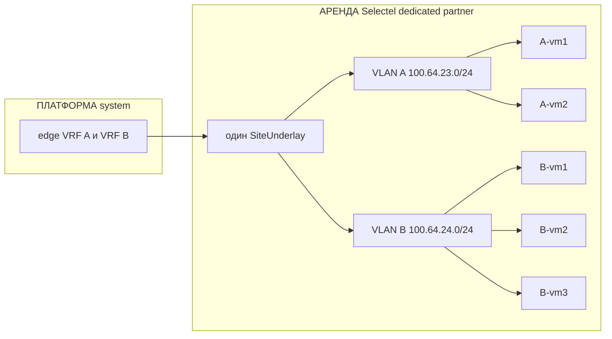

Два клиента делят ящик, не сеть. Allocator выдал два ProjectNet. На PVE два VLAN, пять tap.
A-vm1 пингует A-vm2 по bridge, без edge. До B-vm1 маршрута нет: другой VRF, другой VLAN.
К платформе каждая VM ходит в свой VRF → published своего проекта. Один underlay на dedicated,
не пять WG. Запрещено: общий `vmbr`, общий `10.0.0.0/24`, «гости видят друг друга потому что
один Selectel».

#### U2 — как U1, у B на VM docker-compose

Где: VM — **аренда** (тот же dedicated); docker0 — внутри гостя, не площадка и не платформа.

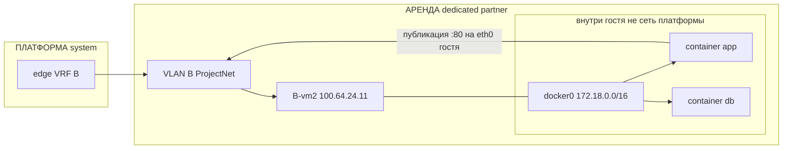

Сеть услуги — по-прежнему ProjectNet B, не compose и не LAN dedicated. Контейнеры на одной
VM разговаривают по docker0; платформа этот CIDR не знает и не маршрутизирует. Снаружи
(соседняя VM B, edge, агент) виден только `100.64.24.11:80`. Compose на PVE запрещён: тогда
стек обойдёт VLAN и увидит чужой сегмент. Если app и db разъедутся на две VM — это уже U1
east-west, в compose пишут адрес соседнего гостя из Estate, не имя контейнера.

#### U3 — VM добавили нодой в свой self-managed k8s

Где: ноды — **наше железо** или **аренда** (тот же ProjectNet). Control plane кластера — не
ядро платформы (не `ns: platform`).

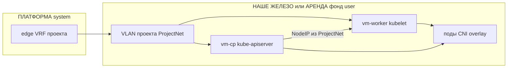

Роль гостя сменилась на kubelet, VRF нет. NodeIP и адрес apiserver — из того же ProjectNet.
Поды — ClusterOverlay (VXLAN и т.п.) поверх нод; edge поды /32 не держит. Allocator выдаёт
уникальные PodCIDR/ServiceCIDR этого кластера, не дефолт `10.42.0.0/16` как у соседа.
Ноду нельзя повесить в VLAN другого Project. Join — по адресу apiserver в ProjectNet, не
через WAN dedicated.

#### U4a — наша VM клиент Yandex Managed K8s

Где: VM — **наше железо** или **аренда** dedicated; кластер — **аренда** Yandex managed;
стык — **платформа** (edge).

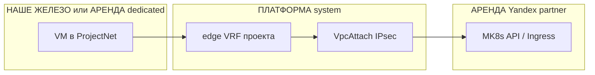

Услуга по умолчанию: VM **не** kubelet. Она ходит к API или Ingress кластера как клиент.
Стык — IPsec в VPC MK8s или только published HTTPS, если частный путь не нужен. В Estate
кластер — managed-ресурс, VM — compute. Нельзя писать в каталоге «нода в вашем k8s».

#### U4b — нода MK8s создаётся в облаке

Где: клиентская VM — **наши/аренда dedicated**; kubelet и CP — целиком **аренда** Yandex VPC.

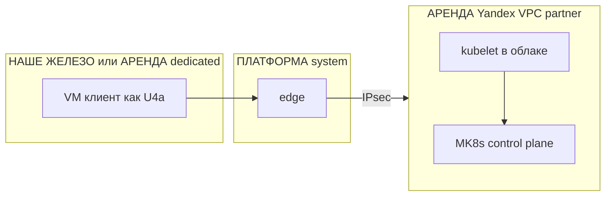

Kubelet живёт там, где его ждёт managed-продукт — в VPC Яндекса, не на dedicated. Наша VM
остаётся U4a. Plan, который рисует «нода на Selectel, control plane managed», без U4c — ошибка.

#### U4c — hybrid: наша VM как kubelet в MK8s

Где: kubelet — **наши/аренда dedicated**; API — **аренда** Yandex; анонс префикса — **платформа**.

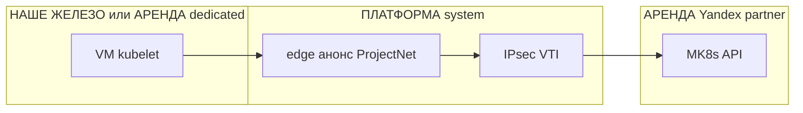

Только если API MK8s принимает внешний kubelet **и** мы анонсируем в VPC ProjectNet и PodCIDR
этой ноды. Иначе отказ Plan, не «попробуем join». Не обещаем в прайсе по умолчанию. Список
провайдеров, где это реально, — открытый пункт ADR.

#### U5 — self-k8s у нас, доп. нода в Selectel

Где: CP — **наше железо**; доп. нода — **аренда** Selectel; hairpin — **платформа**.

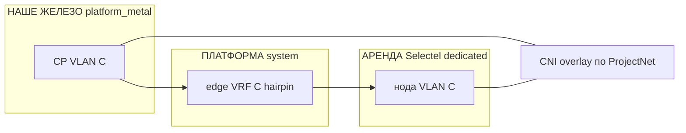

Один ProjectNet, два site, два ProjectSegment. Пакет нода↔apiserver идёт через edge (hairpin
VRF), не через интернет Selectel. CNI инкапсулирует поды по этому L3 — второй кластер не нужен.
Нода должна сесть в VLAN **этого** проекта на dedicated, не в VLAN соседа U1. mgmt PVE в join
не участвует.

#### U6 — только Managed K8s, своих VM нет

Где: сеть и hop — **платформа**; кластер — **аренда** Yandex. Нашего user-железа нет.

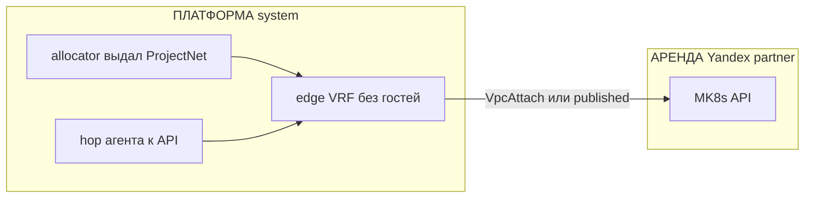

Compute на нашей стороне нет, сеть проекта всё равно есть: место под будущие VM, hop агента,
учёт в Inventory. Нельзя сказать «ProjectNet не нужен, потому что managed». Гостевого VLAN
на dedicated нет, пока не появится U1/U5.

#### U7 — весь self-k8s на одном dedicated

Где: все ноды — **аренда** одного dedicated; edge — **платформа**. Нашего железа нет.

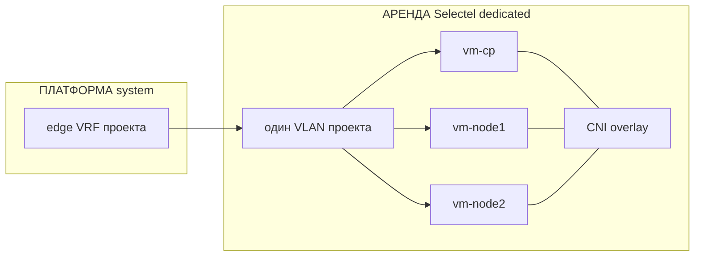

Как U3, один site: все NodeIP в одном ProjectSegment. East-west нод — по bridge, не через
edge. CNI нельзя сажать на mgmt-bridge PVE. Соседний проект на том же ящике — свой VLAN, свой
кластер, свой pod CIDR.

#### U8 — наша VM + managed БД в облаке

Где: VM — **наше железо** или **аренда** dedicated; БД — **аренда** managed; стык — **платформа**.

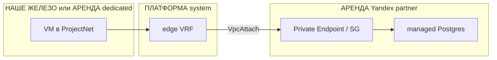

Цепочка как P4 в 0015.1: compute у нас, данные у провайдера. На RDS нет WG. БД не кладут в
VLAN dedicated и не выдают ей адрес из ProjectNet как гостю. VM ходит на endpoint в VPC;
чужой Project этот endpoint не резолвит.

#### U9 — BYO-площадка + VM на нашем dedicated

Где: LAN — **своё клиента**; VM — **аренда** dedicated (или наше железо); стык — **платформа**.

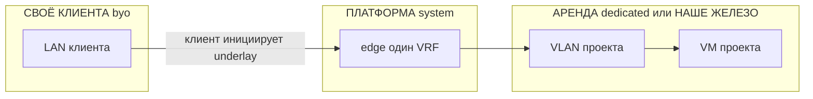

Два SiteUnderlay, один ProjectNet. Клиентский туннель инициирует дальняя сторона (NAT). Хост
у клиента и VM на dedicated видят друг друга в одном VRF. Нельзя склеить LAN BYO с VLAN
соседа на том же dedicated. Без поднятого BYO-underlay гостевой слой у клиента —
`placement-only` (0015.1).

## Явно вне периметра

- код edge, роль/чарт, точный hostname и выбор Linux vs VyOS сверх класса §3;
- продукт «VPN клиенту в офис» и сетка продажи (0015.2);
- TTL rotate ключей туннеля (остаётся открытым);
- замена mgmt-протокола 0014.1.1;
- объекты Intent/Plan (0015.3) — Attachment ссылается на них, не заменяет;
- публичный Ingress / Traefik как замена edge;
- оркестрация docker-compose платформой и compose на гипервизоре dedicated;
- гарантия «любая наша VM = нода Yandex MK8s» без U4c (внешний kubelet не обещаем по умолчанию).

## Открыто

- размер и разбиение пула `100.64.0.0/10` (или ULA);
- TTL и процедура ротации WG/IPsec ключей;
- обязателен ли data-туннель, если гостю достаточно только published Ingress;
- HA пары edge;
- откуда именно published-список (каталог 0015.2 vs объект Project);
- список MK8s-провайдеров, где U4c реально возможен (проверять API, не гадать).

## Последствия

- 0014.1.1 §3 остаётся mgmt-only; продукт overlay для **допуска в фонд** — WG как в §4, не
  отдельный «какой хочешь VPN».
- 0015.1 / 0015.2: открытый «продукт overlay / VPN» для связанности тенанта закрыт этим ADR
  на уровне роли edge и WG; продажа VPN клиенту по-прежнему вне периметра.
- 0015.3 Inventory `network_plane` получает смысл: edge + ProjectNet + observed, не «просто
  default gw на PVE».
- Allocator — домен `platform-api` (0015.2.1), не lk-api. LK видит свой CIDR и Attachment,
  не пул и не чужие VRF.

## Ссылки

- [ADR-0014.1.1](0014.1.1-resource-onboarding-protocol.md) — mgmt до ноды в фонде.
- [ADR-0014.1](0014.1-platform-resource-controller.md) — фонд, не маршруты тенанта.
- [ADR-0015.1](0015.1-infra-agent.md) §8–§9 — Inventory `network_plane`, `connect`.
- [ADR-0015.2](0015.2-admin-panel.md), [0015.2.1](0015.2.1-admin-panel-architecture.md) —
  каталог площадок, allocator.
- [ADR-0015.3](0015.3-contracts.md) — Estate / Inventory.
- [ADR-0015](0015-ai-agent-platform-architecture.md) — `ns: agents`, default-deny.
- [ADR-0016](0016-openbao-secrets-pki.md) — ключи туннелей.
- [ADR-0022](0022-new-component-requirements.md) — когда появится код edge, чек-лист аддона.
