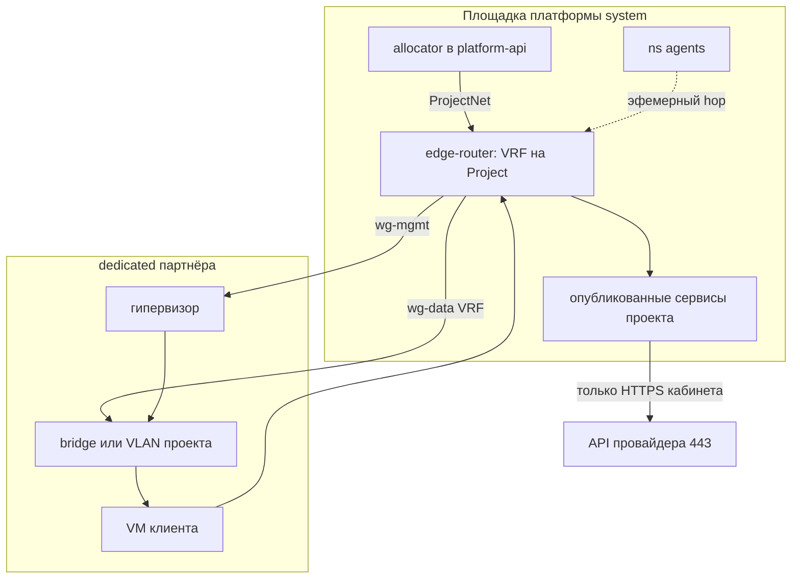

# ADR-0028: Сеть платформы — ProjectNet, edge, плоскости, туннели

- **Статус:** Предложено (архитектура; код, чарт и роль не реализованы)
- **Дата:** 2026-09-26
- **Авторы:** Alexandr Yankov (решения), Cursor (оформление по итогам обсуждения)

## Контекст

Пользователь Project создаёт VM, k8s, сети, БД (свои и managed), подключает своё или получает
ёмкость из фонда. Ресурсы появляются четырьмя путями: своё железо платформы, купленный dedicated /
IaaS, managed у провайдера, BYO клиента.

[ADR-0014.1.1](0014.1.1-resource-onboarding-protocol.md) §3 закрывает только **management plane**:
как control plane достаёт API/SSH/PVE (`local` / `api` / `overlay`). Пользовательские сети
тенанта туда явно не входят. Продукт overlay в [0015.2](0015.2-admin-panel.md) и [0015.1](0015.1-infra-agent.md)
оставлен открытым. Документа, где задаётся адрес проекта и где пакет реально едет, не было.

Без этого агент и Plan не отличают «сеть клиента» от LAN гипервизора и от кабинета Selectel, а
агент с доступом «во все туннели» видит соседа.

Этот ADR не пересматривает 0014.1.1 (mgmt), 0015.1 (оси `owner` / `procurement` / `connect`) и
не продаёт VPN как продукт клиенту (0015.2 §2). Код, hostname edge и дистрибутив пилота сюда
не входят сверх выбора класса (ниже).

## Схема

Сценарий-референс: платформа купила dedicated в Selectel, на нём Proxmox, в Project утвердили
VM — гость рождается **там**. У проекта своя сеть. С платформой связанность точечная.

## Решения

### 1. Определяют и маршрутизируют — разные места

**Решение:** адрес и VRF **задаёт** control plane; пакет **гоняет** datapath на краю и на
площадке. API не форвардит. Коммутатор на PVE не выдаёт CIDR проекта.

| Объект | Кто задаёт | Кто маршрутизирует |
|---|---|---|
| Prefix pool | platform-api / админка | никто |
| SystemNet | админка, `allocation: system` | mgmt-фабрик платформы (0014.1.1) |
| **ProjectNet** | allocator **при создании Project**: `vrf_id` + синтетический CIDR + DNS-зона | **platform edge**, таблица этого VRF |
| **Attachment** | Plan после Approve: ресурс Estate ↔ этот ProjectNet | FIB на площадке, где ресурс живёт, плюс туннель до edge |
| ObservedNet | не мы: Inventory `network_plane` | уже роутер площадки / облака |

Один SoT адресов тенанта — allocator в `platform-api`. Роль, cloud-init и агент не раздают
`10.x` «от себя».

Префикс проекта — **синтетический** (пул вроде `100.64.0.0/10` или ULA), не `10.0.0.0/8`.
Реальный CIDR площадки (VPC, BYO, LAN PVE) — observed. Коллизия с ProjectNet — отказ Plan, не
склейка.

**Обоснование:** иначе два Approve разъедутся, а hybrid/BYO с чужим `10` сломает таблицу.

### 2. Четыре плоскости, не одна сеть

**Решение:**

| Плоскость | Смысл | Не смешивать с |
|---|---|---|
| **mgmt** | фонд, tofu, PVE/SSH, API провайдера | NIC гостя |
| **data** | ProjectNet и его Attachment | SystemNet |
| **agents** | `ns: agents`, default-deny (0015) | стоячая mesh во все VRF |
| **published** | точечный выход VM на разрешённые имена проекта | «весь LAN платформы» |

Четыре канала связанности:

| Канал | Определяет | Маршрутизирует |
|---|---|---|
| Платформа ↔ облако | админка `connect: api`, tofu | HTTPS с system-узлов; VPC attach отдельно |
| Наша инфра ↔ платформа | SystemNet | mgmt, 0014.1.1 |
| Агенты ↔ платформа | 0015 (разрешённые svc) | внутри `ns: agents`; в ProjectNet — только hop на Run |
| Приложение ↔ платформа | published-список Project | edge + Ingress, без SystemNet и чужого VRF |

**Обоснование:** один туннель на mgmt + tenant + агентов даёт соседу чужой Estate.

### 3. Platform edge — программный роутер, не приложение

**Решение:** edge — системная VM (`allocation: system`): Linux + policy routing / VRF + nftables
или VyOS. Не под в k3s, не Traefik, не Authelia, не `egress-proxy` из 0015, не край провайдера.

Он: (1) держит таблицу на каждый Project; (2) терминирует стыки; (3) выпускает из VRF только
published.

Не край платформы: MikroTik и OpenWrt — класс CPE/площадки (P14), не концентратор VRF.
Пилот — Linux + WireGuard + nftables. VyOS — если появится BGP до официального Cloud VPN.

**Обоснование:** CNI кластера не терминирует туннели со всех dedicated и не изолирует ProjectNet.
Железо/CPE нельзя крутить из allocator так же, как VM в фонде.

### 4. Туннель по умолчанию — WireGuard; IPsec — адаптер

**Решение:** поле стыка `tunnel: wireguard | ipsec`.

- **WireGuard** — dedicated, который мы поставили; BYO за NAT (инициирует дальняя сторона,
  0015.1 §9); эфемерный peer агента.
- **IPsec (IKEv2, route-based VTI)** — только если провайдер отдаёт официальный Cloud VPN и
  своей VM-роутера в VPC нет.

Не дублировать WG+IPsec на одном стыке в v1. Не один IPsec «на всю платформу».

Ключи туннелей — OpenBao, как прочие секреты площадки (0016). Клиент ключ кабинета провайдера
не видит.

**Обоснование:** много VRF, NAT, автоматизация peer из allocator — сильная сторона WG.
IPsec нужен как чужой стандарт, не как «серьёзнее».

### 5. Референс: Project → dedicated Selectel → VM

**Решение:** типовой путь (P1: partner dedicated + виртуализация).

1. Админка: провайдер, `connect: api`, заказ dedicated. HTTPS только с платформы на API.
2. На ящике — ОС и гипервизор. Нода в фонде, метка `user`, площадка отдана Project.
3. Project уже имеет ProjectNet (пример: `100.64.23.0/24`, VRF `prj-23`).
4. Approve VM → apply по **wg-mgmt** на API гипервизора.
5. NIC гостя — на **отдельный** bridge/VLAN проекта, адрес из ProjectNet. Не на mgmt-bridge
   и не на WAN.
6. **wg-data** в том же VRF: edge ↔ этот VLAN. Два туннеля (или два VRF в одном конверте),
   не один WG на всё.
7. Inventory: observed IP, gw, `network_plane.edge`.

На dedicated минимум:

- WAN — только UDP туннеля, не `8006` в `0.0.0.0/0`;
- bridge mgmt — гипервизор / SSH;
- bridge проекта — только гости этого Project. Второй Project — второй VLAN.

L3 гостя в пилоте: шлюз ProjectNet на dedicated (VRF/netns), дальше `wg-data` на edge.

Published для VM (через data → edge), не весь `10.10.10.0/24`: их git/DNS, при необходимости
каталог **этого** клиента, scrape **к** VM. Нет: LiteLLM, Semaphore, API провайдера, SystemNet,
чужой ProjectNet. Интернет с VM — только если разрешён NAT в её VRF, не в обход через WAN
dedicated.

Агент не имеет стоячего маршрута в `100.64.23.0/24`. На Run — эфемерный WG-peer или bastion
в этом VRF; после Run peer снимается.

**Обоснование:** Selectel знает dedicated и кабинет платформы, не сеть тенанта. Связанность с
ядром есть только потому, что edge знает VRF и allow-list.

### 6. Пять способов ресурса — разные Attachment, один ProjectNet

| Откуда ресурс | Стык |
|---|---|
| Фонд `user` на нашем железе | VLAN/bridge проекта или WG в тот же VRF |
| Купленное IaaS | VPC, который создали мы; WG или IPsec на edge |
| Managed | Private Endpoint / SG в нашем VPC; WG на RDS нет |
| BYO | overlay инициирует клиент, приземление только в его VRF |
| Пользователи каталога | не сеть; FreeIPA / группы (0019) |

Без ProjectNet агент не предлагает «поставить VM в сеть». `network_plane` в Inventory без
выданного ProjectNet — чужая наблюдаемая сеть, не наша.

### 7. Порядок: сначала сеть проекта, потом гость

1. Создали Project → allocator выдал ProjectNet (ещё нет FIB).
2. Approve → Attachment в объекте (ещё нет пакета).
3. Apply на площадке → интерфейс / WG / endpoint.
4. Edge ставит маршрут «CIDR проекта → этот стык».
5. Inventory пишет observed.
6. Hop агента — только после шага 4, на время Run.

## Явно вне периметра

- код edge, роль/чарт, точный hostname и выбор Linux vs VyOS сверх класса §3;
- продукт «VPN клиенту в офис» и сетка продажи (0015.2);
- TTL rotate ключей туннеля (остаётся открытым);
- замена mgmt-протокола 0014.1.1;
- объекты Intent/Plan (0015.3) — Attachment ссылается на них, не заменяет;
- публичный Ingress / Traefik как замена edge.

## Открыто

- размер и разбиение пула `100.64.0.0/10` (или ULA);
- TTL и процедура ротации WG/IPsec ключей;
- обязателен ли data-туннель, если гостю достаточно только published Ingress;
- HA пары edge;
- откуда именно published-список (каталог 0015.2 vs объект Project).

## Последствия

- 0014.1.1 §3 остаётся mgmt-only; продукт overlay для **допуска в фонд** — WG как в §4, не
  отдельный «какой хочешь VPN».
- 0015.1 / 0015.2: открытый «продукт overlay / VPN» для связанности тенанта закрыт этим ADR
  на уровне роли edge и WG; продажа VPN клиенту по-прежнему вне периметра.
- 0015.3 Inventory `network_plane` получает смысл: edge + ProjectNet + observed, не «просто
  default gw на PVE».
- Allocator — домен `platform-api` (0015.2.1), не lk-api. LK видит свой CIDR и Attachment,
  не пул и не чужие VRF.

## Ссылки

- [ADR-0014.1.1](0014.1.1-resource-onboarding-protocol.md) — mgmt до ноды в фонде.
- [ADR-0014.1](0014.1-platform-resource-controller.md) — фонд, не маршруты тенанта.
- [ADR-0015.1](0015.1-infra-agent.md) §8–§9 — Inventory `network_plane`, `connect`.
- [ADR-0015.2](0015.2-admin-panel.md), [0015.2.1](0015.2.1-admin-panel-architecture.md) —
  каталог площадок, allocator.
- [ADR-0015.3](0015.3-contracts.md) — Estate / Inventory.
- [ADR-0015](0015-ai-agent-platform-architecture.md) — `ns: agents`, default-deny.
- [ADR-0016](0016-openbao-secrets-pki.md) — ключи туннелей.
- [ADR-0022](0022-new-component-requirements.md) — когда появится код edge, чек-лист аддона.
