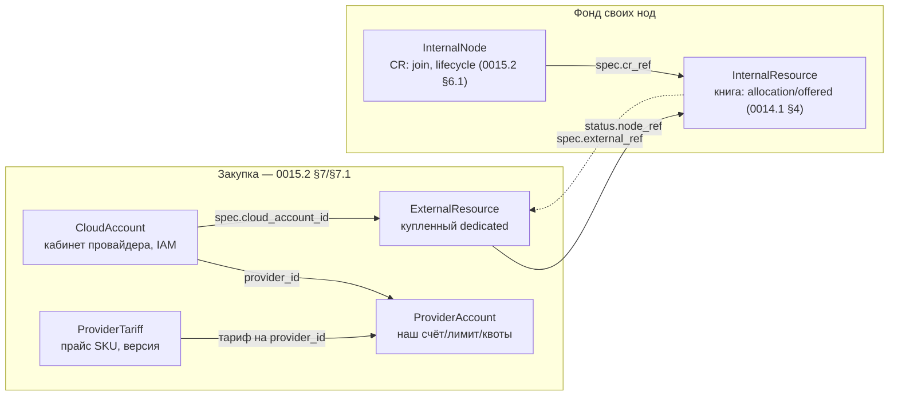

# Kind'ы `platform.devops-labs.ru/v1`

Карта объектов этого apiVersion и как они связаны. Не документ решения — сами решения в ADR,
на которые здесь ссылки; этот файл только собирает то, что разнесено по 0014.1 и 0015.2.

## Карта

Пунктир — связь по значению поля, не по прямой ссылке (сам текст называет её «один физический
ящик — две правды» для `ExternalResource`↔`InternalResource`). Сплошная стрелка — явное
поле-ссылка.

«FundNode» на экранах админки — ярлык той же строки `InternalResource`, не третий kind.

## Кто есть кто

| kind | Где определён | Что это | Пишет |
|---|---|---|---|
| `ExternalResource` | [0014.1](../02-control-plane/fund/0014.1-platform-resource-controller.md) §3, [0015.2](../02-control-plane/admin/0015.2-admin-panel.md) §7.1 | купленный/арендованный ресурс (dedicated, VPS, квота) | platform-resource-controller / cloud-sync |
| `InternalResource` | [0014.1](../02-control-plane/fund/0014.1-platform-resource-controller.md) §4 | своя нода — книга фонда (`allocation` / `offered` / observed) | sync (status); админка (политика) |
| `InternalNode` | [0015.2](../02-control-plane/admin/0015.2-admin-panel.md) §6.1 | CR: lifecycle join своей ноды (etcd control-plane) | node-operator |
| `ProviderAccount` | [0015.2](../02-control-plane/admin/0015.2-admin-panel.md) §7 | наш счёт, лимит, овердрафт, квоты у провайдера | platform-api (sync) / admin (лимиты) |
| `ProviderTariff` | [0015.2](../02-control-plane/admin/0015.2-admin-panel.md) §7 | версионированный прайс SKU провайдера | admin |
| `CloudAccount` | [0015.2](../02-control-plane/admin/0015.2-admin-panel.md) §7.1 | подключение платёжного кабинета провайдера (IAM, возможности) | admin (`owner: platform`) или LK (`owner: client`) |
