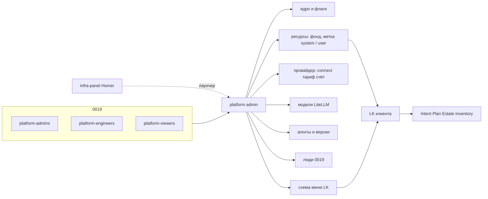
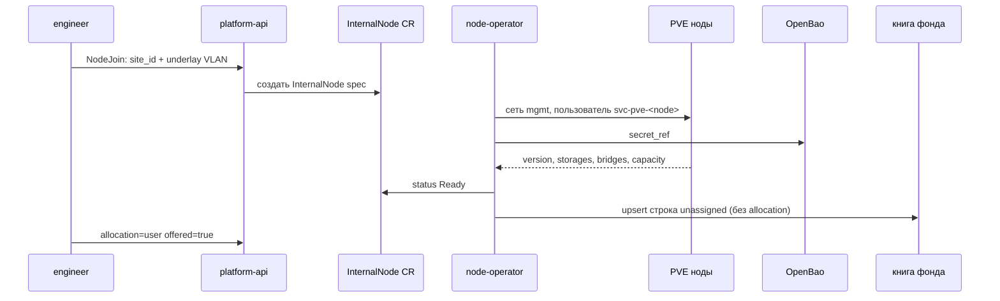

# ADR-0015.2: Platform admin — ресурсы, провайдеры, модели, агенты, люди

- **Статус:** Предложено (архитектурная граница; код и UI не реализованы)
- **Дата:** 2026-09-24 (дополнено 2026-09-27: вариант C — join ноды в CR, политика в книге;
  CloudAccount / dedicated / init ящика; зонд Selectel API — scope и envelope;
  карточка Project в админке, создать проект Selectel если пуст)
- **Авторы:** Alexandr Yankov (решения), Cursor (оформление по итогам обсуждения)

## Контекст

[ADR-0015.1](0015.1-infra-agent.md) закрыл контур клиента: Intent / Plan / Estate / Inventory,
куда кладём (`owner` / `procurement` / `connect`). Каталог площадок, ключи партнёров и то, какие
пункты меню видит LK, клиент настраивать не должен.

Сейчас у оператора нет конфигуратора:

- [infra-panel](0008-infra-panel-role.md) — Homer, стартовая страница со ссылками;
- Semaphore — ручной/аварийный run (0014);
- Open WebUI — чат с моделью, не создаёт Intent.

[ADR-0019](0019-platform-rbac-model.md) уже задаёт **кто** человек на платформе
(`platform-admins` / `platform-engineers` / `platform-viewers`). Этот ADR не пересматривает 0019
и не заводит группы на сервис. Он говорит, **какое приложение** крутит системный слой и как на
него ложатся те же три персоны.

Клиентский LK и `proj-*` (0019 §2, зарезервированы) сюда не входят.

## Схема



## Решения

### 1. Отдельное приложение, не LK и не Homer

**Решение:** системный слой — **platform admin**. Не раздел в кабинете клиента, не страница
Homer, не Semaphore. infra-panel может ссылаться на админку как на ещё один пункт лаунчера.

**Обоснование:** то же, что 0015.1 §1 и 0014: смешать кабинет клиента с настройкой ядра —
два контура в одном UI.

### 2. Что админка владеет

**Решение:** только политика и каталоги платформы, не инфру конкретного Project.

| Домен | Делает | Не делает |
|---|---|---|
| Ядро | окружения, feature flags, какие разделы LK живые | `kubectl` / Module CR руками вместо 0014 |
| Ресурсы | общий фонд; часть помечаем под систему, остальное отдаём пользователям (§6) | гипервизор / `tofu apply` / Estate клиента |
| Провайдеры | облака, к которым мы подключены: `connect`, тариф, **наш** баланс / лимит / овердрафт / квоты / потребление (§7) | ЛК клиента у провайдера; счёт клиенту; продукт VPN |
| Модели | каталог LLM/эмбеддингов за LiteLLM: что подключено, кому можно (§8) | замена движка 0021; прямые ключи в UI |
| Агенты | реестр: кто жив, версия, фреймворк (§9) | код агента, Temporal Worker, `agent-job` руками |
| Люди | список и **смена** членства `platform-*` (0019) (§10) | новые типы групп; `proj-*`; правка `svc-*` |
| Меню LK | какие пункты кабинета существуют и кому из клиентов видны | контент «Инфраструктура» (Intent/Plan) |
| Проекты | **read** карточек клиентов (0015.3 §6): phase, сеть, git, `provider_id` | секреты, Estate, Approve, Init за клиента |

Клиент в LK не видит ключи, org провайдера, `ProviderAccount` / тариф закупки, ресурсы с
`allocation: system`, чужие Project, редактор меню, флаги ядра, реестр агентов.

### 3. Кто ходит — те же `platform-*`

**Решение:** вход как у остальных сервисов за Authelia (0013 + 0019): claim `groups`, не локальные
роли админки.

| Группа 0019 | В platform admin |
|---|---|
| `platform-admins` | полное изменение доменов §2, включая счёт провайдера (`limit` / овердрафт / квоты) и людей |
| `platform-engineers` | ресурсы / `connect` / `offered`, каталог моделей и версии агентов; **нет** счёта провайдера, смены ядра, людей write, raw секретов |
| `platform-viewers` | только чтение |

Локальный break-glass — как в 0019 §7, не новая схема.

`proj-*` по-прежнему не заводятся (0019 §2). Когда появятся — это права **в LK клиента**, не
новые роли админки.

**Обоснование:** per-service группа `platform-admin-panel-admins` — то, от чего 0019 §1 отказался.
Три персоны уже отображаются в Grafana/Gitea/Semaphore; админка — четвёртый сервис на ту же
ось.

### 4. Секреты и ротация

**Решение:** партнёрские API-токены, overlay-ключи и ключи **внешних** моделей — только OpenBao
платформы (0016). Админка пишет *ссылку* на секрет и запускает rotate, сами значения в UI и в
объектах [0015.3](0015.3-contracts.md) не хранит. Клиент rotate не инициирует.

Интервал и алерт «rotate не прошёл» — открыто.

### 5. Каркас приложения — ADR-0015.2.1

**Решение:** граница и RBAC — здесь. Из каких процессов состоит админка, куда деплоится, как
стыкуется с Homer — [ADR-0015.2.1](0015.2.1-admin-panel-architecture.md). Макеты и стек UI
по-прежнему не рисуем до кода.

### 6. Ресурсы: общий фонд, метка системе или пользователям

**Решение:** книга — **весь фонд** того, на чём control plane может размещать нагрузку (общее
количество). Это не три сорта ресурсов (`platform` / `tenant` / `shared`). Оператор **выделяет
и помечает** часть фонда под систему платформы; туда едут только системные компоненты.
Остальное **отдаём пользователям** — там они размещают своё.

| Поле | Смысл |
|---|---|
| `resource_id` | стабильный id |
| `site_id` | площадка 0015.1 §9 (`owner` / `procurement` / `connect`) |
| `kind` | `node` \| `cluster` \| `pool` |
| `allocation` | `unassigned` — в фонде, ещё никому; `system` — помечен под платформу; `user` — отдан пользователям |
| `state` | `active` \| `drain` \| `failed` |
| `offered` | виден ли в LK; имеет смысл только при `allocation: user` |

Сводка фонда (обзор): `total` = все записи; `system` / `user` / `unassigned` — суммы по метке.
Новый ресурс входит как `unassigned`, пока оператор не пометил и не отдал.

Правила размещения:

- системный компонент (Authelia, LiteLLM, агенты платформы, …) — только `allocation: system`;
- клиентский P* / Project — только `allocation: user`;
- `unassigned` — не место размещения, только учёт «есть в фонде».

Третьего режима «на этом же куске и система, и клиент» нет: чтобы не отдать пользователю ноду,
на которой крутится ядро, её нужно **пометить** `system`, а не «поделиться».

Появление и сверка строк фонда — [ADR-0014.1](0014.1-platform-resource-controller.md):
`ExternalResource` (купленное) и `InternalResource` (свои ноды). Метку `allocation` тот
контроллер не ставит.

Квоты и деньги провайдера на ресурс **не** вешаем — они на карточке провайдера (§7).
Свои ноды и **уже наш** dedicated после init входят в **тот же** фонд: underlay VLAN
гипервизоров → join → ёмкость в книге. Спека join — §6.1. Кабинет облака, заказ ящика и
SSH-init до `:8006` — §7.1.

**Обоснование:** иначе клиентский стенд садится на ноду LiteLLM / Authelia, или системный
аддон — в чужой Project.

### 6.1 Свои ноды: CR на lifecycle, книга на политику (вариант C)

**Решение:** две правды, не одна. Свои ноды (`platform_metal`) и уже наш dedicated после
PVE — **один** контур join. Клиентские VLAN (0028) сюда не входят.

| Слой | Где живёт | Что хранит | Кто пишет |
|---|---|---|---|
| **Join / observed** | CR `InternalNode` в `ns: platform` (etcd кластера control-plane) | как нода входит, системный пользователь, факты PVE, ёмкость | оператор **ноды** (не 0014) |
| **Политика фонда** | `platform-api` (книга §6) | `allocation`, `offered`, drain, привязка к `site_id` | админка; оператор ноды **не** пишет |
| Секреты | OpenBao | пароль/токен `svc-pve-*` | оператор ноды создаёт, в книге только `secret_ref` |

Сырой etcd «рядом с кластером» не заводим: SoT join — Kubernetes API, за ним etcd k3s.
Отдельная etcd-касса — третий SoT, отвергнут.

Это не пересмотр 0014 (без CRD `Host` для apply) и не SoT денег: `ProviderAccount` и
`ProjectQuota` в книге / §7, не в CR.



**Сеть join.** Нода садится в **underlay VLAN гипервизоров** (mgmt / SystemNet, 0014.1.1).
Из этого VLAN control plane видит `:8006`. Ресурсы ноды (ядра, RAM, диск, слоты VM) после
Ready попадают в **общий фонд**. Tenant ProjectNet / VLAN клиента на этой ноде режет уже
0028, не этот join.

**Системный пользователь** (один на ноду, не человек 0019):

| | Значение |
|---|---|
| id | `svc-pve-<pve_name>@pve` |
| где секрет | OpenBao, `secret_ref` в CR и в книге |
| можно | создать/удалить VM и CT; Resource Pool; SDN/VLAN (network); storage (datastore) |
| нельзя | `Administrator` / `root@pam`; Permissions.Modify на весь `/`; чужие ноды site, если токен scoped |
| роли PVE (ориентир) | `PVEAdmin` **на `/nodes/<name>`** + `Pool.Allocate` + `SDN.Allocate`/`SDN.Use` + `Datastore.Allocate`; не `/` целиком |

Пользователя создаёт оператор ноды при join (из bootstrap-admin разово, как Init 0015.1, затем
bootstrap с ноды убирается). Клиент этот логин не видит.

**CR `InternalNode`** — желаемое и observed lifecycle:

```yaml
apiVersion: platform.devops-labs.ru/v1
kind: InternalNode
metadata:
  name: proxnode1
  namespace: platform
spec:                                 # пишет platform-api по заявке engineer
  site_id: aicd
  source: proxmox                     # proxmox | libvirt | k3s | bare
  pve_name: proxnode1
  underlay_vlan: 10                   # VLAN гипервизоров, не ProjectSegment
  connect: local                      # local | overlay
  secret_ref: secret/pve/proxnode1    # после первого reconcile
status:                               # пишет только node-operator
  phase: Pending | Joining | Ready | Degraded | Failed
  mgmt_ip: 10.10.10.20
  pve_version: "8.4"
  principal: svc-pve-proxnode1@pve
  capacity:
    cpu_cores: 32
    memory_mib: 131072
    disk_gib: 4000
  facts:
    storages: [local-lvm, tank]
    bridges: [vmbr0]
  conditions:
    - type: NetworkReady
    - type: PrincipalReady
    - type: ApiReady
    - type: BookUpserted
  observed_at: "2026-09-27T05:00:00Z"
```

`phase: Ready` без `BookUpserted` — join не закончен: ёмкости в фонде ещё нет.

**Строка книги** (то, что видит админка / LK-срез) — политика + проекция observed:

```yaml
apiVersion: platform.devops-labs.ru/v1
kind: FundNode
metadata:
  resource_id: aicd:pve:proxnode1     # = InternalResource 0014.1
  site_id: aicd
spec:
  origin: internal
  kind: node
  source: proxmox
  cr_ref: platform/InternalNode/proxnode1
  allocation: unassigned              # только админка
  offered: false                      # только админка, имеет смысл при user
  state: active                       # drain пишет админка; failed — с CR
status:                               # копия с CR, пишет sync из оператора
  phase: Ready
  capacity: {cpu_cores: 32, memory_mib: 131072, disk_gib: 4000}
  secret_ref: secret/pve/proxnode1    # не значение
```

**Не разведено с `InternalResource` (0014.1 §4).** Тот же `resource_id`, тот же общий смысл
строки — но другой `kind` и другой набор полей (`cr_ref`/`secret_ref` здесь, `facts`/`capacity`
напрямую там). Явного решения «переименовать» или «развести по ролям» пока нет — см. сноску и
открытый пункт в 0014.1 §4.

**Кто пишет что**

| Поле | Node-operator (CR) | platform-api / админка | 0014 apply |
|---|---|---|---|
| `InternalNode.spec` (site, vlan, source) | нет | да (заявка join) | нет |
| `InternalNode.status`, principal, capacity | да | нет | нет |
| `FundNode.allocation` / `offered` / drain | нет | да | нет |
| upsert `FundNode` при Ready | да, только unassigned + status | нет | нет |
| Module / inventory | нет | нет | да |
| Estate клиента | нет | нет | нет |

Оператор **не** выставляет `user` и не публикует `offered`. Иначе нода с ядром уедет в LK.

**Заявка в админке** (`NodeJoin` — POST в platform-api, не третий SoT):

| Поле | Смысл |
|---|---|
| `site_id` | площадка уже есть в каталоге (0014.1.1 §1) |
| `source` | `proxmox` в v1 |
| `pve_name` / `mgmt_hint` | как найти ноду в underlay |
| `underlay_vlan` | VLAN гипервизоров |
| `connect` | `local` если L3 уже есть; `overlay` — туннель до sync |

Ответ: создан CR, `phase` крутится в UI. Отказ: нет `site_id`; underlay не сходится; API PVE
не отвечает; не создался principal.

PVE Resource Pool оператор **может** завести как ярлык ноды. Это не строка фонда и не
изоляция тенантов (0028 §8.1).

**Обоснование:** Ивану нужен reconcile «хочу ноду → она в фонде». Админке нужны метки и
срез LK без зависимости от etcd как кассы. Два объекта — чтобы эти контуры не писали в
одно поле.

### 7. Провайдер: connect, тариф и **наш счёт у него**

**Решение:** баланс, лимит, овердрафт, квоты и потребление — поля **провайдера**, не ресурса и
не отдельного домена «закупка». Это наш кабинет у Selectel / Yandex / … : сколько там денег,
какой потолок, какие квоты API/квот облака, что уже съели.

У `procurement: partner` (и облачного кабинета, если он наш) обязательно:

1. **`connect`** — `local` / `api` / `overlay` (0015.1 §9). Ключи — OpenBao, §4.
2. **`ProviderTariff`** — как мы тарифицируем SKU этого провайдера (версионированный документ).
3. **`ProviderAccount`** — живой счёт и квоты **этого** `provider_id`.
4. **`CloudAccount`** — подключение кабинета и его возможности (§7.1). Не этот счёт.

`platform_metal` кабинета у облака нет — счёта нет, только ресурсы §6. Сетка продажи клиенту
по-прежнему открыта (0015).

```yaml
apiVersion: platform.devops-labs.ru/v1
kind: ProviderAccount
metadata:
  provider_id: selectel
  currency: RUB
  period: calendar_month
spec:                              # задаёт оператор (admins)
  limit:
    amount: "50000.00"             # наш потолок трат у этого провайдера
  overdraft:
    enabled: true
    amount: "10000.00"
    action: freeze_new_placement   # иначе alert_only
  quotas:                          # квоты кабинета провайдера, не placement
    - name: vcpu
      unit: cores
      limit: "64"
    - name: floating_ip
      unit: pcs
      limit: "8"
    - name: projects
      unit: pcs
      limit: "3"
status:                            # пишет platform-api (синк / ввод)
  period_start: "2026-09-01"
  balance: "18420.00"              # сколько у нас там осталось (prepaid) или лимит − consumed
  consumed_amount: "31580.00"      # деньги за период
  in_overdraft: false
  consumption:                     # что потребляем сейчас, в единицах квот и SKU
    - name: vcpu
      used: "40"
    - name: floating_ip
      used: "5"
    - sku: dedicated.generic
      used: "2"
      amount: "24000.00"
    - sku: traffic.egress
      used: "800"
      unit: gib
      amount: "4000.00"
```

Тариф (как считать деньги с SKU) — отдельный документ на том же `provider_id`:

```yaml
apiVersion: platform.devops-labs.ru/v1
kind: ProviderTariff
metadata:
  provider_id: selectel
  version: 3
  currency: RUB
  period: calendar_month
spec:
  items:
    - sku: dedicated.generic
      unit: month
      price: "12000.00"
    - sku: traffic.egress
      unit: gib
      price: "5.00"
```

Правила счёта (всегда `provider_id`, не `resource_id`):

- `balance` / `limit` / `overdraft` — деньги **нашего** договора с этим провайдером.
- `quotas[].limit` vs `consumption[].used` — квоты кабинета (vCPU, IP, проекты, …), которые
  провайдер нам выдал, и факт потребления.
- Исчерпан денежный `limit + overdraft` **или** любая квота с `used >= limit` →
  `action: freeze_new_placement` на ресурсах **этого** провайдера; уже живущее не гасим.
- `alert_only` — только сигнал.
- Порог предупреждения по умолчанию — 80% денежного `limit` и 80% каждой квоты.
- Смена тарифа — новый `version`; прошлый период не пересчитываем.

Ресурс (метка `allocation`, drain) отвечает «из фонда кому отдан». Провайдер отвечает «на каких
условиях мы у него живём и сколько уже съели».

### 7.1 Кабинет облака, dedicated и init ящика

**Решение:** платёжный аккаунт провайдера — **не** нода и не строка фонда. Это срез облака:
другой API, другие возможности. Ящик (dedicated) появляется после discover или заказа.
В общий пул ёмкости он входит **после** той же инициализации, что своя нода (§6.1).

Три объекта, не один «ресурс Selectel»:

| Объект | Что это | API | Куда пишем |
|---|---|---|---|
| **CloudAccount** | платёжный кабинет (`account_id` у провайдера) | IAM + баланс + dedicated API | админка (`owner: platform`) или LK (`owner: client`); секрет в OpenBao |
| **CloudBox** (`ExternalResource`) | dedicated как услуга: uuid, WAN IP, ОС, биллинг | только API провайдера | книга закупки; ёмкости PVE ещё нет |
| **FundNode** + `InternalNode` | уже наш гипервизор | SSH → потом PVE `:8006` | тот же контур, что §6.1 |

«Проект» Selectel (IAM / OpenStack) — **не** наш Project и **не** имя сервисного
пользователя. Токен бывает account-scoped (кабинет, баланс) и project-scoped (услуги
внутри их проекта). Имя пользователя и имя их проекта — разные поля: зонд 2026-09-27
(кабинет `635272`, user `agent.devops-labs.ru`) — единственный проект называется `WAVE`,
project-scope на имя пользователя даёт `401`. Наш Project один, `provider_id: selectel`.

Чей кабинет — ортогонально слоям create (0028 §5.3):

| Кто платит | Где подключают | `procurement` | Куда садится dedicated после init |
|---|---|---|---|
| мы | platform admin | `partner` | **фонд**: `unassigned` → engineer ставит `user` / `offered` |
| клиент | его LK | `byo` | **Estate этого Project**, не общий фонд |

Клиентский кабинет в общий пул не кладём: иначе чужой ящик станет offered-ёмкостью соседа.

`ProviderAccount` (§7) — деньги и лимит **нашего** договора. `CloudAccount` — подключение и
возможности. Два поля, одна связка `provider_id`. У `byo` своего `ProviderAccount`
платформы нет: ключ живёт в OpenBao **Project**.

#### Selectel API (коннектор v1)

Документация: [аутентификация](https://docs.selectel.ru/api/authorization/),
[dedicated v2](https://docs.selectel.ru/api/dedicated/). Проверено живым зондом
2026-09-27 (кабинет `635272`).

Токен: Keystone `POST https://cloud.api.selcloud.ru/identity/v3/auth/tokens`, живёт 24 часа,
в запросах `X-Auth-Token`. Нужен **сервисный пользователь** (имя + пароль + `account_id`),
не статический `X-Token` панели — dedicated его не принимает.

Cloud-sync выписывает **два** токена с одним секретом:

| Scope | Зачем | Без какой роли пусто |
|---|---|---|
| **account** | баланс `GET https://api.selectel.ru/v3/balances`; каталог локаций/SKU | `billing` / `dedicated.viewer` / `account_owner` — иначе 403 (`nobody` не считает) |
| **project** | купленное железо, IP, power, boot | `member` / `dedicated.viewer` / `dedicated.admin` на **этом** проекте |

Список их проектов: `GET https://cloud.api.selcloud.ru/identity/v3/auth/projects` (и зеркало
`GET https://api.selectel.ru/vpc/resell/v2/projects`). Не угадывать имя проекта по логину.

Если список **пуст** (кабинет без проектов) — cloud-sync **создаёт** проект Selectel с именем
нашего `slug` (`POST` VPC/resell projects), пишет `selectel_project_id` в карточку. Нужен
account-scope с правом создавать проекты (`member` / owner на аккаунте). `nobody` — `Degraded`
и инструкция клиенту, не тихий пропуск. Несколько уже существующих — не создаём второй;
клиент выбирает один, иначе отказ (один Project — один их проект). То же правило для
`partner`: в **нашем** кабинете, если для этого slug проекта ещё нет — заводим, чтобы
изолировать квоты Selectel от соседа. Этап 2 (0015.1 §1.1), не регистрация.

Dedicated база: `https://api.selectel.ru/servers/v2`. Ответ всегда конверт:

```text
{task_id, status, progress, page, limit, item_count, execution_time, result}
```

`result` — список или объект. Плоского JSON «как в книге» API не отдаёт.

Роли IAM (`GET /iam/v1/roles`, 60 штук). Нужные нам:

| Роль | scope | Зачем нам |
|---|---|---|
| `dedicated.admin` | account + project | заказ, питание, ОС, SSH-ключи |
| `dedicated.viewer` | account + project | list без заказа |
| `member` | account + project | зонд: list resource / IP / power / boot на проекте |
| `reader` | account + project | слабее `member` |
| `billing` | только account | баланс и прогноз |
| `iam.admin` / `iam.viewer` | только account | люди кабинета, не dedicated |

Возможности **кабинета** (слой 1), которых у ноды нет — и какой вызов что значит:

| Вызов | Что это | Scope / роль |
|---|---|---|
| `GET /location` | каталог площадок (SPB/MSK/…), не наши ящики | account, даже `nobody` |
| `GET /service/server` | каталог SKU к заказу (`uuid`, `tariff_line`, cpu/ram/disk, `is_order`) | то же; **не** купленное |
| `GET /service` | тот же каталог услуг шире (server + network + …) | то же |
| `GET /resource` | **купленные** ящики | project `member+`; account `nobody` → 403 `user_resource_list` |
| `GET /network/ipam/ip` | WAN; связь `resource_uuid` → сервер. IP **не** в карточке server | как `/resource` |
| `GET /power/{uuid}` | `result.driver_status.power_state` | project |
| `GET /boot/os/{uuid}` | факт ОС на ящике | project |
| `GET /boot/template/os` | образы для заказа | нужна роль сильнее `nobody` |
| `POST /resource/server/billing` | заказ (`location_uuid`, `service_uuid`, `price_plan_uuid`, `user_desc`) | `dedicated.admin` |
| `GET /v3/balances` | деньги кабинета | account + `billing` (или owner / dedicated.viewer) |

Чего у кабинета **нет**: PVE, VLAN тенанта, WG, `svc-pve-*`, ёмкость для гостей. WAN из IPAM —
ещё не underlay.

Terraform `selectel_dedicated_server_v1` — тот же слой 1 (раннер 1 / state 1), не
node-operator.

#### CloudAccount

```yaml
apiVersion: platform.devops-labs.ru/v1
kind: CloudAccount
metadata:
  account_id: platform-selectel           # наш id, не номер Selectel
spec:                                     # пишет админка или LK
  provider_id: selectel
  owner: platform                         # platform | client
  procurement: partner                    # partner | byo
  selectel:
    account_id: "635272"                  # номер кабинета my.selectel.ru
    identity_url: https://cloud.api.selcloud.ru/identity/v3
    preferred_scope: project              # list dedicated; account — баланс/каталог
    project_name: WAVE                    # их проект, не логин сервисного пользователя
    project_id: 35605418d6954f9d9b448cd74546eaa1
  secret_ref: secret/providers/selectel/platform
  capabilities_wanted: [dedicated]        # v1 — только dedicated
status:                                   # пишет cloud-sync, не человек
  phase: Pending | Ready | Degraded
  token_ok: true
  roles_seen:
    account: [nobody]                     # зонд: так и было; list resource пуст
    project: [member]                     # WAVE: list / power / boot
  balance: null                           # 403 без billing; иначе зеркало в ProviderAccount
  inventory:
    dedicated: 2
    classes: [server]
    projects: [WAVE]
  last_sync: "2026-09-27T05:00:00Z"
```

`phase: Ready` — выписан токен **того** scope, которым открывается `GET /resource`.
Токен кабинета при `nobody` и пустой inventory — `Degraded`, не Ready: каталог SKU ещё не
фонд. `project_name` / `project_id` sync заполняет из `auth/projects`, если оператор не
задал (один проект — берём его; несколько — отказ, выбрать явно).

Платформа: engineer создаёт карточку, ключ кладёт admin в OpenBao, sync проверяет токен.
Клиент в LK: тот же объект, `owner: client`, секрет Project. Дальше Init 0015.1 §6: разово
bootstrap, завести RO (`dedicated.viewer` или project `member`, без `dedicated.admin` /
`billing`), повседневный обход только под ним.

После `Ready` у кабинета есть **карта возможностей**, не нода. Карта зависит от
`roles_seen`, не от желаемого `capabilities_wanted`:

| умеет (при роли) | не умеет никогда |
|---|---|
| локации / SKU — даже `nobody` | VLAN клиента, VM, WG, `:8006` |
| list ящиков / WAN / power — `member` или `dedicated.*` на проекте | считать CPU в фонде |
| баланс — `billing` на аккаунте | |
| заказ — `dedicated.admin` | |

#### Discover и заказ dedicated

```
CloudAccount
        │
        ├─ account token  → GET /location + GET /service/server   (каталог)
        │                   GET /v3/balances                      (если billing)
        └─ project token  → GET /resource                         (купленное)
                            GET /network/ipam/ip                  (WAN)
        │
        ├─ есть server uuid ──► ExternalResource  exists=true
        │
        └─ заказать ──► POST /resource/server/billing
                         ждать task + строка в /resource + IP в ipam
                         SSH-ключ в автоустановку
                         state: ordered → provisioning → active
```

`GET /service` / `/service/server` — **не** inventory. Смешивать со `/resource` нельзя:
каталог сотни SKU, купленное — единицы.

`ExternalResource` (0014.1 §3). Поля с `/resource` + IP с ipam. `site_id` пуст, пока нет init.

```yaml
kind: ExternalResource
metadata:
  resource_id: selectel:dedicated:<uuid>  # result[].uuid
spec:
  origin: external
  provider_id: selectel
  class: dedicated
  sku: DL24                               # result[].info
  connect: api
  cloud_account_id: platform-selectel
  site_id: null
  user_desc: prox_node_1                  # имя в их панели
  location_uuid: edf295d6-…               # SPB-5 и т.п.
  selectel_project_id: 35605418d6954f9d9b448cd74546eaa1
status:
  exists: true
  state: active                           # result[].state
  wan_ip: 31.184.219.221                  # ipam.ip где resource_uuid = uuid
  power: "power on"                       # GET /power/{uuid}
  config_name: "2 × Intel Xeon Silver 4114…"
  consumed:
    sku: DL24
    amount: "22700.00"                    # billing.price.amount_due
    currency: rub
    paid_till: 1792476660
  node_ref: null
```

Это ещё **не** фонд ёмкости. Деньги/SKU — да. Слоты VM — нет.

Заявка `OrderDedicated` (POST в platform-api; LK — только свой `CloudAccount`):

| Поле | Смысл |
|---|---|
| `cloud_account_id` | кабинет уже `Ready` |
| `location_uuid` / `service_uuid` / `price_plan_uuid` | из каталога Selectel |
| `user_desc` | имя в их панели |
| `os_id` / `ssh_key_ref` | автоустановка; ключ — наш, из OpenBao |

Отказ: нет `dedicated.admin`; кабинет не Ready; `byo` заказывает в чужой аккаунт.

#### Слой ноды: SSH, тот же init, что у внутренней

Когда есть ОС и IP, облако кончается. Дальше контур §6.1 плюс шаг до `:8006`.

SSH — не у LLM-агента. Инфра-агент только вызывает tool. Ходит **node-init** (раннер 1 /
тот же node-operator): ключ площадки из OpenBao, временный `22` на WAN.

Профиль init — **тот же**, что у своей ноды:

1. ОС, NTP, hostname, убрать дефолтные пароли.
2. PVE, API на mgmt, не на `0.0.0.0`.
3. `svc-pve-<name>@pve`, секрет в OpenBao.
4. Первая VM — **роутер** (не нода k8s): VRF, VLAN клиентов, `wg-data` на platform edge.
   На хосте PVE — только `wg-mgmt` (0028 §5.3).
5. VLAN тенантов **заворачиваются в WG**, не торчат в интернет Selectel. WAN ящика — UDP
   туннеля; после up публичные `22`/`8006` закрываются.
6. CR `InternalNode` → Ready → upsert `FundNode` `unassigned` (`partner`) **или** запись в
   Estate (`byo`).

Связь двух строк:

```
ExternalResource.status.node_ref = aicd:pve:sel-spb-1
FundNode.external_ref            = selectel:dedicated:<uuid>
```

Один физический ящик — две правды (0014.1.1): кабинет и гипервизор.

```mermaid
sequenceDiagram
    participant Eng as admin или LK
    participant API as platform-api
    participant Sel as API Selectel
    participant Box as dedicated WAN
    participant Init as node-init
    participant CR as InternalNode
    participant Book as книга / Estate

    Eng->>API: CloudAccountAttach + secret_ref
    API->>Sel: Keystone account + project tokens
    Sel-->>API: roles_seen (account / project)
    API->>Sel: GET /resource + GET /network/ipam/ip
    Sel-->>API: uuid, user_desc, WAN
    alt заказ нового
        Eng->>API: OrderDedicated
        API->>Sel: POST /resource/server/billing + SSH key
        Sel-->>Box: ОС + WAN IP
    end
    API->>Book: ExternalResource (закупка)
    Init->>Box: SSH bootstrap (временно на WAN)
    Init->>Box: PVE + svc-pve + vm-router + WG
    Init->>CR: spec + status Ready
    alt partner
        Init->>Book: FundNode unassigned
        Eng->>API: allocation=user offered
    else byo
        Init->>Book: Estate dedicated+node
    end
    Note over Box: 22/8006 с WAN закрыты, остаётся WG
```

**Кто пишет что**

| Действие | cloud-sync | node-init | админка / LK | 0014 apply |
|---|---|---|---|---|
| токен, list кабинета, баланс | да | нет | секрет / лимит | нет |
| заказ dedicated | да (по заявке) | нет | заявка | нет |
| SSH / PVE / роутер / WG | нет | да | нет | нет |
| `allocation` / `offered` | нет | нет | да (только `partner`) | нет |
| Estate / Plan | нет | факт ноды | клиент Approve | после Approve |

Пока WG не встал: `connect` кабинета = `api`, ящика = временный SSH. После init площадка =
`overlay`, дальше как своя нода (§6.1).

**v1.** В облаке создаём и видим только dedicated (`class: server`). VPC / MK8s / S3 —
те же возможности кабинета, другие kind, позже. Один CloudAccount — один `provider_id`.
Второй кабинет другого облака в том же Project — нет. Клиент в LK не видит наш
`ProviderAccount` и не ходит нашим ключом.

**Обоснование:** кабинет умеет заказать железо и не умеет резать VLAN. Склеить это в одну
строку фонда — либо отдать клиенту пустой WAN, либо считать ёмкость до PVE. Два слоя create
уже есть в 0015.1 §9 и 0028 §5.3; здесь — объекты и кто их пишет.

### 8. Модели

**Решение:** админка показывает и включает **то, с чем платформа реально ходит в LiteLLM**
(0015 §6, 0021) — локальный инференс и внешние API, когда они появятся. Не второй роутер.

| Поле | Смысл |
|---|---|
| `model_id` | псевдоним LiteLLM |
| `kind` | `chat` \| `embed` |
| `backend` | `local` \| `external` |
| `provider_id` | если `external` — тот же каталог §7 (токен и spend) |
| `purpose` | `platform` \| `tenant` \| `both` |
| `state` | `enabled` \| `disabled` \| `drain` |

Ключи внешних моделей — OpenBao. Оператору видно «задан / rotate», не значение. 0021 остаётся
выбором **локального** движка и пилотной модели, не этим каталогом.

### 9. Агенты и версии

**Решение:** реестр агентов платформы, не репозиторий их кода. Фреймворк — поле записи, не
догма UI: 0015 §11 фиксирует OpenAI Agents SDK как **дефолт новых** `agent-job`, но на платформе
уже есть и будут другие контуры (`moon-local-engineer` и т.п.).

| Поле | Смысл |
|---|---|
| `agent_id` | `infra` \| `monitoring` \| `kb` \| `coding` \| `testing` \| иной зарегистрированный |
| `version` | semver или tag образа |
| `framework` | `openai-agents-sdk` \| `langgraph` \| `crewai` \| `autogen` \| `llamaindex` \| `pydantic-ai` \| `custom` |
| `image_ref` | что реально крутится |
| `models` | список `model_id` из §8, которыми этому агенту можно |
| `state` | `enabled` \| `disabled` \| `drain` |

Смена версии в админке — желаемое состояние. Выкат — тот же контур, что у остальных аддонов
(0014 / Helmwave), не `kubectl` из UI.

### 10. Люди: читать и менять 0019, не изобретать роли

**Решение:** раздел «Люди» — операторский UI над той же моделью [0019](0019-platform-rbac-model.md).
SoT групп и учёток — FreeIPA. Админка **не** заводит `platform-admin-panel-*` и не рисует свои
роли.

Можно: список людей и групп; членство в `platform-admins` / `engineers` / `viewers`; завести
человека (пароль — OpenBao, смена при первом входе, как 0019 §3); выключить / включить.
Нельзя: новые имена групп; `proj-*` (по-прежнему резерв); править `svc-*`; удалять последнюю
учётку в `platform-admins`; снять с себя последний admin, если другого admin нет.

`freeipa_directory` остаётся GitOps-базой и аддитивна (0019 §3). Живая смена членства из
админки идёт в FreeIPA сразу и **не** вычищается следующим прогоном роли (нет полного prune).

### 11. Производные от §6–§10

Следует из правил выше, отдельно не обсуждалось — принимаем здесь:

| Производное | Зачем |
|---|---|
| Нельзя отдать последнее `system` | в фонде должна остаться помеченная система, иначе некуда класть ядро |
| Drain ресурса | новые размещения стоп, живое не трогаем — то же семейство, что freeze провайдера |
| Привязка модель→агент | агент не вызывает то, чего нет в его `models` |
| Spend внешней модели | идёт в `ProviderAccount` того `provider_id`, не на ресурс и не отдельной кассой |
| Аудит мутаций | кто сменил группу, тариф, `allocation`, версию агента |
| Сервисные учётки | `svc-*` видны read-only, чтобы не путать с людьми |
| Самоблокировка | API отвергает операцию, после которой не останется ни одного `platform-admins` |

## Открыто

- ~~продукт overlay (свой WG hub или иной)~~ — роль края и туннели: [ADR-0028](0028-platform-network.md);
  VPN как продукт клиенту по-прежнему вне периметра;
- TTL и процедура ротации;
- обязателен ли overlay до партнёрской VM, если хватает API + cloud-init (0015.1 §9);
- сетка тарифов **продажи** клиенту и маржа;
- откуда пишется `ProviderAccount.status` (тик 0014.1, выгрузка, ручной ввод);
- ~~минимальная роль Selectel для клиентского RO-Init~~ — list: project `member` или
  `dedicated.viewer` (зонд: `member` на `WAVE` достаточно). Заказ — `dedicated.admin`.
  Баланс — `billing` на аккаунте. `nobody` на кабинете к inventory не годится;
- один node-init на `partner` и `byo` или два `secret_ref`;
- код, точный hostname, стек UI, БД `platform-api` (0015.2.1).

## Явно вне периметра

- клиентский LK и объекты [0015.3](0015.3-contracts.md);
- пересмотр набора групп 0019 и заведение `proj-*`;
- замена infra-panel (лаунчер остаётся);
- `tofu apply`, Semaphore Task Template на клиента;
- межагентная авторизация (0015 «Не проработано»);
- обучение моделей и цикл `dataset → агент`.

## Последствия

- 0015.1 §1: оператор в platform admin, не «на infra-panel».
- 0019: новый сервис на те же `platform-*`; отдельная группа не нужна.
- 0008: Homer не становится конфигуратором.
- 0015.2.1: два процесса (`admin-ui` + `platform-api`), `ns: platform`, forwardAuth, каталог не в Homer.
- Карточки клиентских Project — read в админке (0015.3 §6), без Init за клиента.
- 0014.1: observed своих нод приходит из `InternalNode` CR (§6.1), не сырой etcd; `allocation` по-прежнему только здесь.
- §7.1: кабинет облака (`CloudAccount`) и dedicated — отдельный срез от ноды; `byo` после
  init — Estate, не фонд.
- 0015 «Биллинг»: счёт у провайдера (`ProviderAccount`: баланс / лимит / овердрафт / квоты /
  потребление) закрыт здесь; продажа клиенту — нет.
- 0019: админка — живой write членства; набор групп не меняется.

## Ссылки

- [ADR-0015.2.1](0015.2.1-admin-panel-architecture.md) — каркас: admin-ui + platform-api, деплой.
- [ADR-0015.1](0015.1-infra-agent.md) — LK, цикл, `owner` / `procurement` / `connect`.
- [ADR-0028](0028-platform-network.md) — ProjectNet, platform edge, плоскости сети.
- [ADR-0015](0015-ai-agent-platform-architecture.md) — пять агентов, LiteLLM, дефолт SDK.
- [ADR-0021](0021-agent-platform-model-selection.md) — локальный движок и пилотная модель.
- [ADR-0015.3](0015.3-contracts.md) — Intent / Plan / Estate / Inventory.
- [ADR-0019](0019-platform-rbac-model.md) — `platform-admins` / `engineers` / `viewers`.
- [ADR-0013](0013-unified-auth-architecture.md) — Authelia, вход людей.
- [ADR-0016](0016-openbao-secrets-pki.md) — секреты платформы.
- [ADR-0008](0008-infra-panel-role.md) — лаунчер.
- [ADR-0014](0014-platform-controller-architecture.md) — Semaphore не админка; apply, не фонд.
- [ADR-0014.1](0014.1-platform-resource-controller.md) — синк фонда: external / internal.
- [ADR-0014.1.1](0014.1.1-resource-onboarding-protocol.md) — протокол входа ресурса в фонд.
- `docs/platform/infra-panel.md` — фактический Homer.
