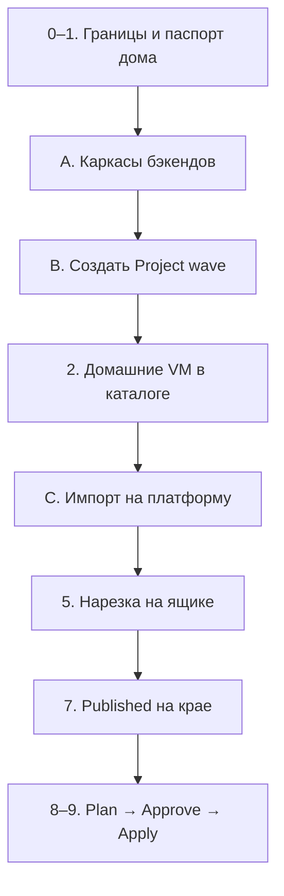
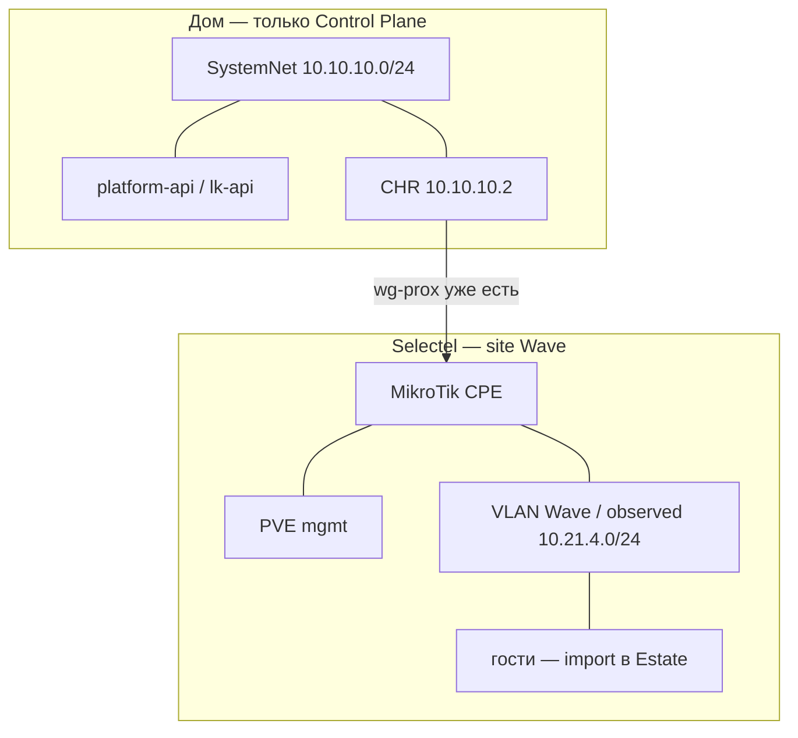

# 0028.1: План — Project Wave, каркасы бэкендов, импорт на платформу

- **Статус:** Операционный план (не новое решение; применяет 0015.1 §1.1 и 0028 к стенду)
- **Дата:** 2026-09-27
- **Авторы:** Alexandr Yankov (решения), Cursor (оформление)

## Контекст

LK UI ещё нет. Control Plane остаётся дома (`pve` `10.10.10.250`, край — CHR `10.10.10.2`).
Wave уже крутится на dedicated Selectel (MikroTik + PVE), туннель **живой** (`wg-prox` →
`31.184.219.221:51820`). Новый WG и новые машины Wave не поднимаем — **заводим проект на
платформе и принимаем уже существующее**.

Решения сети — [0028](0028-platform-network.md), этапы карточки — [0015.1](0015.1-infra-agent.md)
§1.1, каталог — [0015.2](0015.2-admin-panel.md) / [0015.2.1](0015.2.1-admin-panel-architecture.md),
карточка — [0015.3](0015.3-contracts.md) §6.

## Три работы этого захода

Это и есть deliverable. Сеть и метки дома — подготовка, не замена этих трёх.

| # | Работа | Что появляется на платформе | Чего нет |
|---|---|---|---|
| **A** | **Каркасы бэкендов** | поды `platform-api`, `lk-api`, `admin-ui` в `ns: platform`; БД на `postgresql-infra-1` | агенты, Temporal, чат LK, Apply |
| **B** | **Создать Project `wave`** | карточка в API, ProjectNet + `vlan_id`, орг Gitea `wave` (`app` + `infra`), зеркало в админке | кабинет в карточке ещё пустой; TF нет |
| **C** | **Импорт уже существующего** | `CloudAccount`, site, underlay `wg-prox`, Estate/`import[]` живых VM Wave | новый туннель, переезд VM, смена CIDR гостей |

Порядок: **A → B → C**. Без API некуда писать карточку. Без карточки некуда вешать import.
Сеть на ящике не пересобираем до C.

## Границы (этап 0)

| Держим | Не делаем |
|---|---|
| CP на текущем `pve` `10.10.10.250` | CP на `pve2` и на Selectel |
| CHR `10.10.10.2` как край в пилоте | Новый WG рядом с `wg-prox` |
| Живой `wg-prox` → `31.184.219.221:51820` | Миграция / удаление существующих VM |
| Wave = отдельный site (dedicated) | Домашние VM в клиентский пул |
| `pve2` пустой, не для Wave | Склейка `10.10.10.0/24` с `10.21.4.0/24` |

Ключи туннелей и пароли в этот файл не кладём.

## Этап 1. Паспорт домашнего CP (только чтение)

Снять с `pve` / `pve2` — в заметки, в API положим после A:

- кластер `devops-labs`, gw `10.10.10.2` (CHR), RB750 `10.10.10.1` — CPE дома, не край;
- свободная RAM/CPU на `pve`: CP остаётся здесь. Если API не влезут в `aicd` (VM 108, 12 ГБ) —
  докинуть RAM **этой** VM, не ноды и не `pve2`;
- `pve2` (`10.10.10.251`): ~16 ГБ, qemu нет — в фонд **не** предлагать, Wave сюда не сажать;
- SDN пустой, PVE Resource Pool нет — изоляция будет VLAN / `ProjectQuota`, не pool.

**Готово:** цифры хостов есть. Конфиги гипервизора не меняем.

---

## A. Каркасы бэкендов

Отдельная работа, не «параллельная сноска». Пока подов нет — Project Wave существует только
в этом файле.

Новую VM Postgres **не** ставим. Не StatefulSet Postgres в k8s.

### A.1 База на уже стоящем инстансе

VM 113 `postgresql-infra-1` (`10.10.10.246`):

- `CREATE DATABASE platform_api` + роль;
- `CREATE DATABASE lk_api` + роль
  (или одна БД и две схемы — как удобнее в пилоте; два имени в OpenBao);
- TCP `:5432`, `sslmode=require`, как у LiteLLM;
- bind-секреты — OpenBao, не values в git.

### A.2 Поды в `ns: platform` (k3s `aicd`, VM 108)

| Процесс | Зачем в этом заходе | v0 умеет |
|---|---|---|
| **`platform-api`** | каталог фонда, `CloudAccount`, метки VM, read-зеркало карточки | CRUD `/admin/*` |
| **`lk-api`** | SoT карточки Project, `import[]`, Inventory (0015.3) | `POST /projects`, GET карточки, import |
| **`admin-ui`** | оператор видит проект и фонд | экраны «Проекты» и «Ресурсы», без Approve |

Не в этом заходе: Temporal, `agent-job`, чат LK, Open WebUI, полный цикл Plan.

Деплой — два/три Deployment + IngressRoute + TLS из цикла `issue-tls-cert.yml` (0022),
forwardAuth `platform-*`. Чарт через Nexus, когда готов; до этого — минимальный манифест в
`platform/aicd-devops-labs-ru`, не «напрямую из интернета» как постоянное исключение.

### A.3 Критерий готовности A

- поды Running, `/health`;
- API пишет в свои БД;
- `admin-ui` открывается за Authelia;
- можно создать пустой Project запросом (ещё не Wave) и увидеть его в админке.

---

## B. Создать Project `wave`

Это **создание проекта на платформе**, не на Selectel и не «заметка в чате». Делает оператор
через `lk-api` (админка карточку не пишет, 0015.3). Кабинет Selectel на этом шаге **не**
трогаем: их проект `WAVE` уже есть, привяжем в C.

### B.1 Что создаём

| Поле карточки (0015.3 §6) | Значение |
|---|---|
| `slug` / `name` | `wave` |
| `phase` | `shell_ready` |
| `provider_id` | `selectel` (один, второго не будет) |
| `network.project_net` | синтетический CIDR allocator’а (`100.64.x.0/24`) |
| `network.vlan_id` | свободный, зарезервирован |
| `network.observed_overlay` | `10.21.4.0/24` — **не** равен ProjectNet |
| `git.org` | `wave` |
| `git.app` / `git.infra` | `wave/app`, `wave/infra` — пустые репо |
| `cloud.*` | ещё `null` |

### B.2 Шаги

1. `POST` Project `wave` в `lk-api` → карточка, `project_id`.
2. Allocator в `platform-api` выдаёт ProjectNet + `vlan_id`, пишет в карточку.
3. Завести орг Gitea `wave` и два пустых репо (или заглушка имён, если Gitea API ещё не
   подключён — имена всё равно в карточке).
4. Админка: экран «Проекты» показывает `wave`, `phase = shell_ready`, без секретов.

**Готово:** проект Wave **есть на платформе**. На CHR и на ящике тишина. Terraform нет.

---

## Этап 2. Домашние VM — вне клиентского пула

После A: каждая qemu на `pve` — запись в каталоге `platform-api` (`allocation`). На диске
ничего не двигать.

| VM | Имя | Метка |
|---|---|---|
| 100 | gitlab | `system` |
| 101 | jira-wiki | `system` |
| 104 | dns | `system` |
| 105 | llm1 | `system` |
| 107 | Keycloak | `system` |
| 108 | aicd-devops-labs-ru | `system` |
| 109 | freeipa | `system` |
| 111 | Mikrot-Router | `system` |
| 113 | postgresql-infra-1 | `system` |
| 114 | infra-panel | `system` |
| 102 | winows (stop) | `unassigned`, не `offered` |
| 103 | unnamed 45 ГБ (running) | `unassigned`, не `offered` |
| 110 | mon-agent-01 (stop) | `unassigned`, не `offered` |
| 9000 / 9001 | templates | шаблоны платформы, не Estate |

**Готово:** Init/Plan не может выбрать домашнюю VM как ресурс Wave.

---

## C. Импорт уже существующего на платформу

Не заказ dedicated и не `tofu apply`. Железо, туннель и гости **уже есть** — платформа должна
их увидеть и считать своими объектами.

### C.1 Кабинет и ящик (слой облака)

1. `CloudAccount` кабинета `635272`, Keystone-проект `WAVE`
   (`35605418d6954f9d9b448cd74546eaa1`) — id в карточку, пароль только `secret_ref` в OpenBao.
2. Dedicated `prox_node_1` (WAN `31.184.219.221`) → `ExternalResource` + FundNode `user`,
   `site_id` Wave.
3. `wave-prod` (`185.184.79.137`) — **другой** ящик, в этот импорт не входит.

### C.2 Underlay (уже построен, только привязать)

SiteUnderlay карточки = пир на CHR (чтение 2026-09-27). Новый интерфейс не поднимаем.

| Поле | Значение |
|---|---|
| Интерфейс CHR | `wg-prox`, comment «Selectel Proxmox site» |
| Слушает | UDP `51837` |
| Пир | `selectel-prox`, endpoint `31.184.219.221:51820` |
| Линк | CHR `10.20.35.1/24` |
| AllowedIPs пира | `10.20.35.2/32`, `10.21.4.0/24`, `10.8.0.1/32` |
| Маршрут | `10.21.4.0/24` via `wg-prox` |
| Поднят | с 2026-09-20, handshake живой |

В карточке: `connect: overlay`, `attachment` на этот site, observed `10.21.4.0/24`.

Один конверт везёт mgmt и data. Резать на `wg-mgmt` / `wg-data` — не в этом импорте.

### C.3 Гости Wave → Estate / `import[]`

Зайти на PVE площадки **через underlay**. На каждую гостевую VM — запись import (id, диск,
NIC, VLAN, IP). Хост PVE и MikroTik — фонд site, не Estate клиента.

- стек: код в `wave/app` или RO-ключ; иначе `declared-by-user`;
- анкета может быть неполной;
- ничего не переименовывать и не переезжать.

`lk-api`: `import[]` + Inventory. Админка: на карточке Wave видны site, underlay, счётчик
imported. `phase = init`.

**Готово импорта:** платформа знает проект, кабинет, ящик, туннель и гостей. На площадке
пакет не перекладывали.

---

## Этап 5. Нарезка на ящике и уборка на CHR

После C, не вместо него.

**На CHR**

- Маршрут `10.21.4.0/24` via `wg-prox` оставить (observed).
- Убрать `10.21.4.0/24` из AllowedIPs пиров `wg-clients`.
- Не анонсировать гостям `10.10.10.0/24`.
- Не смешивать AllowedIPs Wave с `wg-home` / `wg-clients`.

**На Selectel (MikroTik + PVE)** — проверить и дорезать, не сносить:

| Интерфейс | Должно быть |
|---|---|
| WAN `31.184.219.221` | UDP WG; `:8006` / SSH гостей не в мир |
| mgmt PVE | хост, API; не eth0 гостей |
| VLAN = `vlan_id` из B | только VM Wave; шлюз на площадочном MikroTik |
| `10.21.4.0/24` | пока живые адреса гостей (observed) |

**Готово:** с CHR пингуется линк `.2` и префикс гостей; с гостя не пингуется `10.10.10.0/24`.

## Этап 7. Published на крае

На CHR (пока вручную): из Wave наружу только allow-list проекта — git этого клиента, scrape
**к** его VM.

Запретить из VLAN Wave: Semaphore, LiteLLM, API Selectel, соседний VRF, весь SystemNet
`10.10.10.0/24`.

**Готово:** с тестовой VM Wave открывается только allow-list.

## Этап 8. Plan → Approve (0015.1 этапы 3–4)

Не часть импорта as-is. Plan фиксирует уже импортированное и что создаём позже:

- площадка = этот dedicated;
- сеть = ProjectNet allocator’а + Attachment на observed VLAN;
- не предлагать домашний `pve` и не предлагать новый WG.

После Approve — первый коммит в `wave/infra`. До Approve репо пустое.

## Этап 9. Apply — принять факт, не пересобрать underlay

- Overlay/node-init на уже взятый ящик: закрыть лишний WAN, VLAN = `vlan_id`.
- Гости остаются на `10.21.4.0/24`, пока отдельно не запланировали смену на `100.64.x`.
- Ansible/Helmwave — по ProjectSegment, не на публичный IP.
- Домашний CP не переезжает.

**Готово захода:** Wave в админке `Ready` (или `init`, если Approve ещё нет), underlay тот же
`wg-prox`, каркасы API живы, домашние VM `system`.

## Позже (не в этом заходе)

- Развести `wg-mgmt` (хост PVE) и `wg-data` (vm-router / VRF).
- Сменить адреса гостей с observed `10.21.4.0/24` на синтетический ProjectNet.
- Linux-edge вместо CHR как концентратора VRF (0028 §3: MikroTik — класс CPE).
- Второй Project на этом же dedicated — новый VLAN + свой `wg-data`, тот же SiteUnderlay.
- Агенты, Temporal, полноценный LK UI.

## Три слоя сети (не склеивать)

| Слой | Что это | Сейчас |
|---|---|---|
| SiteUnderlay | L3 до ящика | `wg-prox` (импорт C.2) |
| mgmt | `:8006`, SSH хоста | тем же туннелем |
| ProjectSegment | VLAN + адреса Wave | observed `10.21.4.0/24` |

## Ссылки

- [ADR-0028](0028-platform-network.md) — ProjectNet, плоскости, underlay / segment.
- [ADR-0015.1](0015.1-infra-agent.md) §1.1 — жёсткий порядок оболочки → Init → Plan.
- [ADR-0015.2](0015.2-admin-panel.md) §7.1 — CloudAccount / Selectel.
- [ADR-0015.2.1](0015.2.1-admin-panel-architecture.md) — `platform-api` в `ns: platform`.
- [ADR-0015.3](0015.3-contracts.md) §6 — карточка Project; SoT — `lk-api`.
- [ADR-0014.1](0014.1-platform-resource-controller.md) — фонд, не FIB тенанта.
- [ADR-0023](0023-postgresql-standalone-role.md) — `postgresql-infra-1`.
