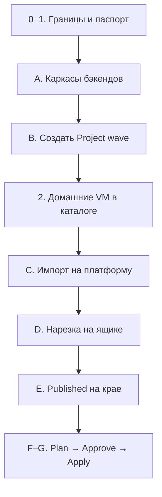
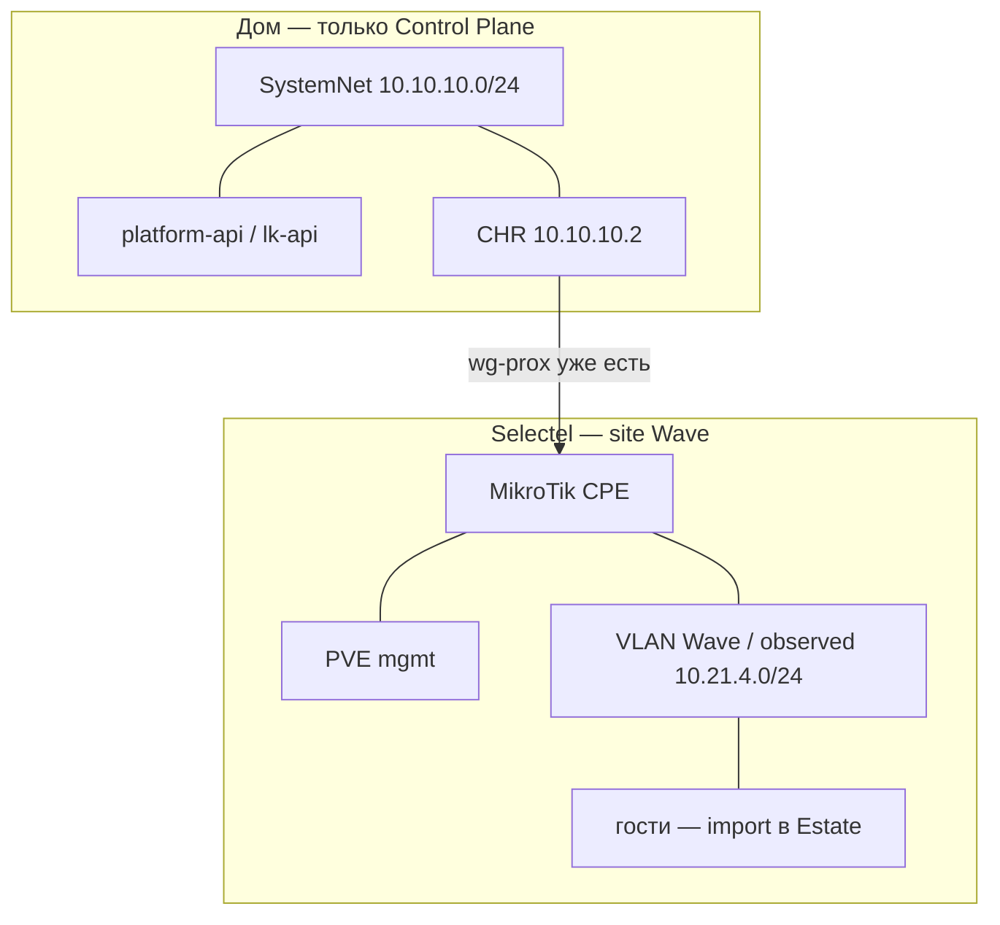

# 0028.1: План — Project Wave, каркасы бэкендов, импорт на платформу

- **Статус:** Операционный план (не новое решение; применяет 0015.1 §1.1 и 0028 к стенду)
- **Дата:** 2026-09-27
- **Авторы:** Alexandr Yankov (решения), Cursor (оформление)

## Как читать

Каждый этап: **зачем → где сидишь → что сделать по шагам → проверка → чего не делать**.
Не перескакивать: **A → B → C**. Без подов карточку некуда писать; без карточки некуда
вешать import.

Пароли, токены, ключи WG в этот файл и в git **не** кладём — только `secret_ref` / OpenBao.

Решения: [0028](0028-platform-network.md), [0015.1](0015.1-infra-agent.md) §1.1,
[0015.2](0015.2-admin-panel.md), [0015.2.1](0015.2.1-admin-panel-architecture.md),
[0015.3](0015.3-contracts.md) §6.

## Три работы этого захода

| # | Работа | Что появляется на платформе | Чего нет |
|---|---|---|---|
| **A** | **Каркасы бэкендов** | поды `platform-api`, `lk-api`, `admin-ui`; две БД на `postgresql-infra-1` | агенты, Temporal, чат LK, Apply |
| **B** | **Создать Project `wave`** | карточка, ProjectNet + `vlan_id`, орг Gitea `wave` | привязка кабинета; Terraform |
| **C** | **Импорт уже существующего** | `CloudAccount`, site, `wg-prox`, гости в `import[]` | новый туннель, переезд VM |



Окружение: `platform/aicd-devops-labs-ru`. Хосты оператора (`/etc/hosts`):

| Имя | IP | Зачем в этом плане |
|---|---|---|
| `pve` | `10.10.10.250` | домашний гипервизор CP |
| `pve2` | `10.10.10.251` | пустой, не трогаем |
| CHR | `10.10.10.2` | край, `wg-prox` |
| `postgresql-infra-1.aicd.devops-labs.ru` | `10.10.10.246` | БД API |
| Traefik / k3s (VM 108) | `10.10.10.249` | поды, Gitea, OpenBao, админка |
| `gitea.aicd.devops-labs.ru` | `10.10.10.249` | орг `wave` |
| `openbao.aicd.devops-labs.ru` | `10.10.10.249` | секреты БД и кабинета |
| Selectel dedicated | `31.184.219.221` | site Wave, пир WG |

---

## Этап 0. Границы

**Зачем.** Чтобы не начать «переносить CP» или поднимать второй туннель.

**Где.** Нигде не логинимся — только договориться и не нарушать таблицу.

| Держим | Не делаем |
|---|---|
| CP на `pve` `10.10.10.250` | CP на `pve2` / Selectel |
| CHR как край в пилоте | Новый WG рядом с `wg-prox` |
| Живой `wg-prox` | Миграция / удаление VM |
| Wave = отдельный site | Домашние VM в пул клиента |
| `pve2` пустой | Склейка `10.10.10.0/24` ↔ `10.21.4.0/24` |

**Проверка.** В чате/тикете эти пять запретов приняты. Дальше любой шаг им противоречит — стоп.

---

## Этап 1. Паспорт домашнего CP

**Зачем.** Понять, хватает ли RAM на VM 108 для трёх подов; зафиксировать, что `pve2` не площадка Wave.

**Где.** SSH на `pve` и `pve2` (root или существующая учётка). Ничего не менять — только смотреть.

1. На `pve`:
   - `free -h` и `nproc` — свободная RAM/CPU хоста.
   - `qm list` — сверить VMID с таблицей этапа 2 (ниже).
   - `qm config 108` — память `aicd` (сейчас ~12 ГБ). Если после этапа A поды OOM — увеличить
     **этой** VM в UI PVE (Hardware → Memory), не добавлять диск/`pve2`.
   - SDN / Datacenter → SDN: пусто. Datacenter → Permissions / Pools: пулов нет — так и надо.
2. На `pve2`: `qm list` пустой, `free -h` (~16 ГБ). В фонд не предлагать.
3. Записать цифры в черновик (чат или issue). В API — после A, когда будет каталог.

**Проверка.** Есть числа: свободная RAM `pve`, RAM VM 108, `pve2` пуст. Конфиг PVE не изменён
(`qm list` тот же).

**Не делать.** `qm migrate`, resize чужих VM, создавать SDN «на будущее».

---

## A. Каркасы бэкендов

**Зачем.** Пока подов нет, Project `wave` существует только в этом файле. Карточка и импорт —
строки в БД, их должен кто-то принять.

Это **инженерная** работа в репозитории + выкат на уже стоящий k3s. Новую VM Postgres не ставим.

### A.1 Код в репозитории

**Где.** Этот git (`devops/uslugi`) или отдельные репо сервисов — как решите, но деплой потом
идёт в `ns: platform` окружения `aicd-devops-labs-ru`.

Сделать три минимальных сервиса (можно один монорепо с тремя бинарниками):

| Сервис | Слушает | Первые маршруты |
|---|---|---|
| `platform-api` | HTTP | `GET /health`; CRUD фонда `/admin/resources`; `CloudAccount`; GET зеркала карточки |
| `lk-api` | HTTP | `GET /health`; `POST /projects`; `GET /projects/{id}`; `POST /projects/{id}/import` |
| `admin-ui` | статика | экраны «Проекты» и «Ресурсы»; ходит только в `platform-api` |

Карточка — поля [0015.3](0015.3-contracts.md) §6. Админка **не** пишет `phase` (кроме отображения).
Создание проекта — `lk-api`.

Пока без: Temporal, агентов, чата, Approve, Terraform-раннера.

Образы: собрать, запушить во внутренний registry (Nexus), не тянуть «с ноутбука в latest» как
постоянный путь. Чек-лист компонента — [0022](0022-new-component-requirements.md).

### A.2 База на `postgresql-infra-1`

**Где.** Тот же приём, что у LiteLLM: секрет в OpenBao → пользователь+БД на VM 113
(`10.10.10.246`). Предпочтительно задачами в `site.yml` / play `postgresql-infra`, не руками
в `psql` «навсегда». Разовый `psql` для пилота допустим, затем повторить декларативно.

1. В OpenBao (`https://openbao.aicd.devops-labs.ru`): два секрета, например
   `secret/platform-api` и `secret/lk-api`, поле `db_password`. Значение в git не копировать.
2. На `postgresql-infra-1` (роль суперпользователя, как для litellm):
   - пользователь `platform_api`, БД `platform_api` (owner он же);
   - пользователь `lk_api`, БД `lk_api`;
   - грант только на свою БД; `sslmode=require`.
3. Точечный `pg_hba`: доступ с CIDR нод k3s / `10.10.10.249`, не `0.0.0.0/0`.

**Проверка.** С ноды k3s (или с ноутбука в LAN):

```text
psql "host=10.10.10.246 dbname=lk_api user=lk_api sslmode=require" -c 'select 1'
```

то же для `platform_api`. Без пароля в истории шелла — `.pgpass` или `PGPASSWORD` из OpenBao
на сессию.

**Не делать.** Postgres в StatefulSet, вторая VM БД, пароль в `values.yaml`.

### A.3 Выкат подов

**Где.** k3s на VM 108, дерево `helm/values/platform-devops-labs-ru/namespaces/platform/`
(рядом с `radar`, `gitea`). Пока своего чарта в Nexus нет — манифесты/чарт в этом репо +
Helmwave env `platform-devops-labs-ru`, не «kubectl run с Docker Hub навсегда».

1. Deployment ×3 (или 2 API + 1 UI) в `ns: platform`.
2. Service + IngressRoute:
   - `admin.aicd.devops-labs.ru` → `admin-ui` + `/admin` API;
   - внутренний URL `lk-api` (можно тот же хост с префиксом `/lk` или `lk.aicd.devops-labs.ru`).
3. TLS — цикл `issue-tls-cert.yml`, как у radar.
4. Вход — Authelia `forwardAuth`, группа `platform-*` (как Homer).
5. Запись в `/etc/hosts` оператора на `10.10.10.249`, если имени ещё нет.
6. Пункт в Homer (`infra-panel.aicd.devops-labs.ru`) → админка.

Переменные БД — из k8s Secret, который наполняется из OpenBao (как litellm), не из git.

**Проверка A**

```text
kubectl -n platform get deploy,pods,ingressroute
curl -fk https://admin.aicd.devops-labs.ru/health   # или /admin/health
```

- поды Running, не CrashLoop (часто: нет маршрута до `:5432` или `sslmode`);
- `admin-ui` открывается, Authelia пускает `platform-*`;
- `POST /projects` с телом `{ "slug": "smoke" }` → 201 и строка в `lk_api`;
- админка показывает smoke-проект;
- smoke потом удалить или оставить как тестовый — не путать с `wave`.

**Не делать.** Открывать API в интернет без Authelia; класть Selectel-пароль в Deployment.

---

## B. Создать Project `wave`

**Зачем.** Появился контур клиента на **нашей** платформе. Их Selectel-проект `WAVE` — другое
имя, его ещё не привязываем.

**Где.** Браузер: админка (если в UI есть кнопка «создать»). Или `curl` в `lk-api` с сессии
оператора. Затем Gitea. CHR и Selectel **не** открывать.

Allocator в коде может ещё не уметь выдавать CIDR. Тогда оператор **выбирает руками** из
зарезервированного пула и пишет те же поля, которые allocator записал бы сам. Не брать
`10.21.4.0/24` как ProjectNet.

1. Выбрать свободные:
   - `project_net`: например `100.64.10.0/24` (не пересекается с `10.10.10.0/24`,
     `10.20.35.0/24`, `10.21.4.0/24`);
   - `vlan_id`: свободный (дома SDN пуст; на ящике Wave не конфликтовать с уже занятыми VLAN —
     посмотреть на Selectel PVE **только RO**, этап C ещё не пишет).
2. `POST /projects` в `lk-api`:

   ```yaml
   slug: wave
   name: Wave
   provider_id: selectel
   network:
     project_net: 100.64.10.0/24    # ваш выбранный
     vlan_id: <свободный>
     observed_overlay: 10.21.4.0/24
   ```

   Ответ: `project_id`, `phase: shell_ready`. `cloud.*` пустые.
3. Gitea (`https://gitea.aicd.devops-labs.ru`): организация `wave`, репозитории `app` и
   `infra`, оба пустые (README можно). В карточку: `git.org=wave`, `git.app=wave/app`,
   `git.infra=wave/infra`.
4. Админка → Проекты: видна строка Wave, phase `shell_ready`, сеть и git, **без** секретов.

**Проверка.** `GET /projects/{id}` совпадает с экраном. В Gitea два репо. На CHR интерфейсы
не изменились (`/rest/interface/wireguard` — тот же набор). На Selectel ничего не создавали.

**Не делать.** `POST` проекта в Selectel VPC. Писать Terraform в `wave/infra`. Поднимать WG.

---

## Этап 2. Домашние VM вне пула клиента

**Зачем.** Чтобы следующий Init не предложил gitlab или `aicd` как «свободную ёмкость Wave».

**Где.** Админка → Ресурсы (после A). На PVE **не** создавать Resource Pool и не стопать VM.

Для каждой строки — `PUT` в `platform-api` (или кнопка в UI): `allocation` как в таблице.
Поля: `vmid`, `node: pve`, `name`, `allocation`.

| VMID | Имя | `allocation` |
|---|---|---|
| 100 | gitlab | `system` |
| 101 | jira-wiki | `system` |
| 104 | dns | `system` |
| 105 | llm1 | `system` |
| 107 | Keycloak | `system` |
| 108 | aicd-devops-labs-ru | `system` |
| 109 | freeipa | `system` |
| 111 | Mikrot-Router | `system` |
| 113 | postgresql-infra-1 | `system` |
| 114 | infra-panel | `system` |
| 102 | winows (stop) | `unassigned` |
| 103 | unnamed | `unassigned` |
| 110 | mon-agent-01 (stop) | `unassigned` |
| 9000, 9001 | templates | шаблон платформы, не Estate |

Ни одну не ставить `offered`.

**Проверка.** Список фонда: 10× `system`, 3× `unassigned`, шаблоны отдельно. `qm list` на `pve`
не изменился (те же статусы running/stopped).

**Не делать.** Удалять VM 102/103/110 «чтобы почистить пул». Переносить их на `pve2`.

---

## C. Импорт уже существующего

**Зачем.** Платформа начинает **видеть** то, что уже крутится: кабинет, ящик, туннель, гости.
Ничего из этого не заказываем заново.

Идти C.1 → C.2 → C.3. Между шагами можно остановиться: карточка частично заполнена — нормально.

### C.1 Кабинет Selectel и dedicated

**Где.** OpenBao + админка / `platform-api`. Панель my.selectel.ru — только сверить uuid, не
заказывать сервер.

1. В OpenBao положить учётки сервисного пользователя (уже использовались для зонда), путь
   вроде `secret/providers/selectel/platform`. В карточке и git — только `secret_ref`.
2. Создать `CloudAccount`: `account_id: "635272"`, `preferred_scope: project`,
   `project_name: WAVE`, `project_id: 35605418d6954f9d9b448cd74546eaa1`.
3. Sync (или ручной GET `/resource` + `/network/ipam/ip`): в inventory должен быть
   `prox_node_1`, WAN `31.184.219.221`. `wave-prod` / `185.184.79.137` **не** привязывать
   к этому Project.
4. Объект `ExternalResource` + строка книги `InternalResource` (`allocation: user`,
   `site_id` Wave). Привязать site к карточке `wave` (`cloud.cloud_account_id`,
   `cloud.selectel_project_id`).

**Проверка.** Карточка Wave: кабинет заполнен, один ящик `prox_node_1`. Phase ещё может быть
`shell_ready` до C.3. Пароля на экране нет.

**Не делать.** `POST /resource/server/billing`. Второй Selectel-проект.

### C.2 Привязать живой `wg-prox`

**Где.** Сначала **прочитать** CHR (HTTP REST `:80` на `10.10.10.2`) — не менять. Потом
записать те же факты в карточку.

1. Проверить, что туннель жив:

   ```text
   # identity
   curl -s http://10.10.10.2/rest/system/identity
   # интерфейс и пир (ключи из вывода в чат/git не копировать)
   curl -s http://10.10.10.2/rest/interface/wireguard
   curl -s http://10.10.10.2/rest/interface/wireguard/peers
   curl -s http://10.10.10.2/rest/ip/route
   ```

   Ожидание: интерфейс `wg-prox` running; пир `selectel-prox` endpoint
   `31.184.219.221:51820`; `last-handshake` минуты, не часы; маршрут `10.21.4.0/24` via
   `wg-prox`.
2. С хоста в `10.10.10.0/24`: `ping -c 2 10.20.35.2` (линк за туннелем). Если не пингуется —
   чинить маршрут/пир **до** записи в API, не поднимать второй WG.
3. В карточку / Inventory: `connect: overlay`, underlay = `wg-prox`,
   `observed_overlay: 10.21.4.0/24`, `attachment.site_id` = site из C.1.

**Проверка.** В админке у Wave: underlay `wg-prox`, endpoint и overlay видны. На CHR
**не** появился новый `wg-*`.

**Не делать.** `/rest/interface/wireguard/add`. Менять listen-port / ключи.

### C.3 Гости с PVE Wave → `import[]`

**Где.** Браузер или `pvesh` на **PVE площадки** (за туннелем: mgmt IP ящика, не обязательно
WAN `31.184.219.221`). Учётку PVE в OpenBao, не в карточку.

1. Список qemu: VMID, имя, статус, память, диск, bridge/VLAN, IP если виден в qemu-guest.
2. Для **каждой гостевой** VM — `POST /projects/{wave}/import` (или кнопка в LK/админке):

   ```yaml
   vmid: <n>
   name: <имя>
   kind: vm
   site_id: <site Wave>
   observed:
     ipv4: <если есть>
     bridge: <vmbr/vlan>
   ```

3. Хост PVE и VM-роутер/MikroTik на ящике — **не** в `import[]`. Они остаются
   `InternalResource` площадки (в админке — FundNode), не Estate клиента.
4. Стек: если есть git приложения — remote в `wave/app` или RO deploy key в OpenBao Project.
   Нет кода — в карточке `init.code: none`, стек `declared-by-user`.
5. Выставить `phase: init`. Админка: счётчик `estate_counts.imported = N`.

**Проверка.** N в карточке = число гостевых VM на PVE Wave. Имена совпадают. Ни один VMID
домашнего `pve` (100–114) в import нет. Гости по-прежнему running, имена на PVE те же.

**Не делать.** `qm clone` / migrate / смена IP гостей. Import домашних VM в Wave.

**Готово C.** Платформа знает проект, кабинет, ящик, туннель и гостей. Пакеты на площадке
не перекладывали.

---

## D. Нарезка сети (после импорта)

**Зачем.** Убрать дыры: клиентские WG не должны видеть `10.21.4.0/24`; гости Wave — не весь дом.

**Где.** Сначала CHR (менять AllowedIPs). Потом RO-проверка на Selectel MikroTik/PVE. Резать
VLAN гостей «по живому» только если они уже не на общем `vmbr` с mgmt — иначе отдельный Plan.

### D.1 CHR

1. Список пиров `wg-clients`: у кого в `allowed-address` есть `10.21.4.0/24` — **убрать** этот
   префикс, остальные адреса пира оставить.
2. Не трогать `allowed-address` пира `selectel-prox`.
3. Не добавлять `10.10.10.0/24` в маршруты **в сторону** Wave (гости не ходят в SystemNet).
4. Маршрут `10.21.4.0/24` → `wg-prox` оставить.

**Проверка.** Повтор `GET /rest/interface/wireguard/peers`: у `selectel-prox` overlay на месте;
у vinogradov/`wg-clients` — нет `10.21.4.0/24`. Handshake `selectel-prox` снова свежий.

### D.2 Ящик Wave (проверка, не снос)

С Winbox/SSH на MikroTik `31.184.219.221` (или через `10.20.35.2`) и PVE:

| Смотрим | Должно быть |
|---|---|
| WAN | UDP WG (порт пира 51820); `:8006` не слушает `0.0.0.0/0` |
| bridge mgmt | только хост PVE |
| VLAN гостей | только VM из import; шлюз на площадочном MikroTik |
| Адреса гостей | пока `10.21.4.0/24` |

Если гости и PVE на одном L2 — **записать долг**, не мигрировать порты в этот же вечер без Plan.

**Проверка.** С CHR: `ping 10.20.35.2` и один адрес из `10.21.4.0/24` (если ICMP открыт).
С гостя Wave (если есть доступ): `ping 10.10.10.250` **не** должен проходить.

**Не делать.** Второй WG «для чистоты». Менять CIDR гостей на `100.64.10.0/24` здесь.

---

## E. Published на крае

**Зачем.** Гость Wave ходит только туда, куда проекту можно: свой git, scrape к своим VM.

**Где.** CHR firewall/NAT (пока руками). Потом — правила allocator’а.

Разрешить из `10.21.4.0/24` (и позже из ProjectNet) примерно:

- `gitea.aicd.devops-labs.ru` (или его IP за Traefik) — git **этого** клиента;
- scrape-порт экспортера **на самой VM Wave** (платформа тянет метрики к гостю, не наоборот
  во весь VictoriaMetrics UI).

Запретить: `10.10.10.0/24` целиком, Semaphore, LiteLLM, OpenBao, API Selectel, соседние WG.

**Проверка.** С одной импортированной VM: `curl` на Gitea — ок (если так задумали);
`curl` на `https://semaphore.aicd.devops-labs.ru` и `ping 10.10.10.113` — отказ.

**Не делать.** `masquerade` гостей Wave в LAN дома «чтобы всё заработало».

---

## F. Plan → Approve

**Зачем.** Зафиксировать в git, что уже импортировано и что платформа **не** будет делать
(новый WG, домашний `pve`).

**Где.** Пока агента нет — оператор пишет Plan v1 руками (файл в админке/`lk-api` или черновик
в issue, затем тот же JSON в API). Approve — отдельное действие, не «закоммитили TF наугад».

В Plan явно:

- site = `prox_node_1`;
- underlay = `wg-prox` (exists);
- гости = список import as-is;
- сеть = ProjectNet из B + observed overlay;
- **нет** строк «создать WG», «VM на 10.10.10.250».

После Approve: первый коммит в `wave/infra` (хотя бы inventory фактов + README «imported»).
До Approve `infra` пустой или только README.

**Проверка.** `phase: approved`. В `wave/infra` есть коммит. На ящике ничего не применилось.

---

## G. Apply

**Зачем.** Довести безопасность ящика (закрыть лишний WAN), не пересобрать туннель.

**Где.** Ansible/Semaphore **после** того, как раннер ходит на PVE **через** `wg-prox`, не на
публичный `:8006` из интернета.

1. Закрыть WAN: SSH/`8006` только с CIDR платформы / underlay; UDP WG оставить.
2. VLAN гостей = `vlan_id` из B, если ещё не так — отдельными задачами, не «все сразу».
3. Адреса гостей оставить `10.21.4.0/24`, пока нет отдельного Plan смены на `100.64.10.0/24`.
4. CP дома не трогать.

**Проверка захода.** Админка: Wave `applied` или `init`+imported; underlay всё ещё `wg-prox`;
три пода API живы; домашние VM `system`. `qm list` на домашнем `pve` без сюрпризов.

---

## Позже (не в этом заходе)

- Развести `wg-mgmt` и `wg-data`.
- Сменить адреса гостей на синтетический ProjectNet.
- Linux-edge вместо CHR как концентратора VRF.
- Второй Project на том же dedicated — новый VLAN, тот же underlay.
- Агенты, Temporal, полноценный LK UI.

## Три слоя сети



| Слой | Сейчас |
|---|---|
| SiteUnderlay | `wg-prox` (шаг C.2) |
| mgmt | тот же туннель до `:8006` |
| ProjectSegment | observed `10.21.4.0/24` |

## Ссылки

- [ADR-0028](0028-platform-network.md) — ProjectNet, плоскости, underlay / segment.
- [ADR-0015.1](0015.1-infra-agent.md) §1.1 — оболочка → Init → Plan.
- [ADR-0015.2](0015.2-admin-panel.md) §7.1 — CloudAccount / Selectel.
- [ADR-0015.2.1](0015.2.1-admin-panel-architecture.md) — `platform-api` в `ns: platform`.
- [ADR-0015.3](0015.3-contracts.md) §6 — карточка; SoT — `lk-api`.
- [ADR-0014.1](0014.1-platform-resource-controller.md) — фонд.
- [ADR-0022](0022-new-component-requirements.md) — чек-лист нового компонента.
- [ADR-0023](0023-postgresql-standalone-role.md) — `postgresql-infra-1`.
