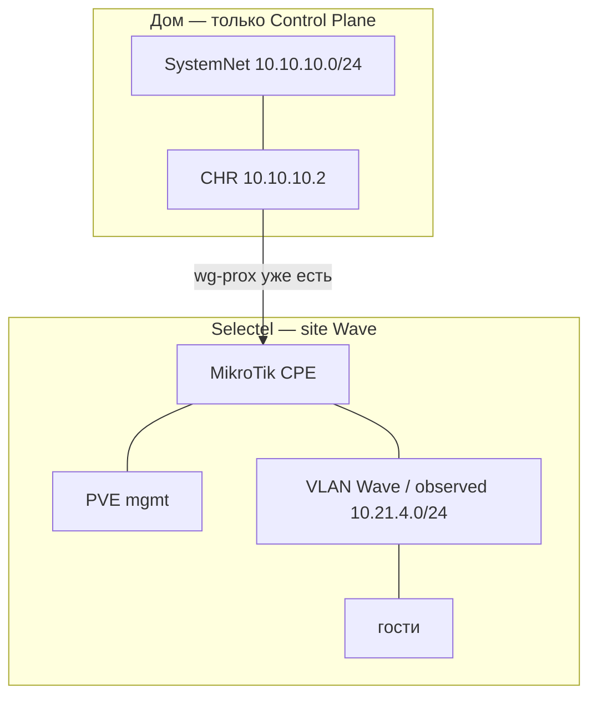

# 0028.1: План — домашний Control Plane, живой underlay, импорт Wave

- **Статус:** Операционный план (не новое решение; применяет 0015.1 §1.1 и 0028 к стенду)
- **Дата:** 2026-09-27
- **Авторы:** Alexandr Yankov (решения), Cursor (оформление)

## Контекст

LK ещё нет. Control Plane остаётся дома (`pve` `10.10.10.250`, край — CHR `10.10.10.2`).
Wave — отдельный site: dedicated Selectel с MikroTik. Туннель **уже живой** (`wg-prox` на
CHR → `31.184.219.221:51820`), новый WG не поднимаем.

Этот файл — порядок работ. Решения сети — [0028](0028-platform-network.md), этапы карточки —
[0015.1](0015.1-infra-agent.md) §1.1, каталог и Selectel — [0015.2](0015.2-admin-panel.md) §7.1.

Порядок ломать нельзя: **оболочка → привязка живого `wg-prox` → нарезка/уборка → инвентарь →
published → Plan → Apply**. Поды `platform-api` пишутся параллельно с этапами 1–3; в CHR и
Selectel они не лезут до этапа 4.

## Границы (этап 0)

| Держим | Не делаем |
|---|---|
| CP на текущем `pve` `10.10.10.250` | CP на `pve2` и на Selectel |
| CHR `10.10.10.2` как край в пилоте | Новый WG рядом с `wg-prox` |
| Живой `wg-prox` → `31.184.219.221:51820` | Миграция / удаление существующих VM |
| Wave = отдельный site (dedicated) | Домашние VM в клиентский пул |
| `pve2` пустой, не для Wave | Склейка `10.10.10.0/24` с `10.21.4.0/24` |

Ключи туннелей и пароли в этот файл не кладём.

```mermaid
flowchart LR
  A0[0. Границы] --> A1[1. Паспорт дома]
  A1 --> A2[2. Домашние VM вне пула]
  A2 --> A3[3. Оболочка Wave]
  A3 --> A4[4. Site + underlay]
  A4 --> A5[5. Нарезка на ящике]
  A5 --> A6[6. Init / Inventory]
  A6 --> A7[7. Published]
  A7 --> A8[8. Plan → Approve]
  A8 --> A9[9. Apply]
```

Параллельно этапам 1–3: скелет `platform-api` + БД на уже стоящем `postgresql-infra-1`
(раздел «Трек платформы» ниже).

## Этап 1. Паспорт домашнего CP (только чтение)

Снять с `pve` / `pve2` и положить в карточку площадки `platform`:

- кластер `devops-labs`, gw `10.10.10.2` (CHR), RB750 `10.10.10.1` — CPE дома, не край;
- свободная RAM/CPU на `pve`: CP остаётся здесь. Если API не влезут в `aicd` (VM 108, 12 ГБ) —
  докинуть RAM **этой** VM, не ноды и не `pve2`;
- `pve2` (`10.10.10.251`): ~16 ГБ, qemu нет — в фонд **не** предлагать, Wave сюда не сажать;
- SDN пустой, PVE Resource Pool нет — изоляция будет VLAN / `ProjectQuota`, не pool.

**Готово:** цифры хостов есть, решение «CP хватает / надо RAM конкретной VM» принято.
Конфиги гипервизора не меняем.

## Этап 2. Домашние VM — вне клиентского пула

Каждую qemu на `pve` пометить в каталоге (`allocation`). На диске ничего не двигать.

| VM | Имя | Метка |
|---|---|---|
| 100 | gitlab | `system` |
| 101 | jira-wiki | `system` |
| 104 | dns | `system` |
| 105 | llm1 | `system` |
| 107 | Keycloak | `system` |
| 108 | aicd-devops-labs-ru | `system` |
| 109 | freeipa | `system` |
| 111 | Mikrot-Router | `system` |
| 113 | postgresql-infra-1 | `system` |
| 114 | infra-panel | `system` |
| 102 | winows (stop) | `unassigned`, не `offered` |
| 103 | unnamed 45 ГБ (running) | `unassigned`, не `offered` |
| 110 | mon-agent-01 (stop) | `unassigned`, не `offered` |
| 9000 / 9001 | templates | шаблоны платформы, не Estate |

**Готово:** Init/Plan не может выбрать домашнюю VM как ресурс Wave.

## Этап 3. Оболочка Project Wave (0015.1 этап 1)

Ещё нет действия в кабинете Selectel, нет нового WG, нет Terraform.

1. Карточка Project `wave`: один `provider_id` = Selectel.
2. Allocator: синтетический ProjectNet (`100.64.x.0/24` + `vrf_id`) и свободный `vlan_id`.
3. Отдельно **observed overlay** = `10.21.4.0/24` — не приравнивать к ProjectNet (0028 §1).
4. Орг Gitea `wave`: пустые `app` + `infra` (если API нет — заглушка имён в карточке).
5. Карточка видна в админке: `phase = shell`.

**Готово:** есть slug, CIDR allocator’а, `vlan_id`, git-имена. На CHR и на ящике тишина.

## Этап 4. Site + underlay — привязать, не строить

1. `CloudAccount` кабинета `635272`, Keystone-проект `WAVE`
   (`35605418d6954f9d9b448cd74546eaa1`) — в карточку id, **не** пароль.
2. Dedicated `prox_node_1` (WAN `31.184.219.221`) → FundNode `user`, site Wave.
   `wave-prod` (`185.184.79.137`) — **другой** ящик, в этот underlay не мешать.
3. SiteUnderlay = существующий пир (живое чтение CHR 2026-09-27):

   | Поле | Значение |
   |---|---|
   | Интерфейс CHR | `wg-prox`, comment «Selectel Proxmox site» |
   | Слушает | UDP `51837` |
   | Пир | `selectel-prox`, endpoint `31.184.219.221:51820` |
   | Линк | CHR `10.20.35.1/24` |
   | AllowedIPs пира | `10.20.35.2/32`, `10.21.4.0/24`, `10.8.0.1/32` |
   | Маршрут | `10.21.4.0/24` via `wg-prox` («Selectel VM overlay») |
   | Поднят | с 2026-09-20, handshake живой |

4. Inventory: `connect: overlay`, observed `10.21.4.0/24`. Новый интерфейс не поднимаем.

Один конверт везёт и mgmt, и data. В 0028 это два канала (`wg-mgmt` / `wg-data`) — резать
позже, когда на ящике будет отдельный vm-router.

**Готово:** в карточке `site_id` + `underlay=wg-prox`. Второй туннель не появился.

## Этап 5. Нарезка на ящике и уборка на CHR

**На CHR**

- Маршрут `10.21.4.0/24` via `wg-prox` оставить (observed).
- Убрать `10.21.4.0/24` из AllowedIPs пиров `wg-clients`.
- Не анонсировать гостям `10.10.10.0/24`.
- VRF проекта на CHR — если ещё нет, не смешивать AllowedIPs Wave с `wg-home` / `wg-clients`.

**На Selectel (MikroTik + PVE)** — проверить и дорезать, не сносить:

| Интерфейс | Должно быть |
|---|---|
| WAN `31.184.219.221` | UDP WG; `:8006` / SSH гостей не в мир |
| mgmt PVE | хост, API; не eth0 гостей |
| VLAN = `vlan_id` этапа 3 | только VM Wave; шлюз на площадочном MikroTik |
| `10.21.4.0/24` | пока живые адреса гостей (observed) |

**Готово:** с CHR пингуется линк `.2` и префикс гостей; с гостя не пингуется `10.10.10.0/24`;
клиентские WG этот `/24` больше не видят.

## Этап 6. Init RO — инвентарь Wave

Зайти на PVE площадки **через underlay**. Снять id, диск, NIC, VLAN, IP.

- Гостевые VM → `import[]` в карточке, Estate Wave.
- Хост PVE и MikroTik → фонд site, не Estate клиента.
- Стек: код в `app` или RO-ключ; иначе `declared-by-user`.
- Анкета может быть неполной.

**Готово:** Inventory заполнен, `phase = init`. Ничего не переименовали и не переехали.

## Этап 7. Published на крае

На CHR (пока вручную): из Wave наружу только allow-list проекта — git этого клиента, scrape
**к** его VM.

Запретить из VLAN Wave: Semaphore, LiteLLM, API Selectel, соседний VRF, весь SystemNet
`10.10.10.0/24`.

**Готово:** с тестовой VM Wave открывается только allow-list.

## Этап 8. Plan → Approve (0015.1 этапы 3–4)

Plan:

- площадка = этот dedicated;
- сеть = ProjectNet allocator’а + Attachment на observed VLAN;
- что импортируем as-is, что создаём позже;
- не предлагать домашний `pve` и не предлагать новый WG.

После Approve — первый коммит в `infra`. До Approve репо пустое.

**Готово:** есть Plan vN и запись в git. На ящике пакет ещё не перекладывали.

## Этап 9. Apply — принять факт, не пересобрать underlay

- Overlay/node-init на уже взятый ящик: закрыть лишний WAN, VLAN = `vlan_id`.
- Гости остаются на `10.21.4.0/24`, пока отдельно не запланировали смену на `100.64.x`.
- Ansible/Helmwave — по ProjectSegment, не на публичный IP.
- Домашний CP не переезжает.

**Готово:** Wave в админке `Ready`, underlay тот же `wg-prox`, домашние VM по-прежнему
`system`.

## Позже (не в этом заходе)

- Развести `wg-mgmt` (хост PVE) и `wg-data` (vm-router / VRF).
- Сменить адреса гостей с observed `10.21.4.0/24` на синтетический ProjectNet.
- Linux-edge вместо CHR как концентратора VRF (0028 §3: MikroTik — класс CPE).
- Второй Project на этом же dedicated — новый VLAN + свой `wg-data`, тот же SiteUnderlay.

## Трек платформы: поды и база

Нужен SoT карточки и меток фонда (этапы 2–4). Новую VM Postgres **не** ставим.

| Что | Сейчас | Куда |
|---|---|---|
| `platform-api` | да, скелет | Deployment в `ns: platform` на k3s `aicd` (VM 108) |
| `admin-ui` | следом, не блокер | второй Deployment / тот же чарт (0015.2.1) |
| `lk-api` / LK / агенты / Temporal | нет | карточка — read-зеркало в админке |
| Postgres-сервер | уже есть | VM 113 `postgresql-infra-1` `10.10.10.246` |

На инстансе — ещё одна БД + роль (как у LiteLLM), TCP `:5432`, `sslmode=require`. Не
StatefulSet Postgres в кластере.

Скелет v0 умеет писать и читать, без агентов и без Apply:

- карточка Project (phase, `provider_id`, ProjectNet, `vlan_id`, observed overlay);
- фонд: домашние VM `system` / `unassigned`, не `offered`;
- site + underlay = существующий `wg-prox`;
- `CloudAccount` — ссылка на кабинет, секрет только `secret_ref` в OpenBao.

Intent / Plan / Estate / Terraform — не в этот скелет.

## Три слоя сети (не склеивать)

| Слой | Что это | Сейчас |
|---|---|---|
| SiteUnderlay | L3 до ящика | `wg-prox` |
| mgmt | `:8006`, SSH хоста | тем же туннелем |
| ProjectSegment | VLAN + адреса Wave | observed `10.21.4.0/24` |

## Ссылки

- [ADR-0028](0028-platform-network.md) — ProjectNet, плоскости, underlay / segment.
- [ADR-0015.1](0015.1-infra-agent.md) §1.1 — жёсткий порядок оболочки → Init → Plan.
- [ADR-0015.2](0015.2-admin-panel.md) §7.1 — CloudAccount / Selectel.
- [ADR-0015.2.1](0015.2.1-admin-panel-architecture.md) — `platform-api` в `ns: platform`.
- [ADR-0015.3](0015.3-contracts.md) §6 — карточка Project.
- [ADR-0014.1](0014.1-platform-resource-controller.md) — фонд, не FIB тенанта.
- [ADR-0023](0023-postgresql-standalone-role.md) — `postgresql-infra-1`.
