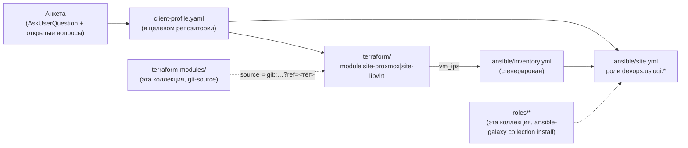

# ADR-0025: Онбординг ресурсов нового клиента — скилл + анкета + terraform-modules

- **Статус:** Предложено (архитектурное решение; v1 реализован — Terraform-модули + скилл +
  генерация `helm/` §4a; интеграция с существующей GitOps-платформой сознательно не решена,
  см. §5)
- **Дата:** 2026-09-20
- **Авторы:** Ivan Vinogradov (решения), Claude Code (оформление по итогам обсуждения)

## Контекст

До этого ADR в коллекции не было процесса «принять инфраструктуру нового внешнего клиента» —
только `roles/*` (переиспользуемая библиотека), `demo/*` (одноразовые демо-стенды для показа
ролей) и `platform/aicd*` (два экземпляра *внутренней* платформы, обслуживающей саму разработку
коллекции). Реальный внешний клиент понадобился раньше, чем этот пробел был замечен:
`ROADMAP.md` №61 (naming convention) заранее зарезервировал под такой сценарий формат
`client-<slug>`, но ничего не реализовывал.

Пример, на котором отлаживалось решение (не хранится в этой коллекции нигде, кроме этого
абстрактного описания — см. «Жёсткое правило» ниже): клиент на собственном дедике облачного
провайдера, на котором уже вручную поднят Proxmox VE и отдельная VM-роутер — структурно тот же
паттерн, что уже есть в `platform/aicd-devops-labs-ru/terraform` (провайдер `bpg/proxmox`), не
нативный облачный API. Запрошенный набор ролей клиента: DNS, git-сервер (только ВМ, без
установки самого git-сервера на этом шаге), FreeIPA, Postgres, Redis, k3s (два узла — основной и
второй под мониторинг), S3-совместимое хранилище (MinIO).

## Схема



## Решения

### 1. Отдельный git-репозиторий на клиента, не каталог в этой коллекции

**Решение:** результат работы скилла — самостоятельный git-репозиторий (Terraform + Ansible),
не директория внутри `ansible-devops-uslugi`.

**Обоснование:** та же граница, что уже проведена между этой коллекцией (библиотека ролей) и
`platform/gitops` (декларация конкретного окружения, ADR-0014) — библиотека и её потребители не
смешиваются в одном дереве git. Клиентский репозиторий не обязан быть доступен операторам этой
коллекции и наоборот; исходный код ролей и Terraform-модулей клиент подключает версионно
(`ansible-galaxy collection install`, git-sourced Terraform module), не копированием.

### 2. `terraform-modules/` — новая полка коллекции, тот же принцип версионирования, что `roles/`

**Решение:** `terraform-modules/site-proxmox/` и `terraform-modules/site-libvirt/` — дочерние
Terraform-модули с одинаковым интерфейсом (`vms` — карта ВМ, `vm_ips` — output), по одному на
облако/гипервизор. Клиентский репозиторий подключает нужный модуль git-ссылкой с закреплённым
тегом: `source = "git::<url>//terraform-modules/site-proxmox?ref=<тег>"`.

**Обоснование:** пользователь явно запросил абстракцию под несколько облаков сразу, а не
Proxmox-only решение. Граница абстракции — «модуль на облако», не универсальный модуль на все
случаи: внутри одного облака ВМ одного типа ресурса, разница только в параметрах (карта +
`for_each`), а смешение Proxmox/libvirt/будущих облаков в одном модуле потребовало бы условной
логики поверх принципиально разных provider API — не абстракция, а протечка. Версионирование
git-ссылкой с закреплённым `ref` — та же дисциплина «точная версия, не диапазон», что уже принята
для `xanmanning.k3s` в `requirements.yml` этой коллекции (ROADMAP №61 упоминает её как образец).

`site-proxmox` — обобщение уже проверенного живым прогоном паттерна
`platform/aicd-devops-labs-ru/terraform/vm.tf` (там — явный resource-блок на каждую VM,
стенд рос органически; здесь VM объявляются все сразу картой из анкеты, поэтому `for_each`
уместен и не нарушает принцип «явное лучше абстракции» — это один и тот же тип ресурса на одном
провайдере, не смешение разных облаков). `site-libvirt` — тот же приём для паттерна
`platform/aicd/terraform` (`network.tf`/`storage.tf`/`vms.tf`).

**Известное ограничение, унаследованное от референсов:** ни один модуль не создаёт cloud-init
шаблон (Proxmox) или не собирает Packer-образ (libvirt) — оба предполагают, что базовый
образ/шаблон уже существует на целевом хосте. Для Proxmox это реальный, сегодня не закрытый
пробел на новом хосте клиента (см. README модуля, раздел «Предусловия»).

**Найденная на реальном клиенте ошибка онбординга (2026-10-04, wave/`sel`):** `site-proxmox`
поддерживает разный `template_vmid` на каждую ВМ карты `vms` (`variables.tf`/README модуля,
«Известные ограничения» — специально рассчитано на «Rocky 9 под FreeIPA, Ubuntu под
остальное»), но сам скилл (§1 ниже) при сборке анкеты этого не проверял — все ВМ клиента,
включая `role: devops.uslugi.freeipa`, молча получили один и тот же `template_vmid` (готовый
Ubuntu-шаблон). `freeipa` требует RHEL-семейство (`dnf`, пакета `freeipa-server` для
Debian/Ubuntu не существует — см. `roles/freeipa/README.md`, «Целевая ОС»). Скилл теперь (§1)
обязан явно сверять `role` каждой ВМ со списком ролей, которым нужна не-Ubuntu ОС, и запрашивать
отдельный `template_vmid` (Rocky 9, `docs/proxmox-templates.md` часть 2) для таких ВМ, а не
дефолтный Ubuntu-шаблон клиента.

### 3. Роли клиента — переиспользуются как есть, недостающие — заглушка, не новая роль

**Решение:** `freeipa`, `postgresql`, `infra_dns`, `fail2ban` (базовый hardening для ВМ без
профильной роли) применяются к клиентским ВМ по полному имени коллекции
(`devops.uslugi.<role>`), без изменений. Redis, MinIO и «просто ВМ» под git-сервер — ролей в
коллекции нет ни для одной: Terraform поднимает ВМ, Ansible заводит inventory и
`devops.uslugi.fail2ban`, установка самого софта — явный `# TODO` комментарий-маркер в
`site.yml`, не молчаливый пропуск и не полноценная задача в рамках этого ADR.

**Обоснование:** написание 2-3 новых ролей — отдельная по объёму задача (роль, README, molecule),
не часть «собрать скилл онбординга»; откладывать реализацию скилла до появления всех ролей
задержало бы реальный, уже нужный сейчас результат ради полноты, которая понадобится позже.
Явный TODO-маркер — тот же принцип, что уже применён требованием №4 ADR-0022 (экспортёр без
дашборда — заметная, а не молчаливая недоделка): оператор клиентского репозитория видит в
`site.yml`, что именно не реализовано, а не находит это по факту сбоя.

### 4. k3s — два узла одного кластера, паттерн `llm1`

**Решение:** первый узел — `xanmanning.k3s` (`k3s_state: installed`, server), второй — **не**
через `xanmanning.k3s`, а сырой install-скрипт `get.k3s.io` с `INSTALL_K3S_EXEC=agent` и
`K3S_TOKEN` из `hostvars` первого узла (delegate_to + slurp + set_fact), тейнт
`dedicated=<taint>:NoSchedule` — join-паттерн, один в один
`platform/aicd-devops-labs-ru/ansible/site.yml`, play «GPU-нода llm1», но без задач
`k3s_gpu_node`/gVisor/NVIDIA (для простого тейнта под мониторинг это лишнее — там изоляция
нужна от произвольного кода агентов, здесь просто разделение ресурсов).

**Обоснование:** второй узел кластера — уже трижды пройденный, живо проверенный путь в этой
коллекции (`llm1`) — переизобретать его для клиента не было причины.

### 4a. `helm/` в целевом репозитории — полная копия, не submodule и не runtime-раскладка (пересмотрено 2026-10-04)

**Решение:** если в анкете есть `k3s_server`, скилл генерирует в целевом репозитории
самодостаточный `<client-repo>/helm/` — полную копию общих частей текущего `helm/` этой
коллекции (`helmwave.yml.tpl`, `envs/_helm-repos.yaml`, `localrepo/universal-chart/`) на
зафиксированном коммите/теге, плюс новый, специфичный для клиента `envs/<client>.yaml` с
пустым `releases: []`. Подробная структура и шаблон задачи `site.yml` — `.claude/skills/
client-onboarding/SKILL.md` §4a.

**Это решение отменяет первую редакцию ADR** (2026-09-20: «Helm-нагрузка — вне периметра v1»,
обоснование — неясно, подключается ли клиентский кластер к платформенному GitOps-контуру).
Пересмотр состоялся по двум причинам: (1) сам каталог с инструментарием (движок-шаблон, список
репозиториев, generic-чарт) не зависит от ответа на вопрос §5 (подключение к
platform-controller/Semaphore) — это просто подготовка площадки для будущих релизов, не решение
об интеграции; откладывать подготовку площадки до решения вопроса интеграции было избыточной
осторожностью. (2) на тех двух платформенных окружениях (`platform/aicd`,
`platform/aicd-devops-labs-ru`), где `helm/` уже реально используется, он обнаружился **вне**
каталога, описывающего само окружение (общий `helm/` коллекции, выбираемый через
`K8S_CLUSTER`, а не `platform/<env>/helm/`) — тот же анти-паттерн, который стоило не повторять
для клиентских репозиториев заново (миграция самих `platform/aicd*` на собственный `helm/` —
отдельная, не входящая в этот ADR задача).

**Отклонённые варианты:**
- **Git submodule** на `ansible-devops-uslugi` (sparse-checkout только `helm/`) с закреплённым
  `ref`, та же дисциплина, что у `terraform-modules/` (§2/§3). Отклонён: `helmwave` (в отличие
  от Terraform) не умеет резолвить чарт прямо по git-ссылке — `chart: localrepo/universal-chart`
  резолвится как обычный путь на диске (подтверждено чтением `helm/helmwave.yml.tpl` —
  построчный рендер `chart.name`, никакого `git::`-синтаксиса), т.е. физический чекаут
  понадобился бы в любом случае; submodule добавил бы только лишний шаг `init`/`update` и
  вопрос доступа CI-раннера клиента к приватному репозиторию коллекции, не убрав копирование.
- **Раскладка общих файлов Ansible-задачей во временный, не закоммиченный каталог** перед
  каждым `helmwave up` (общие файлы берутся из уже установленной `requirements.yml`-версии
  коллекции на control-хосте). Отклонён: воспроизводит тот же анти-паттерн, от которого
  уходим — `helm/` репозитория окружения физически не содержит того, что ему нужно для работы,
  просто прячет это за дополнительным шагом; `cd helm && helmwave up` руками (стандартный
  способ отладки, см. CLAUDE.md этой коллекции) не сработал бы без предварительного прогона
  Ansible.

**Обоснование выбранного варианта:** `helmwave.yml.tpl`/`universal-chart` меняются редко — цена
периодической ручной ресинхронизации (bump коммита в комментарии `envs/<client>.yaml`, если
вообще понадобится) ниже, чем цена операционной сложности submodule или скрытого
runtime-слоя, для оператора, ведущего несколько клиентских репозиториев соло.

### 5. Интеграция с platform-controller/Semaphore/Flux — целевой механизм, с барьером доступа для клиента

**Решение (первая редакция, 2026-09-20):** v1 не регистрирует клиента ни в Semaphore
(`client-<slug>` Project), ни в Module CRD `platform-controller`, ни во Flux `platform/gitops`.
Клиентский репозиторий полностью самодостаточен — исполняется вручную (`tofu apply`/
`ansible-playbook` оператором), не через GitOps-контур существующей платформы.

**Обоснование (первая редакция):** решение сознательно отложено (уточнено с оператором при
разработке этого ADR) — подключение к platform-controller требует ответов на вопросы, которые
сам контроллер сегодня не закрывает даже для внутренних компонентов (пилот только на
`platform/aicd`, ADR-0014 §11): как аутентифицируется клиентский Semaphore Project, куда идут
секреты клиента, кто владеет `inventoryRef`. Форсировать эти ответы ради первого клиента
означало бы проектировать мультитенантность вслепую, на одном примере.

**Уточнение (2026-09-20, тот же день) — решение выше пересмотрено, это была ошибка первой
редакции.** Module CRD + reconcile-контроллер + Semaphore (ADR-0014, Фазы 0–6 реализованы и
проверены на `platform/aicd`) — целевой механизм материализации инфраструктуры **и для
клиентских `Project`, не только для самой платформы**. Откладывать его подключение до
неопределённого «позже» было неверно: это не отдельный, параллельный механизм на будущее, а тот
же самый, уже работающий контур, которым `ai infra agent` исполняет `tofu apply`/
`ansible-playbook` клиентского репозитория (`docs/adr/0015-ai-agent-platform-architecture.md`
§5, уточнено тем же числом).

**Барьер доступа — что делает это решение безопасным для внешнего клиента, не отменяет его:**

- **Клиент никогда не получает сетевого/RBAC-доступа к самому Semaphore** — ни UI, ни API, ни
  через forwardAuth (в отличие от оператора платформы, `docs/platform/semaphore.md`). Вызов
  Semaphore API — только server-to-server, из `lk-api`, привилегированными кредами платформы,
  инициированный `Approve` в цикле `ai infra agent` (`docs/adr/0015.1-infra-agent.md` §3).
- **Клиент видит статус и результат запуска через `lk-api`**, не напрямую из Semaphore.
- **Логи — не напрямую из Semaphore, а выборкой из Loki** (часть стека `monitoring_server`,
  ROADMAP №68, на дату этого уточнения ещё не развёрнут ни на одном окружении): job-логи
  Semaphore уходят в Loki с меткой запуска (run/job ID); `lk-api` запрашивает Loki с фильтром по
  этой метке и отдаёт клиенту только его собственные логи — у клиента нет прямого доступа ни к
  Loki, ни к общему пулу логов платформы.

**Остаётся открытым — отдельно от вопроса доступа к Semaphore/логам, этим уточнением не
решается:**

- **Чей OpenBao хранит секреты клиента** — свой изолированный инстанс/namespace на `Project`,
  или общий с платформой namespace (последнее создаёт границу доверия между клиентами,
  требующую отдельного решения).
- **Кто и как владеет `inventoryRef`** в Module CR клиента — сегодня `inventoryRef` в ADR-0014
  указывает на `platform/gitops`; для клиента это должен быть его собственный, отдельный
  git-репозиторий (этот же ADR, §1) — механизм переиспользования Module CRD для произвольного,
  не `platform/gitops`, git-источника не специфицирован.
- **Структура Semaphore Project/Task Template на клиента** — свой Semaphore Project и Task
  Template на каждого `client-<slug>`, или один общий шаблон с URL репозитория как параметром —
  не решено.

### 6. Host Naming Policy клиентских ВМ — явный шаблон `[площадка]-[окружение]-[сервис][nn]`, не свободный `name`

**Решение:** имя каждой клиентской ВМ (поле `name` в `client-profile.yaml`, оно же — hostname,
без доменной зоны) формируется строго по шаблону:

```
[площадка]-[окружение]-[сервис][порядковый_номер]
```

- **Алфавит:** только строчные латинские буквы `a-z`, цифры `0-9`, разделитель — дефис `-`.
  Подчёркивания, пробелы, спецсимволы, верхний регистр — запрещены.
- **Максимальная длина hostname — 15 символов** (без доменной зоны) — тот же лимит, что у
  classic NetBIOS/многих legacy-DNS/мониторинг-инструментов, которым может пользоваться клиент;
  соблюдается конструкцией шаблона ниже, не проверяется отдельной задачей в v1 (см. «Явно вне
  периметра»).
- **Площадка** — новое обязательное поле анкеты `site_code` (2–3 символа, до 6, если
  требуется уточнить регион внутри площадки клиента) — **отдельное от** `client` (slug клиента,
  см. существующий комментарий в `client-profile.example.yaml` — тот используется для
  имени релиза/сети/пула и может быть длиннее/содержать то, что неудобно в hostname). Площадка —
  про физическое размещение инфраструктуры клиента (его дедик/облако/офис), не про самого
  клиента — в большинстве анкет на одного клиента будет ровно одна площадка, но поле отдельное
  от `client`, чтобы не навязывать это совпадение как инвариант.
- **Окружение** — 1 символ: `i` (infra — обслуживает саму инфраструктуру клиента, не прямая
  бизнес-нагрузка), `p` (prod), `d` (dev). **v1 анкеты не различает окружения клиента** — все ВМ
  одного `client-profile.yaml` получают `p`, если явно не указано иное полем `env` на уровне ВМ.
  Два класса, где `i` — дефолт, не исключение:
  1. Узлы, обслуживающие сам стенд, а не приложение клиента (например, второй k3s-узел под
     мониторинг — тем же принципом, что `platform/aicd-devops-labs-ru` отделяет `llm1` от
     основного control-plane).
  2. **Сервисы `dns`/`ipa`/`gitlab`** (уточнено оператором на реальном клиенте `wave`,
     2026-10-04) — DNS, каталог (FreeIPA — LDAP/Kerberos/CA) и git-хостинг обслуживают саму
     инфраструктуру клиента (резолвинг имён, идентити, хранение кода), а не являются прямой
     бизнес-нагрузкой наравне с БД/кэшем/хранилищем конкретного приложения — поэтому эти три
     сервиса по умолчанию `i`, остальные (`db`/`cache`/`stor`/`k8s` сервера) по умолчанию `p`.
     Переопределяется тем же полем `env` на уровне ВМ, если у конкретного клиента эти сервисы
     концептуально ближе к prod-нагрузке (например, DNS как часть самого продукта, не
     инфраструктуры вокруг него).
  Поддержка нескольких полноценных окружений клиента (staging и т.п.) — отдельная, не решаемая
  здесь задача (см. «Явно вне периметра»).
- **Сервис** — обычно 3–5 символов, закрытый словарь (расширение словаря требует правки этого
  ADR, не свободный текст в анкете). Исключение — когда сам код неизбежно длиннее (конкретный
  продукт, а не класс сервиса, см. `gitlab` ниже): допускается, пока итоговый hostname целиком
  не превышает 15 символов (общий лимит шаблона, см. выше):

  | Код | Роль / назначение |
  |---|---|
  | `dns` | `devops.uslugi.infra_dns` |
  | `ipa` | `devops.uslugi.freeipa` (LDAP+Kerberos KDC+CA) |
  | `db` | `devops.uslugi.postgresql` |
  | `cache` | `stub:redis` (кэш — Redis; установка самого Redis — TODO, см. §3, хост уже именован) |
  | `doc` | Хранилище документов (Nextcloud, File Storage) — в v1 нет ни роли, ни `stub:`-заглушки под этот код (резерв на будущее, пока не используется ни одной ВМ анкеты) |
  | `stor` | `stub:minio` (хранилище объектов — S3-совместимое; установка самого MinIO — TODO, см. §3, хост уже именован) |
  | `gitlab` | `stub:gitlab-ce` (git-хостинг, установка Omnibus-пакета GitLab CE напрямую в `site.yml`, не через роль коллекции — см. §3). Намеренно не сокращён до `git` — `gitlab` однозначно называет конкретный продукт, не класс сервиса (в отличие от `db`/`cache`/`stor` — там код про тип сервиса, не про конкретный софт); при появлении второго git-хостинга другого продукта (Gitea и т.п.) заводится свой код тем же принципом, не переиспользуется `gitlab`. |
  | `srv` | `role: none` — ВМ без какой-либо прикладной задачи этого захода (голая ВМ, установка софта за периметром v1 полностью, не только заглушка хотя бы базового hardening) |
  | `k8s` | `k3s_server` / `k3s_agent_tainted` — оба получают код `k8s`, различаются порядковым номером (`k8s01` — server, `k8s02` — tainted agent), не отдельными кодами, т.к. с точки зрения hostname это узлы одного кластера |
  | `prx` | `devops.uslugi.nginx_multidomain` (reverse-proxy/shared-hosting nginx — код выбран оператором на реальном клиенте `wave`, 2026-10-04, вместо предложенных `web`/`proxy`) |

  Сетевое оборудование (`rtr`/`sw`/`wlc`) в словарь не включено — анкета `client-profile.yaml`
  описывает только ВМ, не физическую сеть клиента; при появлении реальной потребности (клиент
  просит завести в inventory и сетевое оборудование) словарь расширяется тем же порядком.
- **Порядковый номер** — всегда 2 цифры (`01`...`99`), для корректной сортировки. Нумерация —
  в рамках одной пары «площадка+окружение+сервис», не глобально по клиенту: второй Postgres на
  той же площадке/окружении — `db02`, не продолжение сквозного счётчика всех ВМ.

Пример для анкеты из `client-profile.example.yaml` (площадка `ex`; `dns`/`ipa` — окружение `i`
по умолчанию для этих сервисов, см. выше; `db`/`cache`/`stor`/`k8s` server — `p`; второй
k3s-узел под мониторинг — `i`):

```
ex-i-dns01   # devops.uslugi.infra_dns
ex-i-ipa01   # devops.uslugi.freeipa
ex-p-db01    # devops.uslugi.postgresql
ex-p-cache01 # stub:redis
ex-p-stor01  # stub:minio
ex-p-srv01   # role: none
ex-p-k8s01   # k3s_server
ex-i-k8s02   # k3s_agent_tainted (окружение i — служебный узел, не prod-нагрузка)
```

**Обоснование:** до этого решения поле `name` в анкете было свободным текстом
(`client-profile.example.yaml` до этой правки — `dns`, `freeipa`, `postgres`, `redis`, `minio`,
`gitlab`, `k3s-main`, `k3s-monitoring`) — читаемо для одной ВМ одного клиента, но не
масштабируется: при нескольких площадках/окружениях у одного клиента, или при одноимённых ВМ у
разных клиентов в общем мониторинге/инвентаре (если клиентские метрики когда-нибудь окажутся в
одной Grafana/Loki с платформенными — открытый вопрос §5), свободные имена немедленно
коллизируют или требуют ручной дисциплины оператора, которая не проверяется. Явный шаблон с
закрытым словарём сервисов и обязательной площадкой — тот же принцип, что уже применён для
платформенных компонентов (`ROADMAP.md` №61, `<component>-<purpose>-<n>`, ADR-0023 §6), но это
**не тот же самый шаблон** — там именуются логические Kubernetes/Terraform-компоненты платформы
(`postgresql-infra-1`), здесь — физические/VM-хосты клиента, у которых исторически (и у
большинства операторов за пределами этой коллекции) принята мнемоника
«площадка-окружение-сервис» ближе к классическим серверным naming policy (NetBIOS-совместимая
длина, разделение по датацентрам). Пользователь явно запросил именно эту, вторую схему для
клиентских хостов — обе схемы фиксируются раздельно, не унифицируются искусственно.

**Изменения, вытекающие из этого решения (применены этой же правкой):**

- `templates/client-profile.example.yaml` — добавлено поле `site_code`, поле `name` у каждой ВМ
  переписано по шаблону, опциональное поле `env` у ВМ (переопределяет дефолтный `p`) добавлено с
  примером на `k3s_agent_tainted`.
- `.claude/skills/client-onboarding/SKILL.md` — шаг 1 (интервью) дополнен: `site_code` — закрытый
  вопрос через `AskUserQuestion` (как `provider`), `name` каждой ВМ — не свободный текст из уст
  оператора, а собирается скиллом по шаблону из `site_code` + окружения + кода сервиса (сервис
  определяется полем `role` той же ВМ — отдельно спрашивать не нужно) + порядкового номера.

## Жёсткое правило (применимо к скиллу, не к этому ADR)

`.claude/skills/client-onboarding/SKILL.md` и всё рядом с ним не должны содержать имени клиента,
домена, IP или секрета — только обобщённую процедуру и `templates/client-profile.example.yaml`
с заглушками. Реальные данные примера, использованного при отладке (см. «Контекст»), не попали
ни в этот ADR, ни в скилл, ни в `terraform-modules/` — только в generated-вывод вне git-дерева
этой коллекции.

## Явно вне периметра v1

- Реальная установка Redis/MinIO/git-сервера (заглушка, §3).
- Конкретные Helm-релизы на клиентском k3s — скилл готовит каталог `helm/` (§4a), но не решает,
  какие релизы клиенту нужны и не ставит их.
- Конкретная структура Semaphore Project/Task Template на клиента, владение `inventoryRef`,
  изоляция OpenBao клиента (§5) — механизм подключения к Module CRD/Semaphore решён, эти три
  детали реализации — нет.
- Облака помимо Proxmox/libvirt — добавляются тем же паттерном (§2), когда появится реальный
  клиент на них, не заранее.
- Автоматическая проверка длины/формата hostname (§6) — шаблон соблюдается конструкцией анкеты,
  отдельного валидатора (`ansible-lint`-правила/`assert` в `site.yml`) в v1 нет.
- Несколько полноценных окружений (dev/staging) одного клиента (§6) — v1 различает только
  `p`/`i` в рамках одной анкеты, не отдельные `client-profile.yaml` на окружение.

## Ссылки

- `ROADMAP.md` №61 — naming convention `client-<slug>` на уровне Semaphore
  Project/логического компонента платформы — не то же самое, что Host Naming Policy §6 этого
  ADR (там именуются физические VM-хосты клиента, другой шаблон, другое назначение).
- `.claude/skills/client-onboarding/SKILL.md` — исполняемая процедура целиком.
- `terraform-modules/site-proxmox/README.md`, `terraform-modules/site-libvirt/README.md` —
  предусловия и известные ограничения каждого модуля.
- `platform/aicd-devops-labs-ru/terraform/{vm.tf,inventory.tf,templates/inventory.yml.tpl}`,
  `platform/aicd-devops-labs-ru/ansible/site.yml` (play «GPU-нода llm1») — референсные паттерны,
  на которых основаны §2 и §4.
- `platform/aicd/terraform` — референс для `site-libvirt` (§2).
- `helm/helmwave.yml.tpl`, `helm/envs/_helm-repos.yaml`, `helm/localrepo/universal-chart/` —
  общие файлы, копируемые в `<client-repo>/helm/` по §4a.
- `docs/adr/0014-platform-controller-architecture.md` — `Module` CRD/reconcile-контроллер/
  Semaphore, целевой механизм материализации по §5 (уточнено 2026-09-20); §11 — статус пилота
  (Фазы 0–6, только `platform/aicd`).
- `ROADMAP.md` №68 — MinIO+Loki для стека `monitoring_server`, на который опирается барьер
  доступа к логам в §5 (принято 2026-09-16, на дату этого ADR не развёрнуто ни на одном
  окружении).
- `docs/adr/0015-ai-agent-platform-architecture.md` §5 (уточнено 2026-09-20) — этот репозиторий
  формально назван `IAC tools`, которые вызывает `ai infra agent`; роли `roles/*` внутри — не
  инструмент сам по себе, а исполнительное содержимое результата, который агент составляет.
- `docs/adr/0015.1-infra-agent.md` — агентный контур, который должен повторить этот онбординг
  диалогом в LK (скилл остаётся ручным прецедентом).
- `docs/adr/0022-new-component-requirements.md` требование №4 — прецедент явного TODO-маркера
  вместо молчаливой недоделки, на который ссылается §3.
- `roles/freeipa`, `roles/postgresql`, `roles/infra_dns`, `roles/fail2ban` — переиспользуемые
  роли (§3).
