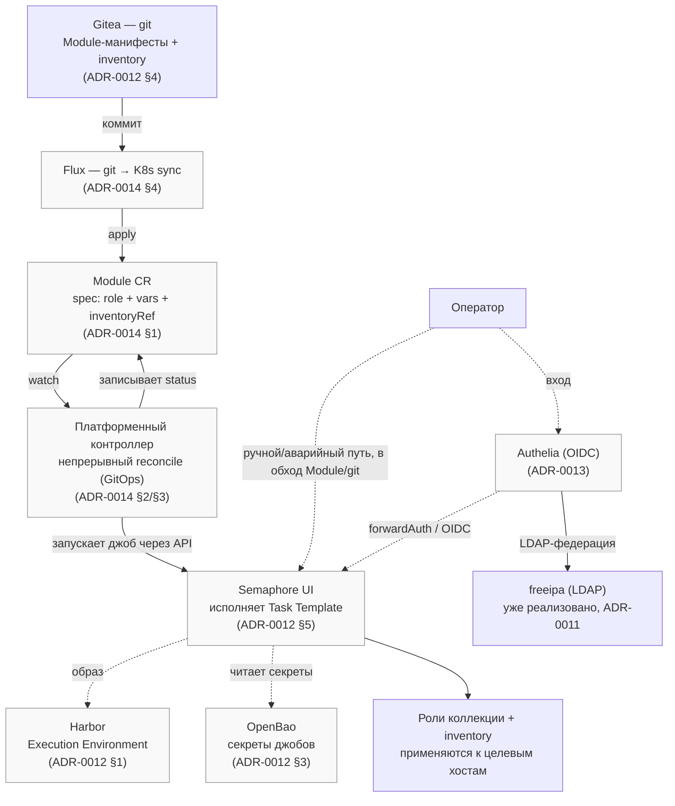

# Обзор проекта: цели и задачи

## Что это

`devops.uslugi` — Ansible collection (`namespace: devops`, `name: uslugi`) с набором
переиспользуемых ролей для развёртывания и эксплуатации типовой DevOps-инфраструктуры на
клиентских хостингах: мониторинг, reverse proxy, DNS, отказоустойчивые кластеры БД, backup,
identity/auth и вспомогательные сервисы. Коллекцию разрабатывает и эксплуатирует один инженер,
который отвечает за инфраструктуру нескольких клиентов — роли создаются не как обобщённый
публичный продукт, а как стандартизация решений, которые иначе повторялись бы вручную или
ad-hoc скриптами на каждом новом хосте/клиенте.

Это описывает то, что уже реализовано и работает сегодня. Целевая архитектура шире: платформа
для управления произвольной IT-инфраструктурой, где роли этой коллекции — исполнительное ядро
под управлением K8s-контроллера, декларативно и непрерывно сводящего инфраструктуру к описанному
состоянию (GitOps). Эта часть архитектурно решена, но не реализована — см.
`docs/adr/0014-platform-controller-architecture.md` и раздел «Целевая архитектура платформы»
ниже.

## Цели

- **Стандартизация раскатки типовых сервисов.** Один и тот же набор ролей с одинаковой схемой
  переменных вместо разных ad-hoc решений на каждом клиентском хосте — конфигурация одного и
  того же сервиса (например, MySQL HA или reverse proxy) выглядит одинаково независимо от того,
  на каком хосте она развёрнута.
- **Явно задокументированные архитектурные решения.** Каждая нетривиальная роль сопровождается
  ADR в [`docs/adr/`](adr/) — почему выбрана конкретная архитектура (например, Bareos vs Proxmox
  Backup Server vs restic/borg для backup), какие альтернативы рассматривались и отклонены,
  какие ограничения приняты осознанно. Решения фиксируются в документе, а не только в голове
  инженера, который их принял.
- **Воспроизводимая проверка вместо «работает у меня».** Каждая роль имеет molecule-сценарий в
  [`extensions/molecule/`](../extensions/molecule/), гоняющий реальную ВМ (vagrant/libvirt) —
  установка, конфигурация и функциональная проверка (не просто «плейбук отработал без ошибок»,
  а `nginx -t`, реальные HTTP-запросы через прокси, `dig`-резолвинг, и т.п.).
- **Демо-стенды для сборки full-stack сценариев.** [`demo/`](../demo/) — исполняемые примеры
  (Terraform+libvirt), собирающие несколько ролей вместе в сценарий, близкий к тому, что
  разворачивается у клиента, прежде чем менять что-то в проде. Список — раздел «Демо-стенды»
  ниже.

## Функциональный охват (задачи)

Коллекция закрывает следующие подсистемы клиентской инфраструктуры:

- **Мониторинг** — `monitoring_server` (VictoriaMetrics/Grafana/VMAlert/Loki, docker или k3s) +
  `monitoring_agent` (экспортеры на целевых хостах: node, mysqld, redis, nginx, php-fpm, pve,
  freeipa и др.).
- **Reverse proxy** — три взаимоисключающих на одном хосте варианта под разные сценарии:
  `reverse_proxy_traefik` (Docker-labels, автообнаружение), `reverse_proxy_npm` (GUI/REST API для
  операторов без IaC), `nginx_multidomain` (YAML-конфиг в стиле shared hosting).
- **DNS** — `infra_dns` (bind9, forward/reverse-зоны из inventory).
- **HA базы данных** — `mysql_replication` + `proxysql` (единая точка подключения), а также
  `postgresql_replication` + `odyssey` — по тому же паттерну: физическая репликация "звездой",
  ручной promote, бэкапы в S3.
- **Backup** — `backup_server` + `backup_agent` (Bareos) — централизованный сервис бэкапа для
  клиентских хостов; `mysql_replication_backup_tool`/`postgresql_replication_backup_tool` могут
  делегировать на этот сервис вместо собственного S3-пути (ROADMAP №48).
- **Identity/auth** — `freeipa` (LDAP + Kerberos KDC + собственный CA). Единая авторизация
  поверх него — Authelia как OIDC-провайдер, федерация через LDAP-бэкенд, `forwardAuth` для
  admin-панелей без нативного OIDC (`docs/adr/0013-unified-auth-architecture.md`) —
  архитектурно решено, роль не реализована.
- **Периметр/защита** — `fail2ban` + `fail2ban_ui` (веб-панель).
- **Инфраструктурные примитивы** — `docker` (единая точка установки Docker Engine, используется
  как зависимость другими ролями).
- **Витрина** — `infra_panel` (homer, дашборд-стартовая страница со ссылками на развёрнутые
  компоненты).

Полный список ролей со ссылками на документацию каждой — [`docs/components.md`](components.md).

## Демо-стенды

8 стендов в [`demo/*`](../demo/) (Terraform/OpenTofu + libvirt, единая обёртка запуска —
`demo/stand.sh up|down <case-name>`; архитектура и обоснование выбора Terraform+libvirt — см.
[`docs/adr/0006-demo-stand.md`](adr/0006-demo-stand.md)):

| Стенд | Роли в составе | Что демонстрирует |
|---|---|---|
| `mysql-ha-platform` | `monitoring_server` (docker) + `reverse_proxy_traefik` + `infra_panel`, `monitoring_agent`, `mysql_replication` (primary + 2 реплики), `proxysql`, `infra_dns` | Полный MySQL HA-стек с мониторингом и единой точкой подключения; есть отдельный `load-generator.yml` |
| `postgresql-ha-platform` | То же, но `postgresql_replication` (repmgr) + `odyssey` вместо MySQL-стека | Полный PostgreSQL HA-стек, тот же паттерн; тоже есть `load-generator.yml` |
| `monitoring-k3s-platform` | `monitoring_server` (**k3s**-путь) + `infra_panel`, `monitoring_agent` (systemd, только `node_exporter`) | Проверка k3s-оркестратора мониторинга (VictoriaMetrics Operator + grafana-operator через Helmwave) отдельно от docker-варианта |
| `backup` | `reverse_proxy_traefik` + `backup_server` + `infra_panel` (сервер), `backup_agent` (клиенты client-a/client-b с демо-файлами) | Bareos backup-server + агенты на нескольких клиентских хостах (ROADMAP №48) |
| `npm` | `docker` + `reverse_proxy_npm` + `fail2ban` + `fail2ban_ui` | NPM как reverse proxy с GUI, под защитой fail2ban + его веб-панелью, plus fixture-бэкенд (`traefik/whoami`) |
| `nginx-multidomain` | `nginx_multidomain` + `fail2ban` + `fail2ban_ui` | nginx shared-hosting конфиг (rate limiting) под защитой fail2ban |
| `samba-server` | Собственные ansible-задачи (не роль коллекции) | Отдельный стенд, вне контура ролей `roles/*` |
| `full-platform` | Все 9 независимых ролей сразу: `reverse_proxy_traefik`+`monitoring_server`(docker)+`backup_server`+`infra_panel` на одном хосте, `monitoring_agent` (systemd, везде), `mysql_replication`+`backup_agent`, `proxysql`, `postgresql_replication`, `odyssey`, `infra_dns`, `nginx_multidomain`+`fail2ban`+`fail2ban_ui`, `docker`+`reverse_proxy_npm`, `freeipa` (единственная VM на Rocky 9) | Особый стенд «всё сразу»: весь охват возможностей коллекции в минимальной конфигурации (СУБД — однонодовые, без реплик; без генератора нагрузки — репликационный лаг показывать нечего) на 9 VM |

## Целевая архитектура платформы

Архитектурно решено (`docs/adr/0014-platform-controller-architecture.md`), не реализовано:
роли коллекции остаются исполнительным ядром, но получают декларативный, самонаблюдающий слой
поверх себя.

*Архитектура решена, ничего из компонентов на схеме (кроме `freeipa` и самих ролей) пока не
развёрнуто — см. таблицу «Архитектура решена, роль не реализована» в
[`docs/components.md`](components.md).*

- **`Module`** — Kubernetes CRD, обёртывающий существующую роль: `spec` — эквивалент
  `group_vars`, ссылка на inventory-файл в git (без отдельного CRD для хостов — Ansible
  по-прежнему сам разбирает инвентарь).
- **Подсистема** — функциональная группировка модулей, совпадает с категориями раздела
  «Функциональный охват» выше (Мониторинг, Reverse proxy, DNS, HA БД, Backup, Identity/auth,
  Периметр, Витрина).
- **Платформенный контроллер** (K3s, одна нода или кластер) реагирует на `Module` CR в
  кластере и оркестрирует Semaphore (`docs/adr/0012-cicd-platform-architecture.md` §5) —
  сам не исполняет Ansible напрямую. Semaphore остаётся ручным/аварийным путём и единой
  историей и автоматических, и ручных запусков.
- **Reconcile — непрерывный (GitOps), не разовый**: контроллер периодически переприменяет
  модуль, обнаруживая дрейф — безопасно именно потому, что идемпотентность ролей уже жёсткое
  требование коллекции (каждый molecule-сценарий проходит `idempotence: changed=0`).
- **Git → K8s** синхронизация — **Flux** (не ArgoCD — выбор сделан при планировании реализации
  ADR-0014: CRD-first, без второго web UI, легче для одной ноды K3s), не часть самого
  контроллера: два независимых цикла сведения состояния (git↔K8s и K8s↔реальная
  инфраструктура), не один монолит.

Главная цель модульности — расширяемость: новый тип управляемого инфраструктурного сервиса
добавляется новым модулем, не правкой ядра платформы.

## Сквозные архитектурные принципы

- **Idempotency и fail-fast на небезопасных дефолтах.** Роли, публикующие сервисы наружу
  (`reverse_proxy_traefik`, `reverse_proxy_npm`, `infra_panel`), явно падают на этапе проверки
  требований, если пользователь не сменил дефолтный пароль, вместо того чтобы развернуть сервис
  с известным всем паролем.
- **Единая точка владения общим ресурсом.** Например, роль `docker` — единственный владелец
  `/etc/docker/daemon.json`: роли-потребители передают свои ключи (`metrics-addr` для
  docker-экспортера и т.п.) через переменные зависимости, а не пишут в файл сами. Тот же принцип
  для общей docker-сети `proxy`, которую создаёт `reverse_proxy_traefik`, а её используют
  `infra_panel`/`backup_server` (webui-proxy) как потребители, не владельцы.
- **Переиспользуемые инфраструктурные примитивы вместо копий одной и той же логики.** Роли,
  которым для работы нужен Docker на хосте, подключают его через зависимость на роль `docker`
  (см. `docs/adr/0002-docker-role.md`), а не повторяют apt-задачи установки Docker Engine у себя.

## Как устроена документация коллекции

| Что искать | Где | Что там |
|---|---|---|
| Что делает роль и как её настроить | `roles/<role>/README.md` | Переменные, обязательные шаги перед использованием, пример конфигурации |
| Почему так, а не иначе | `docs/adr/000N-*.md` | Архитектурное решение, рассмотренные альтернативы, известные ограничения |
| Что делать при инциденте | `docs/runbooks/*.md` | Пошаговые процедуры (сейчас: failover MySQL/PostgreSQL) |
| Что ещё не готово / приоритеты | `ROADMAP.md` | Журнал находок код-ревью (P0 критические баги → P5 архитектурные развилки), с историей закрытых пунктов |
| Формальные требования (где есть) | `docs/Requirements Specification/` | Пока только `mysql-ha.txt` |
| Рабочий пример целиком | `demo/*` | Terraform+libvirt стенды, собирающие несколько ролей вместе |
| Реестр всех компонентов с перекрёстными ссылками | `docs/components.md` | Таблица роль → README/ADR/runbook/molecule/статус |

## Текущий статус

Не все роли доведены до одинаковой полноты — это осознанно фиксируется, а не скрывается:

- `nginx_multidomain` — реализована частично (см. `docs/adr/0003-nginx-multidomain-role.md`,
  разделы 8–9): `letsencrypt`, генерация htpasswd для `basic_auth` и `log_format` для
  json-логов не реализованы, причём включение `basic_auth`/json-логов **ломает** `nginx -t`, а
  не просто не работает.
- `infra_panel` — реализован только `docker`-оркестратор на уровне полноценной роли; `k3s`-путь
  ограничивается рендером values-файла для уже существующего Helmwave-релиза (см.
  `docs/adr/0008-infra-panel-role.md`, §2).

Отдельно — архитектура решена (ADR написан), но роль(-и) ещё не реализованы:

- **CI/CD-платформа** (`docs/adr/0012-cicd-platform-architecture.md`) — Execution Environment
  (Harbor) + self-hosted git с CI (Gitea Actions) + веб-панель запуска ansible/terraform
  (Semaphore UI) + внешнее хранилище секретов (OpenBao). Закрывает ROADMAP №50/№52.
- **Единая авторизация** (`docs/adr/0013-unified-auth-architecture.md`) — Authelia (OIDC) поверх
  уже существующего `freeipa` (LDAP), общая переменная `*_auth_method` для ролей-потребителей.
  Закрывает ROADMAP №49.
- **Платформенный контроллер** (`docs/adr/0014-platform-controller-architecture.md`) — `Module`
  CRD над существующими ролями, GitOps-reconcile через K3s-контроллер, оркестрирующий Semaphore
  (не заменяющий его). Самая крупная из нереализованных архитектур — переопределяет
  позиционирование всего проекта с «набора ролей» на «платформу», см. раздел «Целевая
  архитектура платформы» выше.

За полным и актуальным списком приоритизированных находок — `ROADMAP.md`.
