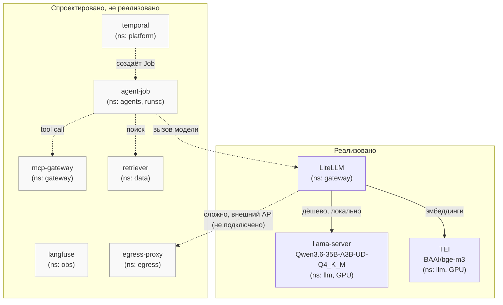
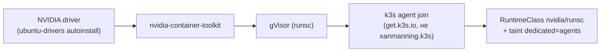
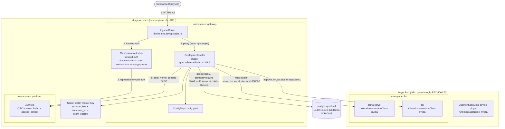

# agent-platform — локальный LLM-инференс и гейтвей

Единственный компонент платформы, развёрнутый **только на `platform/aicd-devops-labs-ru`** —
локальный инференс (llama-server + TEI на GPU-ноде `llm1`) за гейтвеем LiteLLM. Фундамент
изоляции и сетевой топологии — `docs/adr/0015-ai-agent-platform-architecture.md`; выбор
конкретной модели/движка — `docs/adr/0021-agent-platform-model-selection.md`. Реализована пока
только Фаза 1 (нода-фундамент) + инференс + гейтвей — полный агентный стек (Temporal, Langfuse,
CloudNativePG+pgvector, MinIO, egress-proxy, сами агенты) архитектурно спроектирован, но не
реализован.

## Назначение

Даёт платформе собственный, изолированный LLM-инференс (chat completion, tool-calling,
эмбеддинги) для будущих AI-агентов — единая точка входа (LiteLLM), которая скрывает от
потребителей и адрес GPU-ноды, и ключи внешних провайдеров (переключение локально/внешний API —
правка values гейтвея, не пересборка агента).

## HLD

*Только `LiteLLM`/`llama-server`/`TEI` реально развёрнуты и живо проверены реальными
HTTP-запросами (2026-09-06). Остальное — целевая архитектура ADR-0015, серым.*

## LLD

- **`llm1` — второй узел уже существующего k3s-кластера**, не отдельный control-plane
  (уточнено с пользователем при реализации: изоляция от Gitea/Semaphore/OpenBao/Authelia/Radar/
  infra-panel — через `taint dedicated=agents:NoSchedule` + `RuntimeClass`, экономит
  инфраструктуру ценой более слабой изоляции, приемлемо для пилота).
- **Terraform — импорт существующей VM**, не создание: `llm1` уже существовала на Proxmox с
  GPU passthrough, настроенным вручную на уровне гипервизора; все hardware-атрибуты —
  `lifecycle.ignore_changes` (ошибочный diff рискует отцепить GPU при реальном apply).
  `RAM` увеличена до 25600 МиБ (с исходных 10240) под текущую модель — единственное значение
  в `terraform`, которое реально меняется этим ADR.
- **Host bootstrap — новая роль `roles/k3s_gpu_node`**: NVIDIA driver → `nvidia-container-toolkit`
  → gVisor (`runsc`), строго в этом порядке (toolkit должен встать до k3s, иначе
  NVIDIA-рантайм не подхватывается автоматически).
- **Join — официальный install-скрипт k3s** (`INSTALL_K3S_EXEC=agent`), не роль
  `xanmanning.k3s` — при разборе исходников выяснилось, что её auto-clustering не поддерживает
  сценарий «чистый agent-join к уже работающему, установленному не этим прогоном
  control-plane» без риска для живого кластера.
- **`nvidia-device-plugin` собран и запушен вручную в собственный Gitea-registry** — `nvcr.io`
  полностью недоступен с этого стенда (403 на уровне CDN/edge, тот же класс блока, что
  `github.com` release-assets/`vagrantcloud.com`), базовый образ пересобран на
  `docker.io/nvidia/cuda` (тот же дайджест).
- **Модель — llama.cpp (`llama-server`), не vLLM.** Первая версия ADR-0021 в тот же день выбрала
  vLLM + Qwen2.5-14B-Instruct-AWQ по общим критериям; решение пересмотрено, когда выяснилось,
  что на платформу мигрирует конкретный проект с уже работающей другой конфигурацией — итог:
  `Qwen3.6-35B-A3B-UD-Q4_K_M` (GGUF) на `llama-server`, эмбеддинги `BAAI/bge-m3` на **TEI**
  (отдельный движок, не тот же процесс).
- **LiteLLM подключён к БД (2026-09-12)** — не к `ns: data`/CNPG (та часть архитектуры
  по-прежнему не развёрнута), а к отдельному `postgresql-infra-1`
  (`docs/adr/0023-postgresql-standalone-role.md`, ROADMAP.md №60): `general_settings.database_url`
  → Prisma создал 75 таблиц `LiteLLM_*`, virtual keys/spend tracking реально работают
  (`POST /key/generate` проверен живьём, `GET /health/readiness` → `db: connected`). Play
  "Standalone PostgreSQL" в `site.yml` идёт ПЕРЕД play LiteLLM-гейтвея — БД/пользователь должны
  существовать раньше, чем Helm поднимет Deployment (Prisma-миграция при первом старте пода).
  `resources.limits.memory` поднят `1Gi`→`2Gi` — Prisma-миграция при старте держит отдельный
  node-процесс query-engine поверх python-процесса, старый лимит уходил в `OOMKilled`.
- **MCP — встроенная в LiteLLM proxy поддержка**, не отдельный продукт (IBM
  mcp-context-forge и аналоги тянут за собой Postgres+Redis, забегая вперёд `ns: data`) —
  `mcp_servers: {}` пока пусто, ни одного реального инструмента-бэкенда ещё нет.
- **`litellm-master-key` — обычный k8s `Secret`, не `vault://`** — render-токен gomplate
  ограничен policy строго тремя путями (`secret/gitea`/`secret/semaphore`/`secret/authelia`),
  `secret/litellm` не входит; заведён отдельной ansible-задачей ДО Helm-релиза. С 2026-09-12
  этот же секрет несёт второе поле, `database_url` (DSN к `postgresql-infra-1`,
  `sslmode=require`) — `secret/litellm` в OpenBao расширен аддитивно (`db_password` добавлен
  сохранив уже существующий `master_key`, KV v2 `POST` иначе заменил бы данные версии целиком).
- **Admin UI (`/ui`) выставлен наружу (2026-09-13, ROADMAP.md №59) — два независимых слоя,
  не один.** (1) Сетевой периметр: `IngressRoute litellm.aicd.devops-labs.ru` (Traefik) + общий
  Middleware `authelia-forward-auth` + `access_control.rules[].subject` в Authelia, тот же
  паттерн, что `radar`/`infra-panel`/`docs` (docs/adr/0019-platform-rbac-model.md §8) — но,
  в отличие от них, **без `platform-viewers`** (только `platform-admins`+`platform-engineers`),
  т.к. UI создаёт/удаляет virtual keys и меняет бюджеты, не read-only. (2) Собственный логин
  `/ui` — LiteLLM заведён ЕЩЁ ОДНИМ OIDC-клиентом Authelia (generic OIDC,
  `GENERIC_CLIENT_ID`/`_SECRET`/`_AUTHORIZATION_ENDPOINT`/`_TOKEN_ENDPOINT`/`_USERINFO_ENDPOINT`,
  `PROXY_BASE_URL` — env контейнера, не `config.yaml`), тем же классом решения, что Gitea/
  Semaphore/Grafana. `GENERIC_USER_ROLE_ATTRIBUTE` не настроен — маппинг Authelia-групп во
  внутреннюю роль LiteLLM (`proxy_admin`/`internal_user`/...) вне скоупа, сетевой периметр (1)
  уже ограничивает вход. Fallback на `master_key`-логин остаётся на `/fallback/login`.
  **Найдены и исправлены два реальных бага живым прогоном:** встроенный в k3s Traefik не
  поддерживает cross-namespace ссылку на Middleware без явного флага контроллера
  (`--providers.kubernetescrd.allowCrossNamespace`, не включён) — попытка сослаться на
  `authelia-forward-auth` из `ns: platform` отсюда (`ns: gateway`) ловила `middleware
  platform/authelia-forward-auth is not in the IngressRoute namespace gateway` и роут молча
  становился невалидным (голый 404 вместо редиректа на sso); решено вторым Middleware с тем же
  именем в `ns: gateway`, не глобальным флагом на весь Traefik. Второй баг — забытое правило
  `access_control` для домена (без него `default_policy: deny` блокировала бы даже показ
  логина) — добавлено вместе с сетевым периметром. После обоих фиксов подтверждено живьём:
  `302 → sso.aicd.devops-labs.ru` для неаутентифицированного запроса, логи Authelia показывают
  реальное решение `forward-auth` по этому домену. **Третий баг найден пользователем в браузере
  тем же днём**: клик на логин Authelia падал с `Internal server error` — под LiteLLM не доверял
  внутреннему PKI CA (тот же класс проблемы, что уже решён для Gitea/Grafana, но забыт при
  первой раскатке LiteLLM), `httpx` внутри `fastapi_sso` падал на обмене кода на токен с
  `CERTIFICATE_VERIFY_FAILED: self-signed certificate in certificate chain`. Исправлено тем же
  приёмом: `Secret aicd-platform-ca` в `ns: gateway` + `SSL_CERT_FILE` в env контейнера (Python
  `httpx` уважает этот стандартный OpenSSL env var так же, как Go `crypto/x509`). Живо
  проверено: TLS-запрос к `sso.aicd.devops-labs.ru` из пода litellm тем же
  `ssl.create_default_context()`, что использует `httpx`, теперь `200`. **Четвёртый баг тем же
  клик-тестом**: после фикса TLS — `invalid_client`, LiteLLM (`fastapi_sso`/`oauthlib`) шлёт
  `client_secret` через HTTP Basic Auth безусловно, а клиент был зарегистрирован на
  `client_secret_post` (обратный случай уже известного Semaphore-инцидента) — исправлено на
  `token_endpoint_auth_method: 'client_secret_basic'`. **Подтверждено пользователем: логин через
  браузер реально проходит до конца** (запись `ivinogradov` в `LiteLLM_UserTable` — не только
  редирект, полный OIDC-цикл).

  **Маппинг ролей `platform-admins`→`proxy_admin`/`platform-engineers`→`internal_user`
  настроен по запросу пользователя** — не `GENERIC_USER_ROLE_ATTRIBUTE` (ждёт скаляр, `groups` —
  список), а `role_mappings` внутри `SSOConfig` (`PATCH /update/sso_settings`, БД-backed,
  найдено через `openapi.json` живого инстанса). Ещё четыре бага по пути: (1) клиенту `litellm`
  не хватало scope `groups`; (2) `STORE_MODEL_IN_DB=True` — отдельный флаг для admin-API записи
  конфигурации в БД, без него `PATCH` падал `500`; (3) `kubernetes.core.k8s_exec` требует
  `command` строкой, не списком (список молча превращался в мусор, эта путаница давала
  сбивающее с толку `invalid literal for int()` вместо реальной OCI-ошибки); (4) Jinja
  `.values.role_mappings` резолвился в `dict.values()` bound-метод (коллизия имени ключа JSON) —
  исправлено на `['values']['role_mappings']`. Живо подтверждено: `GET /get/sso_settings`
  показывает сохранённый маппинг, повторный `site.yml` корректно пропускает PATCH (идемпотентно).

  **Пятый баг — кнопка SSO пропала с логин-страницы сразу после первого PATCH**, найден
  пользователем в браузере: PATCH только с `role_mappings` переключает у LiteLLM источник правды
  для ВСЕГО `SSOConfig` на БД целиком, а не мёржит по полям с env — поля, не попавшие в тот
  конкретный PATCH (`generic_client_id`/`_secret`/эндпоинты/`proxy_base_url`), перестали
  резолвиться из `GENERIC_*` env-переменных и стали `null`. Исправлено — PATCH несёт ВЕСЬ
  желаемый `SSOConfig` разом. **Живо подтверждено пользователем через реальный браузер: кнопка
  SSO видна и работает.**
  **Открыто**: применяется ли маппинг к уже существующим пользователям при повторном логине, или
  только при первом создании записи — не проверено.

- **Аудит против ADR-0022 (2026-09-13)** нашёл два реальных пробела, оба закрыты живым прогоном:
  - **Требование №1 (внутренний репозиторий)** — образ `ghcr.io/berriai/litellm` тянулся
    напрямую из интернета: `registries.yaml` зеркалил только `docker.io`. Т.к. Docker Registry
    V2 API всегда отдаётся с корня `/v2/` (Traefik не может маршрутизировать по пути запроса на
    разные upstream-registries), отдельный поддомен/порт не заводился — вместо этого
    `docker-hub-proxy` (Nexus) обёрнут в **docker-группу** (`docker-group`, тот же порт 8083)
    вместе с новым `ghcr-proxy` (`indexType: REGISTRY`, не `HUB`): Nexus сам резолвит запрошенный
    образ по членам группы, containerd видит один и тот же URL для обоих registry. Живо
    подтверждено: `GET /v2/berriai/litellm/manifests/v1.99.1` через `nexus-cache` → `200`,
    регрессия на `docker.io/library/postgres` через тот же mirror — тоже `200`.
  - **Требование №4 (метрики)** — `/metrics` не был включён вообще. Добавлено
    `litellm_settings.callbacks: ["prometheus"]` + `VMServiceScrape` (namespace `monitoring`) +
    официальный дашборд BerriAI (`github.com/BerriAI/litellm/.../grafana_dashboard/dashboard_v2`,
    `${DS_PROMETHEUS}`). **Второй баг найден той же живой проверкой**: LiteLLM требует
    `Authorization` для ЛЮБОГО эндпоинта, включая `/metrics` (401 без токена) — `VMServiceScrape`
    без `bearerTokenSecret` скрейпил бы вечный `down`. `kubectl explain` подтвердил: секрет обязан
    лежать в том же namespace, что сам `VMServiceScrape` (`monitoring`), не в namespace таргета
    (`gateway`) — заведён отдельный `Secret litellm-metrics-token` (копия `master_key`) именно
    там. Живо подтверждено: target `health: up` в vmagent, `python_info{job="litellm-litellm"}`
    реально долетает до VictoriaMetrics, `GrafanaDashboard` — `DashboardSynchronized: True`.
  - **Два пункта аудита сознательно отложены** (ROADMAP.md №64, не техническая реализация по
    умолчанию, а решение оператора): NetworkPolicy для `ns: gateway` (требование №10 — не входит
    в список известных исключений ADR-0022 §10, решение не принято) и оценка кандидата-Operator
    [`litellm-operator`](https://operatorhub.io/operator/litellm-operator) (требование №15 —
    найден, не официальный от вендора, ~11 звёзд, зрелость не подтверждена).

## DD

RuntimeClass'ы и каркас namespace (`llm`/`gateway`/`agents`/`data`/`obs`/`egress`), Pod Security
`restricted` + default-deny `NetworkPolicy` в `agents` заведены задачами `site.yml`, не Helm-
релизом. Единственное разрешающее сетевое правило на сегодня — egress к kube-dns из `agents`
(остальные три адреса появятся вместе со своими namespace в следующей фазе — физически их ещё
нет).

## Известные ограничения

- Развёрнута только Фаза 1 (нода-фундамент) + локальный инференс/гейтвей — сами агенты,
  Temporal, Langfuse, векторное хранилище, egress-прокси не реализованы.
- Только на одном из двух окружений платформы (`aicd-devops-labs-ru`) — GPU физически
  отсутствует на `platform/aicd`.
- Внешние LLM-провайдеры (OpenAI/Anthropic и т.п.) не подключены — решение сознательно отложено
  (ADR-0021 §8).
- `dedicated=agents` — единственная изоляция от остальной платформы (общий control-plane,
  общий etcd, общий встроенный Traefik) — слабее полноценного отдельного кластера, явно принятый
  компромисс для пилота.

## Ссылки

- `docs/adr/0015-ai-agent-platform-architecture.md` — полная целевая архитектура, namespace-
  границы, схема связей компонентов (§«Схема размещения агентного стека»), Фаза 1 (§10).
- `docs/adr/0021-agent-platform-model-selection.md` — выбор модели/движка, история пересмотра
  решения, живая проверка chat completion/tool-calling/эмбеддингов.
- `roles/k3s_gpu_node/README.md` — роль bootstrap GPU-ноды.
- [monitoring.md](monitoring.md) — GPU-метрики (`dcgm-exporter`) в общем self-мониторинге.
