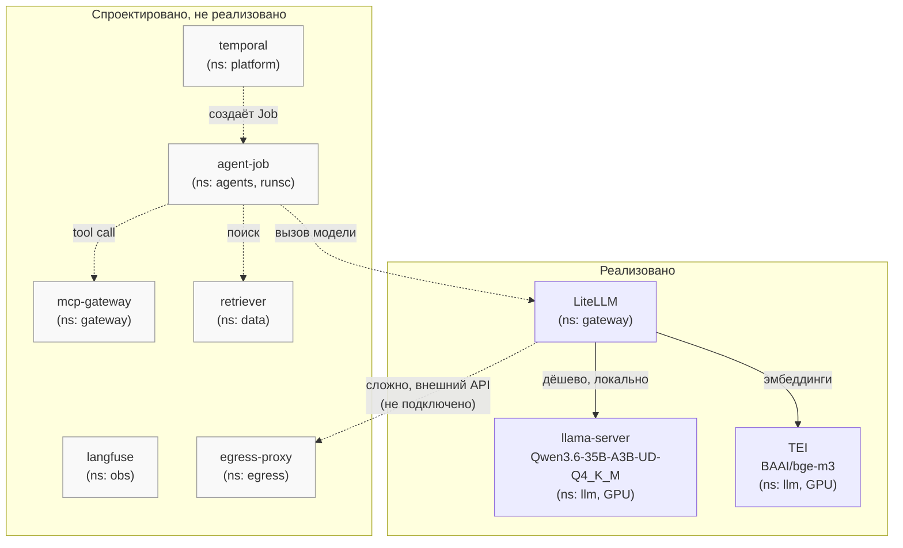
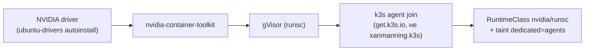
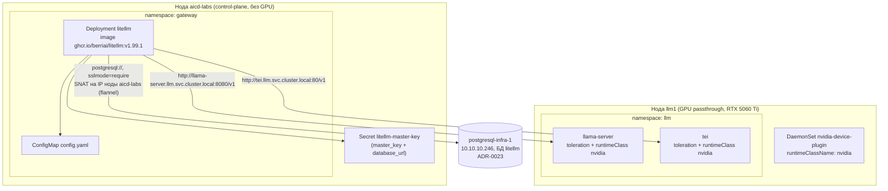

# agent-platform — локальный LLM-инференс и гейтвей

Единственный компонент платформы, развёрнутый **только на `platform/aicd-devops-labs-ru`** —
локальный инференс (llama-server + TEI на GPU-ноде `llm1`) за гейтвеем LiteLLM. Фундамент
изоляции и сетевой топологии — `docs/adr/0015-ai-agent-platform-architecture.md`; выбор
конкретной модели/движка — `docs/adr/0021-agent-platform-model-selection.md`. Реализована пока
только Фаза 1 (нода-фундамент) + инференс + гейтвей — полный агентный стек (Temporal, Langfuse,
CloudNativePG+pgvector, MinIO, egress-proxy, сами агенты) архитектурно спроектирован, но не
реализован.

## Назначение

Даёт платформе собственный, изолированный LLM-инференс (chat completion, tool-calling,
эмбеддинги) для будущих AI-агентов — единая точка входа (LiteLLM), которая скрывает от
потребителей и адрес GPU-ноды, и ключи внешних провайдеров (переключение локально/внешний API —
правка values гейтвея, не пересборка агента).

## HLD

*Только `LiteLLM`/`llama-server`/`TEI` реально развёрнуты и живо проверены реальными
HTTP-запросами (2026-09-06). Остальное — целевая архитектура ADR-0015, серым.*

## LLD

- **`llm1` — второй узел уже существующего k3s-кластера**, не отдельный control-plane
  (уточнено с пользователем при реализации: изоляция от Gitea/Semaphore/OpenBao/Authelia/Radar/
  infra-panel — через `taint dedicated=agents:NoSchedule` + `RuntimeClass`, экономит
  инфраструктуру ценой более слабой изоляции, приемлемо для пилота).
- **Terraform — импорт существующей VM**, не создание: `llm1` уже существовала на Proxmox с
  GPU passthrough, настроенным вручную на уровне гипервизора; все hardware-атрибуты —
  `lifecycle.ignore_changes` (ошибочный diff рискует отцепить GPU при реальном apply).
  `RAM` увеличена до 25600 МиБ (с исходных 10240) под текущую модель — единственное значение
  в `terraform`, которое реально меняется этим ADR.
- **Host bootstrap — новая роль `roles/k3s_gpu_node`**: NVIDIA driver → `nvidia-container-toolkit`
  → gVisor (`runsc`), строго в этом порядке (toolkit должен встать до k3s, иначе
  NVIDIA-рантайм не подхватывается автоматически).
- **Join — официальный install-скрипт k3s** (`INSTALL_K3S_EXEC=agent`), не роль
  `xanmanning.k3s` — при разборе исходников выяснилось, что её auto-clustering не поддерживает
  сценарий «чистый agent-join к уже работающему, установленному не этим прогоном
  control-plane» без риска для живого кластера.
- **`nvidia-device-plugin` собран и запушен вручную в собственный Gitea-registry** — `nvcr.io`
  полностью недоступен с этого стенда (403 на уровне CDN/edge, тот же класс блока, что
  `github.com` release-assets/`vagrantcloud.com`), базовый образ пересобран на
  `docker.io/nvidia/cuda` (тот же дайджест).
- **Модель — llama.cpp (`llama-server`), не vLLM.** Первая версия ADR-0021 в тот же день выбрала
  vLLM + Qwen2.5-14B-Instruct-AWQ по общим критериям; решение пересмотрено, когда выяснилось,
  что на платформу мигрирует конкретный проект с уже работающей другой конфигурацией — итог:
  `Qwen3.6-35B-A3B-UD-Q4_K_M` (GGUF) на `llama-server`, эмбеддинги `BAAI/bge-m3` на **TEI**
  (отдельный движок, не тот же процесс).
- **LiteLLM подключён к БД (2026-09-12)** — не к `ns: data`/CNPG (та часть архитектуры
  по-прежнему не развёрнута), а к отдельному `postgresql-infra-1`
  (`docs/adr/0023-postgresql-standalone-role.md`, ROADMAP.md №60): `general_settings.database_url`
  → Prisma создал 75 таблиц `LiteLLM_*`, virtual keys/spend tracking реально работают
  (`POST /key/generate` проверен живьём, `GET /health/readiness` → `db: connected`). Play
  "Standalone PostgreSQL" в `site.yml` идёт ПЕРЕД play LiteLLM-гейтвея — БД/пользователь должны
  существовать раньше, чем Helm поднимет Deployment (Prisma-миграция при первом старте пода).
  `resources.limits.memory` поднят `1Gi`→`2Gi` — Prisma-миграция при старте держит отдельный
  node-процесс query-engine поверх python-процесса, старый лимит уходил в `OOMKilled`.
- **MCP — встроенная в LiteLLM proxy поддержка**, не отдельный продукт (IBM
  mcp-context-forge и аналоги тянут за собой Postgres+Redis, забегая вперёд `ns: data`) —
  `mcp_servers: {}` пока пусто, ни одного реального инструмента-бэкенда ещё нет.
- **`litellm-master-key` — обычный k8s `Secret`, не `vault://`** — render-токен gomplate
  ограничен policy строго тремя путями (`secret/gitea`/`secret/semaphore`/`secret/authelia`),
  `secret/litellm` не входит; заведён отдельной ansible-задачей ДО Helm-релиза. С 2026-09-12
  этот же секрет несёт второе поле, `database_url` (DSN к `postgresql-infra-1`,
  `sslmode=require`) — `secret/litellm` в OpenBao расширен аддитивно (`db_password` добавлен
  сохранив уже существующий `master_key`, KV v2 `POST` иначе заменил бы данные версии целиком).

## DD

RuntimeClass'ы и каркас namespace (`llm`/`gateway`/`agents`/`data`/`obs`/`egress`), Pod Security
`restricted` + default-deny `NetworkPolicy` в `agents` заведены задачами `site.yml`, не Helm-
релизом. Единственное разрешающее сетевое правило на сегодня — egress к kube-dns из `agents`
(остальные три адреса появятся вместе со своими namespace в следующей фазе — физически их ещё
нет).

## Известные ограничения

- Развёрнута только Фаза 1 (нода-фундамент) + локальный инференс/гейтвей — сами агенты,
  Temporal, Langfuse, векторное хранилище, egress-прокси не реализованы.
- Только на одном из двух окружений платформы (`aicd-devops-labs-ru`) — GPU физически
  отсутствует на `platform/aicd`.
- Внешние LLM-провайдеры (OpenAI/Anthropic и т.п.) не подключены — решение сознательно отложено
  (ADR-0021 §8).
- `dedicated=agents` — единственная изоляция от остальной платформы (общий control-plane,
  общий etcd, общий встроенный Traefik) — слабее полноценного отдельного кластера, явно принятый
  компромисс для пилота.

## Ссылки

- `docs/adr/0015-ai-agent-platform-architecture.md` — полная целевая архитектура, namespace-
  границы, схема связей компонентов (§«Схема размещения агентного стека»), Фаза 1 (§10).
- `docs/adr/0021-agent-platform-model-selection.md` — выбор модели/движка, история пересмотра
  решения, живая проверка chat completion/tool-calling/эмбеддингов.
- `roles/k3s_gpu_node/README.md` — роль bootstrap GPU-ноды.
- [monitoring.md](monitoring.md) — GPU-метрики (`dcgm-exporter`) в общем self-мониторинге.
