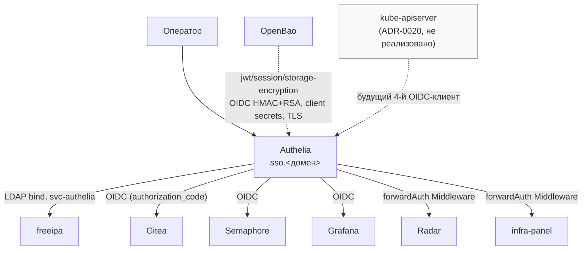
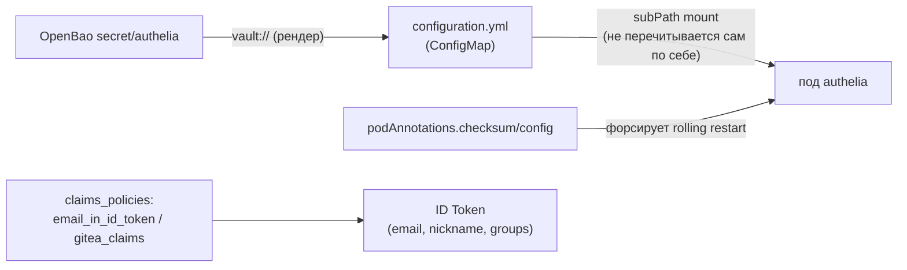
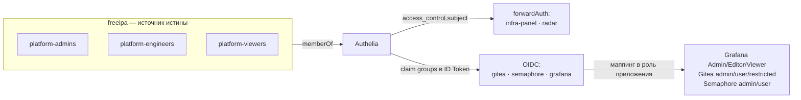
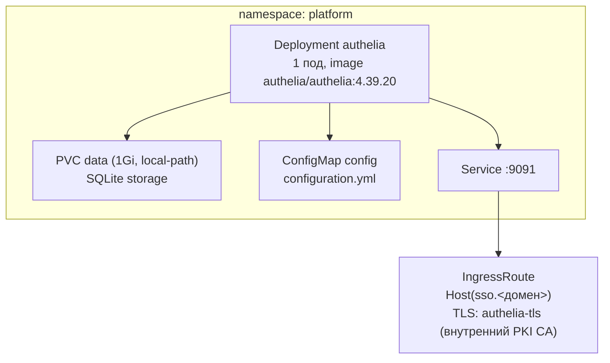

# Authelia — единая авторизация платформы

OIDC-провайдер для сервисов, умеющих OIDC нативно (Gitea, Semaphore, Grafana), и
`forwardAuth`-шлюз перед панелями без собственного логина (Radar, infra-panel). Единственная
точка, где проверяется «кто это» для всей платформы, кроме Nexus (LDAP-логин напрямую в
каталог, минуя Authelia — [nexus.md](nexus.md)). Архитектура —
`docs/adr/0013-unified-auth-architecture.md`; ролевая модель поверх неё —
`docs/adr/0019-platform-rbac-model.md`.

## Назначение

- Единый вход (SSO) на `sso.<домен>` для всех веб-UI платформы.
- Federация с [freeipa.md](freeipa.md) по LDAP (`implementation: freeipa`, готовый пресет) —
  сама Authelia не хранит пользователей.
- Два независимых механизма перед приложениями: нативный **OIDC** (Gitea/Semaphore/Grafana) и
  **forwardAuth** (Traefik Middleware) для приложений без своего логина (Radar/infra-panel).

## HLD

## LLD

- **Развёрнута как Helm-релиз** (`localrepo/universal-chart`), не отдельная ansible-роль —
  ревизия ADR-0013 §6: официального чарта Authelia нет, тот же приём, что Semaphore/
  infra-panel/Radar.
- **Секреты** — `jwt_secret`, `session_secret`, `storage_encryption_key`, `oidc_hmac_secret`,
  `oidc_issuer_private_key` (RSA), `ldap_bind_password`, `*_client_secret`/`*_client_secret_hash`
  (по одному на клиента) — идемпотентно сгенерированы в OpenBao (`secret/authelia`), читаются
  через gomplate `vault://` в момент рендера values.
- **`client_secret` в конфиге Authelia — обязан быть pbkdf2-sha512-хэшем**, не plaintext
  (`authelia crypto hash generate`); сами клиенты (Gitea CLI, `SEMAPHORE_OIDC_PROVIDERS`,
  `auth.generic_oauth` Grafana) получают plaintext-версию того же секрета из отдельного поля.
- **Claim'ы — только через ID Token, не `/userinfo`.** И Semaphore, и Gitea читают claim'ы
  исключительно из ID Token — `email`/`nickname`/`groups` не входят в него по умолчанию,
  принудительно переносятся `identity_providers.oidc.claims_policies.*.custom_claims`
  (найдено реальным прогоном, не предположение из документации).
- **`consent_mode: pre-configured`** (не дефолтный `explicit`) — без него согласие запрашивалось
  бы заново при каждом входе; `pre_configured_consent_duration: '1 year'`.
- **`authorization_policy` — не `one_factor`** — именованные политики
  (`platform_all_groups`/`platform_engineers_admins`), см. RBAC ниже.
- **`password_reset.disable: true`** — bind-аккаунт `svc-authelia` не имеет права менять чужие
  пароли в FreeIPA (обычный непривилегированный пользователь), предлагать нерабочую функцию
  хуже, чем не предлагать.
- **Конфиг монтируется `configMap` + `subPath`** — kubelet не перемонтирует такой файл живому
  поду при изменении ConfigMap; `podAnnotations.checksum/config` форсирует rolling restart при
  любом изменении `configuration.yml` (тот же класс бага, что htpasswd/subPath в `infra_panel`,
  ADR-0008 §2).

## RBAC-модель (ADR-0019)

Три сквозные группы-персоны (не группа на каждый сервис): `platform-admins`,
`platform-engineers`, `platform-viewers` — заведены в [freeipa.md](freeipa.md), доезжают до
приложений claim'ом `groups` в ID Token (для OIDC) или `access_control.subject` (для
forwardAuth).

Матрица допуска и маппинга ролей (реализовано и живо проверено на обоих окружениях,
2026-09-04):

| Сервис | `platform-admins` | `platform-engineers` | `platform-viewers` | Механизм |
|---|---|---|---|---|
| infra-panel | доступ | доступ | доступ | `access_control.subject` |
| radar | доступ | доступ | доступ | `access_control.subject` |
| Grafana | Admin | Editor | Viewer | `role_attribute_path` (JMESPath по `groups`), `role_attribute_strict: true` — вне групп отказ, не дефолтная роль |
| Gitea | admin | обычный пользователь | restricted | `groupClaimName`/`adminGroup`/`restrictedGroup` |
| Semaphore | admin (только локальный аккаунт) | обычный пользователь | **не пускать** (`platform_engineers_admins`, без viewers — «безопасного read-only» у Semaphore нет) | `authorization_policy`; ролевой маппинг по claim'у не поддержан апстримом (сверено с документацией v2.19.8) |
| Nexus | `nx-admin` | publish/deploy | read-only | LDAP `ldapGroupsAsRoles` + `externalRoleMapping` (не Authelia — [nexus.md](nexus.md)) |

Локальные admin-аккаунты каждого сервиса (`admin`/`gitea_admin`/root-токен OpenBao) остаются
активными как **break-glass**, не отключаются — вся модель висит на двух точках отказа
(`freeipa` без репликации + один под Authelia), пароли в OpenBao.

Порядок внедрения был фиксированным (не рекомендацией): сначала данные (группы+человек) →
claim `groups` в токене при ещё мягких политиках → маппинг ролей внутри приложений → и только
в конце — ужесточение `access_control`/`authorization_policies` до group-gated. Тот же принцип
«фундамент → следующий слой», что и bootstrap freeipa → Authelia → forwardAuth → OIDC.

## DD

Ресурсы не заданы явно в values (не входит в список исключений ADR-0022 §9, но и не
задекларирован специально — компонент лёгкий, отдельного инцидента с потреблением не было).
Различий между окружениями, кроме домена, нет.

## Известные ограничения

- OIDC-провайдер Authelia не GA (beta), апстрим прямо предупреждает о ломающих изменениях в
  будущих релизах, задевающих в т.ч. `consent_mode` — принятый, не устранённый риск
  (`docs/adr/0020-kube-apiserver-oidc.md` §1).
- Отзыв доступа не мгновенный: `pre_configured_consent_duration: 1 year` и живые сессии
  приложений не инвалидируются при удалении человека из группы.
- Единая точка отказа — один под, без резервирования.
- `kube-apiserver` как четвёртый OIDC-клиент — архитектурно решено
  (`docs/adr/0020-kube-apiserver-oidc.md`), не реализовано.

## Ссылки

- `docs/adr/0013-unified-auth-architecture.md` — полная история решения и находок (5 багов
  OIDC, найденных живым клик-тестом, §9).
- `docs/adr/0019-platform-rbac-model.md` — ролевая модель целиком, обоснование трёх групп,
  схема именования.
- `docs/adr/0020-kube-apiserver-oidc.md` — план распространения на `kubectl` (не реализовано).
- [freeipa.md](freeipa.md) — источник групп и пользователей.
- [gitea.md](gitea.md), [semaphore.md](semaphore.md), [monitoring.md](monitoring.md),
  [radar.md](radar.md), [infra-panel.md](infra-panel.md) — потребители.
