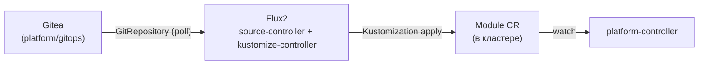
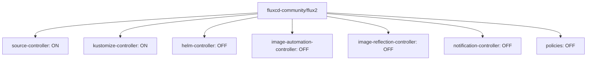
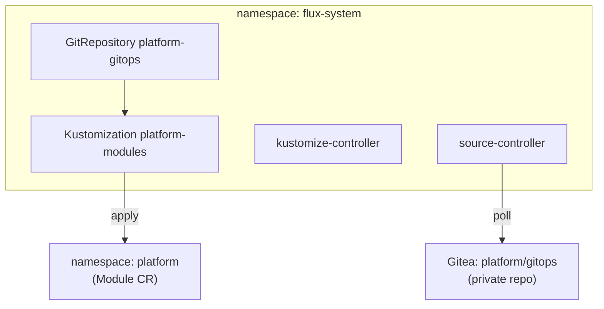

# Flux2 — GitOps-синхронизация

Синхронизирует Module-манифесты из [gitea.md](gitea.md) (`platform/gitops`) в кластер —
git-половина цикла ADR-0014 (`Kustomization` → k8s API), отдельная от Kubernetes-половины
(reconcile самих `Module`, [platform-controller.md](platform-controller.md)). Выбран вместо
ArgoCD — CRD-first, без второго web UI, легче для одной ноды k3s
(`docs/adr/0014-platform-controller-architecture.md` §4).

## Назначение

Единственный компонент, которому платформа доверяет применять объекты в кластер по сигналу из
git — так `Module` CR оказываются в кластере без ручного `kubectl apply`, и любой ручной дрейф
(например, `kubectl patch spec.vars` для отладки) откатывается обратно к версии из git в течение
`interval` (1 мин).

## HLD

## LLD

- **Только `source-controller` и `kustomize-controller` включены** — `helmController`,
  `imageAutomationController`, `imageReflectionController`, `notificationController`, `policies`
  все `create: false`. Пилот не использует Helm-релизы под управлением Flux (Helm-релизы
  платформы применяются `helmwave`, не Flux), не отслеживает образы, не шлёт уведомления — эти
  контроллеры не расходуют ресурсы одной ноды впустую.
- **`installCRDs: true`, `watchAllNamespaces: true`** — стандартная установка CRD чартом,
  наблюдение за всеми namespace (единственный `Kustomization`, `platform-modules`, живёт в
  `flux-system`, но применяет объекты в `platform`).
- **Namespace `flux-system`** — конвенция апстрима, сознательно не переименован в `platform` (в
  отличие от остальных релизов) — чтобы не расходиться с документацией/CLI `flux` при отладке.
- **`Kustomization` reconcile-интервал — 1 мин** — та же величина порядка, что `driftInterval`
  контроллера (30с), обе петли независимы и совместимость между ними подтверждена живым
  прогоном (`platform-controller/README.md`, Фаза 3: ручной `kubectl patch` откатывается
  Kustomization обратно, что само по себе генерирует новый `generation`, корректно
  обрабатываемый контроллером без дублирования job'ов).

## DD

Разворачивается одинаково на обоих окружениях (чарт `fluctcd-community/flux2`, версия `2.19.0`)
— расхождений в values нет.

## Известные ограничения

- Единственный `Kustomization` — весь `platform/gitops` применяется одним потоком, без
  разделения по под-каталогам/namespace.
- `helmController` выключен — Flux не участвует в управлении Helm-релизами платформы, это
  сознательная граница ответственности (весь Helm — через `helmwave`), а не временный пробел.
- Аутентификация к приватному `platform/gitops` — креды Gitea (тот же паттерн, что у Semaphore),
  не отдельный deploy key.

## Ссылки

- `docs/adr/0014-platform-controller-architecture.md` §4 — выбор Flux, обоснование против
  ArgoCD.
- [gitea.md](gitea.md) — источник репозитория.
- [platform-controller.md](platform-controller.md) — потребитель синхронизированных `Module`.
