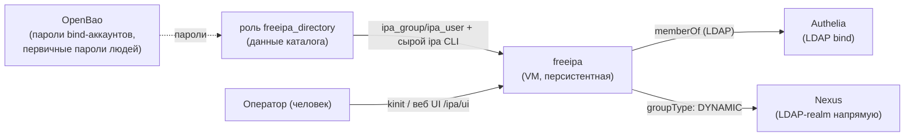
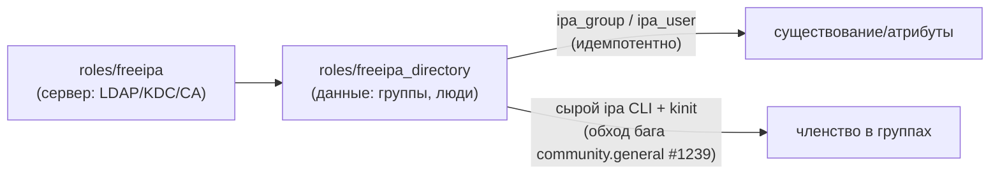
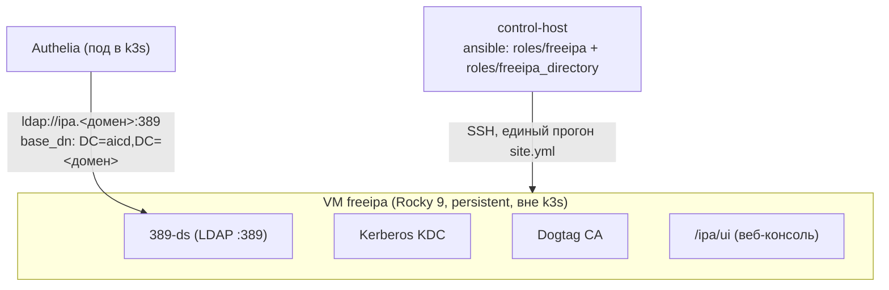

# FreeIPA (персистентный инстанс платформы)

Единый каталог платформы — LDAP + Kerberos KDC + собственный CA. Не отдельный компонент по
архитектуре (та же роль коллекции, что `demo/full-platform`), но отдельный **инстанс**: у
каждого окружения платформы — своя, независимая, персистентная VM, не пересоздаваемая при
каждом прогоне, в отличие от демо-стендов. Роль — `roles/freeipa/README.md`,
`docs/adr/0011-freeipa-role.md`; этот документ — про то, как роль используется именно здесь.

## Назначение

- Источник учётных записей и групп для всей платформы — единственный компонент, в котором
  реально существуют люди-пользователи (все остальные сервисы либо не хранят пользователей
  вовсе, либо получают их из этого каталога).
- Три платформенные группы (`platform-admins`/`platform-engineers`/`platform-viewers`,
  `docs/adr/0019-platform-rbac-model.md` §1) — единственный источник истины для авторизации во
  всех потребителях ([authelia.md](authelia.md), Nexus).
- Bind-аккаунты для сервисов, которым нужен LDAP напрямую или через Authelia
  (`svc-authelia`, `svc-nexus`, `svc-monitoring`).

## HLD

*`freeipa` сам не знает ни про Authelia, ни про RBAC — он отдаёт то, что в нём есть, любому LDAP-
клиенту. Вся логика допуска (кто что видит) — на стороне потребителей, см.
[authelia.md](authelia.md#rbac-модель-adr-0019).*

## LLD

- **Роль-владелец сервера** — `roles/freeipa` (ADR-0011): устанавливает и настраивает сам сервер
  (LDAP/KDC/CA), сознательно **не заводит данные каталога** (ADR-0011 §3 — граница «роль =
  сервер, не данные», нужна для сценария «сервер разворачиваем мы, наполняет заказчик»).
- **Роль-владелец данных** — `roles/freeipa_directory` (`docs/adr/0019-platform-rbac-model.md`
  §3): группы и люди, декларативно и идемпотентно, через
  `community.general.ipa_group`/`ipa_user`. Членство в группах — **не** через эти модули (баг
  апстрима `community.general` issue #1239 — любой непустой ключ `failed` в ответе FreeIPA
  трактуется как ошибка, хотя `group_add_member` всегда возвращает такой ключ), обход — сырой
  `ipa group-add-member`/`group-remove-member` с `kinit`, дифф участников считает сама роль.
  Аддитивна по умолчанию: не удаляет то, чего нет в списках, кроме точечного `state: absent` на
  элемент.
- **Bind-аккаунты сервисов** (`svc-authelia`, `svc-nexus`, `svc-monitoring`) заводятся не ролью
  `freeipa_directory`, а оркестрацией окружения (`site.yml`) — `--password-expiration` далеко в
  будущем (сервисный пароль, интерактивного входа нет; для людей же — обратное, обязательная
  смена пароля при первом входе).
- **Пароли** — идемпотентный check-404-then-generate в OpenBao (`secret/freeipa-directory` —
  первичные пароли людей; пароли bind-аккаунтов — в секретах компонентов-потребителей,
  `secret/authelia` и т.п.).
- **Между окружениями каталоги независимы.** `platform/aicd` и `platform/aicd-devops-labs-ru` —
  два физически отдельных LDAP-сервера без репликации (по построению роли `freeipa`, ADR-0011).
  Один и тот же человек (`ivan`, единственный заведённый на сегодня) существует в обоих
  каталогах отдельными учётными записями с независимыми паролями — два логина, два места
  отзыва доступа, явно принятое ограничение (`docs/adr/0019-platform-rbac-model.md` §3).

## DD

| | `platform/aicd` | `platform/aicd-devops-labs-ru` |
|---|---|---|
| Хост | `ipa.aicd.platform` | `ipa.aicd.devops-labs.ru` |
| Terraform | `platform/aicd/terraform/freeipa-target.tf` | `platform/aicd-devops-labs-ru/terraform/freeipa-target.tf` |
| Образ | тот же Packer-образ Rocky 9, что `demo/full-platform` | то же |
| Известная особенность | CPU-тип VM по умолчанию (`kvm64`/`qemu64`) не даёт `x86-64-v2` — свежий glibc отказывался стартовать, исправлено сменой `cpu.type` и полным перезапуском VM (тот же класс проблемы позже повторился у `llm1`, см. [agent-platform.md](agent-platform.md)) | то же исправление применено заранее |

Реальные пользователи на сегодня: `ivan` (член `platform-admins`) — по одной независимой учётной
записи в каждом каталоге.

## Известные ограничения

- Нет репликации между окружениями и нет резервного KDC/CA внутри одного окружения — одна VM,
  один под отказа.
- Доступ к `kubectl` не завязан на этот каталог (см. `overview.md#доступ-к-кластеру`) —
  `docs/adr/0020-kube-apiserver-oidc.md` спроектирован, но не реализован.
- Аудит выдачи/отзыва доступа (кто и когда добавил человека в группу) не ведётся отдельно от
  стандартных логов FreeIPA/Authelia (`docs/adr/0019-platform-rbac-model.md`, «Не проработано»).

## Ссылки

- `roles/freeipa/README.md`, `docs/adr/0011-freeipa-role.md` — сама роль-сервер.
- `roles/freeipa_directory/README.md` — роль-данные (группы, люди, границы, обход бага
  `community.general`).
- `docs/adr/0013-unified-auth-architecture.md` §7/§8 — реализация persistent-инстанса на обоих
  окружениях.
- `docs/adr/0019-platform-rbac-model.md` — ролевая модель, группы, матрица допуска.
- [authelia.md](authelia.md) — единственный компонент, аутентифицирующий пользователей ЧЕРЕЗ
  этот каталог (кроме Nexus, у которого LDAP-логин напрямую, [nexus.md](nexus.md)).
