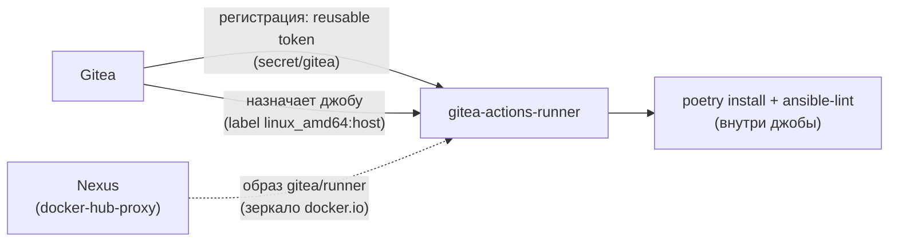
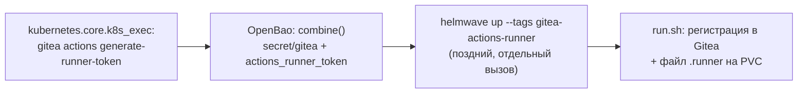
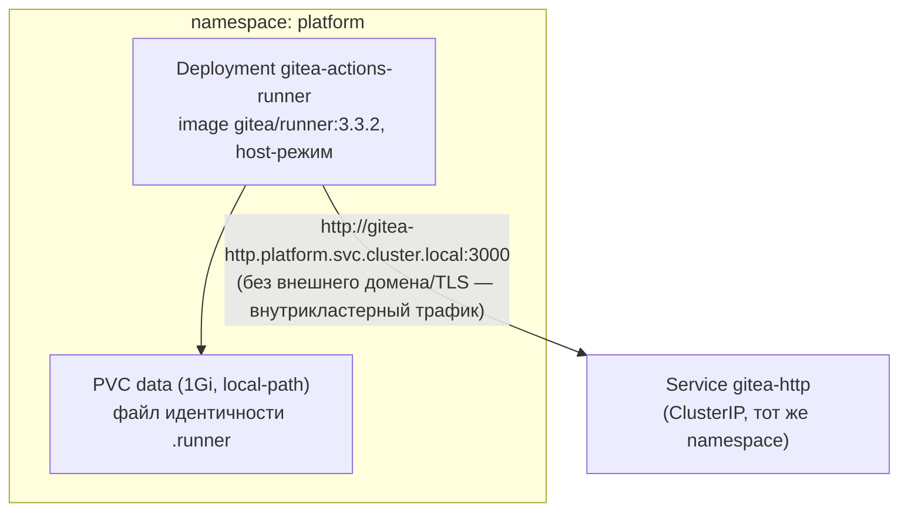

# gitea-actions-runner — CI-раннер Gitea Actions

Лёгкий, in-cluster (k3s) раннер Gitea Actions для host-задач (сейчас — только `ansible-lint`).
Не тот раннер, что `docs/adr/0012-cicd-platform-architecture.md` §4 описывает для `molecule`
(тот сознательно вынесен **за пределы k3s**, нужен `/dev/kvm`) — два раннера не
взаимозаменяемы и не планируются как один компонент. Первый компонент, полностью проведённый
по 12-пунктовому чек-листу `docs/adr/0022-new-component-requirements.md` §12 с самого начала (не
ретрофит).

## Назначение

- Исполняет `.gitea/workflows/lint.yml` (`ansible-lint` всей коллекции) при `push`/`pull_request`
  в главный репозиторий коллекции.
- Единственная сегодня CI-задача, работающая на этой платформе полностью автономно — не через
  Semaphore/platform-controller.

## HLD

## LLD

- **Host-режим, без Docker/DinD** (`GITEA_RUNNER_LABELS: linux_amd64:host`) — официальная
  документация Gitea подтверждает, что `actions/checkout` работает одинаково в Docker- и
  host-режиме; тот же паттерн уже использовался в этой коллекции
  (`trial/swissmakers/fail2ban-ui/.gitea/workflows/build-harbor.yml`). Базовый образ
  `gitea/runner:3.3.2` (alpine + git/bash/tini) — минимальный периметр под задачу lint, не
  универсальный CI-раннер.
- **Известный, задокументированный, не проверенный живым прогоном риск**: как минимум один
  пользователь на форуме Gitea сообщал, что даже `:host`-лейбл требовал доступного демона
  Docker — не подтверждено официальной документацией. Заранее прописан откат: сменить
  `imageTag` на `-dind-rootless` и добавить сайдкар `dind`, если первый реальный прогон
  `lint.yml` упадёт на этом.
- **Образ — `docker.io/gitea/runner`**, не `docker.gitea.com/runner` (дефолт официального
  Helm-чарта `gitea/helm-actions`) — `docker.io` уже мирроируется [nexus.md](nexus.md)
  (`docker-hub-proxy`), второй docker-proxy-репозиторий заводить не пришлось (закрывает
  ADR-0022 §1 без расширения Nexus). `gitea/act_runner` (без «-») — deprecated, заменён на
  `gitea/runner`.
- **Официальный чарт `gitea/helm-actions` сознательно не используется** — обязательно тянет
  privileged/rootless DinD-сайдкар без тумблера отключить; для единственной сегодня задачи
  (lint, без `docker://`-экшенов) это лишний периметр. Вместо него — голый Deployment через
  `localrepo/universal-chart` (тот же приём, что Semaphore/Radar/infra-panel/Authelia).
- **Registration token — reusable**, генерируется самим Gitea (`gitea actions
  generate-runner-token`, через `kubernetes.core.k8s_exec`), пишется retrofit-паттерном в уже
  существующий `secret/gitea` (не отдельный секрет) — см. [openbao.md](openbao.md).
- **Отдельный, поздний `helmwave up --tags gitea-actions-runner`** — chicken-and-egg: токен
  физически не существует до тех пор, пока Gitea не поднят и не сгенерировал его; релиз выведен
  из общего combined-вызова остальных аддонов.
- **ADR-0022 §10/§11 — явные решения, не пропуск**: NetworkPolicy не заводится (раннер не
  открывает ни одного входящего порта, риск не сетевой, а прикладной — состав workflow-файлов);
  бэкап в Bareos не регистрируется (единственное состояние на PVC — тривиально восстановимый
  файл идентичности `.runner`).

## DD

| | `platform/aicd` | `platform/aicd-devops-labs-ru` |
|---|---|---|
| `GITEA_RUNNER_NAME` | `k3s-platform-lint` | `k3s-platform-devops-labs-ru-lint` |
| Остальное | идентично | идентично |

Нет Service/Ingress — раннер не принимает входящих соединений, только исходящие к Gitea и,
внутри джобы, наружу за pip-пакетами.

## Известные ограничения

- Риск «host-режим всё равно требует Docker» не подтверждён и не опровергнут живым прогоном на
  момент написания — первый реальный CI-запуск `lint.yml` покажет, нужен ли откат на DinD.
- Единственная задача — `ansible-lint`; `molecule` этим раннером принципиально не покрывается
  (нужен `/dev/kvm`, см. `docs/adr/0012-cicd-platform-architecture.md` §4).
- Единственная реплика, без резервирования — простой раннера не блокирует ничего, кроме самого
  CI (Gitea и остальная платформа продолжают работать).

## Ссылки

- `docs/adr/0012-cicd-platform-architecture.md` §4 — граница ответственности между этим
  раннером и раннером `molecule`/KVM.
- `docs/adr/0022-new-component-requirements.md` §12 — полный чек-лист, применённый к этому
  компоненту.
- [gitea.md](gitea.md) — сервер, к которому регистрируется раннер.
- `.gitea/workflows/lint.yml` — единственный workflow на сегодня.
