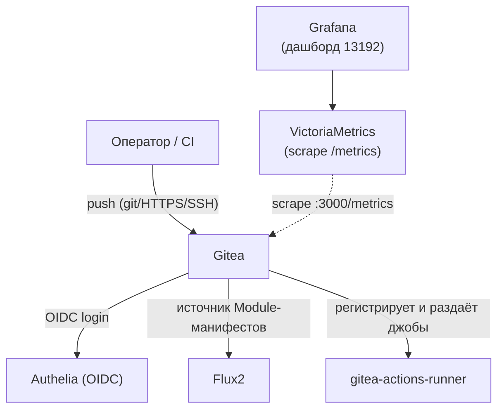
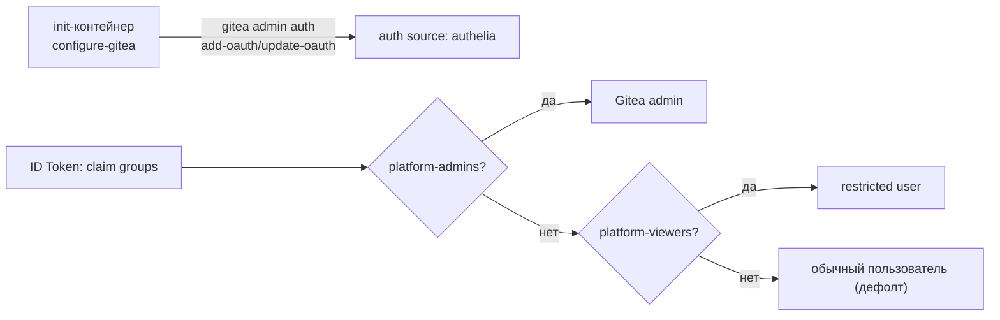
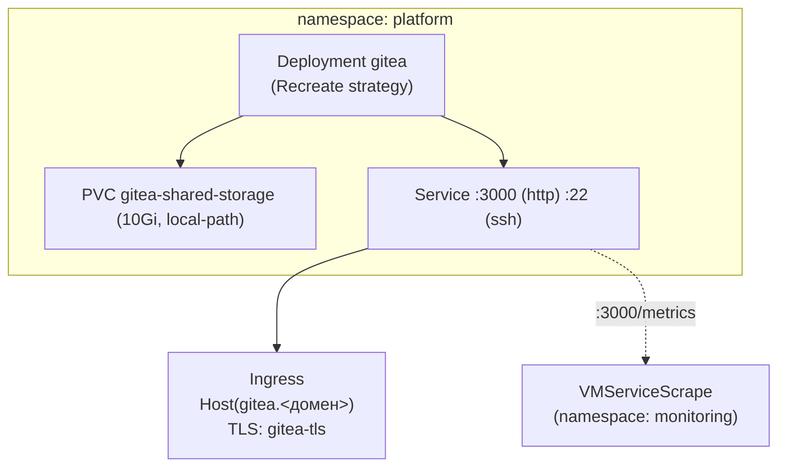

# Gitea — self-hosted git

Self-hosted git-сервер — источник Module-манифестов и Ansible-inventory для
[platform-controller.md](platform-controller.md) через [flux.md](flux.md), и площадка для CI
через встроенные Gitea Actions ([gitea-actions-runner.md](gitea-actions-runner.md)). Закрывает
ROADMAP №52 (выбор в пользу Gitea, не Forgejo). Архитектура —
`docs/adr/0012-cicd-platform-architecture.md` §4.

## Назначение

- Хранит `platform/gitops` — приватный репозиторий с Module-манифестами (`clusters/platform/*`)
  и Ansible-плейбуками/inventory, которые синхронизирует Flux и исполняет Semaphore.
- Первый компонент, полностью проведённый через 12-пунктовый чек-лист новых компонентов
  (`docs/adr/0022-new-component-requirements.md`) — вместе с
  [gitea-actions-runner.md](gitea-actions-runner.md).
- Хостинг зеркала самой коллекции `devops.uslugi` (приватный `platform/devops-uslugi`) — реальный
  источник, из которого Semaphore-раннер устанавливает коллекцию для исполнения ролей.

## HLD

## LLD

- **Официальный чарт `gitea-charts/gitea`**, `sqlite3`/`memory` для session/cache/queue —
  минимальная схема для однонодового пилота, без bundled Postgres/Redis.
- **`strategy.type: Recreate`**, не дефолтный `RollingUpdate`, — новый под и старый делят один
  RWO PVC и один on-disk leveldb-файл очереди; `RollingUpdate` гарантированно приводил бы к
  deadlock (найдено реальным прогоном при первом апгрейде).
- **OIDC через штатный механизм самого чарта** (`gitea.oauth[]`, `templates/gitea/init.yaml`) —
  идемпотентно, `gitea admin auth add-oauth`/`update-oauth` при каждом старте init-контейнера,
  без отдельного ansible-кода.
- **`ENABLE_AUTO_REGISTRATION: true`** обязателен — `freeipa` не заводит пользователей Gitea
  заранее (ADR-0011), без этого флага первый OIDC-логин молча проваливается.
- **RBAC-маппинг через group claim** (`docs/adr/0019-platform-rbac-model.md` §6):
  `groupClaimName: groups`, `adminGroup: platform-admins`, `restrictedGroup: platform-viewers` —
  `platform-engineers` получает обычного пользователя как дефолт (ни admin, ни restricted не
  совпали).
- **Метрики** (`gitea.metrics.enabled: true`, ADR-0022 §4) — нативный `/metrics` на том же порту
  `3000`, без отдельного экспортёра; наружу не публикуется (только `VMServiceScrape` изнутри
  кластера). Дашборд — официальный `grafana.com/13192`, вручную переиндексирован под
  `DS_VICTORIAMETRICS` (репозиторий хардкодит это имя входа для всех дашбордов).
- **Доверие к внутреннему PKI CA** (`SSL_CERT_FILE`) — без него init-контейнер `configure-gitea`
  падал на «certificate signed by unknown authority» при HTTPS-обращении к Authelia.
- **`resources.requests`/`limits` заданы явно** (ADR-0022 §9) — Gitea выведен из списка
  «известных исключений» этого ADR в этой же итерации.

## DD

Разворачивается одинаково на обоих окружениях; различие — только домен и то, что версия чарта
на `platform/aicd` не проверена живым прогоном на момент первого написания values (пометка в
файле — сверить актуальную версию перед первым `helm upgrade`).

## Известные ограничения

- Единственная реплика, SQLite на локальном PVC — без резервирования, без горизонтального
  масштабирования.
- Reset пароля через Authelia недоступен (см. [authelia.md](authelia.md),
  `password_reset.disable: true`) — восстановление доступа только через `freeipa`/локального
  admin-аккаунта.
- Реальный источник коллекции `devops.uslugi` для Semaphore-раннера — приватное зеркало
  `platform/devops-uslugi`, запушенное вручную (не автоматизировано агентом сознательно — см.
  `platform-controller/README.md`, «Не проработано»).

## Ссылки

- `docs/adr/0012-cicd-platform-architecture.md` §4 — выбор Gitea, раздельные раннеры CI.
- `docs/adr/0022-new-component-requirements.md` §4/§9/§12 — метрики, resources, раннер.
- `docs/adr/0019-platform-rbac-model.md` §6 — RBAC-маппинг.
- [gitea-actions-runner.md](gitea-actions-runner.md), [flux.md](flux.md),
  [platform-controller.md](platform-controller.md) — прямые потребители.
