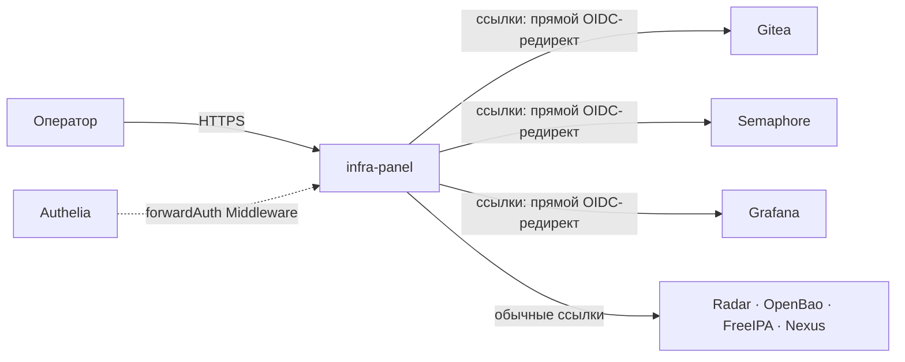
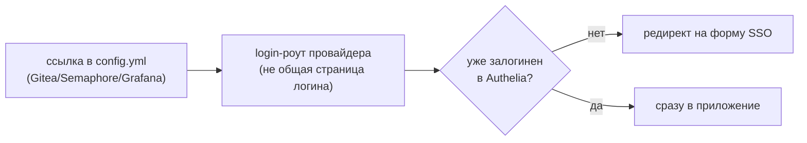
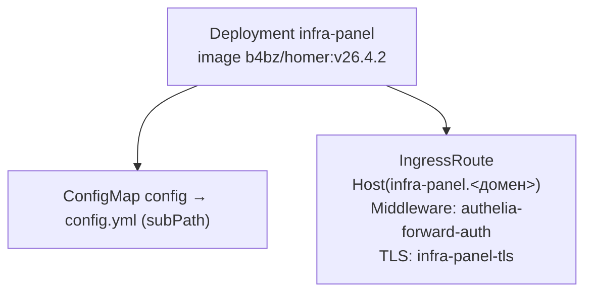

# infra-panel — дашборд-стартовая страница

Homer ([bastienwirtz/homer](https://github.com/bastienwirtz/homer)) — стартовая страница со
ссылками на все веб-UI платформы. K3s-путь той же роли/ADR, что и `infra_panel` в остальной
коллекции (`docs/adr/0008-infra-panel-role.md`), но здесь развёрнут напрямую Helm-релизом
(second стандартный аддон, `docs/adr/0017-platform-cicd-default-addons.md` §3), не самой ролью
(в отличие от `demo/*`, где роль применяется полноценно).

## Назначение

Единая стартовая точка входа для оператора — ссылки на Gitea/Semaphore/Radar/OpenBao/FreeIPA/
SSO/Grafana/Nexus, часть из них ведёт не на страницу логина сервиса, а сразу инициирует
OIDC-флоу через Authelia (минуя промежуточный клик «Sign in with Authelia»).

## HLD

## LLD

- **`configMaps.config` — статический `config.yml`**, не шаблонизирован под конкретного
  пользователя — одна и та же страница для всех допущенных.
- **Ссылки на Gitea/Semaphore/Grafana ведут на login-роут провайдера, инициирующий OIDC**, не на
  общую страницу логина сервиса — найдено чтением исходников каждого сервиса
  (`routers/web/web.go` у Gitea, `api/router.go` у Semaphore, `/login/generic_oauth` у Grafana) —
  редирект на форму SSO происходит автоматически на этом же шаге, если пользователь ещё не
  залогинен.
- **Вход защищён `forwardAuth`-Middleware Authelia** (не basic-auth, как раньше, ADR-0017 §1) —
  тот же механизм, что [radar.md](radar.md).
- **`INIT_ASSETS=0`** — отключает entrypoint-скрипт образа `b4bz/homer`, иначе при пустом
  `/www/assets` он разворачивает туда набор примеров поверх смонтированного конфига.
- **`config.yml` монтируется через `subPath`**, не весь `/www/assets` — иначе перекрывалось бы
  остальное содержимое каталога (кастомные иконки и т.п.).

## DD

Разворачивается одинаково на обоих окружениях — namespace `platform`, без PVC (статическая
страница).

## Известные ограничения

- Ссылки в `config.yml` — статический список, не автогенерируется из фактического набора
  Helm-релизов; при добавлении нового компонента платформы ссылку нужно добавлять вручную
  (см., например, добавление ссылки на Nexus, `docs/adr/0018-internal-caching-proxy.md` §8).
- k3s-путь роли `infra_panel` в этой коллекции ограничивается именно этим — рендером values для
  уже существующего Helmwave-релиза (`docs/adr/0008-infra-panel-role.md` §2), не полноценным
  оркестратором, как `docker`-путь той же роли в остальной коллекции.

## Ссылки

- `docs/adr/0008-infra-panel-role.md` §2 — граница между `docker`- и `k3s`-путём роли.
- `docs/adr/0017-platform-cicd-default-addons.md` §3 — выбор homer, второй стандартный аддон.
- [authelia.md](authelia.md) — источник допуска.
