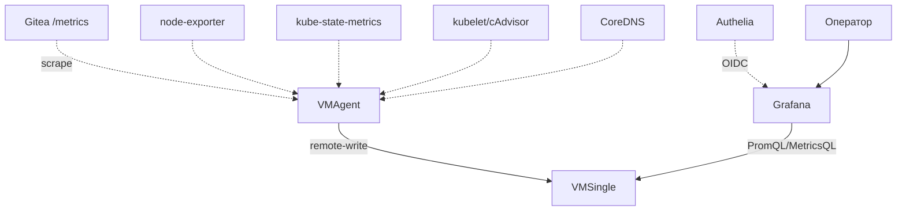
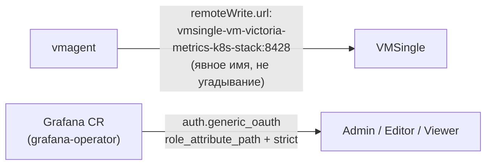
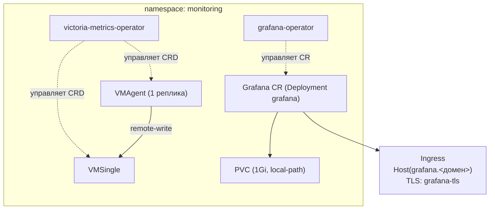

# monitoring — self-мониторинг платформенного кластера

VictoriaMetrics Operator + VMAgent/VMSingle + grafana-operator — third стандартный аддон
(`docs/adr/0017-platform-cicd-default-addons.md`), self-мониторинг самого k3s-кластера
платформы. Урезанная версия референсного стека `helm/envs/k3s-monitoring.yaml`
(`docs/adr/0007-monitoring-server-role.md`), рассчитанного на приём метрик с внешних
agent-хостов — здесь нужен только один кластер сам на себя.

## Назначение

- Единственная площадка наблюдаемости платформы — метрики [gitea.md](gitea.md), node-exporter,
  kube-state-metrics, kubelet/cAdvisor, coreDNS.
- Grafana — единственный публичный вход мониторинга наружу (сам VictoriaMetrics/VMAgent не
  публикуются).

## HLD

## LLD

- **Урезано относительно референса**: без `vmalert`/`alertmanager`/Loki/grafana-alloy — нет
  обоснованного бюджета памяти под ещё пару сервисов при текущей плотности одной ноды; без
  `file_sd` volume (тот нужен только для приёма метрик с внешних agent-хостов, здесь его нет).
- **`global.cluster.clusterLabel` НЕ переопределяется** — найдено живым прогоном: чарт
  использует это значение и как имя PromQL-лейбла прямо в bundled-дашбордах
  (`by(<clusterLabel>)`), и дефис в кастомном значении ломает синтаксис MetricsQL-запроса
  (`unexpected token '-'`), из-за чего валились все панели дашборда «Kubernetes / Views /
  Global». Дефолт чарта (`cluster`) синтаксически валиден и достаточен — один кластер на
  окружение, реальной необходимости в кастомном значении нет.
- **`vmagent.remoteWrite.url` — явное имя Service**, не полагается на угадывание: реальное имя
  Service для релиза `vm` — `vmsingle-vm-victoria-metrics-k8s-stack` (fullname-шаблон чарта
  добавляет суффикс имени чарта, раз имя релиза его не содержит); найдено живым прогоном —
  `vmagent` реально скрейпил (health: up), но `vmsingle` оставался пустым, т.к. remote-write
  молча терял данные на несуществующем хосте (VictoriaMetrics не ретраит вечно на DNS-ошибке).
- **Grafana — нативный OIDC**, не forwardAuth (в отличие от Radar/infra-panel — Grafana умеет
  OIDC сама). `role_attribute_path` + `role_attribute_strict: true` — маппинг
  `platform-admins`/`engineers`/`viewers` → `Admin`/`Editor`/`Viewer`, без catch-all — вне групп
  отказ в логине, не дефолтная роль организации (`docs/adr/0019-platform-rbac-model.md` §6).
- **`server.root_url` обязателен** — без него Grafana строит `redirect_uri` из
  `localhost:3000`-дефолта, Authelia отвечает `invalid_request` (найдено живым прогоном).
- **Дашборды через `grafana-operator`** (`GrafanaDashboard` CR, `dashboards: grafana` label
  selector), не через `sidecar`-паттерн kube-prometheus-stack.
- **GPU-метрики (`dcgm-exporter`)** — единственное различие `extra-objects.yaml` между
  окружениями: `VMPodScrape` на `platform/aicd-devops-labs-ru` для ноды `llm1`
  ([agent-platform.md](agent-platform.md)), нет на `platform/aicd` (нет GPU-ноды).

## DD

Разворачивается одинаково на обоих окружениях (чарты `vm/victoria-metrics-k8s-stack:0.69.0`,
`oci://ghcr.io/grafana/helm-charts/grafana-operator:5.22.0`); единственное различие в
values — `extra-objects.yaml` (GPU-скрейп, только на `aicd-devops-labs-ru`).

## Известные ограничения

- Нет алертинга (`vmalert`/`alertmanager` выключены) — метрики собираются и видны в Grafana, но
  автоматических уведомлений об инцидентах платформы нет.
- Нет сбора логов (Loki/grafana-alloy выключены) — только метрики.
- `defaultDashboards.dashboards` — только `victoriametrics-operator` и `node-exporter-full`; для
  Gitea дашборд подключается отдельной ansible-задачей (`ADDONS/grafana_dashboards/gitea_13192.json`),
  не через этот механизм чарта.

## Ссылки

- `docs/adr/0017-platform-cicd-default-addons.md` — выбор состава, third стандартный аддон.
- `docs/adr/0007-monitoring-server-role.md` §6/§11 — референсный полный стек, от которого этот
  урезан.
- `docs/adr/0019-platform-rbac-model.md` §6 — RBAC-маппинг Grafana.
- [gitea.md](gitea.md) — единственный на сегодня прикладной сервис платформы с собственным
  дашбордом.
- [agent-platform.md](agent-platform.md) — источник GPU-метрик на `aicd-devops-labs-ru`.
