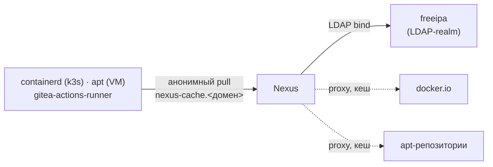
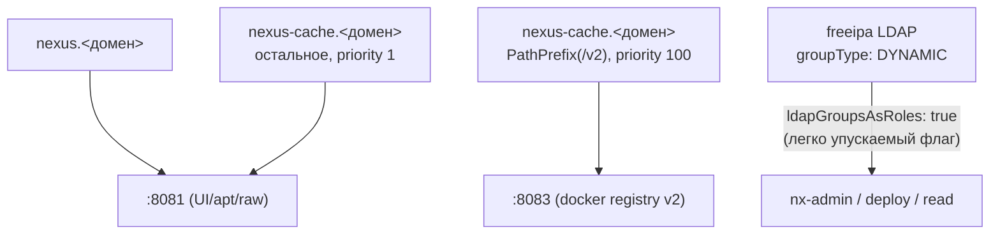
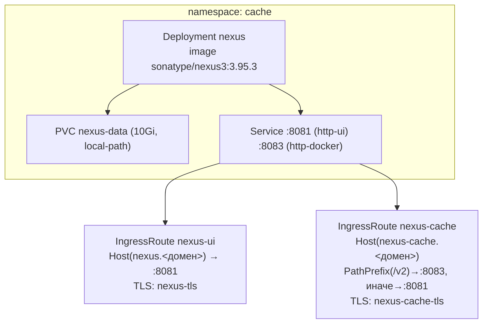

# Nexus — кеширующий прокси платформы

Nexus Repository OSS — единственный сервис, закрывающий кеширование Docker/OCI-образов, apt-
пакетов и произвольных бинарей (raw-формат), инфраструктурная зависимость для остальных
Helm-релизов (снижает частоту обращений наружу). Архитектура —
`docs/adr/0018-internal-caching-proxy.md`.

## Назначение

- Кеширующий прокси `docker-hub-proxy` (`docker.io`) — используется, в частности,
  [gitea-actions-runner.md](gitea-actions-runner.md) для образа `gitea/runner`.
- apt-прокси и raw-хостинг (`internal-releases`) для собственных артефактов платформы.
- Человеческий UI с LDAP-логином платформенной учёткой ([freeipa.md](freeipa.md) напрямую, не
  через [authelia.md](authelia.md) — Nexus OSS не умеет нативный OIDC).

## HLD

## LLD

- **Один образ на все форматы** (`sonatype/nexus3`) вместо трёх отдельных лёгких сервисов —
  осознанный компромисс с RAM (ADR-0018 §3): `requests.memory: 3Gi`/`limits.memory: 4Gi`,
  `INSTALL4J_ADD_VM_PARAMS` подобран под этот лимит.
- **Два внешних хоста, разная модель доступа**:
  - `nexus.<домен>` — человеческий UI, LDAP-логин, полная аутентификация.
  - `nexus-cache.<домен>` — машинные эндпоинты (docker/apt/raw), **анонимный pull, без
    аутентификации** — иначе автоматизация (containerd, apt) не сможет ничего забрать.
- **Docker-формат требует отдельный HTTP-коннектор** (`8083`, отдельный от UI/apt/raw `8081`) —
  задокументированное ограничение самого Nexus, не может отдавать Docker Registry V2 API с того
  же порта. Traefik маршрутизирует `PathPrefix(/v2)` с приоритетом на этот порт, остальное — на
  `8081`.
- **LDAP-логин, не Authelia**: `groupType: DYNAMIC` + `userMemberOfAttribute: memberOf` читает
  группы `freeipa` напрямую; обязательный (легко упускаемый) флаг `ldapGroupsAsRoles: true` —
  без него группы читаются, но роли не резолвятся ни при каких прочих настройках (найденный и
  исправленный живым прогоном баг, `docs/adr/0019-platform-rbac-model.md` §6).
- **External role mapping** — три Nexus-роли (`platform-admins`→`nx-admin`,
  `platform-engineers`→publish/deploy, `platform-viewers`→read-only), заведены тем же REST-
  вызовом, что `internal-releases-reader` (ADR-0018 §9).

## DD

Разворачивается одинаково на обоих окружениях (namespace `cache`, версия `sonatype/nexus3:3.95.3`
на момент внедрения); различие — только домен.

## Известные ограничения

- Единственная реплика, `local-path` PVC — привязан к конкретной ноде, без резервирования.
- Формат `helm`-прокси (Helm chart repository) не реализован — новые компоненты платформы,
  которым нужен публичный Helm-репозиторий, пока обходят это выбором чартов, уже мирроируемых
  существующими прокси, либо использованием вендоренного `localrepo/universal-chart`
  (см., например, [gitea-actions-runner.md](gitea-actions-runner.md)).
- Только `docker.io` мирроируется — образы с других реестров (`docker.gitea.com`, `nvcr.io` и
  т.п.) требуют либо отдельного прокси-репозитория (не заведён), либо выбора альтернативного
  источника при добавлении нового компонента (ADR-0022 §1).

## Ссылки

- `docs/adr/0018-internal-caching-proxy.md` — полная архитектура, включая живой прогон и три
  найденные проблемы (§10).
- `docs/adr/0019-platform-rbac-model.md` §6 — LDAP-роли, найденный баг `ldapGroupsAsRoles`.
- [freeipa.md](freeipa.md) — источник LDAP-групп.
