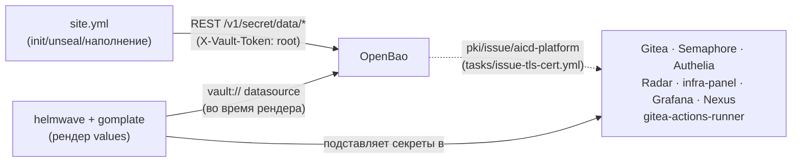
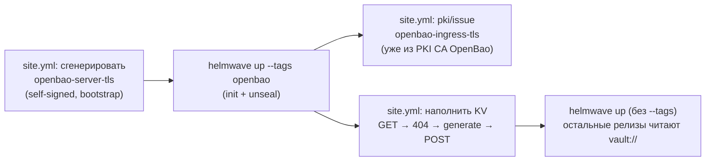
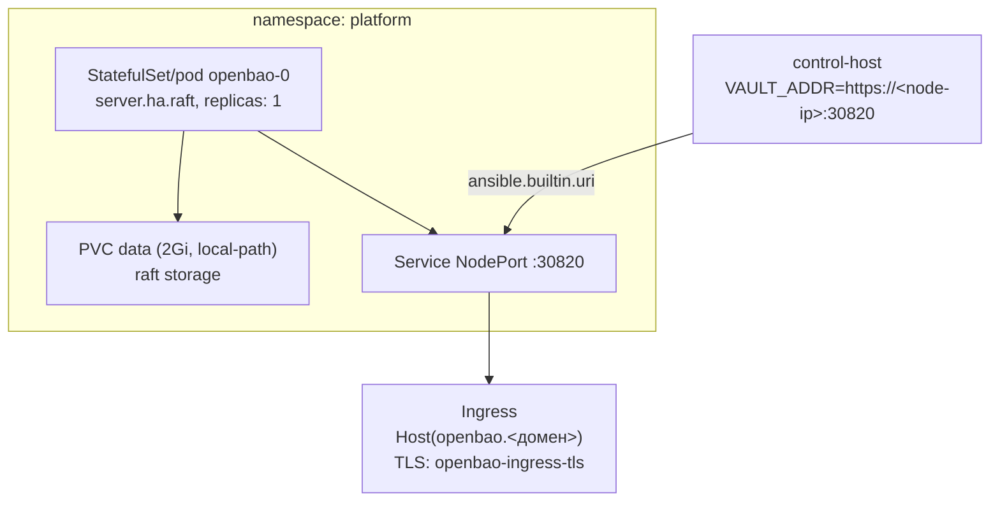

# OpenBao — секреты и внутренний PKI CA

Секреты (KV v2) и внутренний PKI CA всей платформы. Vault-совместимый форк HashiCorp Vault
(Linux Foundation, после смены лицензии на BSL) — выбран не идеологически, а вынужденно:
`docs/adr/0012-cicd-platform-architecture.md` §3 задокументировал устойчивый геоблок
`hashicorp.com`/`releases.hashicorp.com` на этой инфраструктуре. Полная архитектура —
`docs/adr/0016-openbao-secrets-pki.md`.

## Назначение

- Единое хранилище секретов всех остальных компонентов платформы — admin-пароли, cookie/session
  секреты, OIDC client secrets, LDAP bind-пароли (KV v2, путь `secret/<компонент>`).
- Внутренний PKI CA — TLS-сертификаты для внутренних Ingress-хостов платформы (`gitea-tls`,
  `semaphore-tls`, `radar-tls`, `authelia-tls`, `infra-panel-tls`, `nexus-tls`, …), выпущенные
  из одного CA, которому доверяют все компоненты-потребители.
- **Первый релиз, поднимаемый на окружении** — все остальные читают из него секреты через
  gomplate `vault://` уже на этапе рендера собственных values.

## HLD

*OpenBao — не runtime-зависимость потребителей (они не обращаются к нему после старта), а
build-time: секреты подставляются один раз в момент `helmwave up`, дальше живут как обычные
значения в отрендеренных манифестах/Secret-ах Kubernetes.*

## LLD

- **Официальный чарт `openbao/openbao`**, `server.ha.raft` с `replicas: 1` — единственный способ
  чарта включить raft integrated storage (унаследовано из upstream Vault Helm chart:
  «HA-режим» здесь означает «raft backend», не обязательно несколько реплик) — тот же масштаб,
  что весь стенд (одна k3s-нода). НЕ `server.dev.enabled` — dev-режим держит все данные в
  памяти, теряет их при каждом рестарте, неприемлемо для персистентной инфраструктуры.
- **Два независимых TLS-слоя**: `openbao-server-tls` — bootstrap self-signed сертификат
  (`community.crypto`, сгенерирован ansible ДО первого `helmwave up`, монтируется в под) для
  самого listener'а (курица/яйцо: чтобы выпустить сертификат из `pki/issue`, нужен уже
  распечатанный OpenBao с включённым PKI); `openbao-ingress-tls` — уже настоящий сертификат из
  собственного PKI CA, для внешнего Ingress.
- **`service.type: NodePort` (30820)**, не ClusterIP — control-host, где запускается
  helmwave/gomplate, не имеет сетевого маршрута к ClusterIP-адресам сервисов k3s, только к
  реальному IP ноды (`overview.md`, DD). `ServersTransport` с `insecureSkipVerify: true`
  заводится ansible — Traefik не доверяет самоподписанному `openbao-server-tls` без него.
- **Bootstrap-порядок**: `helmwave up --tags openbao` — отдельным, самым первым вызовом (init →
  unseal → наполнение KV/PKI через ansible), и только затем безусловный `helmwave up`
  разворачивает всё остальное, которому OpenBao уже отвечает.
- **Идемпотентный паттерн наполнения секретов**: GET `/v1/secret/data/<путь>` → 404 → сгенерировать
  → POST; повторные прогоны читают уже существующее значение, не перегенерируют. Тот же паттерн
  «retrofit» (добавить новое поле в уже существующий секрет через `| combine({...})`) применён,
  например, при добавлении `actions_runner_token` в уже существующий `secret/gitea`
  ([gitea-actions-runner.md](gitea-actions-runner.md)).
- **Секреты некоторых компонентов сознательно НЕ читаются через `vault://`** — например,
  `secret/litellm` (agent-platform): render-токен `gomplate` ограничен policy строго тремя
  путями, вместо этого используется обычный k8s `Secret`, заведённый ansible-задачей.

## DD

Различий между окружениями, кроме домена, нет — `openbao` разворачивается одинаково на
`platform/aicd` и `platform/aicd-devops-labs-ru`, версия чарта `0.29.2` на обоих.

## Известные ограничения

- Единственная реплика raft — без резервирования; отказ ноды кластера означает потерю доступа к
  секретам до восстановления.
- Root-токен и политики — единственный компонент платформы, полностью вне каталога `freeipa`/
  ролевой модели ADR-0019 (интеграция LDAP/OIDC auth method у OpenBao — отдельная нерешённая
  задача, требующая ревизии ADR-0016).
- Ingress на несколько секунд при самом первом прогоне ссылается на ещё не существующий Secret
  `openbao-ingress-tls` (тот выпускается уже ПОСЛЕ первого `helmwave up --tags openbao`) —
  Traefik подхватывает его сам, как только он появляется в рамках того же прогона.

## Ссылки

- `docs/adr/0016-openbao-secrets-pki.md` — полная архитектура (secrets engine, PKI, TLS-слои).
- `docs/adr/0012-cicd-platform-architecture.md` §3 — почему OpenBao, а не HashiCorp Vault.
- Каждый файл в [README.md](README.md) — потребитель секретов/PKI этого компонента.
