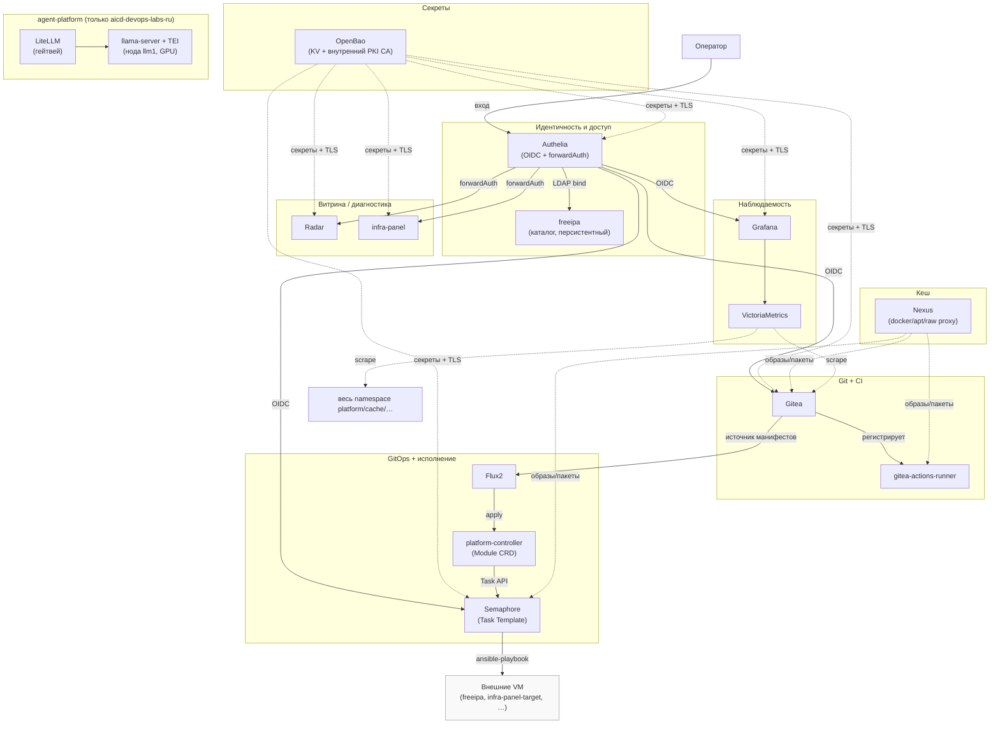
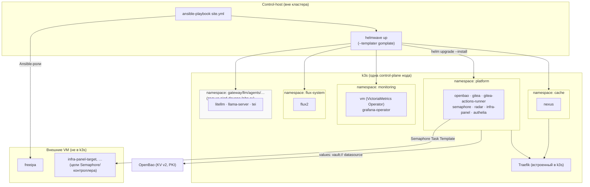
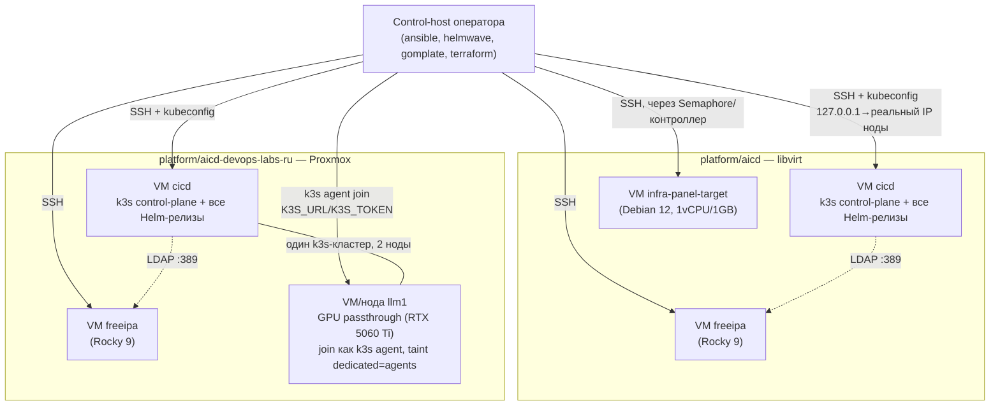

# Платформа `platform/aicd*` — обзор (HLD / LLD / DD)

Персистентная k3s-инфраструктура, обслуживающая разработку и эксплуатацию коллекции
`devops.uslugi` (CI/CD, секреты, единая авторизация, наблюдаемость) — не демо-стенд
(`docs/adr/0006-demo-stand.md`) и не клиентская инфраструктура (`roles/*`). Архитектурное
решение целиком — `docs/adr/0012-cicd-platform-architecture.md`; реестр компонентов с их
собственными HLD/LLD/DD — [`README.md`](README.md).

Два независимых окружения одного и того же стека, без общего состояния между ними:

| | `platform/aicd` | `platform/aicd-devops-labs-ru` |
|---|---|---|
| Гипервизор | libvirt | Proxmox |
| Домен | `aicd.platform` | `aicd.devops-labs.ru` |
| Helm-релизы | `helm/envs/platform.yaml` | `helm/envs/platform-devops-labs-ru.yaml` |
| Values | `helm/values/platform/` | `helm/values/platform-devops-labs-ru/` |
| Ansible | `platform/aicd/ansible/site.yml` | `platform/aicd-devops-labs-ru/ansible/site.yml` |
| Terraform | `platform/aicd/terraform/` | `platform/aicd-devops-labs-ru/terraform/` |
| Отличие в составе | — (референсное окружение) | + agent-platform (ADR-0015/0021, нода `llm1` с GPU) |

Набор релизов, версии чартов и большинство values идентичны — расхождение между окружениями
сознательно минимизировано (см. `diff helm/envs/platform.yaml helm/envs/platform-devops-labs-ru.yaml`:
комментарии второго файла в основном ссылаются на первый вместо повторения). Ниже — архитектура,
общая для обоих, с явной пометкой мест расхождения.

## HLD — граф компонентов

*Пунктир — вспомогательная/фоновая связь (секреты, кеш, метрики), сплошная стрелка — прямая
рабочая зависимость. `agent-platform` — единственный блок, которого нет на `platform/aicd`
(подробности — [agent-platform.md](agent-platform.md)).*

## LLD — слои платформы

*Рендер values — двухшаговый: `ansible-playbook` готовит предпосылки (секреты в OpenBao, PKI,
namespace для тех релизов, где создание не входит в `helmwave options.create_namespace`), затем
`helmwave up --templater gomplate` рендерит values-файлы (датасорс `vault://` читает секреты
живым HTTP-запросом к уже поднятому OpenBao в момент рендера, не подставляет их заранее) и
применяет Helm-релизы. Один `helmwave.<env>.yml` на окружение (гитигнорится, не общий файл —
находка `platform/aicd/README.md`, «Проверено реальным прогоном», п.2).*

## DD — физическое развёртывание

Ключевые физические свойства, общие для обоих окружений:

- **Одна control-plane нода** на кластер (`xanmanning.k3s`, `k3s_release_version: v1.35.1+k3s1`)
  — не HA. `platform/aicd-devops-labs-ru` — исключение: `llm1` присоединена **вторым узлом**
  того же кластера (не отдельным control-plane), изолирована `taint`
  (`dedicated=agents:NoSchedule`) и `RuntimeClass` (`nvidia`/`runsc`), см.
  [agent-platform.md](agent-platform.md).
- **freeipa — отдельная VM**, не под в k3s (LDAP/KDC/CA — не контейнеризуемая штатно роль
  коллекции, `docs/adr/0011-freeipa-role.md`) — единый каталог **для своего окружения**, между
  `aicd` и `aicd-devops-labs-ru` каталоги независимы (два разных человека с двумя разными
  паролями для одного и того же оператора, `docs/adr/0019-platform-rbac-model.md` §3).
- **Control-host не имеет прямого сетевого маршрута к ClusterIP** сервисов k3s — только к
  реальному IP ноды (объясняет `NodePort` у OpenBao, см. [openbao.md](openbao.md), и подмену
  `127.0.0.1` на реальный IP в kubeconfig, снятом `ansible.builtin.fetch`).
- **Дополнительные VM-цели** (`infra-panel-target` и будущие) заводятся отдельными
  terraform-ресурсами, не общим `for_each` — изменение shared-сети/cloudinit-шаблона не должно
  пересоздавать уже работающую control-plane VM (найдено реальным прогоном,
  `platform-controller/README.md`, «Фаза 5»). Эти VM применяются не `helmwave`, а
  Semaphore/платформенным контроллером ([platform-controller.md](platform-controller.md)) —
  они цель Ansible-ролей коллекции, а не Helm-релизов.

## Доступ к кластеру

Два независимых пути, оба существуют одновременно:

1. **Break-glass kubeconfig** (`/etc/rancher/k3s/k3s.yaml`, клиентский сертификат
   `system:masters`) — единственный реально работающий сегодня способ. Обходит RBAC целиком, не
   привязан к человеку, неотзываем без ротации CA кластера. Задокументированный, осознанно
   принятый на сегодня риск — `docs/adr/0020-kube-apiserver-oidc.md`, «Контекст».
2. **OIDC через Authelia** (`kubelogin`/`oidc-login`, structured `AuthenticationConfiguration`,
   группы `platform-*` → `ClusterRoleBinding` с префиксом `oidc:`) — **архитектурно решено,
   не реализовано** (`docs/adr/0020-kube-apiserver-oidc.md`, статус «Предложено»). Зависит от
   уже реализованных [freeipa.md](freeipa.md) (группы) и [authelia.md](authelia.md) (issuer).

## Ссылки

- `docs/adr/0012-cicd-platform-architecture.md` — исходное архитектурное решение (EE/Harbor,
  OpenBao вместо Vault, Gitea+раннер, Semaphore, размещение).
- `docs/adr/0014-platform-controller-architecture.md` — Module CRD, GitOps-reconcile,
  platform-controller.
- `docs/adr/0016-openbao-secrets-pki.md`, `0017-platform-cicd-default-addons.md`,
  `0018-internal-caching-proxy.md`, `0013-unified-auth-architecture.md`,
  `0019-platform-rbac-model.md`, `0020-kube-apiserver-oidc.md`, `0015-ai-agent-platform-architecture.md`,
  `0021-agent-platform-model-selection.md`, `0022-new-component-requirements.md` — решения по
  отдельным компонентам, см. соответствующие файлы в [README.md](README.md).
- `platform/aicd/README.md`, `platform/aicd-devops-labs-ru/README.md` — процедуры запуска,
  ручные шаги, история находок реальных прогонов.
- `docs/overview.md`, `docs/components.md` — коллекция в целом (роли `roles/*`), не платформа.
