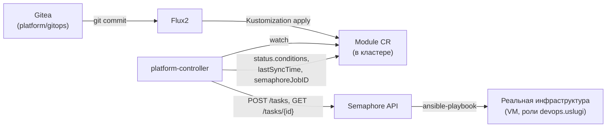
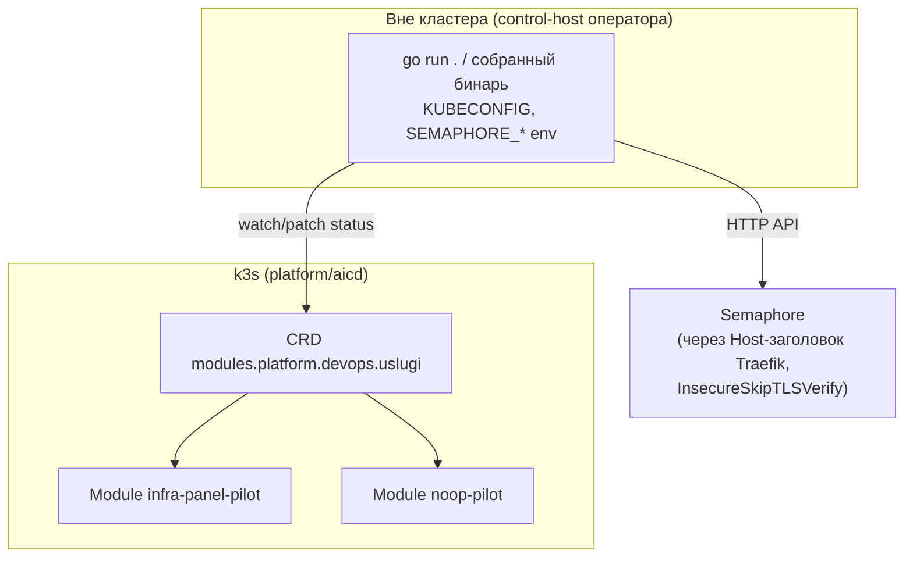

# platform-controller — Module CRD + reconcile-контроллер

Go-приложение (собственный `go.mod`, вне poetry/ansible-lint тулчейна коллекции) — единственный
компонент платформы, написанный на Go, а не развёрнутый Helm-релизом или ролью. Реализует
`Module` CRD и непрерывный GitOps-reconcile цикл поверх [semaphore.md](semaphore.md). Архитектура
— `docs/adr/0014-platform-controller-architecture.md`; реализация и все живые прогоны —
`platform-controller/README.md` (Фазы 1, 3–6 закрыты, живо проверены на `platform/aicd`).

## Назначение

Даёт платформе декларативный, самонаблюдающий слой поверх уже существующих Ansible-ролей
коллекции: вместо ручного запуска Task Template в Semaphore — `git commit` в `platform/gitops`,
дальше git → Flux → `Module` CR → контроллер → Semaphore → реальная инфраструктура полностью
автоматически, включая непрерывное обнаружение и исправление дрейфа.

## HLD



## LLD

```mermaid
graph LR
    GEN["metadata.generation<br/>изменился"] --> START["StartTask<br/>Ready=Unknown"]
    START --> POLL["poll каждые pollInterval (5с)<br/>через mgr.GetAPIReader (минуя кэш)"]
    POLL -->|job ещё выполняется| POLL
    POLL -->|job завершён| TERM["Ready=True/False<br/>lastSyncTime записан"]
    TERM -->|driftInterval (30с) истёк| START
```

- **`Module` CRD** (`modules.platform.devops.uslugi/v1alpha1`): `spec.role` — имя роли/плейбука,
  `spec.vars` — эквивалент `group_vars` (`x-kubernetes-preserve-unknown-fields`),
  `spec.inventoryRef.{repository,revision,path}` — ссылка на inventory в git (не отдельный CRD
  хостов), `spec.semaphoreTemplateID` — ID Task Template (соответствие роль→ID задаётся вручную,
  автоматический lookup не спроектирован).
- **`Module.spec.role` указывает на playbook, не обязательно на одну роль 1:1** (решено в Фазе 6)
  — плейбук может композировать несколько top-level ролей коллекции подряд (тот же паттерн, что
  уже используют molecule-конвержи), Module/контроллер этого не видят — порядок и
  внутриролевые зависимости остаются полностью в компетенции Ansible.
- **`controller-runtime` manager без leader election** (одноузловой пилот), watch по
  `*unstructured.Unstructured` (без кодогенерации `deepcopy`/`client-gen`).
  `WithEventFilter(GenerationChangedPredicate{})` — принципиально: `status`-записи самого
  контроллера не меняют `generation`, иначе бесконечный цикл reconcile.
- **Poll-loop, не блокирующее ожидание**: `StartTask` не ждёт результата — Semaphore исполняет
  асинхронно; `ctrl.Result{RequeueAfter: pollInterval}` (5с) — стандартный для
  `controller-runtime` приём. Найденный и исправленный баг: `Reconcile` обязан читать объект
  через `mgr.GetAPIReader()` (минуя кэш informer'а), иначе сразу после собственной записи
  `status` следующий `Reconcile` видел устаревшую версию и стартовал **второй** job для того же
  `generation`.
- **Непрерывный drift-loop (Фаза 4)**: после терминального статуса `Reconcile` не
  останавливается — `RequeueAfter: driftInterval` (30с, пилотное значение), переприменяет
  Semaphore job для того же `generation`, если прошло больше интервала. Найденный баг: первая
  реализация не возвращала `RequeueAfter` после terminal-статуса — drift-loop не работал вообще,
  хотя код компилировался и «выглядел» рабочим.
- **`internal/semaphore/client.go`** — `Authorization: Bearer <token>`, `StartTask` передаёт
  `spec.vars` через строковое поле `environment` тела запроса (переопределяет Environment,
  привязанный к Task Template).

## DD



Сегодня контроллер запускается **только локально**, не как Deployment в кластере — развёртывание
самого контроллера в кластер (Deployment + RBAC на `modules.platform.devops.uslugi` и их
`status` subresource) не сделано; при постоянно работающем drift-loop это уже необходимость, не
удобство (цикл идёт, только пока кто-то вручную держит процесс запущенным).

Реализовано и живо проверено **только на `platform/aicd`** — `platform/aicd-devops-labs-ru`
воспроизводит остальную платформу, но пилот контроллера на нём не повторялся.

## Известные ограничения

- `role → semaphoreTemplateID` — вручную в каждом CR, без автоматического lookup.
- `lastAppliedRevision` — `metadata.generation` ресурса, не git-revision `platform/gitops`, как
  предполагала исходная схема Фазы 1 (Flux не передаёт git-revision дальше в объект).
- Semaphore-токен — из переменной окружения процесса, не из K8s `Secret` во время выполнения.
- Drift-loop переприменяет job слепо по таймеру для любого устоявшегося `Module`, включая
  гарантированно неисправимые конфигурационные ошибки — нет backoff/circuit-breaker.
- `pollInterval`/`driftInterval` — захардкожены константами (5с/30с), не вынесены в
  конфигурацию; выбраны ради быстрой демонстрации, для реального использования нужны величины
  на порядки больше.

## Ссылки

- `docs/adr/0014-platform-controller-architecture.md` — архитектурное решение целиком.
- `platform-controller/README.md` — полная история реализации по фазам, все живые прогоны и
  найденные баги (гонка кэша, отсутствие requeue, находки Semaphore v2.10.30/BoltDB).
- [flux.md](flux.md) — источник Module-манифестов в кластере.
- [semaphore.md](semaphore.md) — исполнитель, вызываемый контроллером.
- [gitea.md](gitea.md) — git-источник `platform/gitops`.
