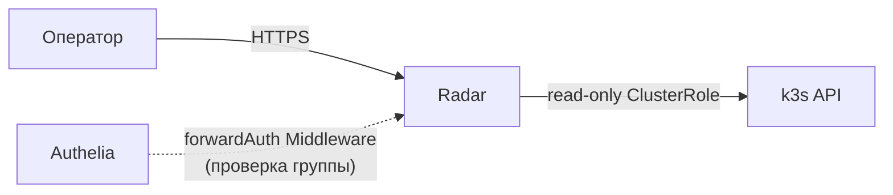
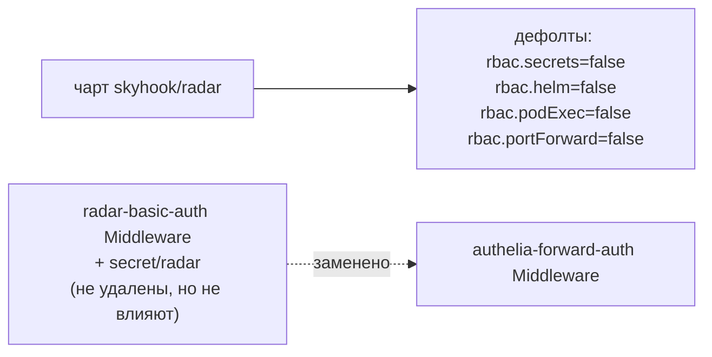
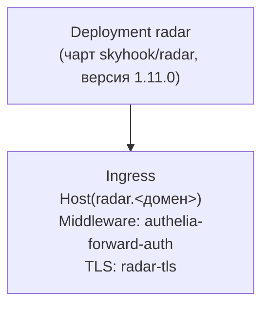

# Radar — read-only Kubernetes UI

Open-source Kubernetes UI ([skyhook-io/radar](https://github.com/skyhook-io/radar)) — топология,
ресурсы, Helm/GitOps-диагностика. Первый стандартный аддон k3s-стенда
(`docs/adr/0017-platform-cicd-default-addons.md`).

## Назначение

Быстрая визуальная диагностика состояния кластера для оператора — без `kubectl`, без
переключения kubeconfig.

## HLD

## LLD

- **RBAC/persistence — дефолты чарта**, явно не ослаблены: `rbac.secrets=false`,
  `rbac.helm=false`, `rbac.podExec=false`, `rbac.portForward=false`, read-only `ClusterRole` на
  остальные ресурсы — уже безопасно для установки рядом с OpenBao/секретами платформы без
  дополнительных ограничений.
- **`auth.mode: none` внутри чарта** — Radar сам никого не аутентифицирует; допуск полностью на
  стороне Traefik/Authelia (`forwardAuth`-Middleware, `docs/adr/0013-unified-auth-architecture.md`
  §4), заменивший более ранний `basic-auth`-Middleware (тот не удалён, просто больше ни на что
  не влияет, ADR-0017 §1).
- **RBAC-допуск (ADR-0019)** — все три группы (`platform-admins`/`engineers`/`viewers`)
  допущены: `access_control.subject` в Authelia, без внутренней ролевой дифференциации у самого
  Radar (read-only UI и так безопасен для всех допущенных).
- **TLS** — `radar-tls`, выпущен из внутреннего PKI CA OpenBao тем же циклом, что
  `gitea-tls`/`semaphore-tls`.

## DD

Разворачивается одинаково на обоих окружениях — namespace `platform`, без PVC (無 персистентного
состояния).

## Известные ограничения

- Read-only по конструкции чарта — не заменяет `kubectl`/Radar не единственный способ
  диагностики, а дополнительный.
- Единственная реплика без резервирования — недоступность Radar не влияет на работу остальной
  платформы (чисто диагностический инструмент).

## Ссылки

- `docs/adr/0017-platform-cicd-default-addons.md` §2 — выбор Radar, RBAC/auth-профиль.
- `docs/adr/0019-platform-rbac-model.md` §6 — матрица допуска.
- [authelia.md](authelia.md) — источник допуска.
