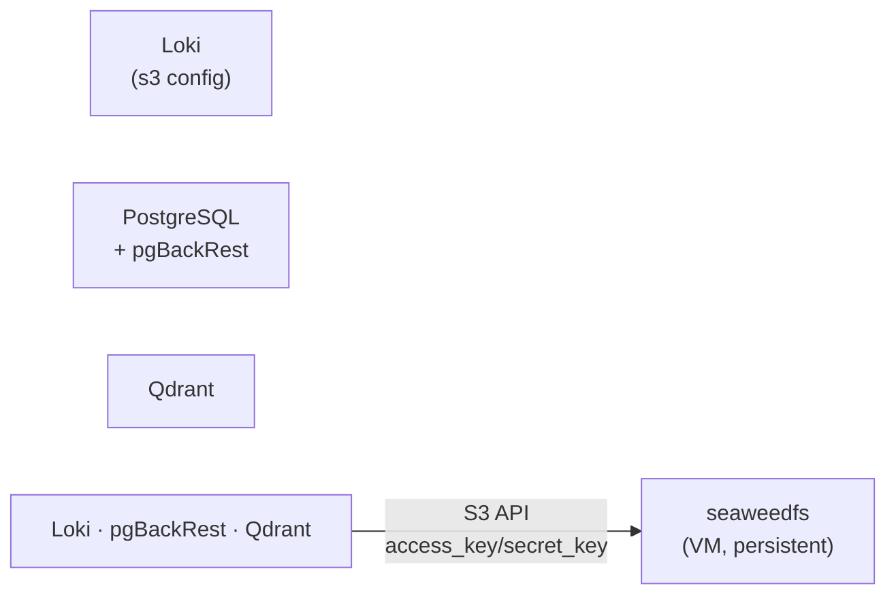
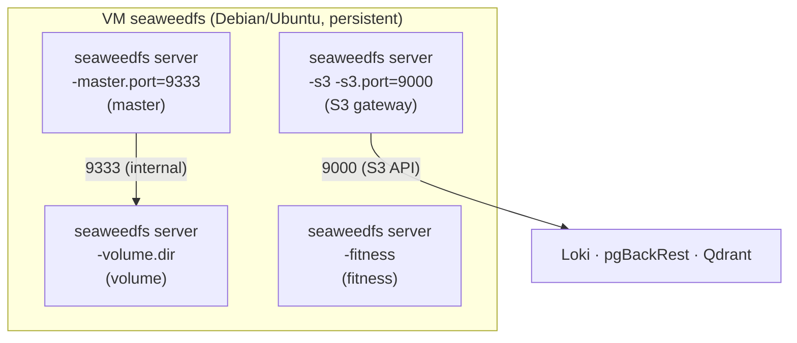

# SeaweedFS — S3-совместимое распределённое хранилище

SeaweedFS — S3-совместимое файловое хранилище, замена MinIO для backend-компонентов платформы
(Loki, pgBackRest, Qdrant). Развёртывается как systemd-сервис на выделенных VM вне k3s-кластера.

**ADR:** `docs/adr/0028-seaweedfs-standalone-role.md` (если заведён), роль —
`roles/ambar/README.md`.

## Назначение

- S3-совместимый backend для Loki (объектное хранилище логов).
- Backend для pgBackRest (резервное копирование PostgreSQL).
- Объектное хранилище для Qdrant (векторный поиск).
- Общий S3-бэкенд для остальных компонентов платформы, которым нужно объектное хранилище.

## HLD

- SeaweedFS разворачивается на peristent VM (Rocky/Debian, libvirt/Proxmox) вне k3s.
- Все потребители подключаются по S3 API (порт 9000) — либо напрямую по IP, либо через
  internal DNS-запись.
- Кластер SeaweedFS: один master + несколько volume-нод, fitness-сервер для балансировки.

## LLD

- **Роль** — `roles/ambar` (коллекция `devops.uslugi`):
  - Устанавливает бинарник SeaweedFS из GitHub Releases (статический Go-бинарник).
  - Настраивает systemd-юнит с режимами `master`/`volume`/`s3-gateway`/`fitness`.
  - Optional: nginx reverse proxy для S3 API с TLS (по желанию окружения).
- **Режимы** управляются переменными:
  - `ambar_master_mode: true` — один узел как master.
  - `ambar_volume_mode: true` — узлы-хранилища.
  - `ambar_s3_gateway_enabled: true` — S3 API.
  - `ambar_fitness_mode: true` — автоматическая балансировка.
- **Бинарник** скачивается из
  `https://github.com/seaweedfs/seaweedfs/releases/download/<version>/linux-amd64.tar.gz`
  и разворачивается в `/usr/local/bin/seaweedfs`.
- **Данные** хранятся в `/var/lib/seaweedfs` (владелец `seaweedfs:seaweedfs`).
- **S3-ключи** задаются в inventory окружения (`ambar_s3_gateway_access_key`,
  `ambar_s3_gateway_secret_key`) — могут быть обернуты в `vault_*`-переменные
  (Playbook окружения).

## Вне скоупа ADR-0022

- **Требование №1** (установка из внутреннего репозитория) — N/A: бинарник скачивается
  из интернета (GitHub Releases). Внутренний кеш бинарных артефактов (Nexus `raw`-repo)
  пока не используется для SeaweedFS — это известный пробел, можно закрыть в будущем
  перекладыванием артефакта в `internal-releases` Nexus с fallback-логикой.
- **Требование №2** (RBAC через групповую модель) — N/A: SeaweedFS не имеет веб-UI,
  аутентификация S3 — по access_key/secret_key. LDAP-переменные (`ambar_master_ldap_*`)
  заложены, но не интегрированы с FreeIPA.
- **Требование №3** (ссылка в infra-panel) — N/A: нет веб-UI.
- **Требование №5** (TLS из внутреннего PKI CA) — N/A: это infra-core сервис, не веб-компонент
  платформы. Optional nginx reverse proxy может принимать TLS-сертификаты из переменных,
  но не выписывает их из PKI CA. Для S3 API TLS не требуется (S3 работает по http внутри
  платформы, или TLS завершается на nginx-прокси, если он включён).
- **Требование №7** (Секреты из OpenBao) — N/A: это infra-core сервис, а не веб-компонент.
  S3-ключи задаются в inventory окружения (могут быть обернуты в `vault_*`). Интеграция
  с OpenBao (`gomplate vault://`) не требуется, так как компонент развёртывается не через Helm/k8s.
- **Требование №8** (Helm releases_common) — N/A: не Helm-компонент.
- **Требование №9** (resources requests/limits) — N/A: не Kubernetes.
- **Требование №10** (NetworkPolicy) — N/A: не Kubernetes.
- **Требование №12** (MCP) — N/A: не применимо.
- **Требование №15** (K8s Operator) — N/A: не Kubernetes.

## Нереализованные требования ADR-0022

- **Требование №4** (метрики) — NO: SeaweedFS отдаёт `/metrics` на master-порту (9333),
  но нет `VMScrapeConfig`, alert-правил и Grafana-дашборда. Закрыть: добавить scrape-конфиг
  в `monitoring_server` + дашборд в `ADDONS/grafana_dashboards/`.
- **Требование №6** (DNS) — PARTIAL: для VM-компонента `coredns-custom` неприменим, но роль
  не добавляет запись в `/etc/hosts`. DNS должен обеспечиваться playbook'ом окружения.
- **Требование №11** (бэкап) — NO: SeaweedFS — stateful-компонент, но нет интеграции
  с Bareos и нет задокументированного решения «почему бэкап не нужен». SeaweedFS имеет
  встроенную репликацию (`replication`-флаг в volume-серверах), но это не заменяет бэкап.
  Нужно явно задокументировать решение: включить в Bareos или записать обоснование.
- **Требование №13** (документация `docs/platform/*.md`) — CLOSED: этот файл.
- **Требование №14** (инфраструктурные тесты) — PARTIAL:   molecule-сценарий
  (`extensions/molecule/ambar/`) есть и проходит (конверг, идэмпотентность, verify:
  бинарник, версия, сервис running, S3 API functional). Персистентные smoke-тесты
  для реального окружения — вне скоупа (ADR-0022 §14: molecule не заменяет их, но
  ретрофит для существующих компонентов вне скоупа этого ADR).

## DD

- Разворачивается одинаково на обоих окружениях (различие — IP/домен и S3-ключи).
- Master и volume-ноды могут быть на одном хосте (одноразовый кластер) или на разных
  (production-кластер).
- systemd-юнит: `Type=simple`, `Restart=on-failure`, `LimitNOFILE=65536`,
  `ProtectSystem=strict`, `ReadWritePaths=/var/lib/seaweedfs /var/run/seaweedfs`.

## Ссылки

- Роль: `roles/ambar/README.md`
- Molecule-сценарий: `extensions/molecule/ambar/`
- SeaweedFS upstream: https://github.com/seaweedfs/seaweedfs
