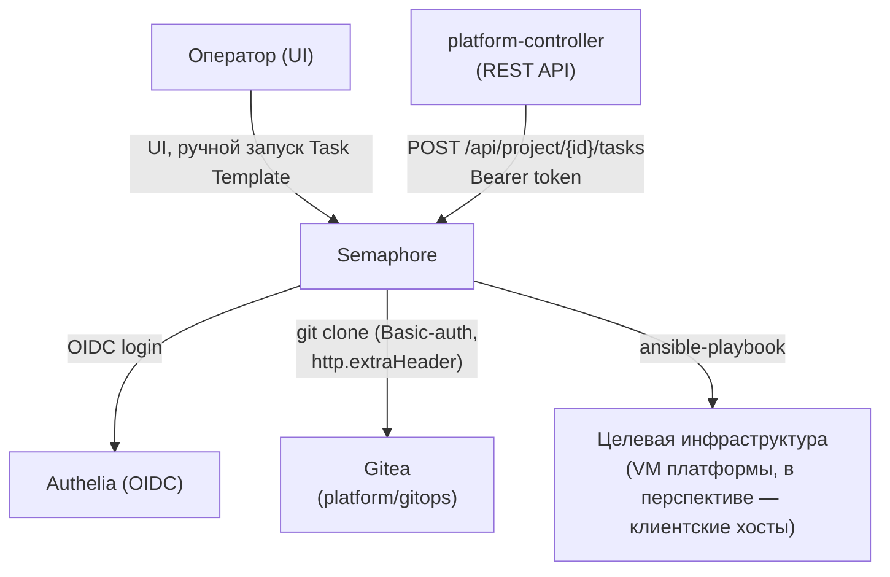
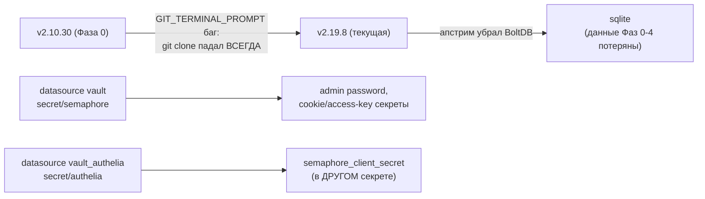
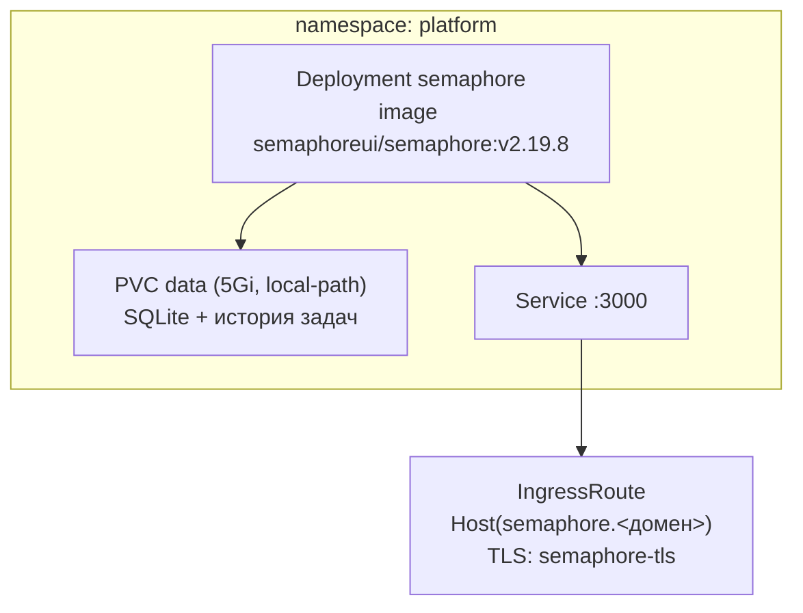

# Semaphore — веб-панель запуска ansible/terraform

Исполнитель Task Template — единственный компонент платформы, который реально запускает
`ansible-playbook` против целевой инфраструктуры (демо-стенды, платформенные VM-цели, в будущем
— клиентские хосты через [platform-controller.md](platform-controller.md)). Закрывает
ROADMAP №50. Архитектура — `docs/adr/0012-cicd-platform-architecture.md` §5.

## Назначение

- Единственная точка исполнения Ansible на этой платформе — и для ручных запусков оператором
  через UI, и для автоматических запусков платформенного контроллера через REST API.
- Git-интеграция напрямую из [gitea.md](gitea.md) (`platform/gitops`), не монтирование
  локального чекаута.
- Хранит историю всех запусков (Task) — единая точка аудита и ручных, и автоматических
  прогонов.

## HLD

## LLD

- **Нет официального Helm-чарта** — развёрнут как голый Deployment/PVC/Service/IngressRoute
  через `localrepo/universal-chart`, тот же приём, что уже применён для `homer` в
  `helm/envs/k3s-monitoring.yaml`.
- **БД — SQLite** (`SEMAPHORE_DB_DIALECT=sqlite`), не BoltDB — апстрим убрал `bolt` в пользу
  `sqlite`/`mysql`/`postgres` между версиями `v2.10.30` и `v2.19.8` (см. ниже); минимальная схема
  для однонодового пилота, без отдельного Postgres.
- **Версия закреплена на `v2.19.8` не произвольно, а из-за реального сбоя**: `v2.10.30`
  содержал апстрим-баг клонирования по HTTP (`GIT_TERMINAL_PROMPT` boolean-парсинг,
  semaphoreui/semaphore issue #3344/#982) — **любой** Task Template падал уже на `git clone`, до
  запуска `ansible-playbook`, независимо от содержимого плейбука. Апгрейд снёс BoltDB — данные
  пилотных прогонов (Фазы 0-4) потеряны и пересозданы заново (задокументированная, принятая
  потеря для пилота).
- **OIDC (ADR-0013 §5)**: `SEMAPHORE_OIDC_PROVIDERS` (JSON-строка в env), `client_secret`
  читается ИЗ ДРУГОГО секрета (`secret/authelia`, не `secret/semaphore`) — второй именованный
  gomplate-датасорс (`vault_authelia`), иначе поле молча рендерится как `<no value>` вместо
  реального секрета.
- **`token_endpoint_auth_method: client_secret_post`** обязателен на стороне Authelia для этого
  клиента — без явного значения Authelia регистрирует дефолтный `client_secret_basic`, а
  Semaphore шлёт `client_secret_post`, что даёт `invalid_client` (найдено живым прогоном).
- **Ролевой маппинг по OIDC claim не поддержан апстримом** (сверено с документацией v2.19.8) —
  единственный сервис платформы, где RBAC (`docs/adr/0019-platform-rbac-model.md` §6)
  ограничивается допуском (пускать/не пускать), не назначением роли; администрирование —
  только через локальный аккаунт.
- **API-токен для platform-controller** — персональный Bearer-токен (не сессионная кука, не
  истекает при рестарте контроллера), создан вручную через `POST /api/user/tokens`, хранится в
  K8s `Secret platform/semaphore-api-token` (не в git).

## DD

Разворачивается одинаково на обоих окружениях; ручные шаги после первого прогона (создание
проекта `platform`, репозитория, inventory, Environment, Task Template) выполняются один раз
через REST API — см. `platform/aicd/README.md`, «Ручные шаги».

## Известные ограничения

- Единственная реплика, SQLite на локальном PVC — без резервирования.
- `platform-viewers` (RBAC) сознательно не допускаются вовсе — «безопасного read-only» в
  Semaphore нет (просмотр истории задач уже раскрывает инвентарь и вывод плейбуков).
- Контроллер получает Semaphore-токен из переменной окружения процесса, не читает его из
  K8s `Secret` сам во время выполнения — известный пробел, актуальный при переносе самого
  контроллера в кластер ([platform-controller.md](platform-controller.md), «Не проработано»).

## Ссылки

- `docs/adr/0012-cicd-platform-architecture.md` §5 — выбор Semaphore, отказ от SSO на старте.
- `docs/adr/0013-unified-auth-architecture.md` §7/§9 — реализация OIDC, найденные баги.
- `docs/adr/0019-platform-rbac-model.md` §6 — граница ролевого маппинга.
- [platform-controller.md](platform-controller.md) — автоматический потребитель API.
- `platform-controller/README.md` — HTTP-клиент, найденная гонка кэша, drift-loop.
